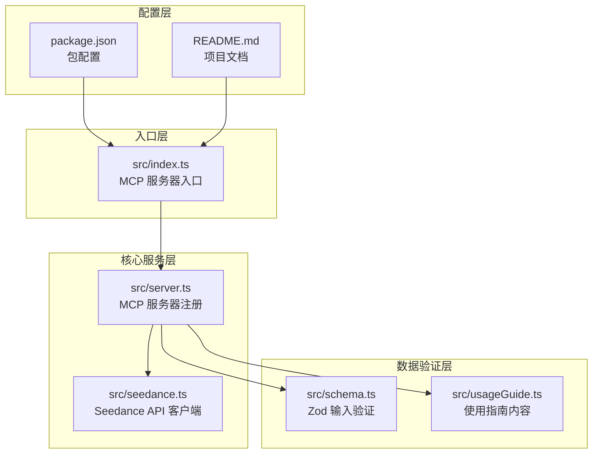
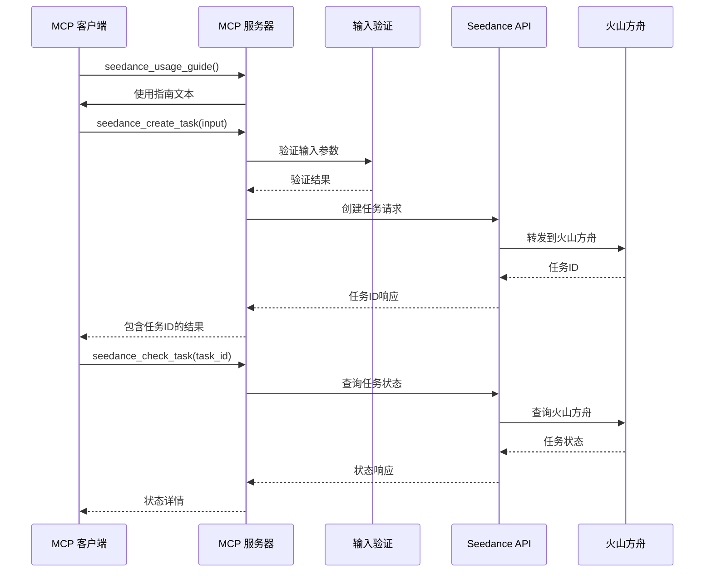
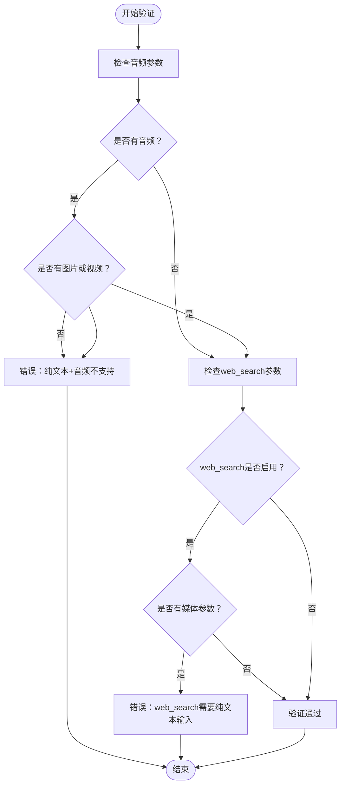
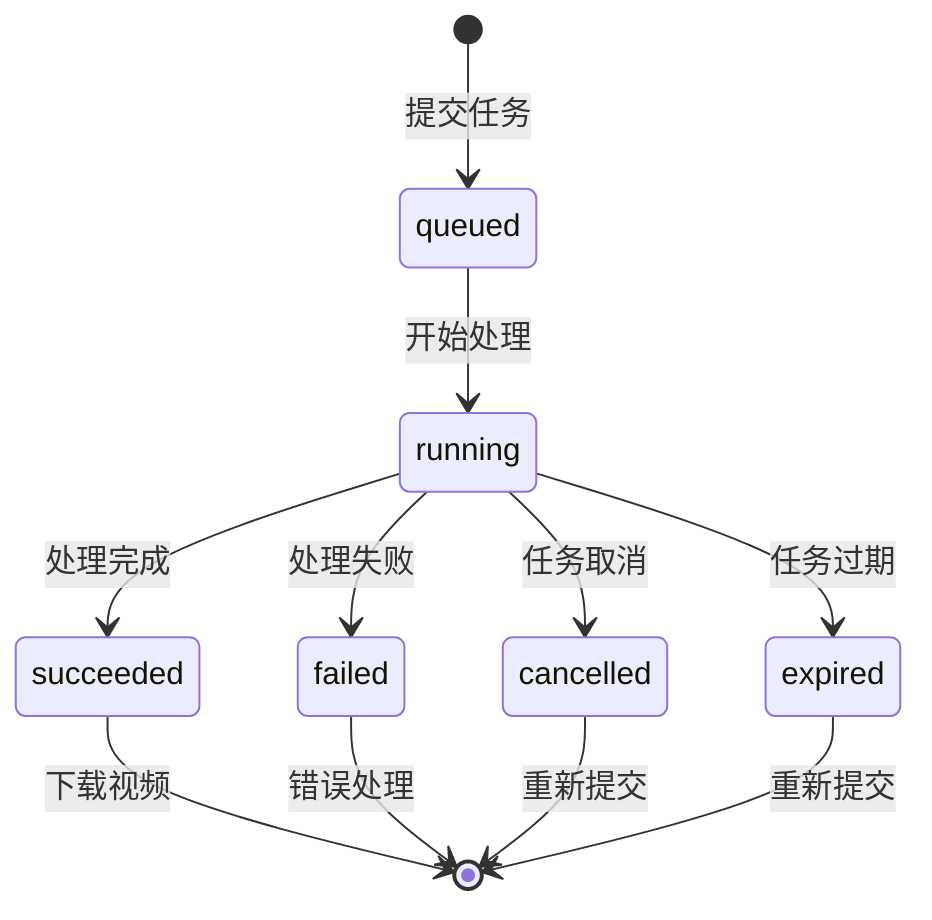
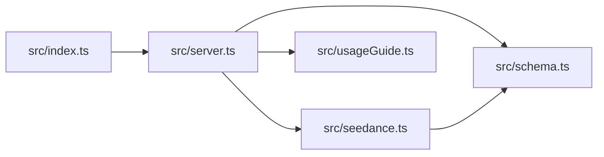

# API 参考文档

<cite>
**本文档引用的文件**
- [src/index.ts](file://src/index.ts)
- [src/server.ts](file://src/server.ts)
- [src/seedance.ts](file://src/seedance.ts)
- [src/schema.ts](file://src/schema.ts)
- [src/usageGuide.ts](file://src/usageGuide.ts)
- [README.md](file://README.md)
- [package.json](file://package.json)
</cite>

## 目录
1. [简介](#简介)
2. [项目结构](#项目结构)
3. [核心组件](#核心组件)
4. [架构概览](#架构概览)
5. [详细组件分析](#详细组件分析)
6. [依赖关系分析](#依赖关系分析)
7. [性能考虑](#性能考虑)
8. [故障排除指南](#故障排除指南)
9. [结论](#结论)
10. [附录](#附录)

## 简介

seedance-2-mcp 是一个开源的本地运行 MCP (Model Context Protocol) 服务器，将火山方舟 (Volcengine ARK) Seedance 2.0 视频生成能力以三个 stdio 工具的形式暴露给 Codex、Claude Desktop、Cursor 等任意 MCP 客户端。

该服务器提供了完整的视频生成工作流，包括使用指南、任务创建和状态查询功能，完全在本地运行，不需要任何云端部署。

## 项目结构

项目采用模块化设计，主要包含以下核心文件：



**图表来源**
- [src/index.ts:1-19](file://src/index.ts#L1-L19)
- [src/server.ts:1-215](file://src/server.ts#L1-L215)
- [src/seedance.ts:1-286](file://src/seedance.ts#L1-L286)
- [src/schema.ts:1-141](file://src/schema.ts#L1-L141)
- [src/usageGuide.ts:1-59](file://src/usageGuide.ts#L1-L59)

**章节来源**
- [src/index.ts:1-19](file://src/index.ts#L1-L19)
- [src/server.ts:1-215](file://src/server.ts#L1-L215)
- [src/seedance.ts:1-286](file://src/seedance.ts#L1-L286)
- [src/schema.ts:1-141](file://src/schema.ts#L1-L141)
- [src/usageGuide.ts:1-59](file://src/usageGuide.ts#L1-L59)

## 核心组件

### MCP 服务器配置

MCP 服务器使用官方 SDK 创建，支持三个核心工具：

- **seedance_usage_guide**: 返回完整的使用指南
- **seedance_create_task**: 提交视频生成任务
- **seedance_check_task**: 查询任务状态

服务器版本信息：
- 服务器名称: `seedance-2-mcp`
- 服务器版本: `0.1.0`
- 客户端版本: `0.1.0`

### 环境变量配置

| 变量名 | 必需 | 默认值 | 描述 |
|--------|------|--------|------|
| `ARK_API_KEY` | ✓ | 无 | 火山方舟 API 密钥 |
| `ARK_BASE_URL` | ✗ | `https://ark.cn-beijing.volces.com/api/v3` | API 基础 URL |

**章节来源**
- [src/server.ts:17-18](file://src/server.ts#L17-L18)
- [src/seedance.ts:55-72](file://src/seedance.ts#L55-L72)
- [README.md:93-101](file://README.md#L93-L101)

## 架构概览

系统采用分层架构设计，实现了 MCP 协议与第三方 API 的解耦：



**图表来源**
- [src/server.ts:31-47](file://src/server.ts#L31-L47)
- [src/server.ts:49-90](file://src/server.ts#L49-L90)
- [src/server.ts:92-174](file://src/server.ts#L92-L174)
- [src/seedance.ts:149-194](file://src/seedance.ts#L149-L194)
- [src/seedance.ts:201-278](file://src/seedance.ts#L201-L278)

## 详细组件分析

### seedance_usage_guide 工具

#### 工具规范

| 属性 | 值 |
|------|-----|
| 工具名称 | `seedance_usage_guide` |
| 标题 | Seedance 2.0 使用指南 |
| 描述 | 返回完整的使用说明：标准流程、模型选择、参数参考和重要注意事项 |
| 输入模式 | 无参数 |
| 注解 | `readOnlyHint: true`, `idempotentHint: true`, `openWorldHint: false` |

#### 返回内容

工具返回完整的 Markdown 格式使用指南，包含：

- 标准工作流程说明
- 模型选择指南
- 参数详细列表
- 重要注意事项和限制

**章节来源**
- [src/server.ts:31-47](file://src/server.ts#L31-L47)
- [src/usageGuide.ts:1-59](file://src/usageGuide.ts#L1-L59)

### seedance_create_task 工具

#### 工具规范

| 属性 | 值 |
|------|-----|
| 工具名称 | `seedance_create_task` |
| 标题 | 创建 Seedance 2.0 视频生成任务 |
| 描述 | 提交 Seedance 2.0 视频生成任务到火山方舟 ARK API 并立即返回任务ID |
| 输入模式 | CreateTaskInput |
| 注解 | `readOnlyHint: false`, `idempotentHint: false`, `openWorldHint: true` |

#### 输入参数规范

##### 必填参数

| 参数名 | 类型 | 默认值 | 说明 |
|--------|------|--------|------|
| `prompt` | string | 无 | 自然语言描述，最多 1000 字符 |

##### 可选参数

| 参数名 | 类型 | 默认值 | 说明 |
|--------|------|--------|------|
| `model` | enum | `doubao-seedance-2-0-260128` | 模型选择 |
| `duration` | integer | `5` | 视频时长（秒），范围 [4, 15] |
| `ratio` | enum | `16:9` | 宽高比，支持 `21:9`, `16:9`, `4:3`, `1:1`, `3:4`, `9:16`, `adaptive` |
| `resolution` | enum | `720p` | 输出分辨率，支持 `480p`, `720p` |
| `generate_audio` | boolean | `true` | 是否生成同步音频 |
| `watermark` | boolean | `true` | 是否添加平台水印 |
| `web_search` | boolean | `false` | 是否启用联网搜索增强 |
| `return_last_frame` | boolean | `false` | 是否返回最后一帧图片URL |
| `image_urls` | array | 无 | 参考图片URL数组，最多9个 |
| `video_urls` | array | 无 | 参考视频URL数组，最多3个 |
| `audio_urls` | array | 无 | 参考音频URL数组，最多3个 |

#### 参数验证规则



**图表来源**
- [src/server.ts:179-199](file://src/server.ts#L179-L199)

#### 返回值格式

```json
{
  "content": [
    {
      "type": "text",
      "text": "任务已提交。任务ID: cgt-2026xxxx-xxxxxx\n\n下一步：等待30-90秒后，使用此任务ID调用 seedance_check_task。\n标准模型的15秒任务通常需要2-5分钟。"
    }
  ],
  "structuredContent": {
    "task_id": "cgt-2026xxxx-xxxxxx",
    "model": "doubao-seedance-2-0-260128",
    "duration": 5,
    "ratio": "16:9",
    "resolution": "720p",
    "raw": {}
  }
}
```

#### 错误处理

| 错误类型 | 触发条件 | 错误消息 |
|----------|----------|----------|
| 输入验证错误 | 参数不符合规则 | 清晰的验证错误信息 |
| API调用错误 | 火山方舟API返回错误 | `ARK API error (HTTP x): 错误信息` |
| 环境变量错误 | 未设置 `ARK_API_KEY` | `Missing ARK_API_KEY environment variable...` |

**章节来源**
- [src/server.ts:49-90](file://src/server.ts#L49-L90)
- [src/schema.ts:52-127](file://src/schema.ts#L52-L127)
- [src/server.ts:179-199](file://src/server.ts#L179-L199)
- [src/server.ts:201-207](file://src/server.ts#L201-L207)

### seedance_check_task 工具

#### 工具规范

| 属性 | 值 |
|------|-----|
| 工具名称 | `seedance_check_task` |
| 标题 | 检查 Seedance 2.0 任务状态 |
| 描述 | 通过任务ID查询 Seedance 2.0 任务状态，成功时返回 video_url 和可选的末帧图片URL |
| 输入模式 | CheckTaskInput |
| 注解 | `readOnlyHint: true`, `idempotentHint: true`, `openWorldHint: true` |

#### 输入参数

| 参数名 | 类型 | 必需 | 说明 |
|--------|------|------|------|
| `task_id` | string | ✓ | 由 `seedance_create_task` 返回的任务ID |

#### 状态处理



**图表来源**
- [src/server.ts:111-157](file://src/server.ts#L111-L157)

#### 返回值格式

```json
{
  "content": [
    {
      "type": "text",
      "text": "任务 succeeded。video_url: https://example.com/video.mp4\nlast_frame_url: https://example.com/frame.jpg\n\n提醒：ARK签名URL通常在24小时内过期。请尽快下载视频。"
    }
  ],
  "structuredContent": {
    "task_id": "cgt-2026xxxx-xxxxxx",
    "status": "succeeded",
    "video_url": "https://example.com/video.mp4",
    "last_frame_url": "https://example.com/frame.jpg",
    "fail_reason": "",
    "raw": {}
  }
}
```

#### 状态说明

| 状态值 | 描述 | 建议操作 |
|--------|------|----------|
| `running` | 任务正在处理中 | 等待30-90秒后重试 |
| `queued` | 任务已排队 | 继续等待 |
| `pending` | 任务待处理 | 继续等待 |
| `in_queue` | 任务在队列中 | 继续等待 |
| `succeeded` | 任务成功完成 | 下载视频URL |
| `failed` | 任务处理失败 | 检查输入参数 |
| `cancelled` | 任务被取消 | 重新提交任务 |
| `expired` | 任务已过期 | 重新提交任务 |

**章节来源**
- [src/server.ts:92-174](file://src/server.ts#L92-L174)
- [src/schema.ts:132-140](file://src/schema.ts#L132-L140)
- [src/seedance.ts:201-278](file://src/seedance.ts#L201-L278)

## 依赖关系分析

### 外部依赖

```mermaid
graph TB
subgraph "核心依赖"
A[@modelcontextprotocol/sdk<br/>MCP协议实现]
B[zod<br/>输入验证]
end
subgraph "运行时依赖"
C[Node.js >= 18<br/>运行时环境]
D[fetch API<br/>HTTP客户端]
end
subgraph "项目内部"
E[src/index.ts<br/>入口点]
F[src/server.ts<br/>服务器实现]
G[src/seedance.ts<br/>API客户端]
H[src/schema.ts<br/>验证规则]
end
E --> F
F --> A
F --> B
F --> G
F --> H
G --> C
G --> D
```

**图表来源**
- [package.json:26-28](file://package.json#L26-L28)
- [src/index.ts:2](file://src/index.ts#L2)
- [src/server.ts:1-15](file://src/server.ts#L1-L15)

### 内部模块依赖



**图表来源**
- [src/index.ts:4](file://src/index.ts#L4)
- [src/server.ts:4-15](file://src/server.ts#L4-L15)

**章节来源**
- [package.json:26-28](file://package.json#L26-L28)
- [src/index.ts:1-19](file://src/index.ts#L1-L19)
- [src/server.ts:1-215](file://src/server.ts#L1-L215)

## 性能考虑

### API 调用性能

- **任务创建**: 立即返回，不阻塞等待
- **轮询间隔**: 建议 30-90 秒间隔查询
- **平均完成时间**: 标准模型 15 秒任务通常需要 2-5 分钟
- **快速模型**: 减少渲染时间但降低质量

### 网络优化

- **连接复用**: 使用 HTTP/1.1 连接池
- **超时设置**: 默认网络超时适配火山方舟 API
- **重试策略**: 建议指数退避重试

### 资源限制

- **并发限制**: 受火山方舟 API 速率限制影响
- **内存使用**: 主要受视频大小和分辨率影响
- **存储空间**: 生成视频文件占用磁盘空间

## 故障排除指南

### 常见错误及解决方案

| 错误类型 | 症状 | 解决方案 |
|----------|------|----------|
| `Missing ARK_API_KEY` | 工具调用失败 | 设置正确的 API 密钥 |
| `401 Unauthorized` | 认证失败 | 检查 API 密钥有效性 |
| `400 Bad Request` | 请求参数错误 | 检查输入参数格式 |
| `429 Too Many Requests` | 请求过于频繁 | 增加轮询间隔 |
| `500 Internal Server Error` | 服务器错误 | 稍后重试或联系支持 |

### 调试方法

1. **使用 MCP Inspector**:
   ```bash
   npx -y @modelcontextprotocol/inspector npx -y seedance-2-mcp
   ```

2. **检查环境变量**:
   ```bash
   echo $ARK_API_KEY
   echo $ARK_BASE_URL
   ```

3. **查看服务器日志**:
   - MCP 服务器输出到标准错误
   - 使用客户端的日志功能查看详细信息

**章节来源**
- [src/seedance.ts:55-64](file://src/seedance.ts#L55-L64)
- [src/seedance.ts:167-173](file://src/seedance.ts#L167-L173)
- [README.md:253-263](file://README.md#L253-L263)

## 结论

seedance-2-mcp 提供了一个完整、可靠的本地 MCP 服务器实现，将火山方舟 Seedance 2.0 视频生成功能无缝集成到各种 MCP 客户端中。该系统具有以下优势：

- **完全本地运行**: 无需云端部署，保护用户隐私
- **标准化接口**: 遵循 MCP 协议标准，兼容性强
- **完善的错误处理**: 提供清晰的错误信息和重试机制
- **灵活的配置选项**: 支持多种模型和参数组合
- **详细的文档**: 包含完整的使用指南和最佳实践

## 附录

### API 版本管理

- **服务器版本**: `0.1.0`
- **客户端版本**: `0.1.0`
- **向后兼容性**: 当前版本为 0.x，可能存在破坏性变更
- **版本升级**: 建议在测试环境中验证新版本兼容性

### 安全最佳实践

1. **密钥管理**: 将 `ARK_API_KEY` 存储在安全位置，不要硬编码
2. **URL 验证**: 确保所有外部 URL 都是公开可访问的
3. **速率限制**: 遵守火山方舟 API 的使用限制
4. **数据保护**: 不要在日志中记录敏感信息

### 客户端集成示例

#### Codex 配置示例

```toml
[mcp_servers.seedance-2-mcp]
command = "npx"
args = ["-y", "seedance-2-mcp"]
env = { "ARK_API_KEY" = "your_key_here" }
```

#### Claude Desktop 配置示例

```json
{
  "mcpServers": {
    "seedance-2-mcp": {
      "command": "npx",
      "args": ["-y", "seedance-2-mcp"],
      "env": {
        "ARK_API_KEY": "your_key_here"
      }
    }
  }
}
```

### 使用限制说明

- **URL 要求**: 所有参考媒体必须是公网可访问的 HTTPS 地址
- **时长限制**: 视频时长必须在 4-15 秒之间
- **媒体数量限制**: 
  - 图片: 最多 9 张
  - 视频: 最多 3 个
  - 音频: 最多 3 个
- **URL 限制**: 不支持本地文件路径或需要认证的资源

**章节来源**
- [README.md:153-239](file://README.md#L153-L239)
- [src/schema.ts:3-28](file://src/schema.ts#L3-L28)
- [src/seedance.ts:184-196](file://src/seedance.ts#L184-L196)