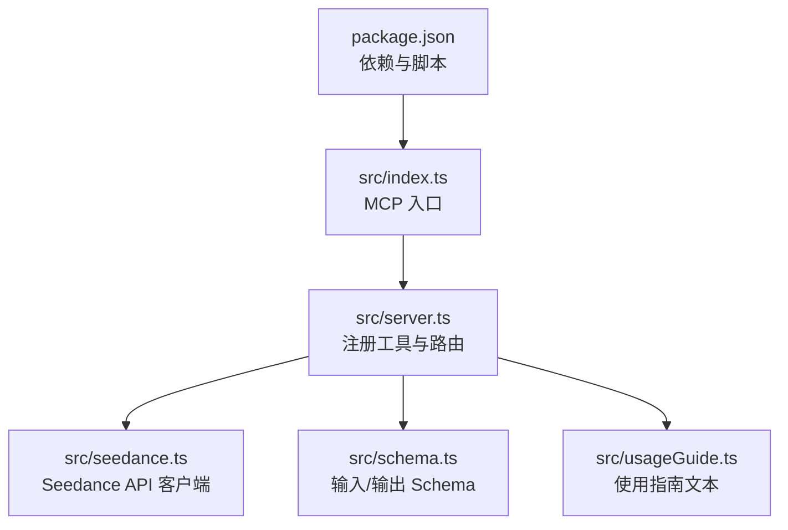
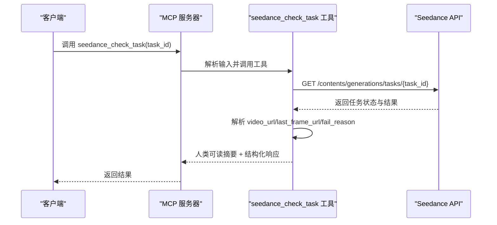
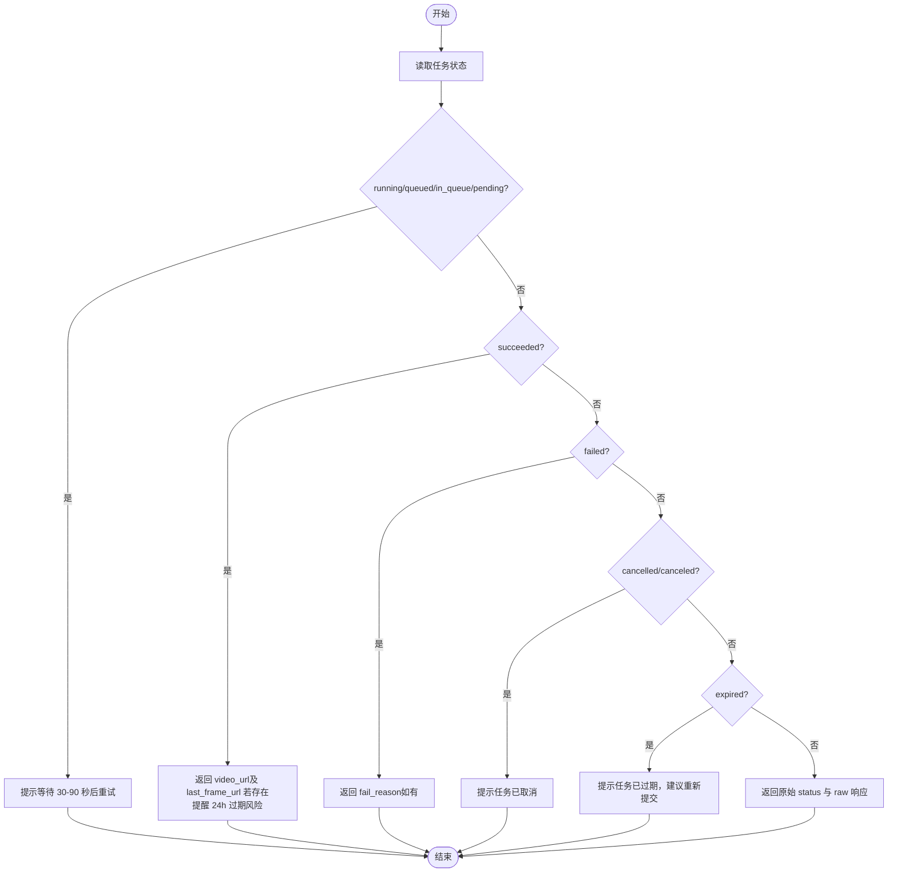
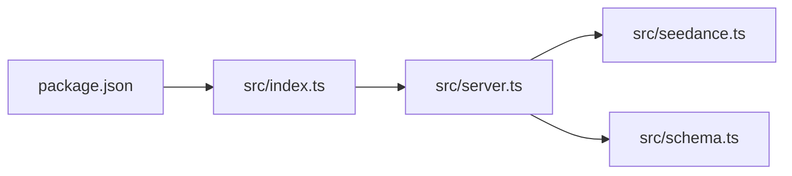

# seedance_check_task 工具

<cite>
**本文引用的文件**
- [src/index.ts](file://src/index.ts)
- [src/server.ts](file://src/server.ts)
- [src/seedance.ts](file://src/seedance.ts)
- [src/schema.ts](file://src/schema.ts)
- [README.md](file://README.md)
- [package.json](file://package.json)
</cite>

## 目录
1. [简介](#简介)
2. [项目结构](#项目结构)
3. [核心组件](#核心组件)
4. [架构总览](#架构总览)
5. [详细组件分析](#详细组件分析)
6. [依赖关系分析](#依赖关系分析)
7. [性能考量](#性能考量)
8. [故障排查指南](#故障排查指南)
9. [结论](#结论)
10. [附录](#附录)

## 简介
seedance_check_task 是一个基于 MCP（Model Context Protocol）的工具，用于查询火山方舟（Volcengine ARK）Seedance 2.0 视频生成任务的状态。该工具通过任务 ID 轮询查询任务状态，并在任务成功时返回视频 URL 以及可选的末帧图片 URL；在失败时返回失败原因；在排队/运行中时提示用户继续轮询；在取消/过期时给出相应提示。工具还提供结构化响应，便于自动化集成。

- 工具名称：seedance_check_task
- 功能：根据任务 ID 查询任务状态，返回人类可读摘要与结构化响应
- 输入参数：task_id（任务ID）
- 输出内容：人类可读状态摘要 + 结构化响应（task_id、status、video_url、last_frame_url、fail_reason、raw 原始响应）

**章节来源**
- [README.md: 16-23:16-23](file://README.md#L16-L23)
- [README.md: 200-209:200-209](file://README.md#L200-L209)

## 项目结构
该项目采用模块化设计，通过 MCP 服务注册三个工具：使用指南、创建任务、检查任务。seedance_check_task 作为其中一个工具，负责状态查询与结果解析。

**图表来源**
- [src/index.ts: 1-19:1-19](file://src/index.ts#L1-L19)
- [src/server.ts: 20-177:20-177](file://src/server.ts#L20-L177)
- [src/seedance.ts: 1-286:1-286](file://src/seedance.ts#L1-L286)
- [src/schema.ts: 1-141:1-141](file://src/schema.ts#L1-L141)
- [package.json: 1-51:1-51](file://package.json#L1-L51)

**章节来源**
- [README.md: 267-283:267-283](file://README.md#L267-L283)
- [package.json: 19-25:19-25](file://package.json#L19-L25)

## 核心组件
- seedance_check_task 工具：接收任务 ID，调用 Seedance API 查询任务状态，返回人类可读摘要与结构化响应。
- Seedance API 客户端：封装 HTTP 请求、错误处理与响应解析。
- 输入/输出 Schema：定义 seedance_check_task 的输入参数（task_id）与输出字段。
- MCP 服务器：注册工具、处理请求、格式化返回内容。

**章节来源**
- [src/server.ts: 92-174:92-174](file://src/server.ts#L92-L174)
- [src/seedance.ts: 201-278:201-278](file://src/seedance.ts#L201-L278)
- [src/schema.ts: 132-141:132-141](file://src/schema.ts#L132-L141)

## 架构总览
seedance_check_task 的调用链路如下：客户端调用 MCP 工具 → MCP 服务器路由到 seedance_check_task → 调用 Seedance API 查询任务 → 解析响应并返回人类可读摘要与结构化数据。

**图表来源**
- [src/server.ts: 105-173:105-173](file://src/server.ts#L105-L173)
- [src/seedance.ts: 201-278:201-278](file://src/seedance.ts#L201-L278)

## 详细组件分析

### 输入参数
- task_id（字符串，必填）：由 seedance_create_task 返回的任务标识符。工具会对输入进行校验，确保非空。

**章节来源**
- [src/schema.ts: 132-137:132-137](file://src/schema.ts#L132-L137)
- [src/server.ts: 105-107:105-107](file://src/server.ts#L105-L107)

### 输出内容
- 人类可读摘要：根据任务状态生成简明提示，包括任务 ID、状态、视频 URL、末帧 URL（如适用）、失败原因（如适用），并提醒 URL 过期时间。
- 结构化响应：包含以下字段
  - task_id：任务 ID
  - status：任务状态（原始字符串）
  - video_url：视频 URL（成功时存在）
  - last_frame_url：末帧图片 URL（当创建任务时开启 return_last_frame 且返回了末帧时存在）
  - fail_reason：失败原因（失败时存在）
  - raw：原始响应体（保留用于透传）

**章节来源**
- [src/server.ts: 159-169:159-169](file://src/server.ts#L159-L169)
- [src/seedance.ts: 35-42:35-42](file://src/seedance.ts#L35-L42)

### 任务状态与行为
- running / queued / in_queue / pending：仍在处理中。工具提示用户等待 30-90 秒后再次轮询。
- succeeded：任务成功。返回 video_url；若创建任务时开启 return_last_frame，则返回 last_frame_url。工具会提醒 URL 通常在约 24 小时内过期，需尽快下载。
- failed：任务失败。返回 fail_reason（如有）。
- cancelled / canceled：任务被取消。
- expired：任务已过期。建议重新提交任务。
- 其他未知状态：原样返回 status 与原始响应，便于进一步诊断。

**图表来源**
- [src/server.ts: 111-157:111-157](file://src/server.ts#L111-L157)

**章节来源**
- [README.md: 202-208:202-208](file://README.md#L202-L208)
- [src/server.ts: 111-157:111-157](file://src/server.ts#L111-L157)

### 错误处理
- 输入校验：task_id 为空时抛出错误。
- API 错误：HTTP 非 2xx 时抛出 SeedanceApiError，包含状态码与原始响应体。
- 响应解析：非 JSON 或缺少必要字段时抛出错误；工具内部会尝试从多种位置提取 video_url、last_frame_url、fail_reason，以兼容不同 SDK 版本。
- MCP 层错误：统一格式化为错误消息并标记为错误结果。

**章节来源**
- [src/seedance.ts: 201-278:201-278](file://src/seedance.ts#L201-L278)
- [src/server.ts: 179-199:179-199](file://src/server.ts#L179-L199)
- [src/server.ts: 201-214:201-214](file://src/server.ts#L201-L214)

### 视频 URL 过期机制与下载提醒
- 生成的 video_url 与 last_frame_url 为带签名的临时 URL，默认约 24 小时内有效。
- 成功后工具会提示尽快下载，避免链接过期。

**章节来源**
- [README.md: 237](file://README.md#L237)
- [src/server.ts: 124](file://src/server.ts#L124)

### 轮询策略建议与最佳实践
- 初始等待：提交任务后等待 30-90 秒再首次查询。
- 轮询间隔：建议 30-90 秒一次，避免过于频繁导致 API 压力。
- 超时控制：根据任务规模设定合理超时上限（例如标准模型 15 秒任务通常需要 2-5 分钟）。
- 幂等性：check_task 为只读幂等操作，可安全重复调用。
- 结果处理：优先检查 status，再根据状态决定是否读取 video_url/last_frame_url/fail_reason。

**章节来源**
- [README.md: 212-227:212-227](file://README.md#L212-L227)
- [src/server.ts: 139-143:139-143](file://src/server.ts#L139-L143)

## 依赖关系分析
- seedance_check_task 依赖于：
  - Seedance API 客户端：封装 HTTP 请求与响应解析
  - 输入/输出 Schema：定义输入参数与输出字段
  - MCP 服务器：注册工具、路由请求、格式化返回

**图表来源**
- [src/server.ts: 4-15:4-15](file://src/server.ts#L4-L15)
- [src/index.ts: 2-4:2-4](file://src/index.ts#L2-L4)
- [package.json: 26-29:26-29](file://package.json#L26-L29)

**章节来源**
- [src/server.ts: 4-15:4-15](file://src/server.ts#L4-L15)
- [src/index.ts: 2-4:2-4](file://src/index.ts#L2-L4)
- [package.json: 26-29:26-29](file://package.json#L26-L29)

## 性能考量
- 轮询频率：建议 30-90 秒一次，避免过度轮询造成不必要的网络与 API 压力。
- 超时策略：结合任务类型与规模设置合理的最大等待时间，避免长时间占用资源。
- 幂等性：check_task 为只读操作，可多次调用而不会改变任务状态。
- 网络与解析：工具内部对响应进行 JSON 安全解析与容错处理，减少异常传播。

**章节来源**
- [src/server.ts: 139-143:139-143](file://src/server.ts#L139-L143)
- [src/seedance.ts: 116-124:116-124](file://src/seedance.ts#L116-L124)

## 故障排查指南
- 环境变量缺失：未设置 ARK_API_KEY 时，工具会返回清晰的错误提示。请在 MCP 客户端配置中注入该变量。
- 任务 ID 无效：输入为空或格式不正确会导致错误。请确认 task_id 来自 seedance_create_task 的返回。
- API 响应异常：当返回非 JSON 或缺少必要字段时，工具会抛出 SeedanceApiError。请检查网络与权限。
- URL 过期：video_url/last_frame_url 通常在 24 小时内过期，成功后请尽快下载。
- 状态异常：若返回未知状态，工具会原样返回 status 与 raw 响应，便于进一步诊断。

**章节来源**
- [src/seedance.ts: 55-64:55-64](file://src/seedance.ts#L55-L64)
- [src/seedance.ts: 167-194:167-194](file://src/seedance.ts#L167-L194)
- [src/seedance.ts: 230-236:230-236](file://src/seedance.ts#L230-L236)
- [README.md: 237](file://README.md#L237)

## 结论
seedance_check_task 工具提供了简洁可靠的种子任务状态查询能力，支持多种状态分支与结构化输出，适合在自动化工作流中进行轮询与决策。通过遵循推荐的轮询策略与注意 URL 过期机制，可以高效、稳定地完成视频生成任务的后续处理。

## 附录

### API 定义与示例
- 工具名称：seedance_check_task
- 输入参数
  - task_id：字符串，必填
- 输出
  - 人类可读摘要：包含任务状态、URL 提示与过期提醒
  - 结构化响应：包含 task_id、status、video_url、last_frame_url、fail_reason、raw

**章节来源**
- [src/schema.ts: 132-141:132-141](file://src/schema.ts#L132-L141)
- [src/server.ts: 159-169:159-169](file://src/server.ts#L159-L169)