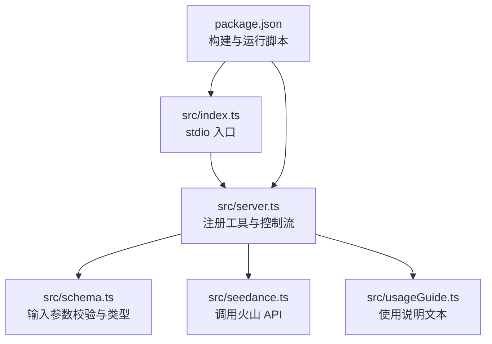
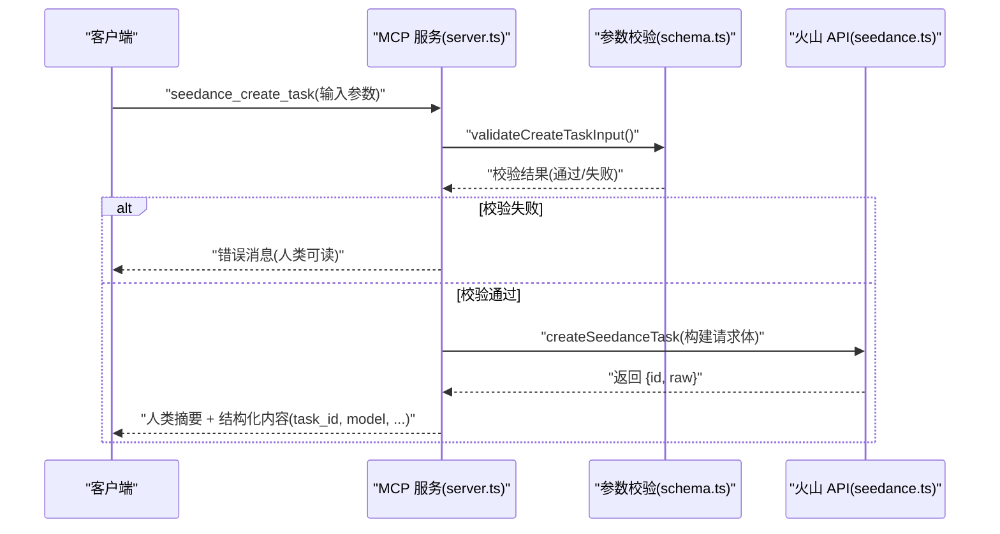
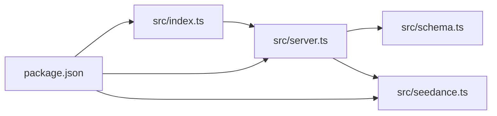

# seedance_create_task 工具

<cite>
**本文引用的文件**
- [src/index.ts](file://src/index.ts)
- [src/server.ts](file://src/server.ts)
- [src/seedance.ts](file://src/seedance.ts)
- [src/schema.ts](file://src/schema.ts)
- [src/usageGuide.ts](file://src/usageGuide.ts)
- [package.json](file://package.json)
- [README.md](file://README.md)
</cite>

## 目录
1. [简介](#简介)
2. [项目结构](#项目结构)
3. [核心组件](#核心组件)
4. [架构总览](#架构总览)
5. [详细组件分析](#详细组件分析)
6. [依赖关系分析](#依赖关系分析)
7. [性能考量](#性能考量)
8. [故障排查指南](#故障排查指南)
9. [结论](#结论)
10. [附录](#附录)

## 简介
seedance_create_task 是一个 MCP 工具，用于提交 Volcengine ARK Seedance 2.0 视频生成任务。该工具通过本地 stdio 运行，立即返回任务 ID（task_id），不阻塞等待渲染完成。随后需轮询 seedance_check_task 获取最终结果。该工具支持文生视频、图生视频、音生视频以及多模态参考生成，并提供参数校验、错误处理与结构化输出。

## 项目结构
- 入口与运行：index.ts 作为 stdio MCP 服务入口，启动 server.ts 创建的 McpServer。
- 业务逻辑：
  - server.ts 注册三个工具：seedance_usage_guide、seedance_create_task、seedance_check_task。
  - schema.ts 定义输入参数的 Zod 校验规则与类型。
  - seedance.ts 实现与火山 API 的交互（创建任务、查询任务）。
  - usageGuide.ts 提供使用说明文本。
- 构建与运行：package.json 定义脚本与依赖，TypeScript 编译输出到 dist。

图表来源
- [src/index.ts:1-19](file://src/index.ts#L1-L19)
- [src/server.ts:20-177](file://src/server.ts#L20-L177)
- [src/schema.ts:52-129](file://src/schema.ts#L52-L129)
- [src/seedance.ts:102-194](file://src/seedance.ts#L102-L194)
- [src/usageGuide.ts:1-59](file://src/usageGuide.ts#L1-L59)
- [package.json:19-25](file://package.json#L19-L25)

章节来源
- [src/index.ts:1-19](file://src/index.ts#L1-L19)
- [src/server.ts:20-177](file://src/server.ts#L20-L177)
- [src/schema.ts:52-129](file://src/schema.ts#L52-L129)
- [src/seedance.ts:102-194](file://src/seedance.ts#L102-L194)
- [src/usageGuide.ts:1-59](file://src/usageGuide.ts#L1-L59)
- [package.json:19-25](file://package.json#L19-L25)

## 核心组件
- seedance_create_task 工具：接收用户输入参数，进行本地校验，调用火山 API 提交任务，返回 task_id 与结构化内容。
- 参数校验：基于 Zod schema，确保字段类型、范围、数量与互斥关系符合火山 API 要求。
- 错误处理：统一捕获 API 错误与解析异常，返回人类可读错误信息与结构化错误内容。
- 结构化输出：返回人类摘要与结构化内容（task_id、model、duration、ratio、resolution、raw）。

章节来源
- [src/server.ts:49-90](file://src/server.ts#L49-L90)
- [src/schema.ts:52-129](file://src/schema.ts#L52-L129)
- [src/seedance.ts:149-194](file://src/seedance.ts#L149-L194)

## 架构总览
seedance_create_task 的调用链路如下：
- 客户端调用 seedance_create_task，传入参数。
- 服务端先做本地参数校验，再调用 createSeedanceTask 发送 HTTP 请求至火山 API。
- 火山 API 返回任务 ID，服务端封装为结构化响应并返回给客户端。

图表来源
- [src/server.ts:62-89](file://src/server.ts#L62-L89)
- [src/schema.ts:179-199](file://src/schema.ts#L179-L199)
- [src/seedance.ts:149-194](file://src/seedance.ts#L149-L194)

## 详细组件分析

### seedance_create_task 输入参数规范
- prompt（字符串，必填）：自然语言描述。若有参考素材，可在 prompt 中用 [Image1]/[Video1]/[Audio1] 引用。
- model（枚举，可选，默认 doubao-seedance-2-0-260128）：模型选择。标准版最高质量，快速版更快更便宜。
- duration（整数，可选，默认 5）：视频时长（秒），范围 [4, 15]。
- ratio（枚举，可选，默认 16:9）：宽高比，支持 21:9/16:9/4:3/1:1/3:4/9:16/adaptive。
- resolution（枚举，可选，默认 720p）：输出分辨率，480p 或 720p。
- generate_audio（布尔，可选，默认 true）：是否生成同步音频（对白/音效/BGM），设为 false 可生成无声视频。
- watermark（布尔，可选，默认 true）：是否添加平台水印（部分账号不可关闭）。
- web_search（布尔，可选，默认 false）：启用联网增强提示词。仅允许纯文本输入，不能与任何参考素材同时使用。
- return_last_frame（布尔，可选，默认 false）：是否返回最后一帧图片 URL，便于拼接片段。
- image_urls（数组，可选，最多 9）：参考图片数组，每项含 url 与可选 role。role 默认 reference_image；也可用 first_frame（与可选 last_frame）实现图生视频动画。
- video_urls（数组，可选，最多 3）：参考视频数组，每项含 url 与可选 role，默认 reference_video。
- audio_urls（数组，可选，最多 3）：参考音频数组，每项含 url 与可选 role，默认 reference_audio。必须至少配一张图片或一段视频。

章节来源
- [src/schema.ts:52-129](file://src/schema.ts#L52-L129)
- [src/server.ts:49-61](file://src/server.ts#L49-L61)
- [README.md:163-179](file://README.md#L163-L179)

### 参数验证规则与约束
- 数值范围：duration 必须为整数且在 [4, 15]。
- 数量限制：image_urls ≤ 9，video_urls ≤ 3，audio_urls ≤ 3。
- 互斥关系：
  - 纯文本 + 音频（audio_urls）会被拒绝（Seedance 不支持纯文本 + 音频）。
  - web_search=true 与任何参考素材（image_urls/video_urls/audio_urls）同时出现会被拒绝。
- URL 要求：所有外部媒体 URL 必须为 http/https 可达地址，本地/内网/需要鉴权的资源不可用。
- 其他：prompt 不能为空；web_search=true 时必须为纯文本输入。

章节来源
- [src/schema.ts:65-71](file://src/schema.ts#L65-L71)
- [src/schema.ts:106-126](file://src/schema.ts#L106-L126)
- [src/schema.ts:179-199](file://src/schema.ts#L179-L199)
- [README.md:180-186](file://README.md#L180-L186)

### 输出格式
- 人类可读摘要：包含任务提交确认、task_id 以及下一步轮询建议（等待时长与调用 seedance_check_task）。
- 结构化内容：
  - task_id：任务标识符。
  - model/duration/ratio/resolution：与输入一致的参数快照。
  - raw：火山 API 原始响应（保留未识别字段以便透传）。

章节来源
- [src/server.ts:69-85](file://src/server.ts#L69-L85)
- [src/seedance.ts:25-29](file://src/seedance.ts#L25-L29)

### 错误处理机制
- 参数校验失败：返回人类可读错误信息，说明违反的规则（如纯文本+音频、web_search 与参考素材冲突等）。
- API 调用失败：捕获 HTTP 错误与解析异常，构造统一错误消息（包含 HTTP 状态码与错误体中的 message 字段）。
- 解析异常：当火山 API 返回非 JSON 文本时，记录原始响应并抛出错误。

章节来源
- [src/server.ts:179-199](file://src/server.ts#L179-L199)
- [src/server.ts:201-207](file://src/server.ts#L201-L207)
- [src/seedance.ts:116-140](file://src/seedance.ts#L116-L140)

### 请求/响应示例
以下示例展示不同参数组合的使用场景（仅列出关键字段与说明，不包含具体代码内容）：
- 示例一：文生视频（最简）
  - 输入：prompt、model（默认）、duration（默认）、ratio（默认）、resolution（默认）、generate_audio（默认）、watermark（默认）、web_search（默认）、return_last_frame（默认）、image_urls/video_urls/audio_urls 均为空。
  - 输出：包含 task_id 与结构化内容（model/duration/ratio/resolution/raw）。
- 示例二：图生视频（含参考图片）
  - 输入：prompt（含 [Image1] 引用）、image_urls（最多 9，可指定 role 为 first_frame/last_frame）、video_urls/audio_urls 可选。
  - 输出：包含 task_id 与结构化内容。
- 示例三：音生视频（含参考音频）
  - 输入：prompt（含 [Audio1] 引用）、audio_urls（最多 3，role 默认 reference_audio）、至少配一张图片或一段视频。
  - 输出：包含 task_id 与结构化内容。
- 示例四：联网增强（web_search=true）
  - 输入：prompt（纯文本）、web_search=true、image_urls/video_urls/audio_urls 均为空。
  - 输出：包含 task_id 与结构化内容。
- 示例五：参数校验失败
  - 场景：pure text + audio_urls。
  - 结果：返回人类可读错误，说明 Seedance 不支持纯文本 + 音频。
- 示例六：参数校验失败
  - 场景：web_search=true 与参考素材同时出现。
  - 结果：返回人类可读错误，说明联网增强仅支持纯文本输入。

章节来源
- [src/server.ts:69-85](file://src/server.ts#L69-L85)
- [src/schema.ts:179-199](file://src/schema.ts#L179-L199)
- [README.md:180-186](file://README.md#L180-L186)

### 任务创建后的后续步骤与轮询策略
- 提交任务后立即获得 task_id，不等待渲染完成。
- 建议等待 30-90 秒后调用 seedance_check_task 查询状态。
- 标准模型 15 秒任务通常需要 2-5 分钟完成；快速模型更短。
- 成功后返回 video_url（与 last_frame_url，若开启 return_last_frame），需尽快下载（URL 通常 24 小时内过期）。

章节来源
- [src/server.ts:72-74](file://src/server.ts#L72-L74)
- [src/server.ts:108-157](file://src/server.ts#L108-L157)
- [README.md:212-227](file://README.md#L212-L227)

## 依赖关系分析
- 依赖关系
  - index.ts 依赖 server.ts 创建并连接 MCP 服务。
  - server.ts 依赖 schema.ts 进行参数校验，依赖 seedance.ts 调用火山 API。
  - seedance.ts 依赖 schema.ts 的 CreateTaskInput 类型定义。
  - package.json 定义运行时依赖（@modelcontextprotocol/sdk、zod）与开发依赖（typescript、tsx）。
- 运行时环境
  - Node.js >= 18（使用原生 fetch）。
  - 必须设置环境变量 ARK_API_KEY；可选 ARK_BASE_URL 覆盖基础地址。

图表来源
- [src/index.ts:1-19](file://src/index.ts#L1-L19)
- [src/server.ts:20-177](file://src/server.ts#L20-L177)
- [src/schema.ts:52-129](file://src/schema.ts#L52-L129)
- [src/seedance.ts:102-194](file://src/seedance.ts#L102-L194)
- [package.json:26-34](file://package.json#L26-L34)

章节来源
- [src/index.ts:1-19](file://src/index.ts#L1-L19)
- [src/server.ts:20-177](file://src/server.ts#L20-L177)
- [src/schema.ts:52-129](file://src/schema.ts#L52-L129)
- [src/seedance.ts:102-194](file://src/seedance.ts#L102-L194)
- [package.json:26-34](file://package.json#L26-L34)

## 性能考量
- 渲染时长：标准模型 15 秒任务通常需要 2-5 分钟；快速模型更短。
- 网络开销：提交任务为一次 HTTP POST，查询任务为一次 HTTP GET；建议合理设置轮询间隔（30-90 秒）。
- 资源限制：参考素材数量上限与 URL 可达性直接影响成功率与耗时。
- 并发策略：同一客户端可并发提交多个任务，但需注意 API 速率限制与客户端轮询节奏。

## 故障排查指南
- 缺少 ARK_API_KEY：环境变量未设置时，调用真实 API 的工具会返回清晰错误提示。
- 参数校验失败：检查 duration 范围、参考素材数量、web_search 与参考素材的互斥关系。
- 火山 API 错误：查看结构化内容中的 raw 字段，定位具体错误原因；必要时重试或调整参数。
- URL 不可达：确保 image_urls/video_urls/audio_urls 为公网可访问的 http/https 地址。
- URL 过期：成功后尽快下载 video_url/last_frame_url，URL 通常 24 小时内过期。

章节来源
- [src/seedance.ts:55-64](file://src/seedance.ts#L55-L64)
- [src/server.ts:179-199](file://src/server.ts#L179-L199)
- [src/server.ts:201-207](file://src/server.ts#L201-L207)
- [README.md:233-239](file://README.md#L233-L239)

## 结论
seedance_create_task 工具提供了简洁、可靠的视频生成任务提交接口，具备完善的参数校验、错误处理与结构化输出。结合 seedance_check_task 的轮询机制，可稳定地完成从提交到下载的全流程。建议在首次使用前先调用 seedance_usage_guide 获取完整使用说明，并严格遵循参数约束与安全要求。

## 附录
- 使用说明：参见 seedance_usage_guide 工具返回的 Markdown 文本，涵盖标准工作流、模型选择、参数参考与重要注意事项。
- 安全与合规：不要将 ARK_API_KEY 写入版本控制；生成的 URL 通常 24 小时内过期，需及时下载。

章节来源
- [src/server.ts:31-47](file://src/server.ts#L31-L47)
- [src/usageGuide.ts:1-59](file://src/usageGuide.ts#L1-L59)
- [README.md:233-239](file://README.md#L233-L239)