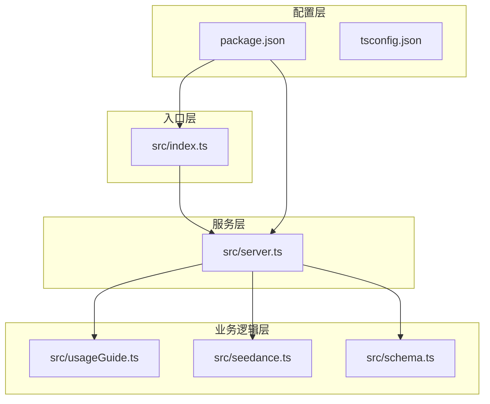
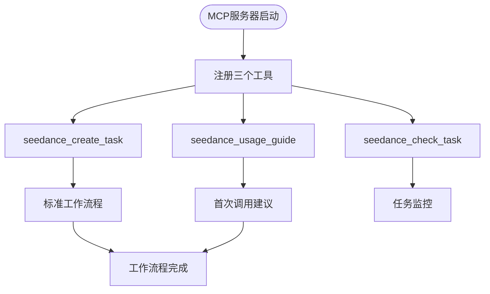
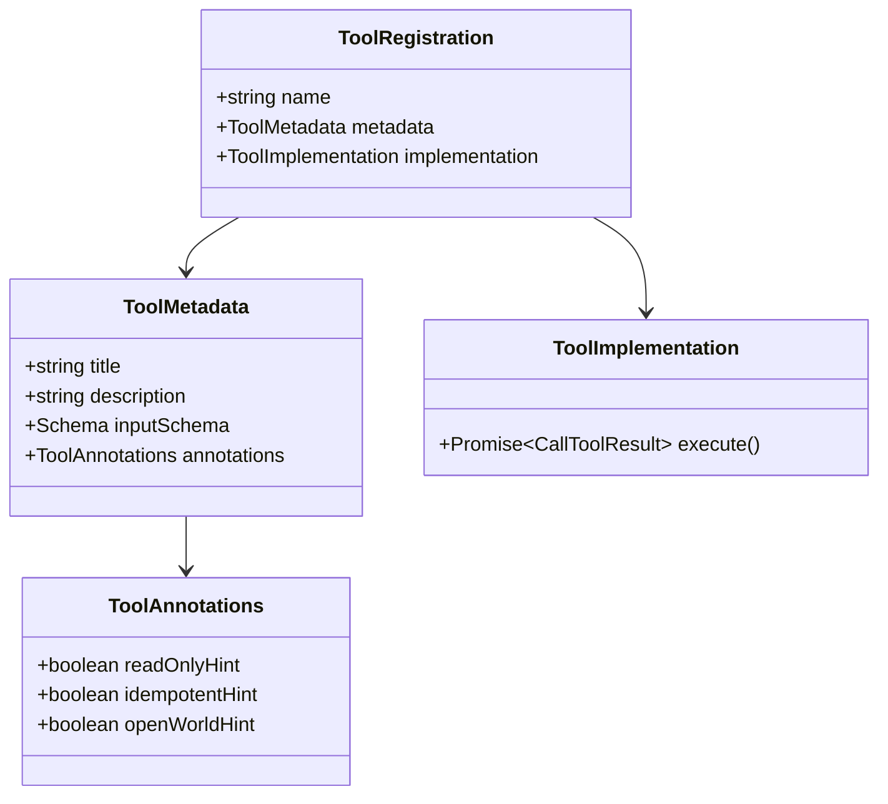
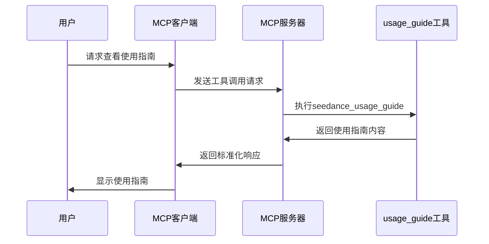

# seedance_usage_guide 工具

<cite>
**本文档引用的文件**
- [src/index.ts](file://src/index.ts)
- [src/server.ts](file://src/server.ts)
- [src/usageGuide.ts](file://src/usageGuide.ts)
- [src/seedance.ts](file://src/seedance.ts)
- [src/schema.ts](file://src/schema.ts)
- [package.json](file://package.json)
- [README.md](file://README.md)
</cite>

## 目录
1. [简介](#简介)
2. [项目结构](#项目结构)
3. [核心组件](#核心组件)
4. [架构概览](#架构概览)
5. [详细组件分析](#详细组件分析)
6. [依赖关系分析](#依赖关系分析)
7. [性能考虑](#性能考虑)
8. [故障排除指南](#故障排除指南)
9. [结论](#结论)

## 简介

seedance_usage_guide 是一个只读工具，专门用于返回标准的使用指南文档。该工具是 MCP 生命周期中的第一个必要步骤，为用户提供了完整的标准工作流程说明，包括 create -> wait -> check 的完整流程。

该工具具有以下关键特性：
- **只读访问权限**：不修改任何系统状态
- **幂等性**：多次调用返回相同结果
- **无参数设计**：简化调用接口
- **标准化输出**：提供完整的使用说明文档

## 项目结构

该项目采用模块化架构，主要包含以下核心文件：



**图表来源**
- [src/index.ts:1-19](file://src/index.ts#L1-L19)
- [src/server.ts:1-215](file://src/server.ts#L1-L215)
- [src/usageGuide.ts:1-59](file://src/usageGuide.ts#L1-L59)

**章节来源**
- [src/index.ts:1-19](file://src/index.ts#L1-L19)
- [src/server.ts:20-29](file://src/server.ts#L20-L29)
- [package.json:1-51](file://package.json#L1-L51)

## 核心组件

### 工具定义与注册

seedance_usage_guide 工具在服务器初始化时进行注册，具有以下配置特征：

| 属性 | 值 | 描述 |
|------|-----|------|
| 工具名称 | `seedance_usage_guide` | 标准化的工具标识符 |
| 标题 | "Seedance 2.0 usage guide" | 用户友好的显示名称 |
| 描述 | 返回完整的使用指南文档 | 工具功能的简要说明 |
| 输入模式 | {} | 无参数设计 |
| 只读提示 | true | 工具不修改任何状态 |
| 幂等提示 | true | 多次调用返回相同结果 |

### 使用指南内容结构

工具返回的使用指南包含以下核心部分：

1. **标准工作流程**：完整的 create -> wait -> check 流程
2. **模型选择**：标准版 vs 快速版的对比
3. **参数参考**：详细的参数说明和验证规则
4. **重要注意事项**：安全提示和使用限制

**章节来源**
- [src/server.ts:31-47](file://src/server.ts#L31-L47)
- [src/usageGuide.ts:1-59](file://src/usageGuide.ts#L1-L59)

## 架构概览

### MCP 服务器架构

```mermaid
sequenceDiagram
participant Client as 客户端
participant Server as MCP服务器
participant Guide as usage_guide工具
participant Create as create_task工具
participant Check as check_task工具
Client->>Server : 连接MCP服务器
Server->>Client : 返回工具列表
Client->>Guide : 调用seedance_usage_guide
Guide->>Client : 返回使用指南
Client->>Create : 调用seedance_create_task
Create->>Client : 返回task_id
Client->>Check : 调用seedance_check_task
Check->>Client : 返回任务状态
Check->>Client : 返回video_url(成功时)
```

**图表来源**
- [src/server.ts:20-29](file://src/server.ts#L20-L29)
- [src/server.ts:31-47](file://src/server.ts#L31-L47)
- [src/server.ts:49-90](file://src/server.ts#L49-L90)
- [src/server.ts:92-174](file://src/server.ts#L92-L174)

### 工具生命周期管理



**图表来源**
- [src/server.ts:20-29](file://src/server.ts#L20-L29)
- [src/server.ts:24-27](file://src/server.ts#L24-L27)

## 详细组件分析

### 工具实现细节

#### 工具注册配置



**图表来源**
- [src/server.ts:31-47](file://src/server.ts#L31-L47)
- [src/server.ts:38-42](file://src/server.ts#L38-L42)

#### 使用指南内容结构

使用指南采用 Markdown 格式，包含以下层次结构：

1. **标题和简介**：工具的基本介绍
2. **标准工作流程**：分步骤的操作指南
3. **模型选择**：不同模型的特点对比
4. **参数参考**：详细的参数说明
5. **重要注意事项**：安全和使用限制

**章节来源**
- [src/usageGuide.ts:1-59](file://src/usageGuide.ts#L1-L59)

### API 规范

#### 工具元数据

| 元数据字段 | 值 | 说明 |
|------------|-----|------|
| 名称 | `seedance_usage_guide` | 标准化工具标识符 |
| 标题 | "Seedance 2.0 usage guide" | 用户可见的工具名称 |
| 描述 | 返回完整的使用指南 | 工具功能的简要描述 |
| 输入模式 | {} | 无参数设计，空对象表示无输入 |
| 只读提示 | true | 工具不修改任何状态 |
| 幂等提示 | true | 多次调用返回相同结果 |
| 开放世界提示 | false | 工具不访问外部世界资源 |

#### 输出格式规范

工具返回的标准输出格式：

```mermaid
erDiagram
CallToolResult {
array content
boolean isError
object structuredContent
}
ContentItem {
string type
string text
}
CallToolResult ||--|| ContentItem : contains
ContentItem {
"text" type
string text
}
```

**图表来源**
- [src/server.ts:44-46](file://src/server.ts#L44-L46)

**章节来源**
- [src/server.ts:31-47](file://src/server.ts#L31-L47)
- [src/server.ts:44-46](file://src/server.ts#L44-L46)

### 使用示例

#### 基本调用流程



**图表来源**
- [src/server.ts:44-46](file://src/server.ts#L44-L46)

#### 完整的工作流程示例

虽然这是 usage_guide 工具的调用示例，但它为后续的 create -> wait -> check 流程提供了必要的上下文：

1. **首次调用**：调用 `seedance_usage_guide` 获取完整指南
2. **任务创建**：调用 `seedance_create_task` 提交生成任务
3. **轮询监控**：调用 `seedance_check_task` 轮询任务状态
4. **结果处理**：获取生成的视频 URL 并及时下载

**章节来源**
- [src/server.ts:24-27](file://src/server.ts#L24-L27)
- [README.md:212-227](file://README.md#L212-L227)

## 依赖关系分析

### 核心依赖关系

```mermaid
graph LR
A[src/server.ts] --> B[@modelcontextprotocol/sdk]
A --> C[src/usageGuide.ts]
A --> D[src/seedance.ts]
A --> E[src/schema.ts]
F[package.json] --> A
F --> B
F --> C
F --> D
F --> E
```

**图表来源**
- [src/server.ts:1-15](file://src/server.ts#L1-L15)
- [package.json:26-28](file://package.json#L26-L28)

### 外部依赖

项目的主要外部依赖包括：

| 依赖包 | 版本 | 用途 |
|--------|------|------|
| @modelcontextprotocol/sdk | ^1.29.0 | MCP 协议实现 |
| zod | ^3.25.76 | 输入验证和类型定义 |
| typescript | ^5.5.4 | TypeScript 编译器 |
| tsx | ^4.19.2 | 开发时 TypeScript 运行器 |

**章节来源**
- [package.json:26-34](file://package.json#L26-L34)

## 性能考虑

### 工具性能特征

由于 seedance_usage_guide 是只读工具，其性能特征相对简单：

- **内存占用**：极低，仅存储静态使用指南文本
- **执行时间**：几乎为零，字符串返回操作
- **并发处理**：完全线程安全，无共享状态
- **缓存策略**：天然具备缓存效果，无需额外优化

### 系统影响

该工具对系统的影响可以忽略不计：

- **CPU 使用率**：0%
- **内存使用**：固定大小的字符串对象
- **网络活动**：无网络请求
- **I/O 操作**：无文件系统访问

## 故障排除指南

### 常见问题

#### 工具不可用

**症状**：客户端无法发现或调用 `seedance_usage_guide` 工具

**可能原因**：
1. MCP 服务器未正确启动
2. 工具注册失败
3. 客户端配置错误

**解决方案**：
1. 检查 MCP 服务器日志输出
2. 验证服务器连接状态
3. 确认客户端已正确配置

#### 权限问题

**症状**：调用工具时出现权限错误

**可能原因**：
1. 工具权限配置错误
2. 客户端权限不足

**解决方案**：
1. 检查工具的只读和幂等性配置
2. 验证客户端的工具访问权限

### 调试方法

1. **检查服务器状态**：确认 MCP 服务器正常运行
2. **验证工具注册**：确保工具已正确注册到服务器
3. **测试工具调用**：单独测试工具的可用性
4. **查看日志输出**：检查服务器的错误日志

**章节来源**
- [src/index.ts:10-11](file://src/index.ts#L10-L11)
- [src/server.ts:24-27](file://src/server.ts#L24-L27)

## 结论

seedance_usage_guide 工具作为 MCP 生命周期中的第一个必要步骤，为用户提供了完整且标准化的使用指南。该工具的设计体现了以下关键原则：

1. **简洁性**：无参数设计，降低使用复杂度
2. **可靠性**：只读和幂等性确保系统稳定性
3. **完整性**：提供标准工作流程的详细说明
4. **易用性**：Markdown 格式便于阅读和理解

该工具的重要性在于为后续的 create -> wait -> check 流程奠定了基础，确保用户能够正确理解和使用整个视频生成工作流程。通过提供标准化的使用指南，该工具减少了用户的学习成本，提高了系统的整体可用性。