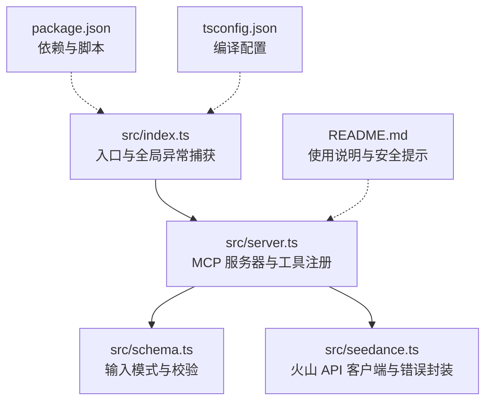
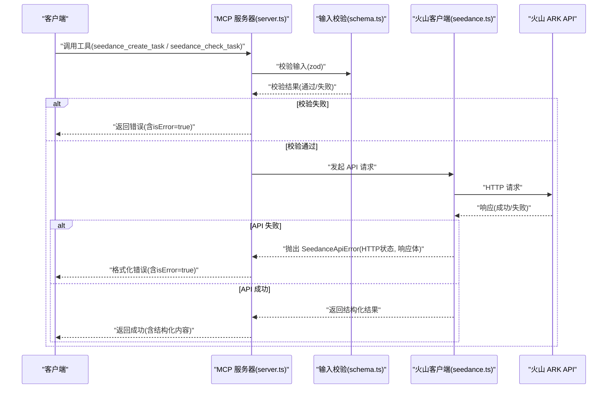
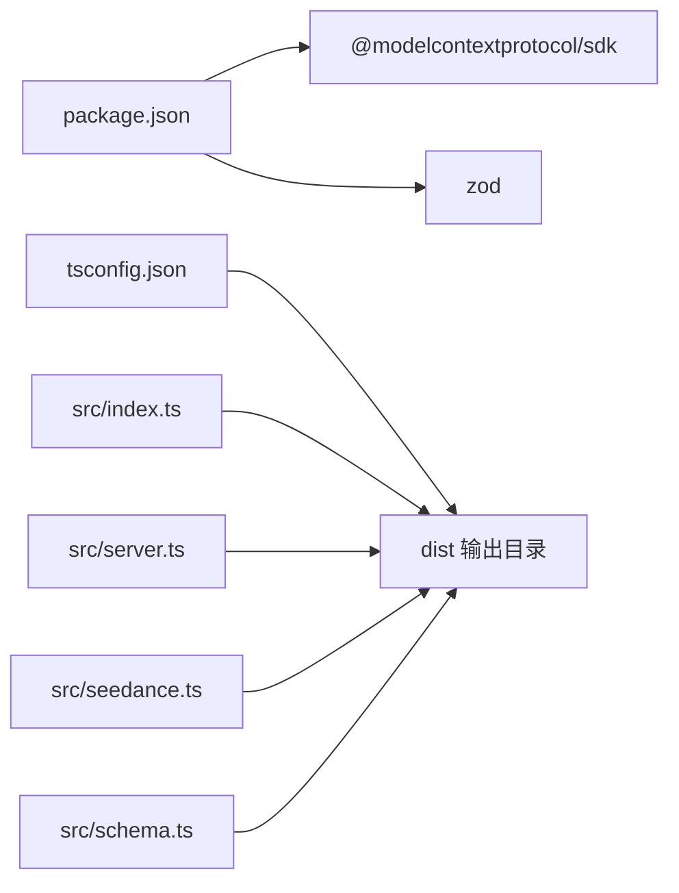
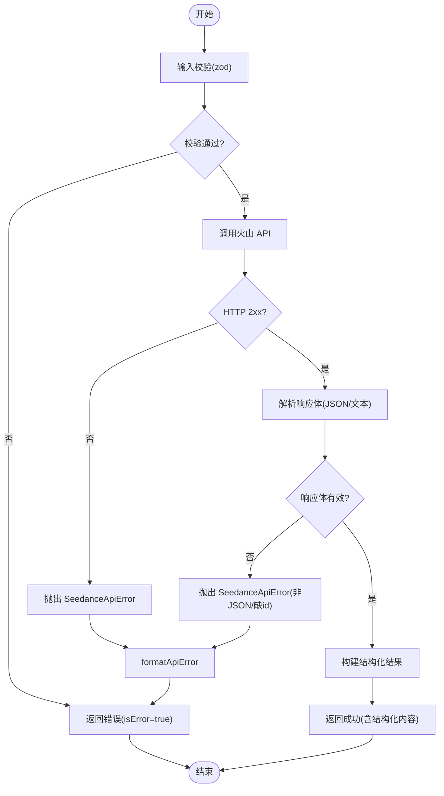

# 错误处理和状态码

<cite>
**本文引用的文件**
- [src/index.ts](file://src/index.ts)
- [src/server.ts](file://src/server.ts)
- [src/seedance.ts](file://src/seedance.ts)
- [src/schema.ts](file://src/schema.ts)
- [README.md](file://README.md)
- [package.json](file://package.json)
- [tsconfig.json](file://tsconfig.json)
</cite>

## 目录
1. [简介](#简介)
2. [项目结构](#项目结构)
3. [核心组件](#核心组件)
4. [架构总览](#架构总览)
5. [详细组件分析](#详细组件分析)
6. [依赖关系分析](#依赖关系分析)
7. [性能考量](#性能考量)
8. [故障排查指南](#故障排查指南)
9. [结论](#结论)
10. [附录](#附录)

## 简介
本文件系统性梳理了 MCP 工具调用中的错误分类、处理机制与状态码参考，覆盖参数验证错误、API 调用错误、网络连接错误、任务状态异常等。文档重点说明：
- 错误消息格式与结构化错误响应
- SeedanceApiError 类的使用与 HTTP 状态码映射
- 常见错误场景的诊断与修复建议
- 错误恢复策略与重试机制
- isError 标志的使用与错误传播机制
- 调试技巧与日志记录建议

## 项目结构
该仓库采用分层设计：入口负责连接 MCP 传输层并捕获顶层异常；服务层注册工具并进行输入校验与错误归一化；种子层封装火山 API 客户端，统一抛出结构化错误；模式层使用 zod 进行输入校验；使用指南提供标准工作流与参数说明。

图表来源
- [src/index.ts:1-19](file://src/index.ts#L1-L19)
- [src/server.ts:1-215](file://src/server.ts#L1-L215)
- [src/seedance.ts:1-286](file://src/seedance.ts#L1-L286)
- [src/schema.ts:1-141](file://src/schema.ts#L1-L141)
- [README.md:1-293](file://README.md#L1-L293)
- [package.json:1-51](file://package.json#L1-L51)
- [tsconfig.json:1-23](file://tsconfig.json#L1-L23)

章节来源
- [src/index.ts:1-19](file://src/index.ts#L1-L19)
- [src/server.ts:1-215](file://src/server.ts#L1-L215)
- [src/seedance.ts:1-286](file://src/seedance.ts#L1-L286)
- [src/schema.ts:1-141](file://src/schema.ts#L1-L141)
- [README.md:1-293](file://README.md#L1-L293)
- [package.json:1-51](file://package.json#L1-L51)
- [tsconfig.json:1-23](file://tsconfig.json#L1-L23)

## 核心组件
- SeedanceApiError：统一的 API 错误类，携带 HTTP 状态码与原始响应体，便于上层统一处理。
- createSeedanceTask/checkSeedanceTask：封装火山 API 的任务创建与查询，失败时抛出 SeedanceApiError。
- server 层工具：注册 seedance_create_task 与 seedance_check_task，内置输入校验与错误归一化。
- 输入模式：使用 zod 对输入进行严格校验，减少无效请求进入 API 层。
- 结构化响应：工具返回包含 isError 标志与结构化内容的 CallToolResult，便于客户端识别与展示。

章节来源
- [src/seedance.ts:44-53](file://src/seedance.ts#L44-L53)
- [src/seedance.ts:149-194](file://src/seedance.ts#L149-L194)
- [src/seedance.ts:201-278](file://src/seedance.ts#L201-L278)
- [src/server.ts:62-90](file://src/server.ts#L62-L90)
- [src/server.ts:105-174](file://src/server.ts#L105-L174)
- [src/schema.ts:52-141](file://src/schema.ts#L52-L141)

## 架构总览
下图展示了 MCP 工具调用的错误处理与状态流转：客户端调用工具 → 服务层校验与转发 → 种子层发起 API 请求 → 统一错误封装 → 结构化错误返回。

图表来源
- [src/server.ts:62-90](file://src/server.ts#L62-L90)
- [src/server.ts:105-174](file://src/server.ts#L105-L174)
- [src/schema.ts:52-141](file://src/schema.ts#L52-L141)
- [src/seedance.ts:149-194](file://src/seedance.ts#L149-L194)
- [src/seedance.ts:201-278](file://src/seedance.ts#L201-L278)

## 详细组件分析

### SeedanceApiError 类与 HTTP 状态码映射
- 设计目的：将 HTTP 状态码与原始响应体封装为可识别的错误对象，便于上层统一处理与展示。
- 关键字段：
  - status：HTTP 状态码
  - body：原始响应体（JSON 对象或字符串）
- 使用位置：
  - createSeedanceTask：当 HTTP 非 2xx 或响应体不符合预期时抛出
  - checkSeedanceTask：当 HTTP 非 2xx 或响应体不符合预期时抛出
- 映射关系：错误对象直接承载 HTTP 状态码，便于与客户端约定的错误处理逻辑对接。

章节来源
- [src/seedance.ts:44-53](file://src/seedance.ts#L44-L53)
- [src/seedance.ts:167-173](file://src/seedance.ts#L167-L173)
- [src/seedance.ts:222-228](file://src/seedance.ts#L222-L228)

### 参数验证错误
- 输入校验来源：schema.ts 使用 zod 对输入进行严格校验，包括必填字段、枚举值、范围限制与数组长度限制。
- 服务层二次校验：server.ts 在工具内部补充业务规则校验，例如：
  - 纯音频输入被拒绝（Seedance 不支持）
  - web_search=true 与参考素材同时出现被拒绝
- 错误返回：校验失败时返回结构化错误，包含 isError:true 与人类可读的错误信息。

章节来源
- [src/schema.ts:52-141](file://src/schema.ts#L52-L141)
- [src/server.ts:179-199](file://src/server.ts#L179-L199)
- [src/server.ts:209-214](file://src/server.ts#L209-L214)

### API 调用错误
- 创建任务：createSeedanceTask
  - 步骤：获取密钥与基础 URL → 构造请求体 → 发送 HTTP 请求 → 解析响应 → 校验响应体 → 抛出 SeedanceApiError（若非 2xx 或响应体异常）
- 查询任务：checkSeedanceTask
  - 步骤：校验 task_id → 发送 HTTP 请求 → 解析响应 → 校验响应体 → 归一化状态与结果字段
- 错误提取：extractApiErrorMessage 从响应体中优先提取 error.message 或 message，否则回退为通用提示。

章节来源
- [src/seedance.ts:149-194](file://src/seedance.ts#L149-L194)
- [src/seedance.ts:201-278](file://src/seedance.ts#L201-L278)
- [src/seedance.ts:126-140](file://src/seedance.ts#L126-L140)

### 网络连接错误
- 场景：fetch 请求失败（DNS 解析失败、超时、网络中断等）
- 表现：res.ok 为 false，parseJsonSafe 返回解析后的 body 或文本
- 处理：统一抛出 SeedanceApiError，message 由 extractApiErrorMessage 生成，status 为实际 HTTP 状态码
- 建议：客户端侧结合网络状况进行指数退避重试

章节来源
- [src/seedance.ts:167-173](file://src/seedance.ts#L167-L173)
- [src/seedance.ts:222-228](file://src/seedance.ts#L222-L228)
- [src/seedance.ts:116-124](file://src/seedance.ts#L116-L124)

### 任务状态异常
- 支持状态：running、queued、pending、in_queue、succeeded、failed、cancelled、canceled、expired 等
- 归一化：checkSeedanceTask 对不同 SDK 版本的响应形状进行探测式归一，确保 video_url、last_frame_url、fail_reason 等字段稳定输出
- 异常分支：default 分支返回原始状态与 raw，便于进一步诊断

章节来源
- [src/seedance.ts:244-268](file://src/seedance.ts#L244-L268)
- [src/server.ts:111-157](file://src/server.ts#L111-L157)

### 错误消息格式与结构化错误响应
- 结构化响应字段：
  - content：文本内容（人类可读）
  - structuredContent：结构化数据（如 task_id、status、urls、raw 等）
  - isError：布尔标志，指示是否为错误
- 错误格式：
  - SeedanceApiError：包含 HTTP 状态码与原始响应体
  - formatApiError：将 SeedanceApiError 格式化为统一错误字符串

章节来源
- [src/server.ts:75-85](file://src/server.ts#L75-L85)
- [src/server.ts:159-169](file://src/server.ts#L159-L169)
- [src/server.ts:201-207](file://src/server.ts#L201-L207)
- [src/server.ts:209-214](file://src/server.ts#L209-L214)

### 错误恢复策略与重试机制
- 重试建议：
  - 对于网络瞬时错误（如 5xx、超时），建议采用指数退避重试（如 1s、2s、4s、8s）
  - 对于 4xx（如 401、403、429），需检查凭据、配额与限流，不建议盲目重试
  - 对于任务状态为 running/queued/pending/in_queue 的情况，按 30-90 秒间隔轮询
- 任务过期：expired 状态需重新提交任务

章节来源
- [src/server.ts:135-153](file://src/server.ts#L135-L153)
- [README.md:212-227](file://README.md#L212-L227)

### isError 标志的使用与错误传播机制
- isError:true：表示本次工具调用返回的是错误，客户端应将其作为失败处理
- errorResult：统一构造错误响应，包含 isError:true 与错误文本
- 传播链路：工具内部捕获错误 → formatApiError 格式化 → errorResult 返回

章节来源
- [src/server.ts:209-214](file://src/server.ts#L209-L214)
- [src/server.ts:86-88](file://src/server.ts#L86-L88)
- [src/server.ts:171-172](file://src/server.ts#L171-L172)

### 调试技巧与日志记录建议
- 日志输出：
  - 入口处使用 console.error 记录致命错误与服务器运行信息
  - 严禁在 stdout 输出调试日志（stdout 保留为 MCP JSON-RPC 通道）
- 调试工具：
  - 使用 @modelcontextprotocol/inspector 进行 stdio MCP 调试
- 环境变量：
  - 通过 MCP 客户端配置注入 ARK_API_KEY 与可选 ARK_BASE_URL
- 安全与合规：
  - 不在日志或返回值中打印 API Key
  - 生成的 URL 通常 24 小时内过期，需及时下载

章节来源
- [src/index.ts:10-18](file://src/index.ts#L10-L18)
- [README.md:253-263](file://README.md#L253-L263)
- [README.md:93-101](file://README.md#L93-L101)
- [README.md:233-239](file://README.md#L233-L239)

## 依赖关系分析
- 依赖管理：使用 @modelcontextprotocol/sdk 与 zod
- 编译配置：NodeNext 模块解析，目标 ES2022
- 入口脚本：bin 指向 dist/index.js，构建后赋予可执行权限

图表来源
- [package.json:26-29](file://package.json#L26-L29)
- [tsconfig.json:7-8](file://tsconfig.json#L7-L8)
- [src/index.ts:1-19](file://src/index.ts#L1-L19)
- [src/server.ts:1-215](file://src/server.ts#L1-L215)
- [src/seedance.ts:1-286](file://src/seedance.ts#L1-L286)
- [src/schema.ts:1-141](file://src/schema.ts#L1-L141)

章节来源
- [package.json:1-51](file://package.json#L1-L51)
- [tsconfig.json:1-23](file://tsconfig.json#L1-L23)

## 性能考量
- 轮询间隔：建议 30-90 秒，避免频繁请求导致限流
- 超时设置：客户端侧为网络请求设置合理超时，防止长时间阻塞
- 并发控制：同一任务仅单线程轮询，避免重复请求
- 响应解析：parseJsonSafe 对非 JSON 文本进行容错处理，提升健壮性

章节来源
- [src/server.ts:135-143](file://src/server.ts#L135-L143)
- [src/seedance.ts:116-124](file://src/seedance.ts#L116-L124)

## 故障排查指南

### 常见错误场景与修复建议
- 缺少 ARK_API_KEY
  - 现象：调用真实 API 的两个工具会抛出错误
  - 修复：在 MCP 客户端配置中注入 env ARK_API_KEY
- 环境变量覆盖
  - 现象：海外/代理场景访问失败
  - 修复：设置 ARK_BASE_URL 覆盖默认基础 URL
- 输入参数非法
  - 现象：参数验证失败或业务规则拒绝
  - 修复：遵循 schema.ts 与 server.ts 的校验规则，调整参数组合
- 纯音频输入被拒绝
  - 现象：Seedance 不支持纯文本 + 音频
  - 修复：至少提供一张图像或一段视频作为参考
- web_search 与参考素材冲突
  - 现象：启用联网增强时仍提供参考素材
  - 修复：移除参考素材或将 web_search 设为 false
- 任务状态异常
  - 现象：状态不在标准集合内
  - 修复：查看 structuredContent.raw 获取原始响应，定位问题

章节来源
- [README.md:103-106](file://README.md#L103-L106)
- [README.md:93-101](file://README.md#L93-L101)
- [src/schema.ts:52-141](file://src/schema.ts#L52-L141)
- [src/server.ts:179-199](file://src/server.ts#L179-L199)
- [src/server.ts:154-157](file://src/server.ts#L154-L157)

### 错误码对照表与处理建议
- 400（参数错误/业务规则拒绝）
  - 建议：修正输入参数或参数组合，满足 schema 与业务规则
- 401/403（鉴权失败）
  - 建议：检查 ARK_API_KEY 是否正确、是否具备相应权限
- 404（任务不存在）
  - 建议：确认 task_id 是否正确，必要时重新提交任务
- 429（限流）
  - 建议：降低请求频率，采用指数退避重试
- 5xx（服务端错误）
  - 建议：稍后重试，关注服务端健康状态
- 200（成功）
  - 建议：按 succeeded 状态处理，下载视频 URL

章节来源
- [src/seedance.ts:167-173](file://src/seedance.ts#L167-L173)
- [src/seedance.ts:222-228](file://src/seedance.ts#L222-L228)

### SeedanceApiError 使用要点
- 捕获方式：在工具回调中使用 try/catch 捕获 SeedanceApiError
- 格式化：通过 formatApiError 统一错误字符串，便于返回给客户端
- 结构化：在 errorResult 中设置 isError:true，确保客户端正确识别

章节来源
- [src/server.ts:86-88](file://src/server.ts#L86-L88)
- [src/server.ts:171-172](file://src/server.ts#L171-L172)
- [src/server.ts:201-207](file://src/server.ts#L201-L207)
- [src/server.ts:209-214](file://src/server.ts#L209-L214)

## 结论
本项目通过严格的输入校验、统一的 API 错误封装与结构化的错误响应，实现了 MCP 工具调用的稳健错误处理。SeedanceApiError 与 isError 标志确保了错误的可识别与可恢复性；服务层的业务规则校验与状态归一化提升了用户体验。建议在客户端侧结合指数退避与合理的轮询间隔，以获得最佳稳定性与性能。

## 附录

### 错误处理流程图

图表来源
- [src/schema.ts:52-141](file://src/schema.ts#L52-L141)
- [src/seedance.ts:149-194](file://src/seedance.ts#L149-L194)
- [src/seedance.ts:201-278](file://src/seedance.ts#L201-L278)
- [src/server.ts:62-90](file://src/server.ts#L62-L90)
- [src/server.ts:105-174](file://src/server.ts#L105-L174)
- [src/server.ts:201-207](file://src/server.ts#L201-L207)