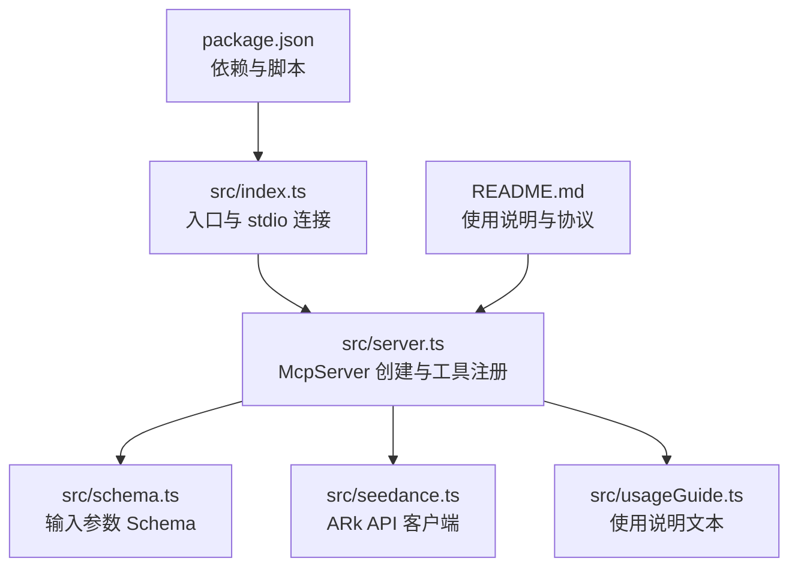
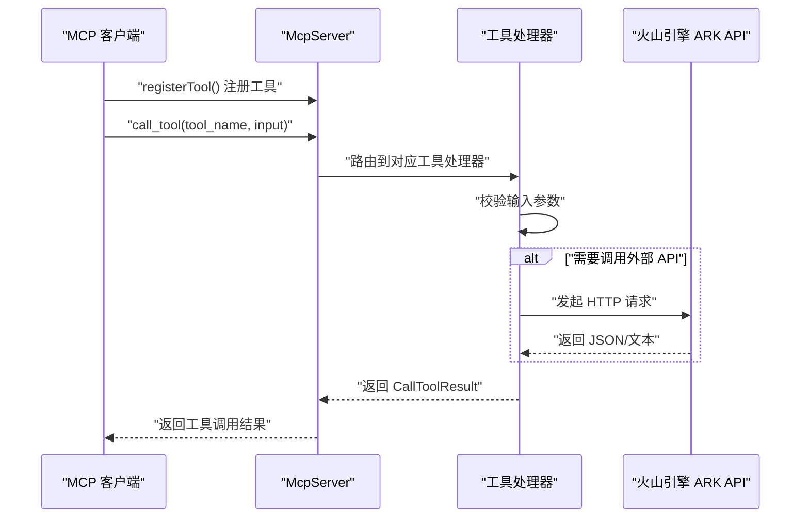
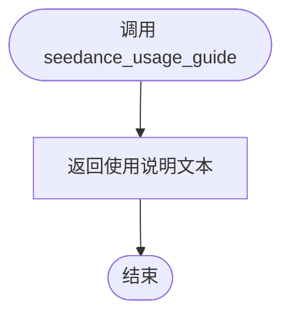
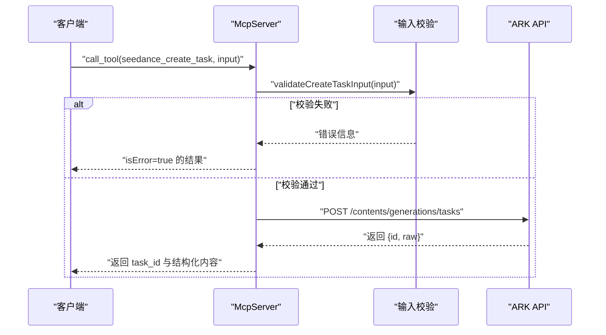
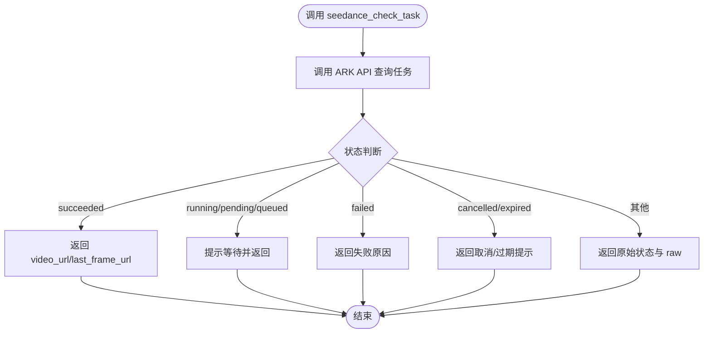
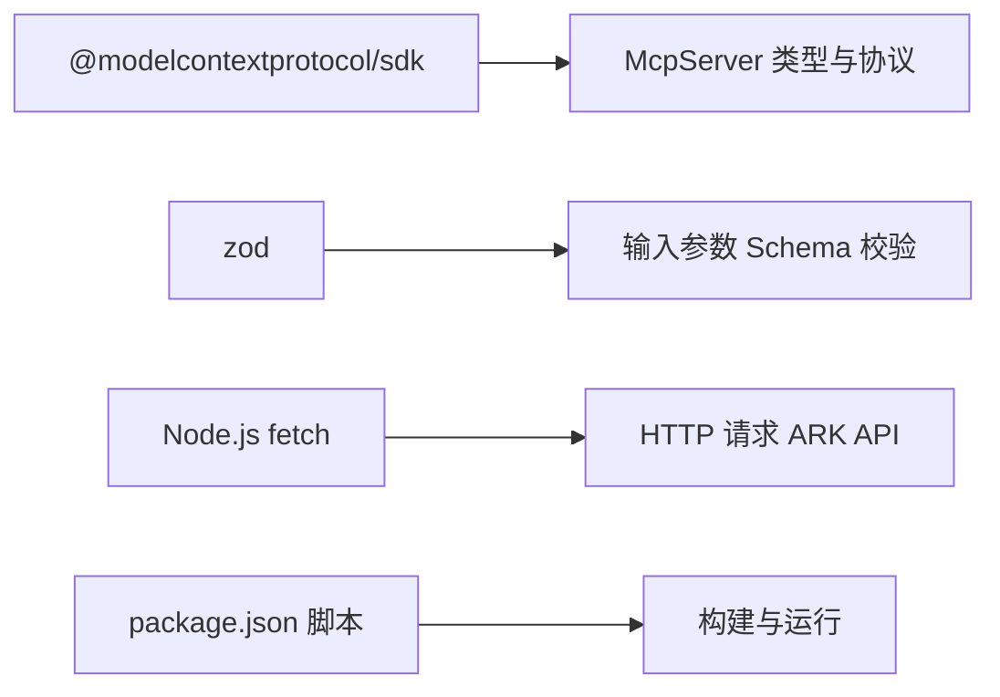

# MCP 工具注册机制

<cite>
**本文引用的文件**
- [src/index.ts](file://src/index.ts)
- [src/server.ts](file://src/server.ts)
- [src/seedance.ts](file://src/seedance.ts)
- [src/schema.ts](file://src/schema.ts)
- [src/usageGuide.ts](file://src/usageGuide.ts)
- [package.json](file://package.json)
- [README.md](file://README.md)
</cite>

## 目录
1. [简介](#简介)
2. [项目结构](#项目结构)
3. [核心组件](#核心组件)
4. [架构总览](#架构总览)
5. [详细组件分析](#详细组件分析)
6. [依赖关系分析](#依赖关系分析)
7. [性能考量](#性能考量)
8. [故障排查指南](#故障排查指南)
9. [结论](#结论)
10. [附录](#附录)

## 简介
本项目是一个基于 Model Context Protocol (MCP) 的本地 stdio 服务器，将火山引擎 ARK Seedance 2.0 视频生成能力封装为三个工具：seedance_usage_guide、seedance_create_task、seedance_check_task。本文档聚焦于工具注册机制，详细解释 server.registerTool() 的使用方式与参数结构，深入分析三个核心工具的具体实现，解析工具描述信息的构成（title、description、inputSchema、annotations），阐明工具注解（annotations）的语义与影响，提供最佳实践与兼容性说明，并给出注册自定义工具与处理工具调用的实际示例路径。

## 项目结构
该项目采用分层模块化组织：
- 入口模块负责创建 MCP 服务器并通过 stdio 传输与客户端交互
- 服务器模块负责注册三个工具并定义其行为
- Schema 模块定义输入参数的类型与校验规则
- Seedance 模块封装对火山引擎 API 的调用
- UsageGuide 模块提供工具使用说明文本



图表来源
- [src/index.ts:1-19](file://src/index.ts#L1-L19)
- [src/server.ts:20-177](file://src/server.ts#L20-L177)
- [src/schema.ts:1-141](file://src/schema.ts#L1-L141)
- [src/seedance.ts:1-286](file://src/seedance.ts#L1-L286)
- [src/usageGuide.ts:1-59](file://src/usageGuide.ts#L1-L59)
- [package.json:1-51](file://package.json#L1-L51)
- [README.md:1-293](file://README.md#L1-L293)

章节来源
- [src/index.ts:1-19](file://src/index.ts#L1-L19)
- [src/server.ts:20-177](file://src/server.ts#L20-L177)
- [src/schema.ts:1-141](file://src/schema.ts#L1-L141)
- [src/seedance.ts:1-286](file://src/seedance.ts#L1-L286)
- [src/usageGuide.ts:1-59](file://src/usageGuide.ts#L1-L59)
- [package.json:1-51](file://package.json#L1-L51)
- [README.md:267-283](file://README.md#L267-L283)

## 核心组件
- server.registerTool()：MCP 服务器注册工具的标准方法，接收工具名、工具描述对象与处理器函数三部分参数
- 三个核心工具：
  - seedance_usage_guide：只读、幂等、非开放世界，返回使用说明
  - seedance_create_task：有副作用、非幂等、开放世界，提交任务并返回 task_id
  - seedance_check_task：只读、幂等、开放世界，查询任务状态并返回结果
- 输入参数校验：使用 zod Schema 定义与校验，确保工具调用的输入符合预期
- ARK API 客户端：封装 POST /contents/generations/tasks 与 GET /contents/generations/tasks/{task_id} 请求

章节来源
- [src/server.ts:31-174](file://src/server.ts#L31-L174)
- [src/schema.ts:52-141](file://src/schema.ts#L52-L141)
- [src/seedance.ts:149-278](file://src/seedance.ts#L149-L278)

## 架构总览
MCP 服务器通过 stdio 与客户端通信，入口模块创建服务器实例并建立连接，随后在服务器中注册三个工具。工具调用时，服务器根据工具名路由到对应的处理器，处理器内部进行输入校验、调用 ARK API 并返回结构化结果。



图表来源
- [src/index.ts:6-12](file://src/index.ts#L6-L12)
- [src/server.ts:31-174](file://src/server.ts#L31-L174)
- [src/seedance.ts:149-278](file://src/seedance.ts#L149-L278)

## 详细组件分析

### server.registerTool() 使用方式与参数结构
- 参数一：工具名（字符串），用于客户端识别与调用
- 参数二：工具描述对象（对象），包含以下关键字段：
  - title：工具标题，用于显示与帮助
  - description：工具描述，说明用途、行为与注意事项
  - inputSchema：输入参数的 Schema，用于参数校验与客户端提示
  - annotations：工具注解，包含 readOnlyHint、idempotentHint、openWorldHint
- 参数三：处理器函数（异步函数），接收输入参数并返回 CallToolResult

该方法在服务器初始化阶段被调用三次，分别注册三个工具。

章节来源
- [src/server.ts:31-47](file://src/server.ts#L31-L47)
- [src/server.ts:49-90](file://src/server.ts#L49-L90)
- [src/server.ts:92-174](file://src/server.ts#L92-L174)

### 工具描述信息的构成与作用
- title：工具的简明标题，便于客户端展示与搜索
- description：工具的详细说明，包括行为、限制、注意事项与典型用法
- inputSchema：定义工具输入参数的类型、默认值、取值范围与描述，用于客户端自动校验与参数提示
- annotations：对工具行为的语义标注，指导客户端如何安全地调用工具

章节来源
- [src/server.ts:33-42](file://src/server.ts#L33-L42)
- [src/server.ts:55-60](file://src/server.ts#L55-L60)
- [src/server.ts:98-103](file://src/server.ts#L98-L103)

### 工具注解（annotations）的含义与影响
- readOnlyHint：是否只读
  - true：工具不产生副作用，适合在只读场景下安全调用
  - false：工具可能产生副作用（如创建任务、修改状态）
- idempotentHint：是否幂等
  - true：重复调用同一输入不会产生额外副作用，客户端可安全重试
  - false：重复调用可能产生不同结果或副作用
- openWorldHint：是否与外部世界交互
  - true：工具会访问外部世界（网络请求），客户端需注意网络与权限
  - false：工具完全在本地执行

这些注解影响客户端的调度策略、重试策略与安全策略。

章节来源
- [src/server.ts:38-42](file://src/server.ts#L38-L42)
- [src/server.ts:57-59](file://src/server.ts#L57-L59)
- [src/server.ts:99-103](file://src/server.ts#L99-L103)

### seedance_usage_guide 工具注册与实现
- 工具名：seedance_usage_guide
- 描述：返回完整的使用说明，建议在首次调用前先调用
- 输入：无
- 注解：readOnlyHint=true、idempotentHint=true、openWorldHint=false
- 实现：直接返回预定义的使用说明文本



图表来源
- [src/server.ts:31-47](file://src/server.ts#L31-L47)
- [src/usageGuide.ts:1-59](file://src/usageGuide.ts#L1-L59)

章节来源
- [src/server.ts:31-47](file://src/server.ts#L31-L47)
- [src/usageGuide.ts:1-59](file://src/usageGuide.ts#L1-L59)

### seedance_create_task 工具注册与实现
- 工具名：seedance_create_task
- 描述：提交 Seedance 2.0 视频生成任务并立即返回 task_id
- 输入：CreateTaskInput（由 zod Schema 定义）
- 注解：readOnlyHint=false、idempotentHint=false、openWorldHint=true
- 实现要点：
  - 先进行输入校验（validateCreateTaskInput）
  - 调用 createSeedanceTask 提交任务
  - 返回结构化内容（task_id、模型、时长、比例、分辨率、原始响应）



图表来源
- [src/server.ts:62-89](file://src/server.ts#L62-L89)
- [src/server.ts:179-199](file://src/server.ts#L179-L199)
- [src/seedance.ts:149-194](file://src/seedance.ts#L149-L194)

章节来源
- [src/server.ts:49-90](file://src/server.ts#L49-L90)
- [src/schema.ts:52-129](file://src/schema.ts#L52-L129)
- [src/server.ts:179-199](file://src/server.ts#L179-L199)
- [src/seedance.ts:149-194](file://src/seedance.ts#L149-L194)

### seedance_check_task 工具注册与实现
- 工具名：seedance_check_task
- 描述：根据 task_id 查询任务状态，成功时返回 video_url 与可选 last_frame_url
- 输入：CheckTaskInput（包含 task_id）
- 注解：readOnlyHint=true、idempotentHint=true、openWorldHint=true
- 实现要点：
  - 调用 checkSeedanceTask 查询任务状态
  - 根据状态返回人类可读摘要与结构化内容
  - 结构化内容包含 task_id、status、video_url、last_frame_url、fail_reason、raw



图表来源
- [src/server.ts:105-173](file://src/server.ts#L105-L173)
- [src/seedance.ts:201-278](file://src/seedance.ts#L201-L278)

章节来源
- [src/server.ts:92-174](file://src/server.ts#L92-L174)
- [src/schema.ts:132-141](file://src/schema.ts#L132-L141)
- [src/seedance.ts:201-278](file://src/seedance.ts#L201-L278)

### 工具调用序列图（整体流程）
```mermaid
sequenceDiagram
participant Client as "客户端"
participant Guide as "seedance_usage_guide"
participant Create as "seedance_create_task"
participant Check as "seedance_check_task"
Client->>Guide : "获取使用说明"
Client->>Create : "提交任务"
Create-->>Client : "返回 task_id"
loop "轮询直到完成"
Client->>Check : "查询任务状态"
Check-->>Client : "返回状态与 URL"
end
```

图表来源
- [src/server.ts:31-174](file://src/server.ts#L31-L174)

## 依赖关系分析
- 依赖 @modelcontextprotocol/sdk：提供 McpServer、CallToolResult 等类型与协议支持
- 依赖 zod：用于定义与校验输入参数 Schema
- 依赖 Node.js 原生 fetch：用于调用火山引擎 ARK API
- 项目脚本：构建、开发、类型检查与发布流程



图表来源
- [package.json:26-34](file://package.json#L26-L34)
- [src/server.ts:1-2](file://src/server.ts#L1-L2)
- [src/schema.ts:1](file://src/schema.ts#L1)

章节来源
- [package.json:26-34](file://package.json#L26-L34)
- [src/server.ts:1-2](file://src/server.ts#L1-L2)
- [src/schema.ts:1](file://src/schema.ts#L1)

## 性能考量
- 工具调用的性能主要受网络与 ARK API 响应时间影响
- seedance_create_task 为非幂等且有副作用，客户端应避免不必要的重复调用
- seedance_check_task 为只读幂等，可安全重试与并发调用
- 建议在客户端侧实现指数退避与最大重试次数，以应对 ARK API 的波动

## 故障排查指南
- 环境变量缺失：当未设置 ARK_API_KEY 时，调用真实 API 的工具会返回清晰错误
- 输入参数错误：create_task 的输入校验会拒绝不合法组合（如纯音频无图像/视频、web_search 与参考素材同时存在）
- API 错误：捕获 SeedanceApiError 并格式化为人类可读消息
- URL 有效性：确保传入的媒体 URL 为公网可达的 HTTP/HTTPS 地址

章节来源
- [src/seedance.ts:55-64](file://src/seedance.ts#L55-L64)
- [src/server.ts:179-199](file://src/server.ts#L179-L199)
- [src/server.ts:201-207](file://src/server.ts#L201-L207)

## 结论
本项目通过 server.registerTool() 将三个工具以标准化方式注册到 MCP 服务器，结合 zod Schema 与 ARK API 客户端实现了可靠的输入校验与外部服务集成。工具注解明确了工具的行为特征，有助于客户端做出正确的调度与重试策略。遵循本文档的最佳实践，可以安全、高效地扩展更多工具并满足 MCP 协议的兼容性要求。

## 附录

### 工具注册最佳实践
- 命名规范：使用清晰、语义化的工具名，如 seedance_create_task
- 描述编写：简洁明了地说明工具用途、输入输出与注意事项
- 输入 Schema：使用 zod 定义严格的类型、默认值与取值范围
- 注解设置：准确标注 readOnlyHint、idempotentHint、openWorldHint
- 错误处理：统一格式化错误消息，区分业务错误与网络错误

### 注册自定义工具的步骤
- 定义输入 Schema：参考 createTaskInputShape 与 checkTaskInputShape
- 实现处理器函数：接收输入参数，进行校验与业务处理
- 调用 registerTool：传入工具名、描述对象与处理器函数
- 测试与验证：使用 MCP Inspector 或客户端进行测试

章节来源
- [src/schema.ts:52-141](file://src/schema.ts#L52-L141)
- [src/server.ts:31-174](file://src/server.ts#L31-L174)

### MCP 协议兼容性要求
- 使用 @modelcontextprotocol/sdk 提供的 McpServer 与 CallToolResult
- 通过 stdio 传输 JSON-RPC 消息
- 工具描述与注解遵循 MCP 规范，确保客户端正确理解工具行为
- 严格区分只读、幂等与开放世界工具，避免在不安全场景下调用有副作用的工具

章节来源
- [src/index.ts:2](file://src/index.ts#L2)
- [src/server.ts:1-2](file://src/server.ts#L1-L2)
- [README.md:109-149](file://README.md#L109-L149)