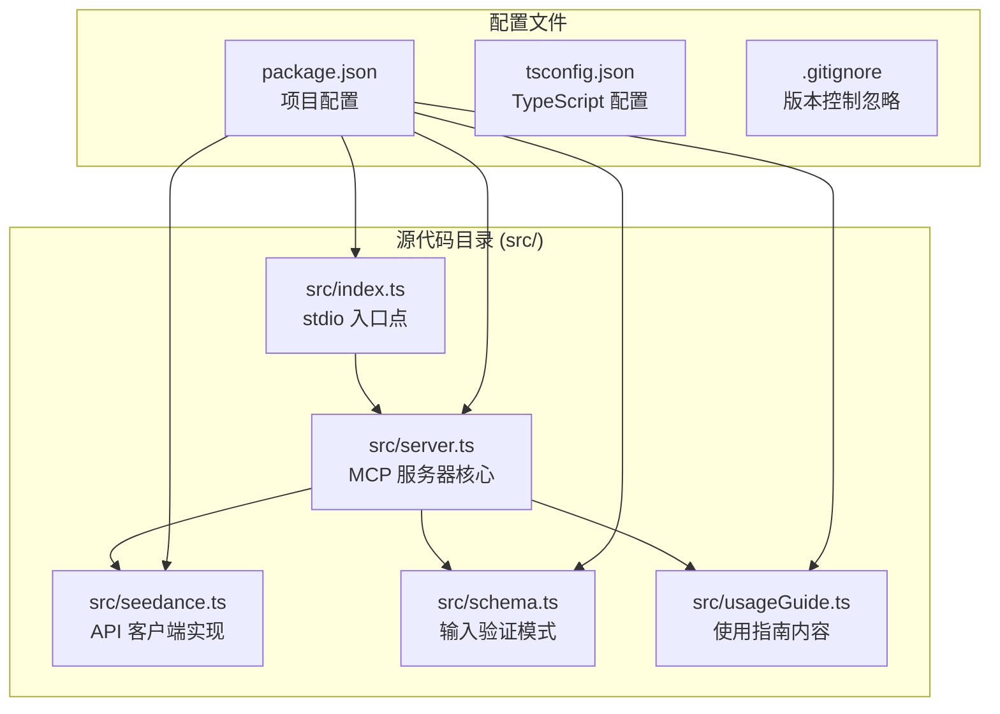
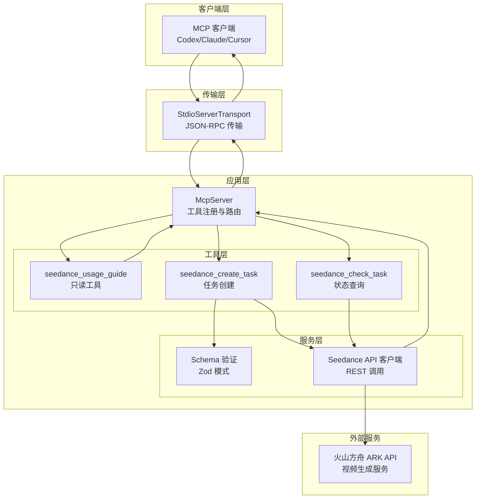
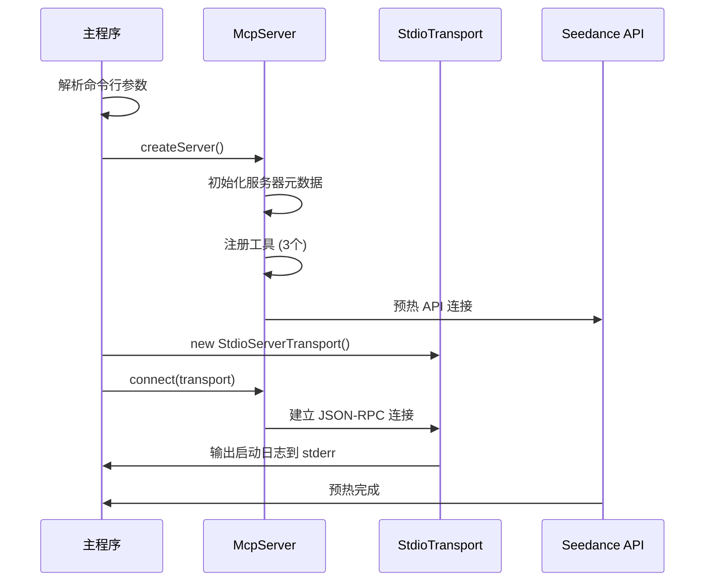
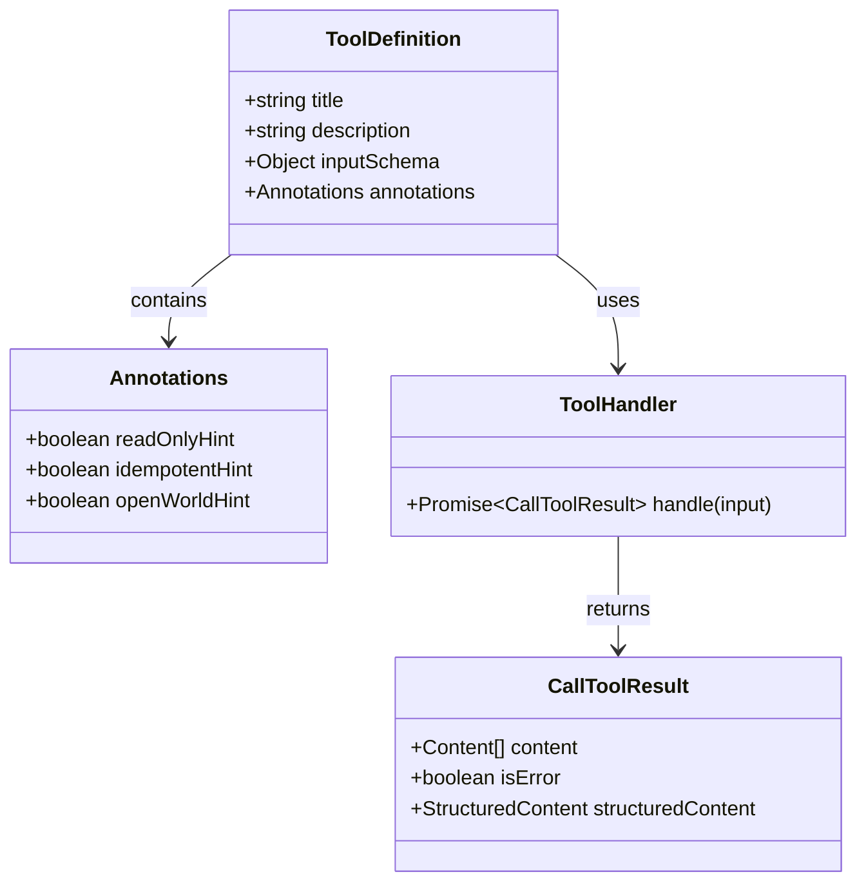
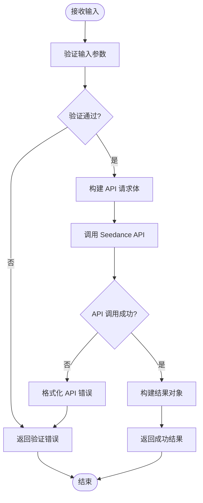
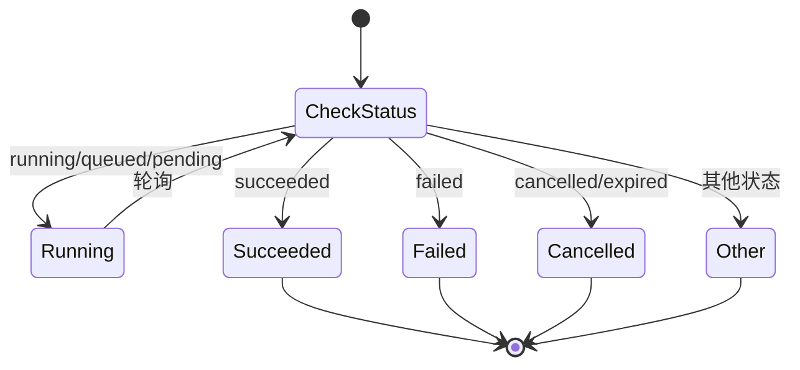
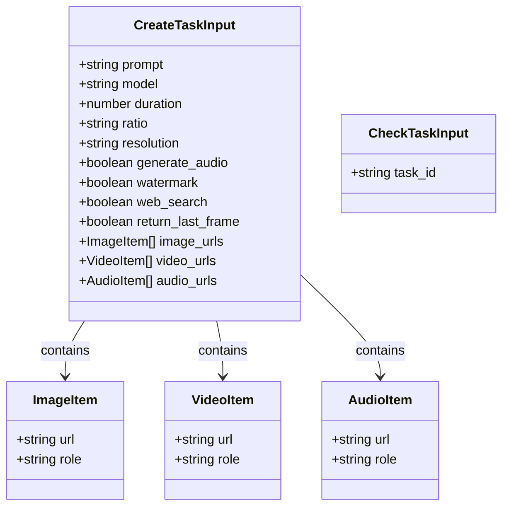
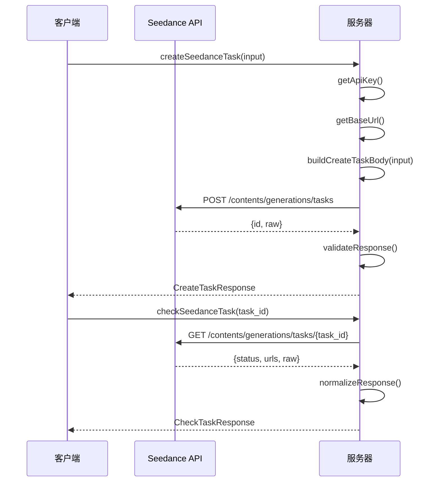

# MCP 服务器实现

<cite>
**本文档引用的文件**
- [src/index.ts](file://src/index.ts)
- [src/server.ts](file://src/server.ts)
- [src/seedance.ts](file://src/seedance.ts)
- [src/schema.ts](file://src/schema.ts)
- [src/usageGuide.ts](file://src/usageGuide.ts)
- [package.json](file://package.json)
- [README.md](file://README.md)
</cite>

## 目录
1. [简介](#简介)
2. [项目结构](#项目结构)
3. [核心组件](#核心组件)
4. [架构概览](#架构概览)
5. [详细组件分析](#详细组件分析)
6. [依赖分析](#依赖分析)
7. [性能考虑](#性能考虑)
8. [故障排除指南](#故障排除指南)
9. [结论](#结论)
10. [附录](#附录)

## 简介

这是一个开源的本地运行 MCP (Model Context Protocol) 服务器实现，将火山方舟 (Volcengine ARK) Seedance 2.0 视频生成能力通过三个 stdio 工具暴露给各种 MCP 客户端。该服务器完全本地化运行，不需要云端部署，使用 Node.js + TypeScript 编写，基于官方 @modelcontextprotocol/sdk 构建。

该实现提供了完整的视频生成工作流：从任务创建、状态轮询到结果获取，所有操作都通过标准的 MCP 工具接口进行。

## 项目结构

项目采用模块化的 TypeScript 结构，主要文件组织如下：



**图表来源**
- [src/index.ts:1-19](file://src/index.ts#L1-L19)
- [src/server.ts:1-215](file://src/server.ts#L1-L215)
- [src/seedance.ts:1-286](file://src/seedance.ts#L1-L286)
- [src/schema.ts:1-141](file://src/schema.ts#L1-L141)
- [src/usageGuide.ts:1-59](file://src/usageGuide.ts#L1-L59)

**章节来源**
- [package.json:1-51](file://package.json#L1-L51)
- [README.md:267-283](file://README.md#L267-L283)

## 核心组件

### 服务器工厂函数

项目的核心是 `createServer()` 工厂函数，它创建并配置了完整的 MCP 服务器实例。该函数实现了工厂模式，负责：

- 初始化 McpServer 实例
- 注册三个核心工具
- 配置服务器元数据和指令
- 设置工具的输入模式和注解

### 工具注册机制

服务器通过 `registerTool()` 方法注册三个专用工具：

1. **seedance_usage_guide**: 返回完整的使用指南
2. **seedance_create_task**: 创建视频生成任务
3. **seedance_check_task**: 查询任务状态

每个工具都包含：
- 工具定义（title、description、inputSchema）
- 工具注解（readOnlyHint、idempotentHint、openWorldHint）
- 异步处理函数

**章节来源**
- [src/server.ts:20-177](file://src/server.ts#L20-L177)

## 架构概览

该系统采用分层架构设计，各组件职责清晰分离：



**图表来源**
- [src/index.ts:6-12](file://src/index.ts#L6-L12)
- [src/server.ts:20-177](file://src/server.ts#L20-L177)
- [src/seedance.ts:149-278](file://src/seedance.ts#L149-L278)

## 详细组件分析

### 服务器初始化流程

服务器初始化采用异步工厂模式，确保所有依赖正确加载：



**图表来源**
- [src/index.ts:6-12](file://src/index.ts#L6-L12)
- [src/server.ts:20-29](file://src/server.ts#L20-L29)

**章节来源**
- [src/index.ts:1-19](file://src/index.ts#L1-L19)
- [src/server.ts:17-29](file://src/server.ts#L17-L29)

### 工具注册机制详解

#### 工具定义结构

每个工具都遵循统一的注册模式：



**图表来源**
- [src/server.ts:31-47](file://src/server.ts#L31-L47)
- [src/server.ts:92-174](file://src/server.ts#L92-L174)

#### seedance_usage_guide 工具

这是唯一的只读工具，提供完整的使用指南：

- **功能**: 返回 Markdown 格式的详细使用说明
- **特性**: readOnlyHint=true, idempotentHint=true
- **输入**: 无参数
- **输出**: 文本内容，包含标准工作流程、模型选择、参数说明

**章节来源**
- [src/server.ts:31-47](file://src/server.ts#L31-L47)
- [src/usageGuide.ts:1-59](file://src/usageGuide.ts#L1-L59)

#### seedance_create_task 工具

核心任务创建工具，实现完整的输入验证和错误处理：



**图表来源**
- [src/server.ts:62-89](file://src/server.ts#L62-L89)
- [src/schema.ts:52-127](file://src/schema.ts#L52-L127)

**章节来源**
- [src/server.ts:49-90](file://src/server.ts#L49-L90)
- [src/schema.ts:52-127](file://src/schema.ts#L52-L127)

#### seedance_check_task 工具

任务状态查询工具，提供智能状态处理：



**图表来源**
- [src/server.ts:105-174](file://src/server.ts#L105-L174)

**章节来源**
- [src/server.ts:92-174](file://src/server.ts#L92-L174)

### 数据验证系统

系统使用 Zod 库实现强大的输入验证：



**图表来源**
- [src/schema.ts:52-127](file://src/schema.ts#L52-L127)
- [src/schema.ts:132-140](file://src/schema.ts#L132-L140)

**章节来源**
- [src/schema.ts:1-141](file://src/schema.ts#L1-L141)

### API 客户端实现

Seedance API 客户端封装了与火山方舟 API 的交互：



**图表来源**
- [src/seedance.ts:149-278](file://src/seedance.ts#L149-L278)

**章节来源**
- [src/seedance.ts:1-286](file://src/seedance.ts#L1-L286)

## 依赖分析

项目依赖关系清晰，采用模块化设计：

```mermaid
graph LR
subgraph "运行时依赖"
A[@modelcontextprotocol/sdk<br/>MCP SDK]
B[zod<br/>输入验证]
end
subgraph "开发时依赖"
C[typescript<br/>类型系统]
D[tsx<br/>开发运行]
E[@types/node<br/>Node 类型]
end
subgraph "项目模块"
F[src/index.ts]
G[src/server.ts]
H[src/seedance.ts]
I[src/schema.ts]
J[src/usageGuide.ts]
end
F --> A
G --> A
G --> B
H --> B
I --> B
J --> G
F -.-> C
G -.-> C
H -.-> C
I -.-> C
J -.-> C
F -.-> D
G -.-> D
H -.-> D
I -.-> D
J -.-> D
```

**图表来源**
- [package.json:26-34](file://package.json#L26-L34)
- [src/index.ts:1-2](file://src/index.ts#L1-L2)
- [src/server.ts:1-9](file://src/server.ts#L1-L9)

**章节来源**
- [package.json:1-51](file://package.json#L1-L51)

## 性能考虑

### 异步处理优化

系统充分利用 JavaScript 的异步特性：

- **非阻塞 I/O**: 所有 API 调用都是异步的
- **并发处理**: 多个工具可以并行处理
- **流式响应**: 使用流式 JSON-RPC 传输

### 内存管理

- **请求体大小限制**: 通过输入验证限制数组长度
- **响应解析优化**: 智能解析不同格式的响应
- **错误处理**: 及时释放异常状态下的资源

### 网络优化

- **连接复用**: API 客户端复用连接
- **超时控制**: 合理的网络超时设置
- **重试机制**: 对临时性错误的重试策略

## 故障排除指南

### 常见错误及解决方案

#### API 密钥问题

**症状**: 调用工具时报错，提示缺少 API 密钥

**原因**: 未正确设置 `ARK_API_KEY` 环境变量

**解决方案**:
1. 在 MCP 客户端配置中设置环境变量
2. 确保密钥格式正确
3. 验证密钥权限

#### 网络连接问题

**症状**: API 调用超时或连接失败

**原因**: 网络连接不稳定或防火墙阻止

**解决方案**:
1. 检查网络连接
2. 验证 API 基础 URL
3. 检查代理设置

#### 输入验证错误

**症状**: 工具调用返回验证错误

**原因**: 输入参数不符合约束条件

**解决方案**:
1. 检查参数类型和范围
2. 验证 URL 格式
3. 确认引用媒体的可达性

**章节来源**
- [src/seedance.ts:55-64](file://src/seedance.ts#L55-L64)
- [src/server.ts:179-199](file://src/server.ts#L179-L199)

### 调试技巧

#### 使用 MCP Inspector

```bash
# 调试 stdio MCP 连接
npx -y @modelcontextprotocol/inspector npx -y seedance-2-mcp
```

#### 日志记录

- 使用 `stderr` 输出运行时信息
- 避免在 `stdout` 输出调试日志（stdout 保留给 JSON-RPC）
- 记录关键操作的时间戳

## 结论

这个 MCP 服务器实现展示了现代异步服务架构的最佳实践。通过清晰的模块分离、严格的输入验证和优雅的错误处理，系统提供了可靠的视频生成工具服务。

主要优势包括：
- **模块化设计**: 清晰的职责分离和依赖管理
- **类型安全**: 完整的 TypeScript 类型系统
- **用户友好**: 直观的工具接口和详细的使用指南
- **可扩展性**: 易于添加新工具和功能

对于开发者来说，这个项目提供了优秀的学习范例，展示了如何构建生产级别的 MCP 服务器。

## 附录

### 扩展新工具指南

要添加新的 MCP 工具，按照以下步骤：

1. **定义输入模式**: 在 `schema.ts` 中添加新的 Zod 模式
2. **实现工具逻辑**: 在 `server.ts` 中注册新工具
3. **添加业务逻辑**: 在 `seedance.ts` 中实现 API 调用
4. **测试验证**: 编写单元测试和集成测试

### 配置选项

| 配置项 | 必需 | 默认值 | 说明 |
|--------|------|--------|------|
| `ARK_API_KEY` | 是 | 无 | 火山方舟 API 密钥 |
| `ARK_BASE_URL` | 否 | `https://ark.cn-beijing.volces.com/api/v3` | API 基础 URL |
| `NODE_ENV` | 否 | `production` | 运行环境 |

### 支持的模型

- `doubao-seedance-2-0-260128`: 标准高质量模型
- `doubao-seedance-2-0-fast-260128`: 快速低延迟模型

### 状态码说明

- `running`: 任务正在处理中
- `queued`: 任务已排队等待
- `succeeded`: 任务成功完成
- `failed`: 任务执行失败
- `cancelled`: 任务被取消
- `expired`: 任务已过期