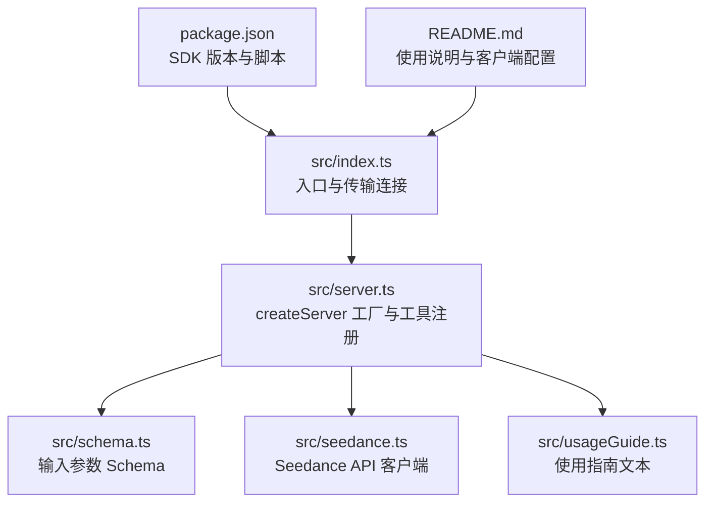
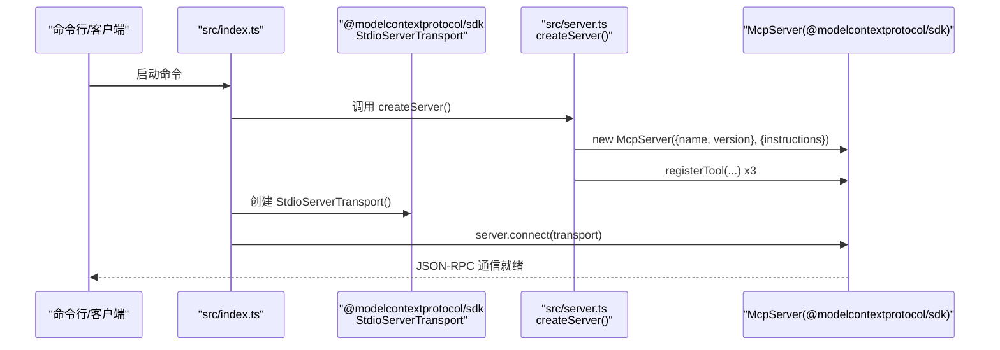
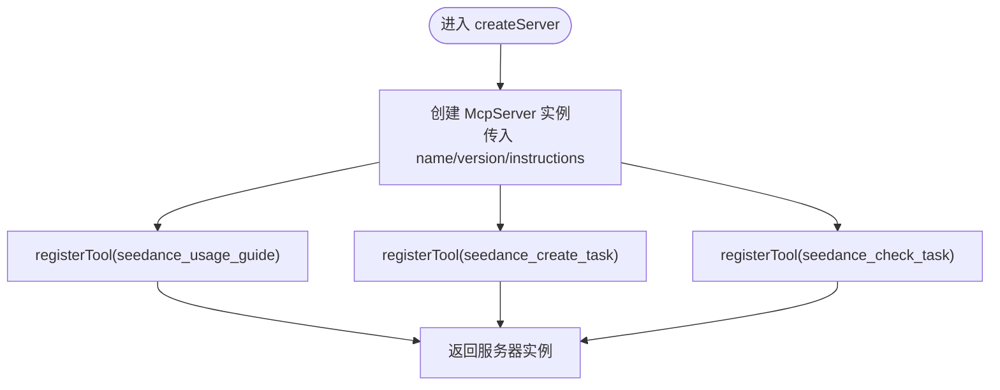
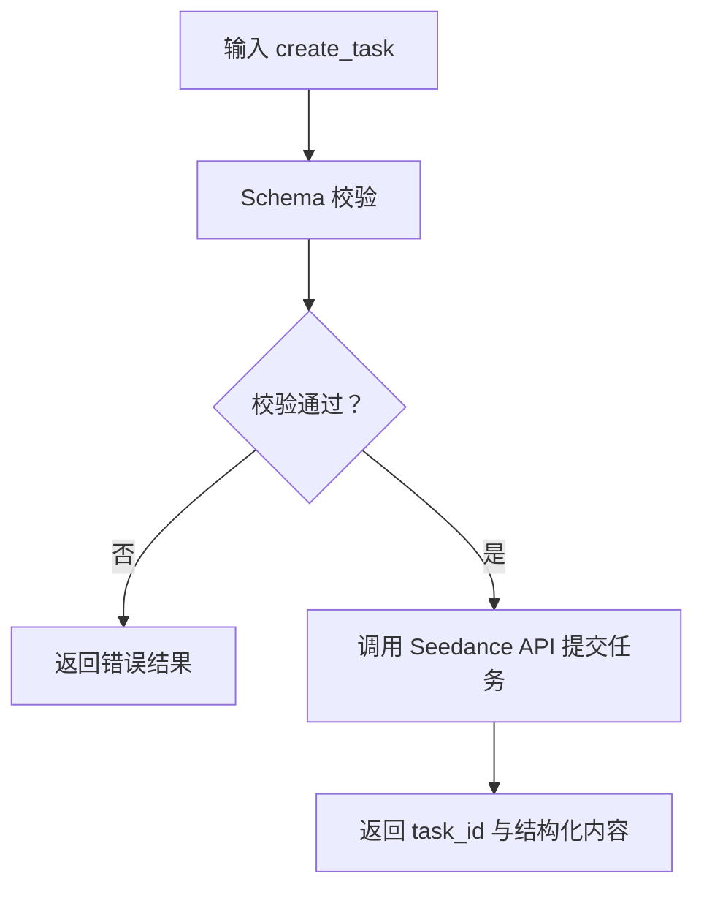
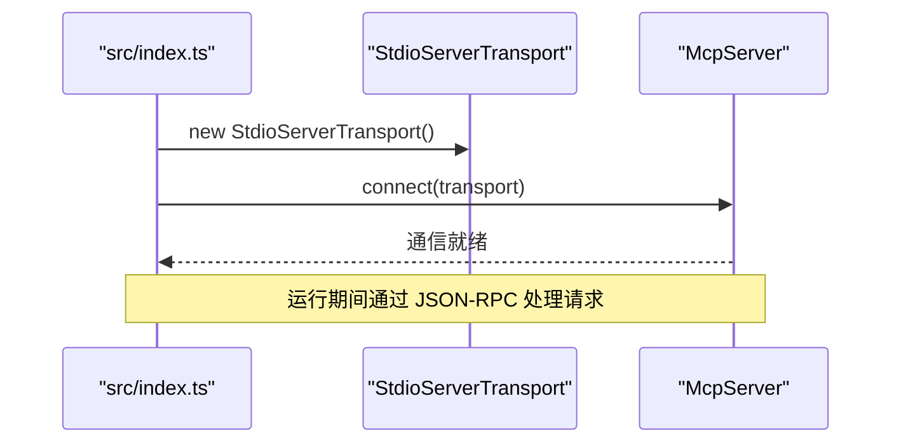
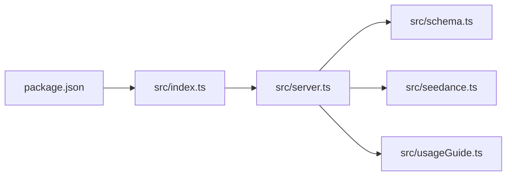

# 服务器初始化与配置

<cite>
**本文引用的文件**
- [src/index.ts](file://src/index.ts)
- [src/server.ts](file://src/server.ts)
- [src/schema.ts](file://src/schema.ts)
- [src/seedance.ts](file://src/seedance.ts)
- [src/usageGuide.ts](file://src/usageGuide.ts)
- [package.json](file://package.json)
- [README.md](file://README.md)
</cite>

## 目录
1. [简介](#简介)
2. [项目结构](#项目结构)
3. [核心组件](#核心组件)
4. [架构总览](#架构总览)
5. [详细组件分析](#详细组件分析)
6. [依赖关系分析](#依赖关系分析)
7. [性能考量](#性能考量)
8. [故障排查指南](#故障排查指南)
9. [结论](#结论)
10. [附录](#附录)

## 简介
本文件聚焦于 MCP 服务器的初始化与配置，围绕 createServer() 工厂函数展开，系统阐述以下主题：
- 服务器实例创建流程与控制流
- 名称与版本信息的来源与用途
- 配置选项 instructions 的含义与作用
- MCP Server 构造函数参数结构（name、version、instructions）
- 生命周期管理与资源清理最佳实践
- 与 MCP SDK 的集成方式与版本兼容性
- 实际示例与扩展建议（以路径引用代替具体代码）

## 项目结构
该项目采用按职责分层的模块化组织：
- 入口脚本负责连接传输层与启动服务器
- 服务器工厂负责注册工具与构造 MCP 服务实例
- Schema 定义输入参数的数据结构与约束
- Seedance API 客户端封装火山方舟 ARK 的 REST 调用
- 使用指南提供标准化的交互说明

图表来源
- [src/index.ts:1-19](file://src/index.ts#L1-L19)
- [src/server.ts:1-215](file://src/server.ts#L1-L215)
- [src/schema.ts:1-141](file://src/schema.ts#L1-L141)
- [src/seedance.ts:1-286](file://src/seedance.ts#L1-L286)
- [src/usageGuide.ts:1-59](file://src/usageGuide.ts#L1-L59)
- [package.json:1-51](file://package.json#L1-L51)

章节来源
- [src/index.ts:1-19](file://src/index.ts#L1-L19)
- [src/server.ts:1-215](file://src/server.ts#L1-L215)
- [src/schema.ts:1-141](file://src/schema.ts#L1-L141)
- [src/seedance.ts:1-286](file://src/seedance.ts#L1-L286)
- [src/usageGuide.ts:1-59](file://src/usageGuide.ts#L1-L59)
- [package.json:1-51](file://package.json#L1-L51)
- [README.md:1-293](file://README.md#L1-L293)

## 核心组件
- createServer 工厂函数：创建并配置 McpServer 实例，注册三个工具，返回服务器对象
- 服务器构造参数：name、version、instructions
- 工具注册：seedance_usage_guide、seedance_create_task、seedance_check_task
- 输入验证与数据建模：基于 zod 的 Schema
- API 客户端：封装火山 ARK 的任务提交与查询接口
- 使用指南：标准化交互说明文本

章节来源
- [src/server.ts:20-177](file://src/server.ts#L20-L177)
- [src/schema.ts:52-140](file://src/schema.ts#L52-L140)
- [src/seedance.ts:149-278](file://src/seedance.ts#L149-L278)
- [src/usageGuide.ts:1-59](file://src/usageGuide.ts#L1-L59)

## 架构总览
下图展示了从入口到服务器实例创建、工具注册以及与 SDK 传输层的交互关系。

图表来源
- [src/index.ts:6-12](file://src/index.ts#L6-L12)
- [src/server.ts:20-30](file://src/server.ts#L20-L30)

章节来源
- [src/index.ts:1-19](file://src/index.ts#L1-L19)
- [src/server.ts:1-215](file://src/server.ts#L1-L215)

## 详细组件分析

### createServer 工厂函数实现原理
- 服务器实例创建
  - 通过 SDK 的 McpServer 构造函数创建实例，传入服务器元信息与 instructions
  - 返回已配置的服务器对象，供入口脚本进行连接
- 名称与版本信息
  - 服务器名称与版本常量来自模块内部导出，便于统一管理与发布
- instructions 的含义与作用
  - 作为服务器的“行为说明”，指导客户端如何正确调用工具
  - 包含标准工作流提示、调用顺序、注意事项等，帮助客户端自动化地与服务器交互
- 工具注册
  - 注册三个工具：使用指南、任务创建、任务查询
  - 每个工具包含标题、描述、输入 Schema、只读/幂等/开放世界注解等
  - 工具实现中包含输入校验、错误处理与结构化结果返回

图表来源
- [src/server.ts:20-177](file://src/server.ts#L20-L177)

章节来源
- [src/server.ts:17-30](file://src/server.ts#L17-L30)
- [src/server.ts:31-47](file://src/server.ts#L31-L47)
- [src/server.ts:49-90](file://src/server.ts#L49-L90)
- [src/server.ts:92-174](file://src/server.ts#L92-L174)

### MCP Server 构造函数参数结构
- 参数一：服务器元信息对象
  - name：服务器名称，用于标识与展示
  - version：服务器版本，用于版本追踪与兼容性提示
- 参数二：服务器配置对象
  - instructions：服务器的行为说明与使用指南，影响客户端的交互策略与自动化行为

章节来源
- [src/server.ts:20-30](file://src/server.ts#L20-L30)
- [src/server.ts:17-18](file://src/server.ts#L17-L18)

### 服务器配置选项：instructions
- 作用
  - 指导客户端在首次调用前先获取使用指南
  - 明确任务创建与轮询检查的标准流程
  - 提醒 URL 过期时间与下载时机
- 设计意图
  - 将“如何使用”的知识内嵌到服务器配置中，降低客户端实现成本
  - 通过标准化说明提升自动化工具的可用性

章节来源
- [src/server.ts:24-28](file://src/server.ts#L24-L28)

### 工具注册与输入验证
- seedance_usage_guide
  - 无输入参数，返回标准化使用指南文本
- seedance_create_task
  - 输入参数由 Schema 定义，包含模型、时长、比例、分辨率、是否生成音频、水印、联网增强、返回末帧、参考媒体等
  - 输入校验确保：
    - 纯文本+音频组合被拒绝
    - 联网增强与参考媒体同时使用被拒绝
  - 结构化返回 task_id 与关键参数
- seedance_check_task
  - 输入为 task_id
  - 返回状态与 URL（视频/末帧），失败原因，以及原始响应

图表来源
- [src/server.ts:179-199](file://src/server.ts#L179-L199)
- [src/seedance.ts:149-194](file://src/seedance.ts#L149-L194)

章节来源
- [src/schema.ts:52-127](file://src/schema.ts#L52-L127)
- [src/schema.ts:132-140](file://src/schema.ts#L132-L140)
- [src/server.ts:179-199](file://src/server.ts#L179-L199)
- [src/seedance.ts:149-194](file://src/seedance.ts#L149-L194)

### 服务器生命周期管理与资源清理
- 连接建立
  - 入口脚本创建 StdioServerTransport 并调用 server.connect() 建立 JSON-RPC 通道
- 日志与输出
  - 标准输出保留为 JSON-RPC 通信通道，错误日志输出到标准错误
- 资源清理
  - 服务器本身不持有外部持久资源；SDK 负责传输层生命周期
  - 如需扩展，应在工具实现中确保异步请求的超时与错误处理，避免泄漏

图表来源
- [src/index.ts:6-12](file://src/index.ts#L6-L12)
- [src/server.ts:20-30](file://src/server.ts#L20-L30)

章节来源
- [src/index.ts:10-18](file://src/index.ts#L10-L18)
- [src/index.ts:6-12](file://src/index.ts#L6-L12)

### 与 MCP SDK 的集成与版本兼容性
- SDK 版本
  - 依赖 @modelcontextprotocol/sdk，版本范围在 package.json 中声明
- 集成方式
  - 使用 StdioServerTransport 作为传输层
  - 通过 McpServer 构造函数与 registerTool 注册工具
- 兼容性建议
  - 保持与 SDK 主版本兼容，升级前进行回归测试
  - 注意 SDK 对 JSON-RPC、工具注册、错误返回等接口的变更

章节来源
- [package.json:26-29](file://package.json#L26-L29)
- [src/index.ts:2](file://src/index.ts#L2)
- [src/server.ts:1](file://src/server.ts#L1)

### 实际示例与扩展建议
- 自定义服务器配置
  - 修改服务器名称与版本常量以匹配发布版本
  - 更新 instructions 以反映新的工作流或限制
- 扩展服务器功能
  - 新增工具：遵循现有 registerTool 模式，定义输入 Schema 与注解
  - 错误处理：统一使用 errorResult 返回结构化错误
  - 输入校验：复用现有 validateCreateTaskInput 的思路，保证一致性

章节来源
- [src/server.ts:17-18](file://src/server.ts#L17-L18)
- [src/server.ts:24-28](file://src/server.ts#L24-L28)
- [src/server.ts:209-214](file://src/server.ts#L209-L214)
- [src/server.ts:179-199](file://src/server.ts#L179-L199)

## 依赖关系分析
- 入口依赖 SDK 传输层与服务器核心
- 服务器依赖 Schema 与 Seedance API 客户端
- Schema 与 Seedance API 客户端相互独立，便于维护与替换

图表来源
- [src/index.ts:1-19](file://src/index.ts#L1-L19)
- [src/server.ts:1-215](file://src/server.ts#L1-L215)
- [src/schema.ts:1-141](file://src/schema.ts#L1-L141)
- [src/seedance.ts:1-286](file://src/seedance.ts#L1-L286)
- [src/usageGuide.ts:1-59](file://src/usageGuide.ts#L1-L59)
- [package.json:1-51](file://package.json#L1-L51)

章节来源
- [src/index.ts:1-19](file://src/index.ts#L1-L19)
- [src/server.ts:1-215](file://src/server.ts#L1-L215)
- [src/schema.ts:1-141](file://src/schema.ts#L1-L141)
- [src/seedance.ts:1-286](file://src/seedance.ts#L1-L286)
- [src/usageGuide.ts:1-59](file://src/usageGuide.ts#L1-L59)
- [package.json:1-51](file://package.json#L1-L51)

## 性能考量
- I/O 密集型
  - 服务器主要依赖网络请求（Seedance API），性能瓶颈在于网络延迟与 API 限流
- 轮询策略
  - 建议在客户端侧采用指数退避与最大重试次数，避免频繁轮询导致的 API 压力
- 数据校验
  - 在服务器端进行严格的输入校验，减少无效请求对上游 API 的压力
- 日志与输出
  - 仅在标准错误输出日志，避免 JSON-RPC 通道被日志污染

## 故障排查指南
- 环境变量缺失
  - ARK_API_KEY 未设置会导致真实 API 调用失败，返回清晰错误信息
- URL 可达性
  - 参考媒体 URL 必须公网可达，否则上游 API 无法拉取
- URL 过期
  - 生成的视频 URL 通常在 24 小时内过期，需及时下载
- 输入校验失败
  - 纯文本+音频或联网增强与参考媒体同时使用会被拒绝，需调整输入
- SDK 版本不兼容
  - 升级 SDK 后需验证工具注册与 JSON-RPC 行为是否一致

章节来源
- [src/seedance.ts:55-64](file://src/seedance.ts#L55-L64)
- [src/seedance.ts:204-206](file://src/seedance.ts#L204-L206)
- [src/seedance.ts:201-278](file://src/seedance.ts#L201-L278)
- [src/server.ts:179-199](file://src/server.ts#L179-L199)
- [README.md:93-106](file://README.md#L93-L106)

## 结论
- createServer 工厂函数以简洁的方式完成服务器实例创建、工具注册与配置注入
- instructions 将“如何使用”的知识内嵌至服务器配置，提升客户端自动化体验
- 通过 Schema 与 API 客户端实现强类型输入与稳健的错误处理
- 与 MCP SDK 的集成稳定可靠，版本升级需关注兼容性
- 建议在生产环境中完善轮询策略、超时与重试机制，确保稳定性与性能平衡

## 附录
- 客户端配置示例与环境变量说明可参考项目 README
- 开发与调试建议：使用 @modelcontextprotocol/inspector 进行 stdio MCP 调试

章节来源
- [README.md:109-150](file://README.md#L109-L150)
- [README.md:253-263](file://README.md#L253-L263)