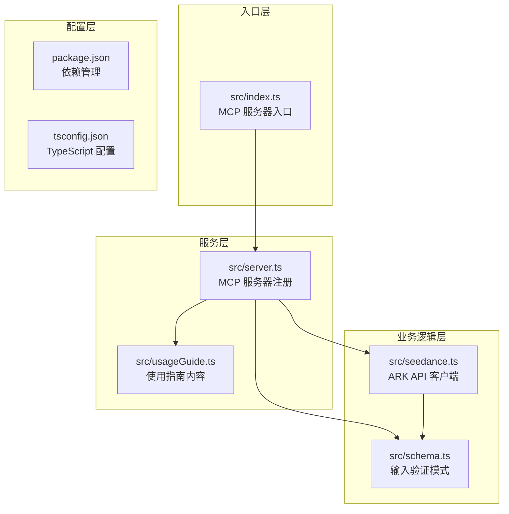
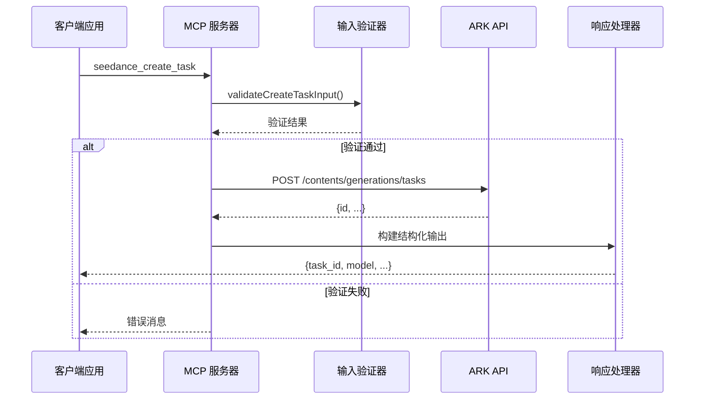
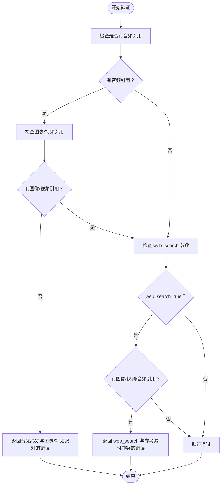
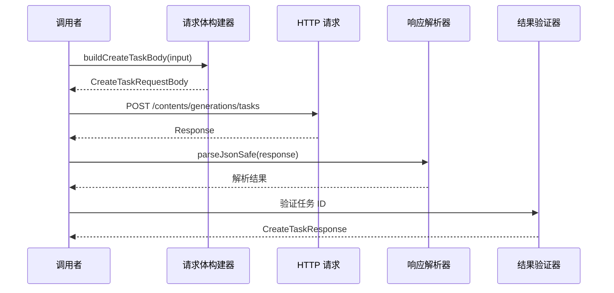
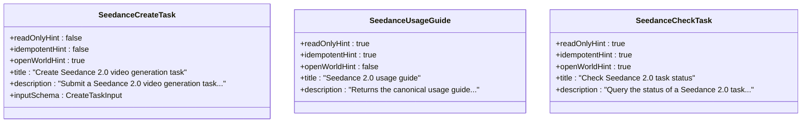

# 任务创建工具 (seedance_create_task)

<cite>
**本文档引用的文件**
- [src/index.ts](file://src/index.ts)
- [src/server.ts](file://src/server.ts)
- [src/seedance.ts](file://src/seedance.ts)
- [src/schema.ts](file://src/schema.ts)
- [src/usageGuide.ts](file://src/usageGuide.ts)
- [README.md](file://README.md)
</cite>

## 目录
1. [简介](#简介)
2. [项目结构](#项目结构)
3. [核心组件](#核心组件)
4. [架构概览](#架构概览)
5. [详细组件分析](#详细组件分析)
6. [依赖关系分析](#依赖关系分析)
7. [性能考虑](#性能考虑)
8. [故障排除指南](#故障排除指南)
9. [结论](#结论)
10. [附录](#附录)

## 简介

任务创建工具 `seedance_create_task` 是一个基于 Model Context Protocol (MCP) 的本地运行工具，用于提交 Seedance 2.0 视频生成任务。该工具通过火山方舟 (Volcengine ARK) API 实现文生视频、图生视频和多模态参考生成功能。

该工具提供了完整的输入参数验证、错误处理机制，以及与 ARK API 的可靠交互。工具采用非幂等设计，确保任务提交的正确性，并提供只读的使用指南工具。

## 项目结构

该项目采用模块化架构，主要包含以下核心文件：



**图表来源**
- [src/index.ts:1-19](file://src/index.ts#L1-L19)
- [src/server.ts:1-215](file://src/server.ts#L1-L215)
- [src/seedance.ts:1-286](file://src/seedance.ts#L1-L286)
- [src/schema.ts:1-141](file://src/schema.ts#L1-L141)

**章节来源**
- [src/index.ts:1-19](file://src/index.ts#L1-L19)
- [src/server.ts:20-60](file://src/server.ts#L20-L60)
- [README.md:267-283](file://README.md#L267-L283)

## 核心组件

### 1. MCP 服务器架构

MCP 服务器采用工厂模式创建，注册三个核心工具：
- `seedance_usage_guide` - 使用指南工具（只读、幂等）
- `seedance_create_task` - 任务创建工具（非幂等、可写）
- `seedance_check_task` - 任务状态查询工具（只读、幂等）

### 2. 输入验证系统

使用 Zod 库实现强类型输入验证，支持：
- 枚举值验证（模型、比例、分辨率）
- 数值范围验证（持续时间 4-15 秒）
- 数组长度限制（最多 9 张图片、3 个视频、3 个音频）
- 条件验证规则（音频必须与图像或视频配对）

### 3. ARK API 客户端

封装了完整的 ARK API 交互逻辑：
- 动态 API 密钥和基础 URL 解析
- 请求体构建和响应解析
- 错误处理和重试机制
- 任务状态查询功能

**章节来源**
- [src/server.ts:17-60](file://src/server.ts#L17-L60)
- [src/schema.ts:52-127](file://src/schema.ts#L52-L127)
- [src/seedance.ts:149-194](file://src/seedance.ts#L149-L194)

## 架构概览



**图表来源**
- [src/server.ts:62-89](file://src/server.ts#L62-L89)
- [src/seedance.ts:149-194](file://src/seedance.ts#L149-L194)
- [src/server.ts:179-199](file://src/server.ts#L179-L199)

## 详细组件分析

### 输入验证器 (validateCreateTaskInput)

输入验证器实现了严格的业务规则检查：



**图表来源**
- [src/server.ts:179-199](file://src/server.ts#L179-L199)

#### 验证规则详解

1. **音频引用配对规则**
   - 纯音频输入被严格禁止
   - 音频必须与至少一张图像或一个视频配对
   - 违反此规则会返回明确的错误消息

2. **web_search 参数限制**
   - 当启用网络搜索增强时，不允许任何参考素材
   - 纯文本输入是唯一允许的组合
   - 这确保了网络搜索的有效性和安全性

3. **参数范围验证**
   - 持续时间必须在 4-15 秒之间（包含边界）
   - 图像数量最多 9 张，视频最多 3 个，音频最多 3 个
   - 模型、比例、分辨率必须在预定义枚举中

**章节来源**
- [src/server.ts:179-199](file://src/server.ts#L179-L199)
- [src/schema.ts:52-127](file://src/schema.ts#L52-L127)

### 任务创建函数 (createSeedanceTask)

任务创建函数负责与 ARK API 的实际交互：



**图表来源**
- [src/seedance.ts:102-114](file://src/seedance.ts#L102-L114)
- [src/seedance.ts:149-194](file://src/seedance.ts#L149-L194)

#### 关键处理步骤

1. **环境变量处理**
   - 从 `ARK_API_KEY` 获取认证密钥
   - 支持自定义 `ARK_BASE_URL` 覆盖默认基础 URL
   - 提供详细的错误提示当密钥缺失时

2. **请求体构建**
   - 将输入参数转换为 ARK API 格式
   - 处理内容数组（文本、图像、视频、音频）
   - 条件包含工具配置（web_search）

3. **API 调用和响应处理**
   - 发送 POST 请求到 `/contents/generations/tasks`
   - 解析 JSON 响应，处理非 JSON 情况
   - 验证响应包含有效的任务 ID

4. **错误处理机制**
   - HTTP 状态码异常时抛出 `SeedanceApiError`
   - 响应格式验证失败时提供清晰的错误信息
   - 保持原始响应以便调试和透明度

**章节来源**
- [src/seedance.ts:55-72](file://src/seedance.ts#L55-L72)
- [src/seedance.ts:102-114](file://src/seedance.ts#L102-L114)
- [src/seedance.ts:149-194](file://src/seedance.ts#L149-L194)

### 结构化输出格式

工具返回标准化的结构化输出，包含：

| 字段名 | 类型 | 描述 | 示例值 |
|--------|------|------|--------|
| `task_id` | string | 任务唯一标识符 | `"cgt-2026xxxx-xxxxxx"` |
| `model` | enum | 使用的模型标识 | `"doubao-seedance-2-0-260128"` |
| `duration` | number | 视频时长（秒） | `5` |
| `ratio` | enum | 视频宽高比 | `"16:9"` |
| `resolution` | enum | 输出分辨率 | `"720p"` |
| `raw` | object | 原始 API 响应 | `{id, status, ...}` |

**章节来源**
- [src/server.ts:77-84](file://src/server.ts#L77-L84)
- [src/seedance.ts:25-29](file://src/seedance.ts#L25-L29)

### 工具注解和特性



**图表来源**
- [src/server.ts:49-61](file://src/server.ts#L49-L61)
- [src/server.ts:92-104](file://src/server.ts#L92-L104)
- [src/server.ts:31-47](file://src/server.ts#L31-L47)

#### 特性说明

- **非幂等性 (`idempotentHint: false`)**: 任务创建不是幂等操作，重复调用可能产生多个任务
- **可写性 (`readOnlyHint: false`)**: 该工具会创建新的资源，具有写入副作用
- **开放世界 (`openWorldHint: true`)**: 工具可以访问外部世界（网络 API 调用）

**章节来源**
- [src/server.ts:56-60](file://src/server.ts#L56-L60)
- [src/server.ts:99-103](file://src/server.ts#L99-L103)
- [src/server.ts:38-42](file://src/server.ts#L38-L42)

## 依赖关系分析

```mermaid
graph LR
subgraph "外部依赖"
A[@modelcontextprotocol/sdk]
B[zod]
C[node-fetch]
end
subgraph "内部模块"
D[index.ts]
E[server.ts]
F[seedance.ts]
G[schema.ts]
H[usageGuide.ts]
end
D --> E
E --> F
E --> G
E --> H
F --> G
G --> B
E -.-> A
F -.-> C
```

**图表来源**
- [src/index.ts:2](file://src/index.ts#L2)
- [src/server.ts:1-15](file://src/server.ts#L1-L15)
- [src/seedance.ts:1](file://src/seedance.ts#L1)
- [src/schema.ts:1](file://src/schema.ts#L1)

### 核心依赖说明

1. **MCP SDK**: 提供协议实现和服务器框架
2. **Zod**: 实现类型安全的输入验证
3. **Node Fetch**: 处理 HTTP 请求和响应
4. **TypeScript**: 提供编译时类型检查

**章节来源**
- [src/server.ts:1-15](file://src/server.ts#L1-L15)
- [src/seedance.ts:1](file://src/seedance.ts#L1)
- [src/schema.ts:1](file://src/schema.ts#L1)

## 性能考虑

### 1. API 调用优化

- **连接复用**: 使用 Node.js 内置的 HTTP/HTTPS 连接池
- **超时控制**: 建议在客户端实现合理的超时策略
- **重试机制**: 对临时性错误实现指数退避重试

### 2. 内存管理

- **流式处理**: 响应解析采用流式方式处理大响应
- **对象池**: 避免频繁创建临时对象
- **垃圾回收**: 及时清理不再使用的变量引用

### 3. 并发控制

- **队列管理**: 实现任务队列避免 API 限流
- **速率限制**: 遵循 ARK API 的速率限制
- **背压处理**: 实现适当的背压机制

## 故障排除指南

### 常见错误及解决方案

#### 1. 认证错误

**问题**: `Missing ARK_API_KEY environment variable`
**原因**: 环境变量未正确设置
**解决方案**: 
- 在 MCP 客户端配置中设置 `ARK_API_KEY`
- 确保 API Key 来自火山引擎控制台
- 避免将 API Key 提交到版本控制系统

#### 2. 输入验证错误

**问题**: 音频必须与图像/视频配对
**原因**: 纯音频输入被拒绝
**解决方案**:
- 添加至少一张图像或一个视频作为参考
- 或者移除音频引用

**问题**: web_search 与参考素材冲突
**原因**: 网络搜索增强与参考素材同时使用
**解决方案**:
- 移除所有参考素材或禁用 web_search

#### 3. API 响应错误

**问题**: ARK API 请求失败
**原因**: 网络问题或 API 限流
**解决方案**:
- 检查网络连接
- 实现指数退避重试
- 查看原始响应中的详细错误信息

#### 4. URL 有效性问题

**问题**: 生成的视频链接过期
**原因**: ARK 签名 URL 默认 24 小时有效期
**解决方案**:
- 在任务成功后立即下载视频
- 实现自动下载机制
- 设置合适的过期时间提醒

**章节来源**
- [src/seedance.ts:55-64](file://src/seedance.ts#L55-L64)
- [src/server.ts:179-199](file://src/server.ts#L179-L199)
- [src/seedance.ts:167-191](file://src/seedance.ts#L167-L191)

### 调试技巧

1. **启用详细日志**: 在客户端配置中启用 MCP 日志
2. **检查原始响应**: 利用 `raw` 字段查看完整的 API 响应
3. **验证 URL 可达性**: 确保所有参考媒体 URL 可公开访问
4. **测试环境变量**: 使用简单的 curl 命令验证 API Key 有效性

## 结论

`seedance_create_task` 工具提供了一个健壮、类型安全且用户友好的接口来创建 Seedance 2.0 视频生成任务。其设计特点包括：

- **强类型验证**: 使用 Zod 实现全面的输入验证
- **清晰的错误处理**: 提供具体的错误信息和解决方案
- **透明的 API 交互**: 保持原始响应以便调试
- **符合 MCP 标准**: 正确实现工具注解和特性标记

该工具适合集成到各种 MCP 客户端中，为用户提供本地化的视频生成能力，同时保持与火山引擎 ARK API 的兼容性和可靠性。

## 附录

### 调用示例

#### 基础文本生成
```json
{
  "prompt": "一个美丽的日落场景",
  "model": "doubao-seedance-2-0-260128",
  "duration": 5,
  "ratio": "16:9",
  "resolution": "720p"
}
```

#### 图像参考生成
```json
{
  "prompt": "基于图像生成动画场景",
  "image_urls": [
    {"url": "https://example.com/image1.jpg", "role": "reference_image"},
    {"url": "https://example.com/image2.jpg", "role": "first_frame"}
  ],
  "duration": 8,
  "ratio": "9:16"
}
```

#### 网络搜索增强
```json
{
  "prompt": "最新的科技新闻摘要",
  "web_search": true,
  "duration": 5,
  "ratio": "16:9"
}
```

### 环境变量配置

| 变量名 | 必需性 | 默认值 | 说明 |
|--------|--------|--------|------|
| `ARK_API_KEY` | 必需 | 无 | 火山引擎 API 密钥 |
| `ARK_BASE_URL` | 可选 | `https://ark.cn-beijing.volces.com/api/v3` | API 基础 URL 覆盖 |

### 模型选择指南

| 模型标识 | 特点 | 适用场景 |
|----------|------|----------|
| `doubao-seedance-2-0-260128` | 标准质量 | 高质量视频生成 |
| `doubao-seedance-2-0-fast-260128` | 快速便宜 | 低延迟需求 |