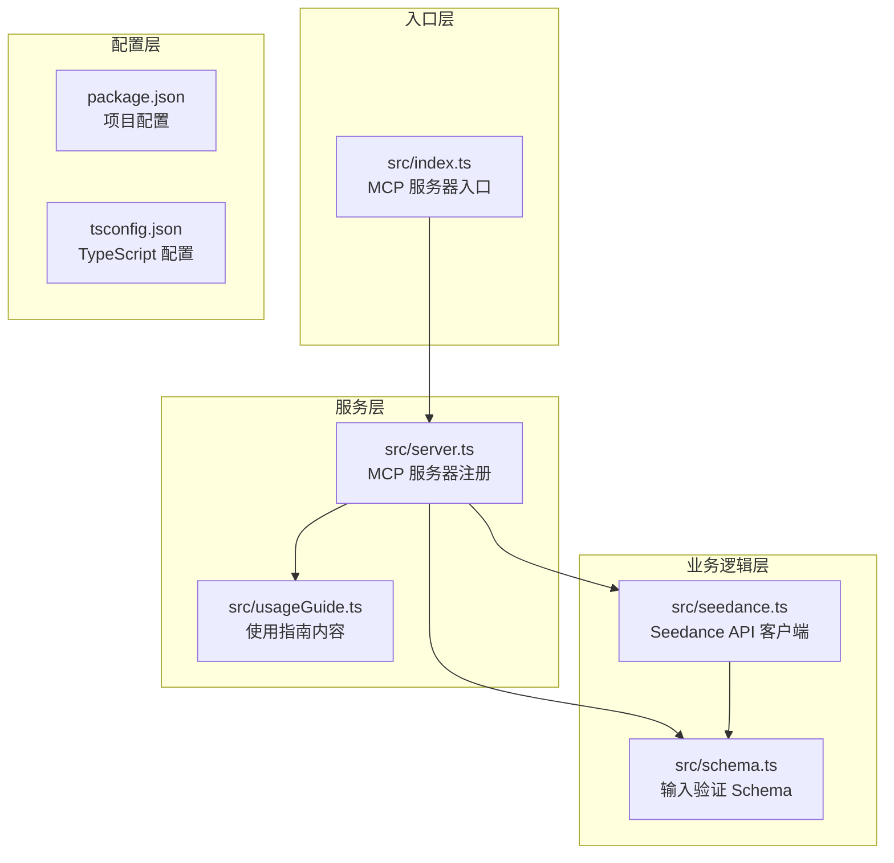
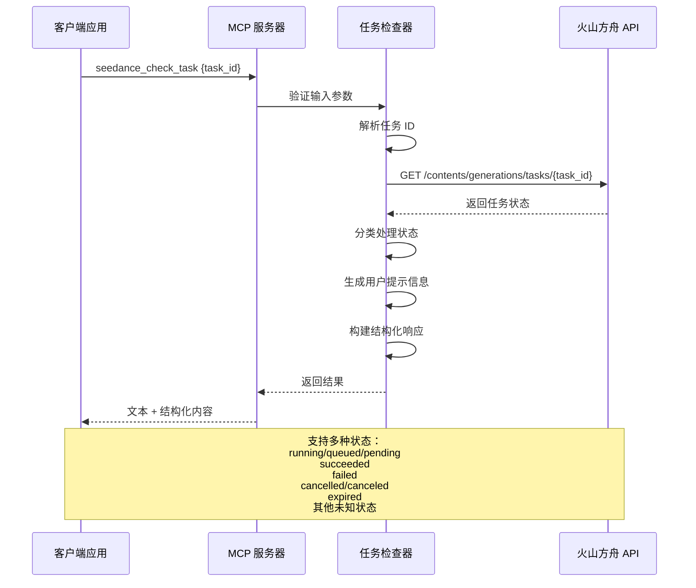
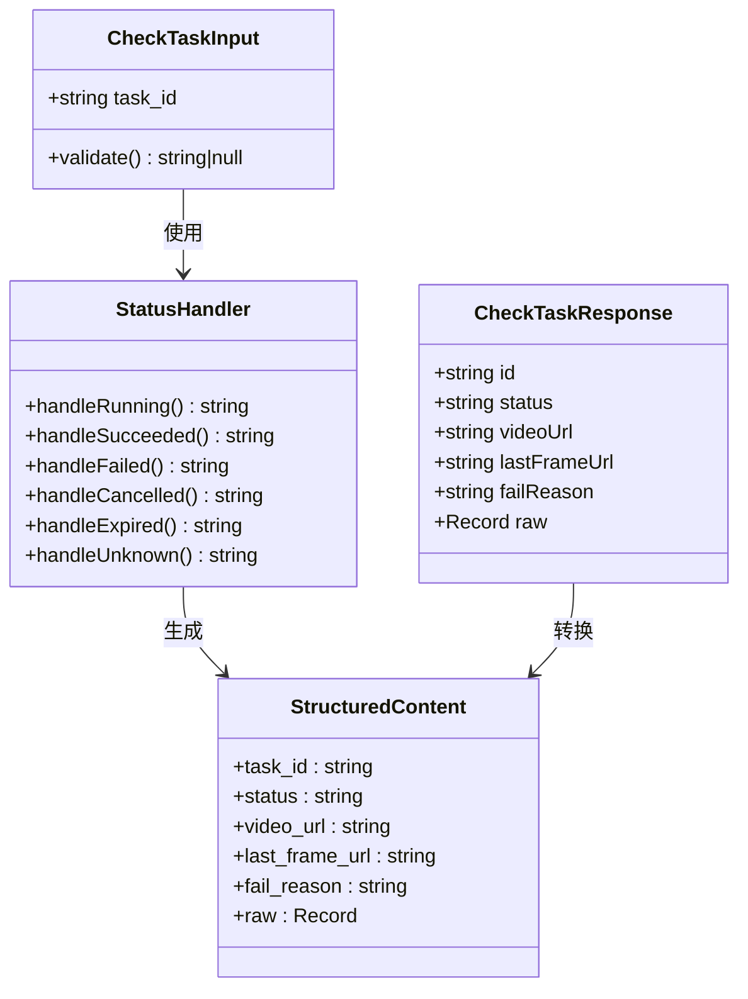
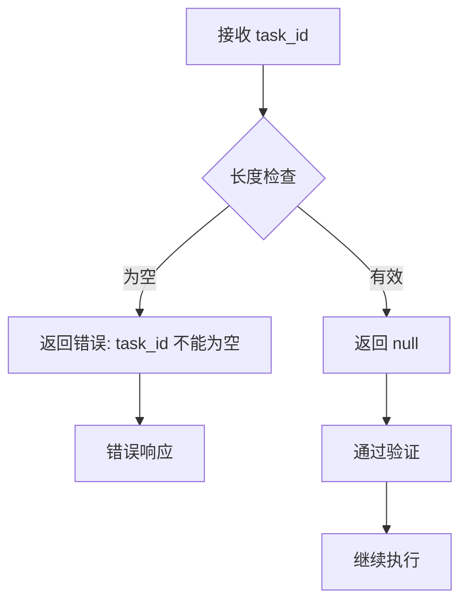
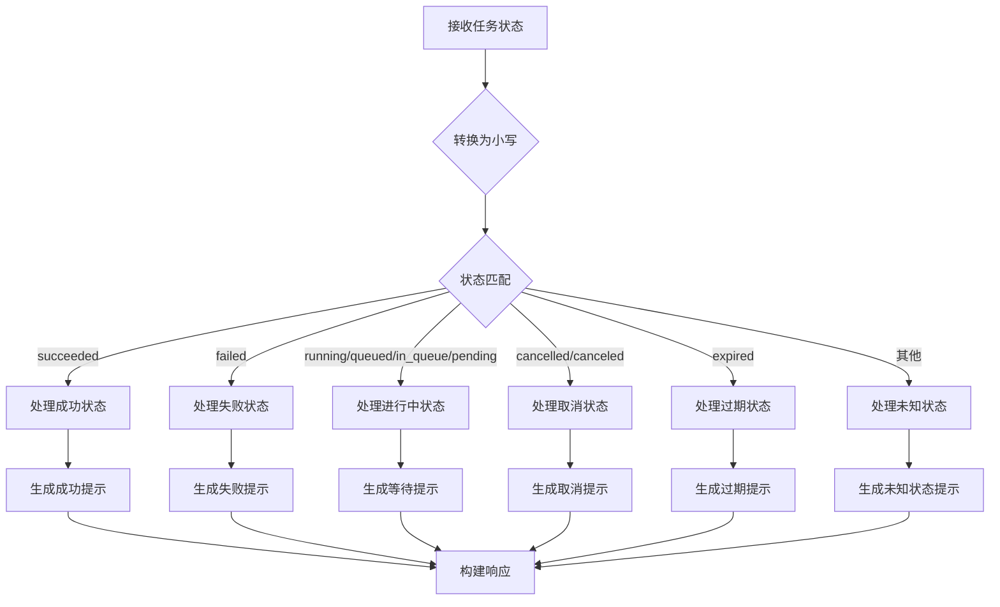
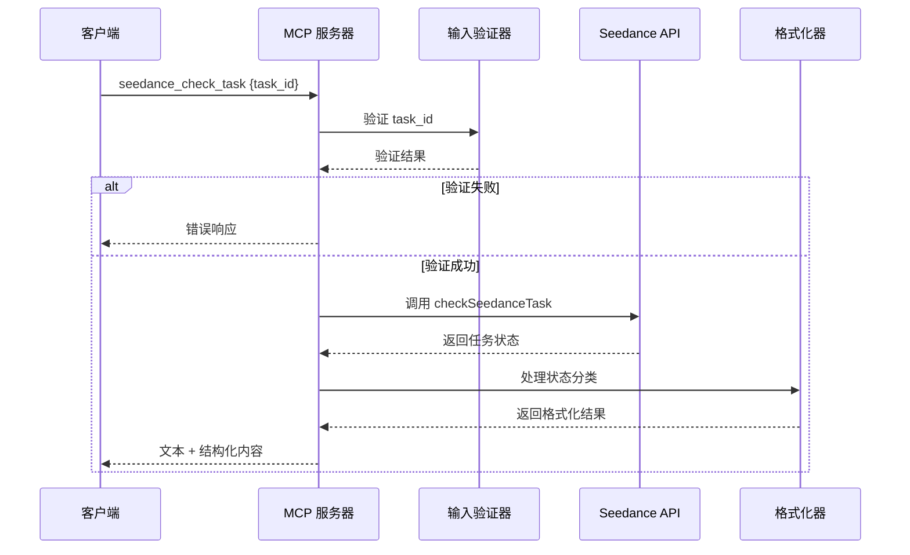
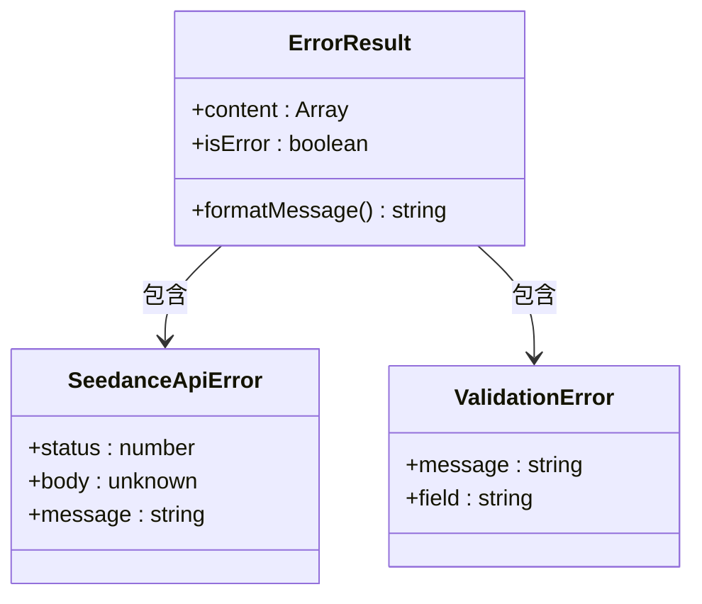

# 任务状态查询工具 (seedance_check_task)

<cite>
**本文档引用的文件**
- [src/index.ts](file://src/index.ts)
- [src/server.ts](file://src/server.ts)
- [src/seedance.ts](file://src/seedance.ts)
- [src/schema.ts](file://src/schema.ts)
- [src/usageGuide.ts](file://src/usageGuide.ts)
- [README.md](file://README.md)
</cite>

## 目录
1. [简介](#简介)
2. [项目结构](#项目结构)
3. [核心组件](#核心组件)
4. [架构概览](#架构概览)
5. [详细组件分析](#详细组件分析)
6. [状态处理逻辑](#状态处理逻辑)
7. [数据流分析](#数据流分析)
8. [错误处理策略](#错误处理策略)
9. [性能考虑](#性能考虑)
10. [故障排除指南](#故障排除指南)
11. [结论](#结论)

## 简介

任务状态查询工具 (`seedance_check_task`) 是一个基于 Model Context Protocol (MCP) 的本地工具，专门用于查询火山方舟 (Volcengine ARK) Seedance 2.0 视频生成任务的状态。该工具提供了对各种任务状态的智能分类处理，包括成功、失败、进行中、已取消、已过期等状态，并为每种状态提供相应的用户提示信息和结构化输出内容。

该工具的核心功能是通过调用 `checkSeedanceTask` 函数来查询任务状态，并根据不同的状态返回相应的响应格式和提示信息。工具设计遵循 MCP 协议规范，支持标准的 JSON-RPC 通信模式。

## 项目结构

该项目采用模块化的 TypeScript 架构，主要包含以下核心文件：

**图表来源**
- [src/index.ts:1-19](file://src/index.ts#L1-L19)
- [src/server.ts:1-215](file://src/server.ts#L1-L215)
- [src/seedance.ts:1-286](file://src/seedance.ts#L1-L286)
- [src/schema.ts:1-141](file://src/schema.ts#L1-L141)

**章节来源**
- [src/index.ts:1-19](file://src/index.ts#L1-L19)
- [src/server.ts:20-29](file://src/server.ts#L20-L29)
- [README.md:267-283](file://README.md#L267-L283)

## 核心组件

### MCP 服务器组件

MCP 服务器是整个系统的入口点，负责注册和管理三个核心工具：

- **seedance_usage_guide**: 提供完整的使用指南
- **seedance_create_task**: 创建视频生成任务
- **seedance_check_task**: 查询任务状态

每个工具都具有特定的输入验证、错误处理和响应格式化逻辑。

### Seedance API 客户端

封装了与火山方舟 API 的交互，包括：
- 任务创建和状态查询
- 错误处理和重试机制
- API 密钥管理和基础 URL 配置

### 数据验证层

使用 Zod 库实现严格的输入验证，确保所有用户输入都符合预期格式和约束条件。

**章节来源**
- [src/server.ts:31-177](file://src/server.ts#L31-L177)
- [src/seedance.ts:149-278](file://src/seedance.ts#L149-L278)
- [src/schema.ts:52-141](file://src/schema.ts#L52-L141)

## 架构概览

**图表来源**
- [src/server.ts:92-174](file://src/server.ts#L92-L174)
- [src/seedance.ts:201-278](file://src/seedance.ts#L201-L278)

## 详细组件分析

### seedance_check_task 工具实现

该工具实现了完整的任务状态查询功能，包括输入验证、状态分类处理和响应格式化。

**图表来源**
- [src/server.ts:92-174](file://src/server.ts#L92-L174)
- [src/schema.ts:132-141](file://src/schema.ts#L132-L141)
- [src/seedance.ts:35-42](file://src/seedance.ts#L35-L42)

### 输入验证机制

工具使用 Zod Schema 进行严格的输入验证：

**图表来源**
- [src/schema.ts:132-137](file://src/schema.ts#L132-L137)

**章节来源**
- [src/server.ts:92-174](file://src/server.ts#L92-L174)
- [src/schema.ts:132-141](file://src/schema.ts#L132-L141)

## 状态处理逻辑

### 状态分类体系

工具支持以下状态分类，每种状态都有特定的处理逻辑和用户提示：

#### 成功状态 (succeeded)
- **响应格式**: 返回任务成功信息和视频 URL
- **提示信息**: 显示任务 ID、视频 URL、可选的末帧 URL
- **结构化输出**: 包含 task_id、status、video_url、last_frame_url、raw
- **特殊提醒**: 提醒用户视频 URL 通常在 24 小时内过期

#### 失败状态 (failed)
- **响应格式**: 返回任务失败信息和失败原因
- **提示信息**: 显示任务 ID 和失败原因（如有）
- **结构化输出**: 包含 task_id、status、fail_reason、raw

#### 进行中状态 (running/queued/in_queue/pending)
- **响应格式**: 返回任务仍在处理中的信息
- **提示信息**: 建议等待 30-90 秒后再次查询
- **结构化输出**: 包含 task_id、status、raw

#### 取消状态 (cancelled/canceled)
- **响应格式**: 返回任务已取消的信息
- **提示信息**: 显示任务 ID 和取消状态
- **结构化输出**: 包含 task_id、status、raw

#### 过期状态 (expired)
- **响应格式**: 返回任务已过期的信息
- **提示信息**: 建议重新提交任务
- **结构化输出**: 包含 task_id、status、raw

#### 未知状态
- **响应格式**: 返回原始状态信息
- **提示信息**: 指出这不是标准状态，建议查看结构化响应
- **结构化输出**: 包含所有原始响应数据

### 状态处理流程图

**图表来源**
- [src/server.ts:105-173](file://src/server.ts#L105-L173)

**章节来源**
- [src/server.ts:111-157](file://src/server.ts#L111-L157)

## 数据流分析

### 请求处理流程

**图表来源**
- [src/server.ts:105-173](file://src/server.ts#L105-L173)
- [src/seedance.ts:201-278](file://src/seedance.ts#L201-L278)

### 响应结构分析

每个响应都包含两个主要部分：

#### 文本内容 (content)
- **类型**: `[{ type: "text", text: string }]`
- **用途**: 人类可读的提示信息和状态说明
- **内容**: 根据状态类型生成的相应提示

#### 结构化内容 (structuredContent)
- **类型**: `CallToolResult['structuredContent']`
- **用途**: 机器可读的数据，便于程序处理
- **字段**: 包含任务 ID、状态、URL、原因等关键信息

**章节来源**
- [src/server.ts:159-169](file://src/server.ts#L159-L169)

## 错误处理策略

### 错误分类和处理

工具实现了多层次的错误处理策略：

#### API 错误处理
- **SeedanceApiError**: 专门处理火山方舟 API 错误
- **HTTP 状态码**: 保留原始 HTTP 状态码用于诊断
- **错误消息提取**: 从 API 响应中提取有意义的错误信息

#### 输入验证错误
- **Zod Schema 验证**: 使用 Zod 进行严格的数据类型验证
- **自定义验证规则**: 针对特定业务规则的验证
- **错误消息格式化**: 提供清晰的错误描述

#### 环境变量错误
- **API Key 缺失**: 检测并报告缺失的 ARK_API_KEY
- **基础 URL 配置**: 支持自定义基础 URL 的配置

### 错误响应格式

**图表来源**
- [src/server.ts:201-214](file://src/server.ts#L201-L214)
- [src/seedance.ts:44-53](file://src/seedance.ts#L44-L53)

**章节来源**
- [src/server.ts:201-214](file://src/server.ts#L201-L214)
- [src/seedance.ts:167-191](file://src/seedance.ts#L167-L191)

## 性能考虑

### 轮询策略优化

- **等待时间**: 建议 30-90 秒的轮询间隔，平衡响应速度和 API 负载
- **状态缓存**: 对于频繁查询的场景，可以考虑本地缓存最近的状态
- **并发控制**: 避免过度并发的轮询请求

### API 调用优化

- **连接复用**: 使用持久连接减少握手开销
- **错误重试**: 实现指数退避的重试机制
- **超时控制**: 设置合理的超时时间避免长时间阻塞

### 内存管理

- **响应清理**: 及时清理不再使用的响应数据
- **流式处理**: 对大文件 URL 可以考虑流式处理策略

## 故障排除指南

### 常见问题诊断

#### 任务状态查询失败
1. **检查网络连接**: 确保能够访问火山方舟 API
2. **验证 API Key**: 确认 ARK_API_KEY 配置正确
3. **检查任务 ID**: 确认 task_id 格式正确且未过期

#### 状态显示异常
1. **查看原始响应**: 检查 structuredContent 中的 raw 字段
2. **确认状态字符串**: 注意大小写转换的影响
3. **检查 API 版本**: 确认使用的 API 版本支持该状态

#### URL 过期问题
1. **及时下载**: 任务成功后立即下载生成的视频
2. **检查过期时间**: 通常为 24 小时
3. **重新查询**: 如需重新下载，重新提交任务

### 调试技巧

- **启用详细日志**: 在开发环境中启用详细的 API 调用日志
- **使用 Inspector**: 利用 MCP Inspector 工具调试通信问题
- **检查环境变量**: 确认所有必要的环境变量都已正确设置

**章节来源**
- [README.md:233-240](file://README.md#L233-L240)
- [src/server.ts:201-214](file://src/server.ts#L201-L214)

## 结论

seedance_check_task 工具提供了一个完整、健壮的任务状态查询解决方案。其设计特点包括：

- **全面的状态支持**: 支持所有标准和非标准的任务状态
- **友好的用户界面**: 提供清晰的提示信息和结构化输出
- **强大的错误处理**: 实现多层次的错误检测和处理机制
- **灵活的配置选项**: 支持自定义基础 URL 和 API 密钥配置
- **严格的输入验证**: 使用 Zod 确保数据的完整性和正确性

该工具为视频生成任务的状态监控提供了可靠的基础，特别适合集成到各种 AI 助手和自动化工作流中。通过合理的轮询策略和错误处理，用户可以获得流畅的任务管理体验。