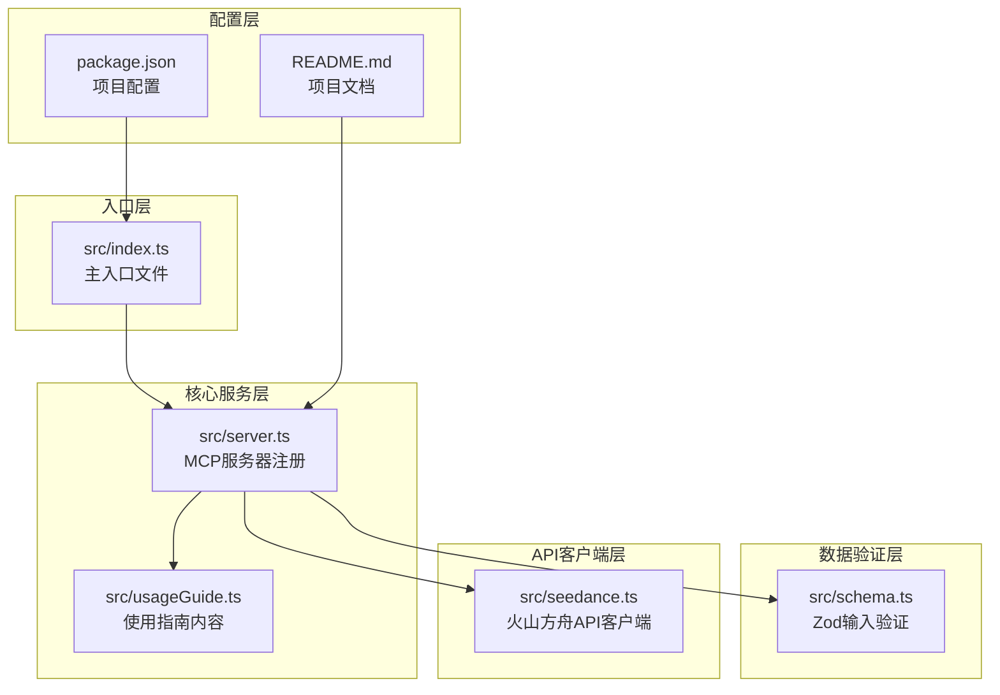
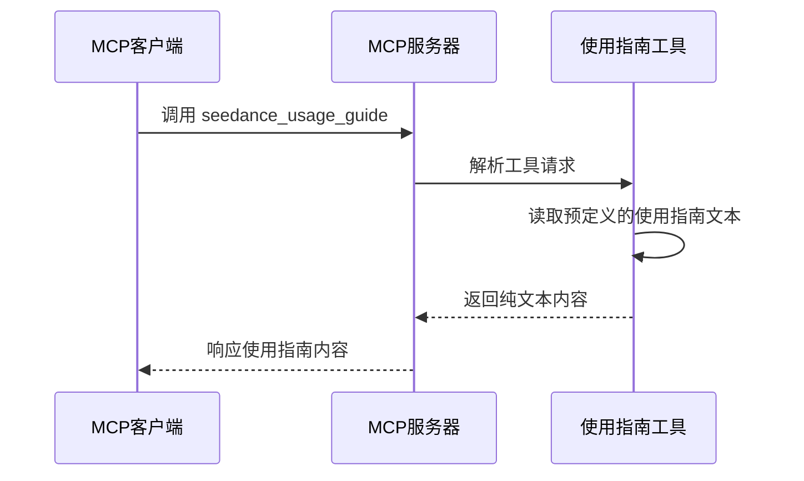
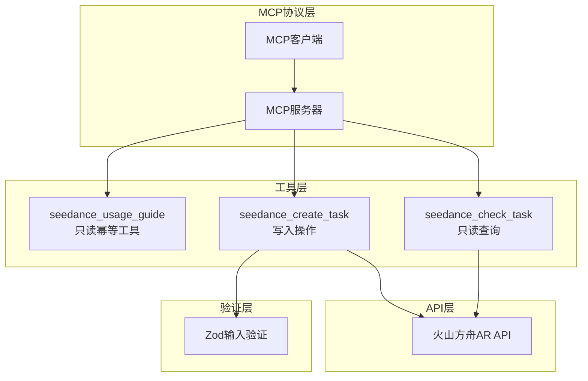
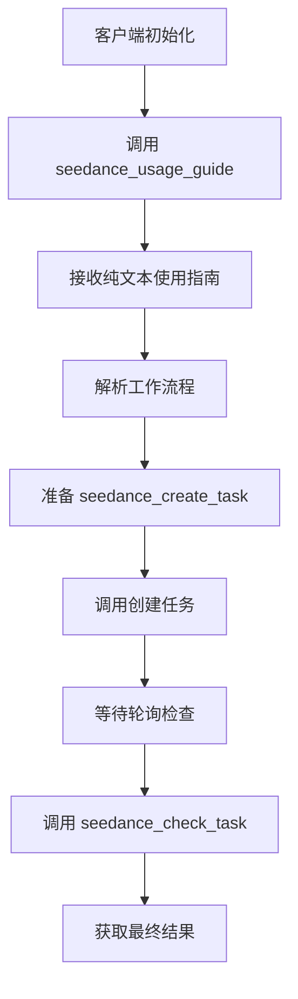

# 使用指南工具 (seedance_usage_guide)

<cite>
**本文档引用的文件**
- [src/index.ts](file://src/index.ts)
- [src/server.ts](file://src/server.ts)
- [src/usageGuide.ts](file://src/usageGuide.ts)
- [src/schema.ts](file://src/schema.ts)
- [src/seedance.ts](file://src/seedance.ts)
- [README.md](file://README.md)
- [package.json](file://package.json)
</cite>

## 目录
1. [简介](#简介)
2. [项目结构](#项目结构)
3. [核心组件](#核心组件)
4. [架构概览](#架构概览)
5. [详细组件分析](#详细组件分析)
6. [依赖关系分析](#依赖关系分析)
7. [性能考虑](#性能考虑)
8. [故障排除指南](#故障排除指南)
9. [结论](#结论)
10. [附录](#附录)

## 简介

seedance_usage_guide 是一个专门设计的 MCP 工具，用于返回完整的 Seedance 2.0 视频生成服务使用指南。该工具具有只读、幂等的设计特性，确保用户能够安全地获取使用说明而不会对系统状态产生任何影响。

该工具返回纯文本格式的完整使用指南，包含标准工作流程、模型选择、参数参考和重要注意事项。作为 MCP 客户端的第一个调用，它为后续的任务创建和状态检查提供了必要的上下文信息。

## 项目结构

该项目采用模块化架构，主要文件组织如下：



**图表来源**
- [src/index.ts:1-19](file://src/index.ts#L1-L19)
- [src/server.ts:1-215](file://src/server.ts#L1-L215)
- [src/usageGuide.ts:1-59](file://src/usageGuide.ts#L1-L59)
- [src/schema.ts:1-141](file://src/schema.ts#L1-L141)
- [src/seedance.ts:1-286](file://src/seedance.ts#L1-L286)
- [package.json:1-51](file://package.json#L1-L51)

**章节来源**
- [src/index.ts:1-19](file://src/index.ts#L1-L19)
- [src/server.ts:20-29](file://src/server.ts#L20-L29)
- [package.json:1-51](file://package.json#L1-L51)

## 核心组件

### 使用指南工具定义

seedance_usage_guide 工具在服务器中通过以下配置进行注册：

- **工具名称**: `seedance_usage_guide`
- **标题**: "Seedance 2.0 usage guide"
- **描述**: 返回 Seedance 2.0 MCP 的规范使用指南：标准创建 -> 等待 -> 检查工作流程、模型选择、参数参考和重要注意事项
- **输入模式**: 空对象 `{}` - 无参数需求
- **输出格式**: 纯文本内容
- **注解配置**: 
  - `readOnlyHint: true` - 只读操作
  - `idempotentHint: true` - 幂等操作
  - `openWorldHint: false` - 不涉及外部世界交互

### 工具实现细节

工具的核心实现位于服务器注册函数中，采用简洁的异步函数模式：



**图表来源**
- [src/server.ts:31-47](file://src/server.ts#L31-L47)
- [src/usageGuide.ts:1-59](file://src/usageGuide.ts#L1-L59)

**章节来源**
- [src/server.ts:31-47](file://src/server.ts#L31-L47)
- [src/usageGuide.ts:1-59](file://src/usageGuide.ts#L1-L59)

## 架构概览

### 整体架构设计



**图表来源**
- [src/server.ts:20-177](file://src/server.ts#L20-L177)
- [src/schema.ts:52-141](file://src/schema.ts#L52-L141)
- [src/seedance.ts:149-278](file://src/seedance.ts#L149-L278)

### 工具调用流程

```mermaid
sequenceDiagram
participant User as 用户
participant Client as MCP客户端
participant Guide as 使用指南工具
participant Create as 创建任务工具
participant Check as 检查任务工具
participant API as 火山方舟API
User->>Client : 请求生成视频
Client->>Guide : 调用 seedance_usage_guide
Guide-->>Client : 返回使用指南
Client->>Create : 调用 seedance_create_task
Create->>API : 提交生成任务
API-->>Create : 返回 task_id
Create-->>Client : 返回任务ID
loop 轮询检查
Client->>Check : 调用 seedance_check_task
Check->>API : 查询任务状态
API-->>Check : 返回状态信息
Check-->>Client : 返回状态结果
end
```

**图表来源**
- [src/server.ts:31-47](file://src/server.ts#L31-L47)
- [src/server.ts:49-90](file://src/server.ts#L49-L90)
- [src/server.ts:92-174](file://src/server.ts#L92-L174)

## 详细组件分析

### 使用指南内容结构

使用指南工具返回的完整内容包含以下关键部分：

#### 标准工作流程
- **步骤1**: 调用 `seedance_create_task` 提交任务
- **步骤2**: 等待 30-90 秒
- **步骤3**: 调用 `seedance_check_task` 查询状态
- **步骤4**: 重复步骤3直到状态为 `succeeded` 或 `failed`
- **步骤5**: 下载生成的视频URL

#### 模型选择
- **标准模型**: `doubao-seedance-2-0-260128` - 最高质量
- **快速模型**: `doubao-seedance-2-0-fast-260128` - 更快更便宜但质量较低

#### 参数参考
工具支持丰富的参数配置，包括：
- **基础参数**: prompt、model、duration、ratio、resolution
- **媒体参数**: image_urls、video_urls、audio_urls
- **功能参数**: generate_audio、watermark、web_search、return_last_frame

#### 重要注意事项
- 生成的URL通常在24小时内过期
- 所有媒体URL必须是公网可访问的
- 15秒标准模型任务通常需要2-5分钟完成
- `web_search=true` 仅适用于纯文本输入

### 只读、幂等特性设计

#### 只读特性 (`readOnlyHint: true`)
- 工具不修改任何系统状态
- 不会创建、更新或删除任何数据
- 仅返回预定义的静态内容
- 不会产生副作用

#### 幂等特性 (`idempotentHint: true`)
- 重复调用不会产生不同的结果
- 无论调用多少次，返回的内容完全相同
- 不会累积状态或副作用
- 支持安全的重试机制

### 工具调用示例

#### MCP客户端调用方式



**图表来源**
- [src/server.ts:24-27](file://src/server.ts#L24-L27)
- [README.md:212-227](file://README.md#L212-L227)

### 任务流程中的作用

作为第一个调用的重要性体现在：

1. **上下文建立**: 为后续操作提供必要背景知识
2. **最佳实践指导**: 确保用户遵循推荐的工作流程
3. **错误预防**: 提前告知常见陷阱和注意事项
4. **效率提升**: 减少因不熟悉流程导致的重复调用

## 依赖关系分析

### 组件依赖图

```mermaid
graph LR
subgraph "外部依赖"
A[@modelcontextprotocol/sdk]
B[zod]
end
subgraph "内部模块"
C[src/index.ts]
D[src/server.ts]
E[src/usageGuide.ts]
F[src/schema.ts]
G[src/seedance.ts]
end
A --> D
B --> F
C --> D
D --> E
D --> F
D --> G
```

**图表来源**
- [src/server.ts:1-15](file://src/server.ts#L1-L15)
- [package.json:26-29](file://package.json#L26-L29)

### 关键依赖关系

1. **MCP协议支持**: 依赖 `@modelcontextprotocol/sdk` 实现标准协议
2. **输入验证**: 使用 `zod` 进行类型安全的输入验证
3. **环境配置**: 通过 `process.env` 访问配置信息
4. **HTTP通信**: 使用原生 `fetch` API 进行网络请求

**章节来源**
- [src/server.ts:1-15](file://src/server.ts#L1-L15)
- [package.json:26-29](file://package.json#L26-L29)

## 性能考虑

### 工具性能特征

由于使用指南工具的简单性质，其性能特征相对简单：

- **内存占用**: 极低 - 仅存储静态字符串内容
- **CPU消耗**: 几乎为零 - 无计算逻辑
- **响应时间**: 几乎瞬时 - 直接返回预定义内容
- **并发处理**: 完全支持高并发调用

### 优化策略

1. **内容缓存**: 使用指南内容在内存中缓存，避免重复加载
2. **连接复用**: 与其他工具共享相同的MCP连接
3. **零拷贝传输**: 直接传输预分配的字符串缓冲区

## 故障排除指南

### 常见问题及解决方案

#### 工具调用失败
- **症状**: 调用返回错误或超时
- **原因**: MCP服务器未正确启动或网络连接问题
- **解决**: 检查服务器状态和网络连接

#### 内容显示异常
- **症状**: 使用指南显示不完整或格式错误
- **原因**: 文本编码或传输问题
- **解决**: 验证客户端的文本处理能力

#### 权限问题
- **症状**: 调用被拒绝或返回权限错误
- **原因**: MCP客户端权限配置不正确
- **解决**: 检查客户端的工具访问权限

### 调试方法

1. **日志检查**: 查看MCP服务器的日志输出
2. **协议检查**: 使用MCP Inspector工具验证协议兼容性
3. **网络诊断**: 验证网络连接和防火墙设置

**章节来源**
- [src/index.ts:14-18](file://src/index.ts#L14-L18)
- [README.md:253-263](file://README.md#L253-L263)

## 结论

seedance_usage_guide 工具通过其精心设计的只读、幂等特性，为用户提供了可靠且一致的使用指南获取体验。该工具不仅简化了用户的操作流程，还通过标准化的接口设计确保了系统的稳定性和可维护性。

工具的核心价值在于：
- **易用性**: 通过单一调用提供完整的使用指导
- **可靠性**: 幂等设计确保重复调用的安全性
- **一致性**: 标准化的输出格式便于客户端处理
- **扩展性**: 模块化设计支持未来功能扩展

## 附录

### 工具扩展可能性

#### 功能增强方向
1. **动态内容生成**: 根据用户配置生成定制化指南
2. **多语言支持**: 支持不同语言的使用指南
3. **交互式帮助**: 提供基于问答的帮助系统
4. **上下文感知**: 根据用户操作历史提供相关建议

#### 技术限制
1. **静态内容限制**: 当前版本仅支持预定义的固定内容
2. **无状态设计**: 不支持持久化用户偏好设置
3. **单次调用限制**: 每次调用返回完整指南而非增量信息

### 最佳实践建议

1. **优先调用**: 建议在任何其他工具调用之前先调用使用指南工具
2. **内容缓存**: 客户端可以缓存使用指南内容以提高响应速度
3. **错误处理**: 实现适当的错误处理机制以应对网络或服务器问题
4. **用户体验**: 提供清晰的界面指示用户何时应该查看使用指南