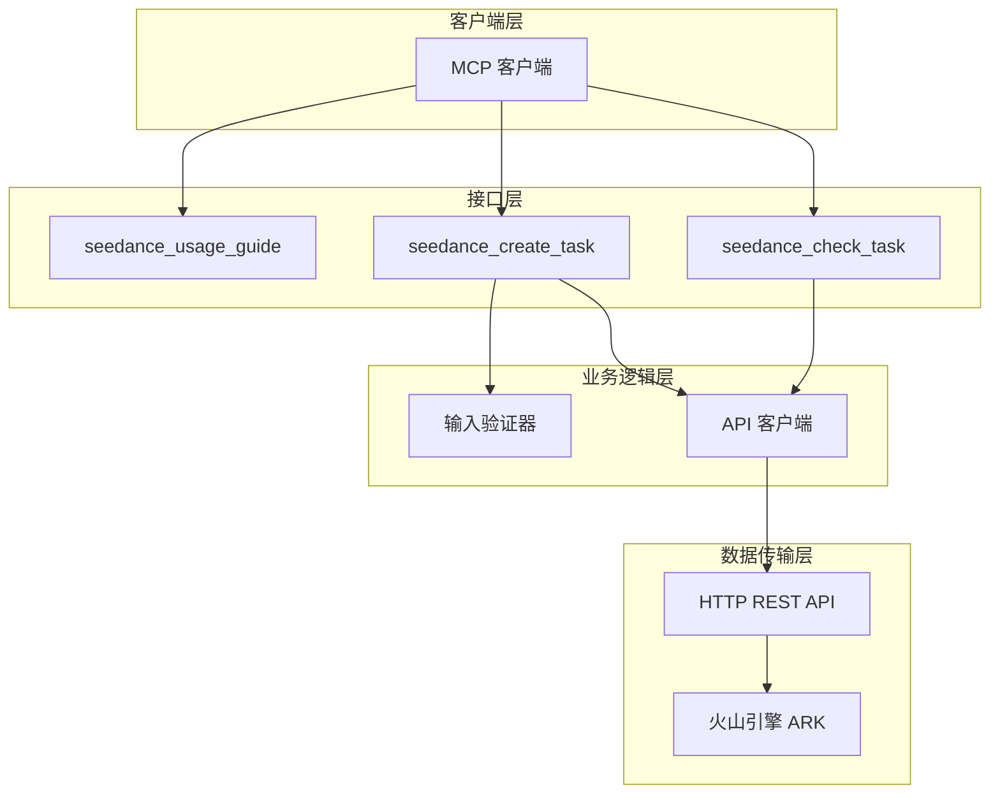
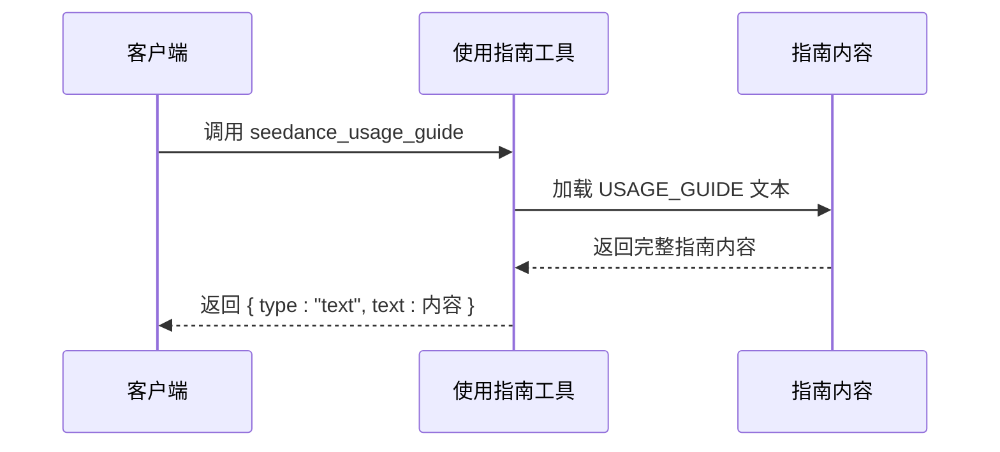
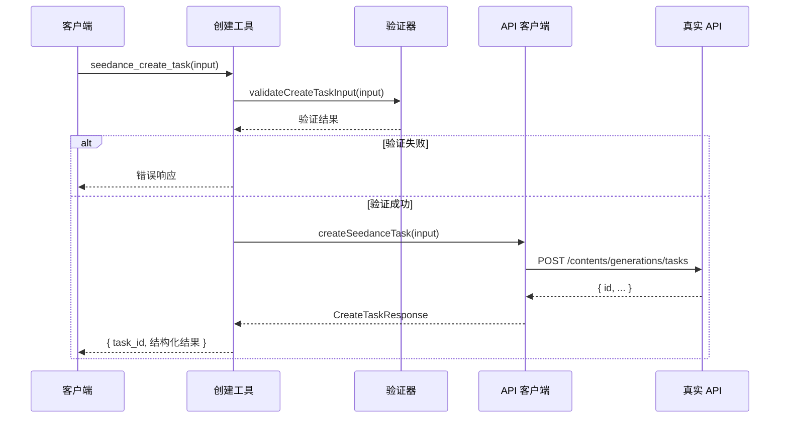
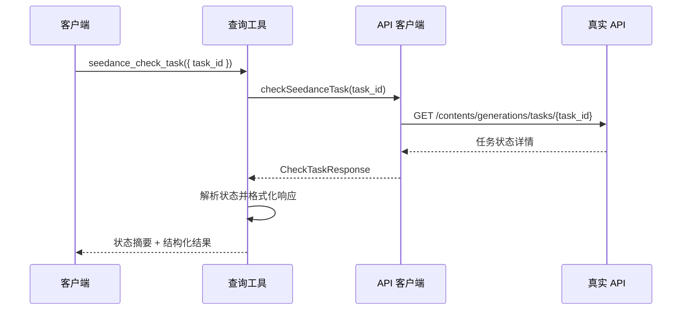
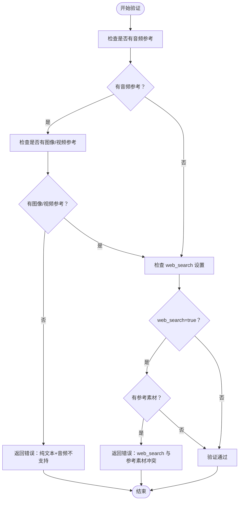

# 核心工具实现详解

<cite>
**本文档引用的文件**
- [src/index.ts](file://src/index.ts)
- [src/server.ts](file://src/server.ts)
- [src/seedance.ts](file://src/seedance.ts)
- [src/schema.ts](file://src/schema.ts)
- [src/usageGuide.ts](file://src/usageGuide.ts)
- [package.json](file://package.json)
- [README.md](file://README.md)
</cite>

## 目录
1. [简介](#简介)
2. [项目结构](#项目结构)
3. [核心组件](#核心组件)
4. [架构总览](#架构总览)
5. [详细组件分析](#详细组件分析)
6. [依赖关系分析](#依赖关系分析)
7. [性能考虑](#性能考虑)
8. [故障排除指南](#故障排除指南)
9. [结论](#结论)
10. [附录](#附录)

## 简介
本项目是一个基于 Model Context Protocol (MCP) 的本地 stdio 服务器，封装了火山引擎 ARK Seedance 2.0 视频生成 API，提供三个核心工具：
- seedance_usage_guide：使用指南工具
- seedance_create_task：任务创建工具  
- seedance_check_task：任务查询工具

该实现采用 TypeScript 编写，使用 Zod 进行输入参数验证，通过 @modelcontextprotocol/sdk 构建 MCP 服务，支持本地 stdio 通信。

## 项目结构
项目采用模块化设计，主要文件职责如下：
- src/index.ts：MCP 服务器入口，负责初始化和连接
- src/server.ts：MCP 服务器注册与工具实现，包含三个核心工具
- src/seedance.ts：Seedance API 客户端，封装 HTTP 请求与错误处理
- src/schema.ts：Zod 输入参数验证模式定义
- src/usageGuide.ts：使用指南内容定义
- package.json：项目依赖与构建脚本

```mermaid
graph TB
subgraph "入口层"
A[index.ts]
end
subgraph "MCP 层"
B[server.ts]
C[usageGuide.ts]
end
subgraph "业务层"
D[seedance.ts]
E[schema.ts]
end
subgraph "外部依赖"
F[@modelcontextprotocol/sdk]
G[zod]
end
A --> B
B --> C
B --> D
B --> E
D --> F
E --> G
```

**图表来源**
- [src/index.ts:1-19](file://src/index.ts#L1-L19)
- [src/server.ts:1-215](file://src/server.ts#L1-L215)
- [src/seedance.ts:1-286](file://src/seedance.ts#L1-L286)
- [src/schema.ts:1-141](file://src/schema.ts#L1-L141)
- [src/usageGuide.ts:1-59](file://src/usageGuide.ts#L1-L59)

**章节来源**
- [src/index.ts:1-19](file://src/index.ts#L1-L19)
- [src/server.ts:1-215](file://src/server.ts#L1-L215)
- [src/seedance.ts:1-286](file://src/seedance.ts#L1-L286)
- [src/schema.ts:1-141](file://src/schema.ts#L1-L141)
- [src/usageGuide.ts:1-59](file://src/usageGuide.ts#L1-L59)

## 核心组件
本项目的核心组件围绕三个 MCP 工具展开，每个工具都有明确的职责边界和严格的输入验证机制。

### 使用指南工具 (seedance_usage_guide)
- **功能定位**：提供完整的使用说明文档，包括标准工作流程、模型选择、参数参考和重要注意事项
- **实现特点**：只读工具，无副作用，返回静态 Markdown 文档
- **安全特性**：不涉及任何 API 调用，无敏感信息输出

### 任务创建工具 (seedance_create_task)
- **功能定位**：提交 Seedance 2.0 视频生成任务，立即返回 task_id
- **实现特点**：异步非阻塞，支持多种输入模态（文本、图像、视频、音频）
- **验证机制**：双重验证（Zod Schema + 自定义验证函数）

### 任务查询工具 (seedance_check_task)
- **功能定位**：查询任务状态，支持轮询机制
- **实现特点**：幂等查询，支持多种状态返回（running/succeeded/failed/pending等）
- **结果处理**：智能解析不同 SDK 版本的响应结构

**章节来源**
- [src/server.ts:31-90](file://src/server.ts#L31-L90)
- [src/server.ts:92-174](file://src/server.ts#L92-L174)
- [src/usageGuide.ts:1-59](file://src/usageGuide.ts#L1-L59)

## 架构总览
系统采用分层架构设计，清晰分离了接口层、业务逻辑层和数据传输层。



**图表来源**
- [src/server.ts:20-177](file://src/server.ts#L20-L177)
- [src/seedance.ts:149-278](file://src/seedance.ts#L149-L278)
- [src/schema.ts:52-141](file://src/schema.ts#L52-L141)

## 详细组件分析

### seedance_usage_guide 工具实现
该工具作为只读工具，提供完整的使用指南文档。



**图表来源**
- [src/server.ts:31-47](file://src/server.ts#L31-L47)
- [src/usageGuide.ts:1-59](file://src/usageGuide.ts#L1-L59)

**实现要点**：
- 无输入参数验证
- 返回固定格式的文本内容
- 标记为只读、幂等、非开放世界工具

**章节来源**
- [src/server.ts:31-47](file://src/server.ts#L31-L47)
- [src/usageGuide.ts:1-59](file://src/usageGuide.ts#L1-L59)

### seedance_create_task 工具实现
该工具负责创建视频生成任务，是整个工作流的核心入口。



**图表来源**
- [src/server.ts:49-90](file://src/server.ts#L49-L90)
- [src/seedance.ts:149-194](file://src/seedance.ts#L149-L194)
- [src/server.ts:179-199](file://src/server.ts#L179-L199)

**输入参数验证机制**：
- **Zod Schema 验证**：确保基本类型、范围和默认值正确
- **自定义业务验证**：validateCreateTaskInput 函数执行业务规则检查
- **验证规则**：
  - 纯文本 + 音频组合被拒绝（Seedance 不支持）
  - web_search=true 时禁止任何参考素材
  - 限制数组长度（image_urls≤9, video_urls≤3, audio_urls≤3）
  - duration 必须在 [4,15] 范围内的整数

**业务逻辑处理**：
- 将 CreateTaskInput 转换为 API 请求体
- 构建 ContentItem 数组（文本 + 参考素材）
- 处理工具配置（web_search）
- 返回标准化的任务信息

**错误处理机制**：
- SeedanceApiError：API 调用失败时抛出
- 格式化错误消息：提取 API 返回的错误详情
- 统一错误响应格式：包含 isError 标记

**章节来源**
- [src/server.ts:49-90](file://src/server.ts#L49-L90)
- [src/seedance.ts:102-114](file://src/seedance.ts#L102-L114)
- [src/seedance.ts:149-194](file://src/seedance.ts#L149-L194)
- [src/server.ts:179-199](file://src/server.ts#L179-L199)
- [src/server.ts:201-214](file://src/server.ts#L201-L214)

### seedance_check_task 工具实现
该工具支持任务状态轮询查询，是工作流的重要组成部分。



**图表来源**
- [src/server.ts:92-174](file://src/server.ts#L92-L174)
- [src/seedance.ts:201-278](file://src/seedance.ts#L201-L278)

**状态处理逻辑**：
- **成功状态**：返回 video_url 和可选的 last_frame_url
- **失败状态**：返回 fail_reason（如有）
- **进行中状态**：running/queued/pending/in_queue/pending
- **其他状态**：cancelled/canceled/expired/unknown

**响应格式化**：
- 人类可读摘要：根据状态生成相应的提示信息
- 结构化内容：包含 task_id、status、urls、fail_reason 等关键信息
- 原始响应保留：raw 字段包含完整的 API 响应

**章节来源**
- [src/server.ts:92-174](file://src/server.ts#L92-L174)
- [src/seedance.ts:201-278](file://src/seedance.ts#L201-L278)

### validateCreateTaskInput 函数详解
该函数实现了自定义的业务规则验证，确保输入符合 Seedance API 的实际限制。



**图表来源**
- [src/server.ts:179-199](file://src/server.ts#L179-L199)

**验证规则说明**：
1. **音频限制**：Seedance 不支持纯文本 + 音频的组合，音频必须与至少一个图像或视频参考配对
2. **web_search 限制**：当启用 web_search 时，不允许提供任何参考素材
3. **数量限制**：图像最多 9 个，视频最多 3 个，音频最多 3 个
4. **数值范围**：duration 必须是 4-15 秒之间的整数

**章节来源**
- [src/server.ts:179-199](file://src/server.ts#L179-L199)

## 依赖关系分析

```mermaid
graph LR
subgraph "运行时依赖"
A[@modelcontextprotocol/sdk]
B[zod]
end
subgraph "项目模块"
C[index.ts]
D[server.ts]
E[seedance.ts]
F[schema.ts]
G[usageGuide.ts]
end
C --> D
D --> E
D --> F
D --> G
E --> A
F --> B
```

**图表来源**
- [src/index.ts:1-19](file://src/index.ts#L1-L19)
- [src/server.ts:1-215](file://src/server.ts#L1-L215)
- [src/seedance.ts:1-286](file://src/seedance.ts#L1-L286)
- [src/schema.ts:1-141](file://src/schema.ts#L1-L141)
- [package.json:26-34](file://package.json#L26-L34)

**依赖特点**：
- **外部依赖**：@modelcontextprotocol/sdk（MCP 协议实现），zod（类型验证）
- **内部模块**：模块间依赖清晰，server.ts 依赖其他所有模块
- **运行时要求**：Node.js >= 18，使用原生 fetch API

**章节来源**
- [package.json:26-34](file://package.json#L26-L34)
- [src/server.ts:1-215](file://src/server.ts#L1-L215)

## 性能考虑
基于代码实现分析，以下是一些性能优化建议和最佳实践：

### 网络请求优化
- **连接复用**：当前实现每次请求都建立新的连接，可以考虑使用连接池减少握手开销
- **超时控制**：为 API 请求设置合理的超时时间，避免长时间阻塞
- **重试机制**：对于临时性网络错误实现指数退避重试

### 内存管理
- **响应解析**：parseJsonSafe 函数已经处理了非 JSON 响应，但可以考虑增加响应大小限制
- **对象池**：对于频繁创建的 ContentItem 对象，可以考虑使用对象池模式

### 并发处理
- **批量查询**：对于多个任务查询场景，可以实现并发控制避免过度并发
- **背压处理**：在高并发场景下实现适当的背压机制

### 缓存策略
- **配置缓存**：API Key 和 Base URL 可以缓存，避免重复读取环境变量
- **响应缓存**：对于相同的查询请求可以实现短期缓存

## 故障排除指南

### 常见错误类型及处理

**环境变量错误**
- **症状**：抛出 "Missing ARK_API_KEY" 错误
- **原因**：未设置 ARK_API_KEY 环境变量
- **解决方案**：在 MCP 客户端配置中设置 ARK_API_KEY

**输入参数验证错误**
- **症状**：返回业务规则验证错误
- **常见类型**：
  - 纯文本 + 音频组合被拒绝
  - web_search=true 与参考素材同时使用
  - 参考素材数量超过限制
- **解决方案**：根据错误消息调整输入参数

**API 调用错误**
- **症状**：SeedanceApiError 异常
- **处理方式**：formatApiError 函数会提取详细的错误信息
- **重试策略**：对于网络错误实现指数退避重试

**章节来源**
- [src/seedance.ts:55-64](file://src/seedance.ts#L55-L64)
- [src/server.ts:201-214](file://src/server.ts#L201-L214)
- [src/server.ts:179-199](file://src/server.ts#L179-L199)

### 调试技巧
- **使用 inspector 工具**：通过 `@modelcontextprotocol/inspector` 监控 MCP 通信
- **查看原始响应**：利用 raw 字段查看完整的 API 响应
- **检查状态码**：关注 HTTP 状态码和错误消息

## 结论
本项目成功实现了基于 MCP 协议的 Seedance 2.0 视频生成工具集，具有以下特点：

**优势**：
- 清晰的分层架构，职责分离明确
- 严格的输入验证机制，确保 API 调用的有效性
- 完善的错误处理和状态管理
- 支持多种输入模态和灵活的配置选项

**设计亮点**：
- 使用 Zod 进行类型安全的输入验证
- 实现自定义业务规则验证函数
- 提供完整的使用指南和错误信息
- 支持标准的 MCP 工具调用协议

**改进建议**：
- 添加连接池和重试机制
- 实现响应缓存策略
- 增加监控和日志记录
- 支持更多 Seedance API 功能

该项目为本地 Agent 集成提供了可靠的视频生成能力，遵循了 MCP 协议的最佳实践。

## 附录

### 工具调用示例

**seedance_usage_guide 调用示例**：
```json
{
  "name": "seedance_usage_guide",
  "input": {}
}
```

**seedance_create_task 调用示例**：
```json
{
  "name": "seedance_create_task",
  "input": {
    "prompt": "一个美丽的日落场景",
    "model": "doubao-seedance-2-0-260128",
    "duration": 5,
    "ratio": "16:9",
    "resolution": "720p",
    "generate_audio": true,
    "watermark": true,
    "web_search": false,
    "return_last_frame": false,
    "image_urls": [],
    "video_urls": [],
    "audio_urls": []
  }
}
```

**seedance_check_task 调用示例**：
```json
{
  "name": "seedance_check_task",
  "input": {
    "task_id": "cgt-2026xxxx-xxxxxx"
  }
}
```

### 返回值结构

**seedance_create_task 返回值**：
```json
{
  "content": ["text/plain", "任务已提交。task_id: cgt-..."],
  "structuredContent": {
    "task_id": "string",
    "model": "string",
    "duration": "number",
    "ratio": "string",
    "resolution": "string",
    "raw": "object"
  }
}
```

**seedance_check_task 返回值**：
```json
{
  "content": ["text/plain", "任务状态摘要"],
  "structuredContent": {
    "task_id": "string",
    "status": "string",
    "video_url": "string?",
    "last_frame_url": "string?",
    "fail_reason": "string?",
    "raw": "object"
  }
}
```

### 设计模式应用

**验证模式**：
- **策略模式**：validateCreateTaskInput 函数实现了不同的验证策略
- **工厂模式**：buildCreateTaskBody 函数创建标准化的请求体

**错误处理模式**：
- **统一异常处理**：SeedanceApiError 提供统一的错误包装
- **格式化器模式**：formatApiError 实现错误消息格式化

**章节来源**
- [src/server.ts:62-89](file://src/server.ts#L62-L89)
- [src/server.ts:105-173](file://src/server.ts#L105-L173)
- [src/seedance.ts:149-194](file://src/seedance.ts#L149-L194)
- [src/seedance.ts:201-278](file://src/seedance.ts#L201-L278)