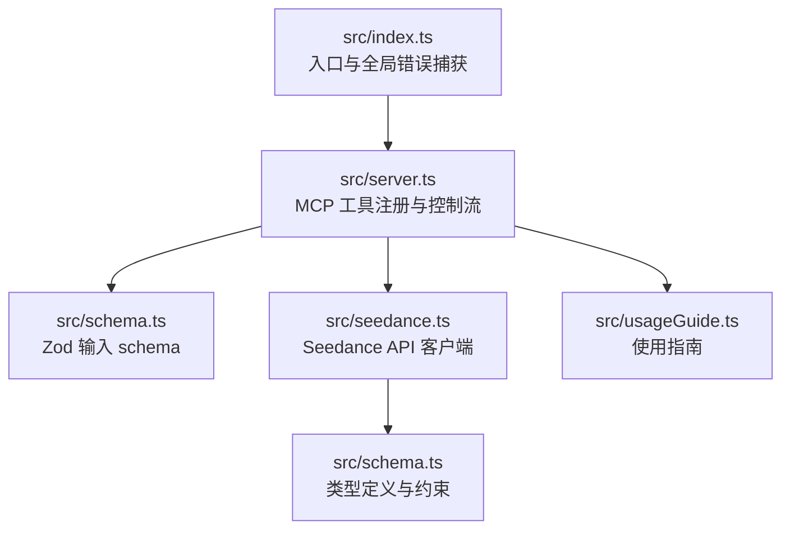
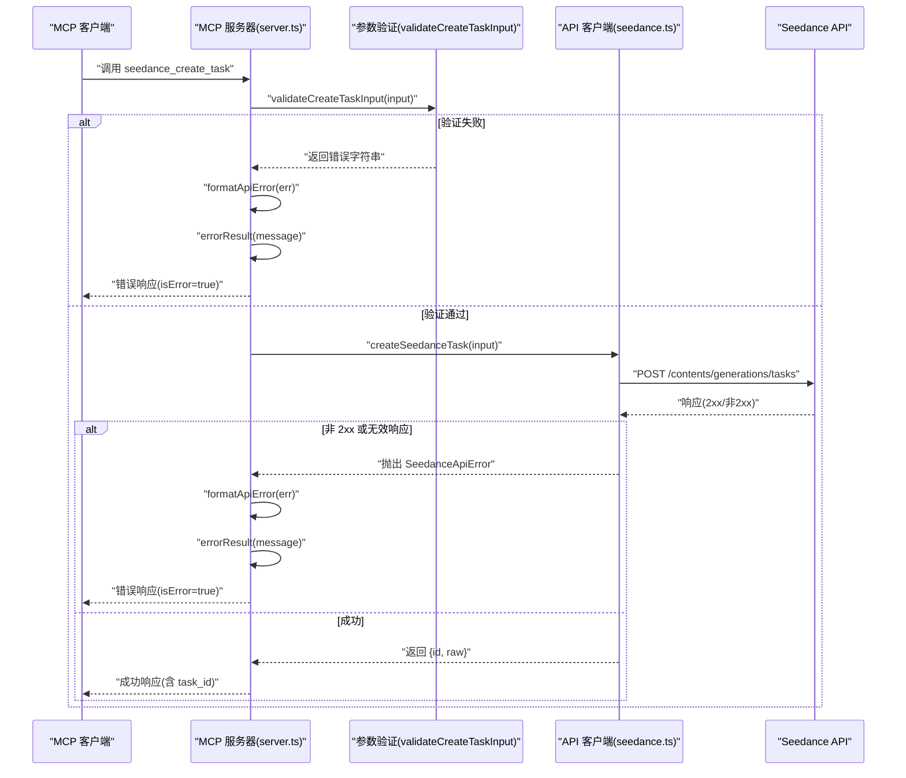
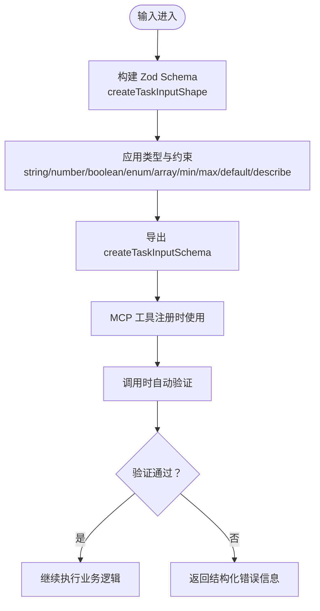
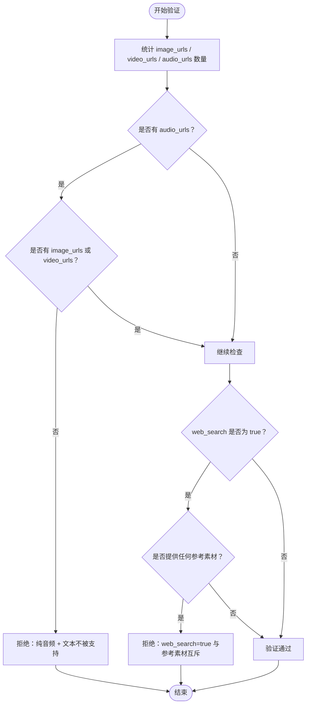
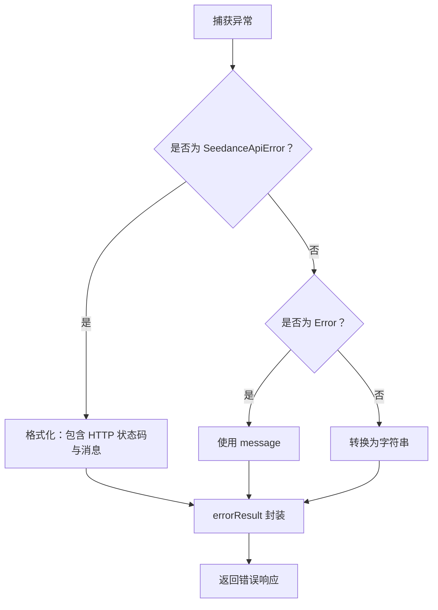
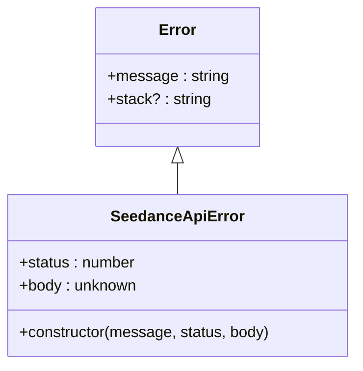
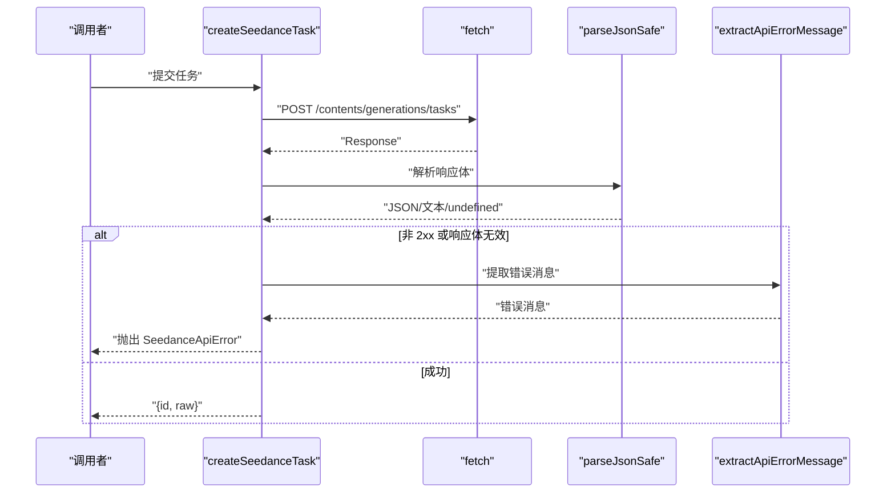
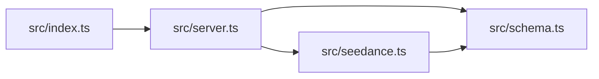

# 错误处理与参数验证

<cite>
**本文档引用的文件**
- [src/index.ts](file://src/index.ts)
- [src/schema.ts](file://src/schema.ts)
- [src/seedance.ts](file://src/seedance.ts)
- [src/server.ts](file://src/server.ts)
- [src/usageGuide.ts](file://src/usageGuide.ts)
- [README.md](file://README.md)
</cite>

## 目录
1. [简介](#简介)
2. [项目结构](#项目结构)
3. [核心组件](#核心组件)
4. [架构总览](#架构总览)
5. [详细组件分析](#详细组件分析)
6. [依赖关系分析](#依赖关系分析)
7. [性能考量](#性能考量)
8. [故障排除指南](#故障排除指南)
9. [结论](#结论)
10. [附录](#附录)

## 简介
本文件聚焦于项目的错误处理与参数验证机制，涵盖以下关键点：
- errorResult 函数的使用与错误结果封装
- formatApiError 函数的错误格式化逻辑
- SeedanceApiError 异常类型的处理与传播
- validateCreateTaskInput 函数的参数验证规则与约束
- Zod 类型验证系统在 schema.ts 中的应用与类型安全保证
- 各类错误场景示例：参数验证失败、API 调用错误、网络异常
- 错误消息格式化与用户友好提示的设计
- 调试技巧与常见问题排查方法

## 项目结构
该项目采用分层模块化组织，核心文件如下：
- src/index.ts：MCP 服务器入口，负责连接传输层与全局错误捕获
- src/server.ts：注册 MCP 工具、参数校验与错误结果封装
- src/schema.ts：Zod 输入 schema 定义，提供类型安全与约束
- src/seedance.ts：Seedance API 客户端，包含异常类型、请求构建与错误提取
- src/usageGuide.ts：使用指南文本，辅助用户理解参数与工作流
- README.md：项目说明与使用指南

图表来源
- [src/index.ts:1-19](file://src/index.ts#L1-L19)
- [src/server.ts:20-177](file://src/server.ts#L20-L177)
- [src/schema.ts:1-141](file://src/schema.ts#L1-L141)
- [src/seedance.ts:1-286](file://src/seedance.ts#L1-L286)
- [src/usageGuide.ts:1-59](file://src/usageGuide.ts#L1-L59)

章节来源
- [src/index.ts:1-19](file://src/index.ts#L1-L19)
- [src/server.ts:20-177](file://src/server.ts#L20-L177)
- [src/schema.ts:1-141](file://src/schema.ts#L1-L141)
- [src/seedance.ts:1-286](file://src/seedance.ts#L1-L286)
- [src/usageGuide.ts:1-59](file://src/usageGuide.ts#L1-L59)
- [README.md:267-283](file://README.md#L267-L283)

## 核心组件
本节概述错误处理与参数验证的关键组件及其职责：
- Zod 输入 schema：在 schema.ts 中定义输入参数的类型、默认值与约束，确保工具输入的类型安全
- validateCreateTaskInput：在 server.ts 中实现业务级参数验证，覆盖音频引用、web_search 互斥与多模态输入约束
- SeedanceApiError：在 seedance.ts 中定义的 API 异常类型，携带 HTTP 状态码与原始响应体
- formatApiError：在 server.ts 中统一格式化错误消息，区分不同异常类型
- errorResult：在 server.ts 中封装错误响应，标记为错误并返回用户可读提示
- createSeedanceTask/checkSeedanceTask：在 seedance.ts 中发起网络请求并解析响应，遇到非 2xx 或无效响应抛出 SeedanceApiError
- 全局错误捕获：在 index.ts 中捕获主流程异常，输出致命错误并退出

章节来源
- [src/schema.ts:52-127](file://src/schema.ts#L52-L127)
- [src/server.ts:179-214](file://src/server.ts#L179-L214)
- [src/seedance.ts:44-53](file://src/seedance.ts#L44-L53)
- [src/seedance.ts:149-194](file://src/seedance.ts#L149-L194)
- [src/seedance.ts:201-278](file://src/seedance.ts#L201-L278)
- [src/index.ts:14-18](file://src/index.ts#L14-L18)

## 架构总览
下图展示了从 MCP 工具调用到 API 请求与错误处理的整体流程。

图表来源
- [src/server.ts:62-89](file://src/server.ts#L62-L89)
- [src/server.ts:179-199](file://src/server.ts#L179-L199)
- [src/server.ts:201-207](file://src/server.ts#L201-L207)
- [src/server.ts:209-214](file://src/server.ts#L209-L214)
- [src/seedance.ts:149-194](file://src/seedance.ts#L149-L194)

## 详细组件分析

### Zod 类型验证系统与输入约束
- schema.ts 定义了 createTaskInputShape 与 checkTaskInputShape，分别用于创建任务与查询任务的输入参数
- 使用 z.object(...) 与 z.string()/z.number()/z.boolean()/z.enum()/z.array(...) 等组合，提供：
  - 类型约束（如 prompt 必须为字符串）
  - 默认值（如 model、duration、ratio、resolution、generate_audio、watermark、web_search、return_last_frame）
  - 范围与长度限制（如 duration 整数且范围 [4,15]；数组最大长度）
  - 描述性注释（describe），用于生成工具文档与使用指南
- createTaskInputSchema 与 checkTaskInputSchema 作为最终导出的 Zod 对象，供 server.ts 注册工具时使用

图表来源
- [src/schema.ts:52-127](file://src/schema.ts#L52-L127)
- [src/server.ts:55](file://src/server.ts#L55)

章节来源
- [src/schema.ts:52-127](file://src/schema.ts#L52-L127)
- [src/schema.ts:129-140](file://src/schema.ts#L129-L140)
- [src/server.ts:55](file://src/server.ts#L55)

### 参数验证规则与 validateCreateTaskInput
validateCreateTaskInput 实现了业务级参数验证，确保：
- 纯音频参考（audio_urls）必须至少配有一个图像或视频参考（image_urls 或 video_urls），否则拒绝
- 当 web_search 为 true 时，禁止同时提供任何参考素材（image_urls/video_urls/audio_urls），否则拒绝
- 其余情况下返回 null 表示验证通过

图表来源
- [src/server.ts:179-199](file://src/server.ts#L179-L199)

章节来源
- [src/server.ts:179-199](file://src/server.ts#L179-L199)

### 错误格式化与用户友好提示
- formatApiError：将 SeedanceApiError 格式化为包含 HTTP 状态码与消息的字符串；对普通 Error 返回 message；否则转换为字符串
- errorResult：封装错误响应，content 为文本，isError 标记为 true，便于客户端识别错误
- createSeedanceTask/checkSeedanceTask：在非 2xx 或响应体不符合预期时抛出 SeedanceApiError，由上层统一格式化

图表来源
- [src/server.ts:201-207](file://src/server.ts#L201-L207)
- [src/server.ts:209-214](file://src/server.ts#L209-L214)
- [src/seedance.ts:168-173](file://src/seedance.ts#L168-L173)
- [src/seedance.ts:223-228](file://src/seedance.ts#L223-L228)

章节来源
- [src/server.ts:201-207](file://src/server.ts#L201-L207)
- [src/server.ts:209-214](file://src/server.ts#L209-L214)
- [src/seedance.ts:168-173](file://src/seedance.ts#L168-L173)
- [src/seedance.ts:223-228](file://src/seedance.ts#L223-L228)

### SeedanceApiError 异常类型
- SeedanceApiError 继承自 Error，包含 status 与 body 字段，便于上层格式化与记录
- createSeedanceTask/checkSeedanceTask 在以下情况抛出该异常：
  - HTTP 非 2xx
  - 响应体为空或非对象
  - 响应体缺少 task_id
- index.ts 中对主流程进行全局错误捕获，输出致命错误并退出进程

图表来源
- [src/seedance.ts:44-53](file://src/seedance.ts#L44-L53)
- [src/index.ts:14-18](file://src/index.ts#L14-L18)

章节来源
- [src/seedance.ts:44-53](file://src/seedance.ts#L44-L53)
- [src/index.ts:14-18](file://src/index.ts#L14-L18)

### API 调用与错误提取
- createSeedanceTask：构建请求体、发送 POST 请求、解析响应；非 2xx 抛出 SeedanceApiError；响应体非对象或缺少 id 同样抛出异常
- checkSeedanceTask：校验 task_id 非空；GET 请求查询任务状态；非 2xx 抛出 SeedanceApiError；解析多种可能的字段位置，兼容不同 SDK 版本
- extractApiErrorMessage：从响应体中提取错误消息，优先查找嵌套的 error.message，其次查找顶层 message，最后回退为通用提示

图表来源
- [src/seedance.ts:149-194](file://src/seedance.ts#L149-L194)
- [src/seedance.ts:116-124](file://src/seedance.ts#L116-L124)
- [src/seedance.ts:126-140](file://src/seedance.ts#L126-L140)

章节来源
- [src/seedance.ts:149-194](file://src/seedance.ts#L149-L194)
- [src/seedance.ts:116-124](file://src/seedance.ts#L116-L124)
- [src/seedance.ts:126-140](file://src/seedance.ts#L126-L140)

### 错误场景示例与处理方式
- 参数验证失败
  - 纯音频 + 文本：返回错误提示，说明 Seedance 不支持纯音频 + 文本生成
  - web_search=true 与参考素材同时出现：返回错误提示，说明 web_search 仅支持纯文本输入
- API 调用错误
  - HTTP 非 2xx：formatApiError 将状态码与消息格式化为用户可读字符串
  - 响应体为空或非对象：抛出 SeedanceApiError，由上层统一格式化
  - 响应体缺少 task_id：抛出 SeedanceApiError，由上层统一格式化
- 网络异常
  - fetch 失败或超时：在 createSeedanceTask/checkSeedanceTask 中抛出 SeedanceApiError，由上层统一格式化

章节来源
- [src/server.ts:179-199](file://src/server.ts#L179-L199)
- [src/server.ts:201-207](file://src/server.ts#L201-L207)
- [src/seedance.ts:168-173](file://src/seedance.ts#L168-L173)
- [src/seedance.ts:223-228](file://src/seedance.ts#L223-L228)

## 依赖关系分析
- server.ts 依赖 schema.ts 的输入 schema 与类型定义
- server.ts 依赖 seedance.ts 的 API 客户端与异常类型
- seedance.ts 依赖 schema.ts 的类型定义（CreateTaskInput 等）
- index.ts 依赖 server.ts 创建并连接 MCP 服务器，同时提供全局错误捕获

图表来源
- [src/index.ts:4](file://src/index.ts#L4)
- [src/server.ts:4-15](file://src/server.ts#L4-L15)
- [src/seedance.ts:1](file://src/seedance.ts#L1)

章节来源
- [src/index.ts:4](file://src/index.ts#L4)
- [src/server.ts:4-15](file://src/server.ts#L4-L15)
- [src/seedance.ts:1](file://src/seedance.ts#L1)

## 性能考量
- Zod 验证在工具注册阶段即完成，运行时开销极低
- validateCreateTaskInput 为 O(1) 检查，仅统计数组长度与布尔判断
- API 请求解析采用异步 fetch，错误提取与响应体解析均为轻量操作
- 建议在客户端侧减少不必要的重复调用，遵循“创建 -> 等待 -> 查询”的标准流程

## 故障排除指南
- 环境变量缺失
  - 症状：调用真实 API 的两个工具返回清晰错误，提示缺少 ARK_API_KEY
  - 处理：在 MCP 客户端配置或系统环境变量中设置 ARK_API_KEY
- URL 不可达
  - 症状：Seedance API 返回错误或网络异常
  - 处理：确保 image_urls/video_urls/audio_urls 为公网可访问的 HTTP/HTTPS 地址
- 参数验证失败
  - 症状：返回错误提示，说明纯音频 + 文本不被支持或 web_search 与参考素材互斥
  - 处理：调整参数，满足 validateCreateTaskInput 的约束
- API 响应异常
  - 症状：SeedanceApiError，包含 HTTP 状态码与消息
  - 处理：查看 formatApiError 的格式化结果，结合 raw 响应定位问题
- 调试技巧
  - 使用 MCP Inspector 进行 stdio 通信调试
  - 查看 README 中的开发与调试命令示例

章节来源
- [README.md:93-106](file://README.md#L93-L106)
- [README.md:253-263](file://README.md#L253-L263)
- [src/server.ts:201-207](file://src/server.ts#L201-L207)
- [src/seedance.ts:168-173](file://src/seedance.ts#L168-L173)

## 结论
本项目通过 Zod 类型验证与业务级参数验证相结合，实现了输入参数的强类型约束与合理的业务规则校验；通过 SeedanceApiError 与统一的错误格式化函数，提供了清晰一致的错误反馈；通过全局错误捕获与结构化错误响应，提升了用户体验与可维护性。建议在实际使用中严格遵循参数约束与工作流程，确保稳定高效的视频生成体验。

## 附录
- 使用指南与参数说明可参考 usageGuide.ts 与 README.md 中的“Tools 详解”
- 标准工作流程：先调用 usage_guide，再 create -> 等待 -> check

章节来源
- [src/usageGuide.ts:1-59](file://src/usageGuide.ts#L1-L59)
- [README.md:153-227](file://README.md#L153-L227)