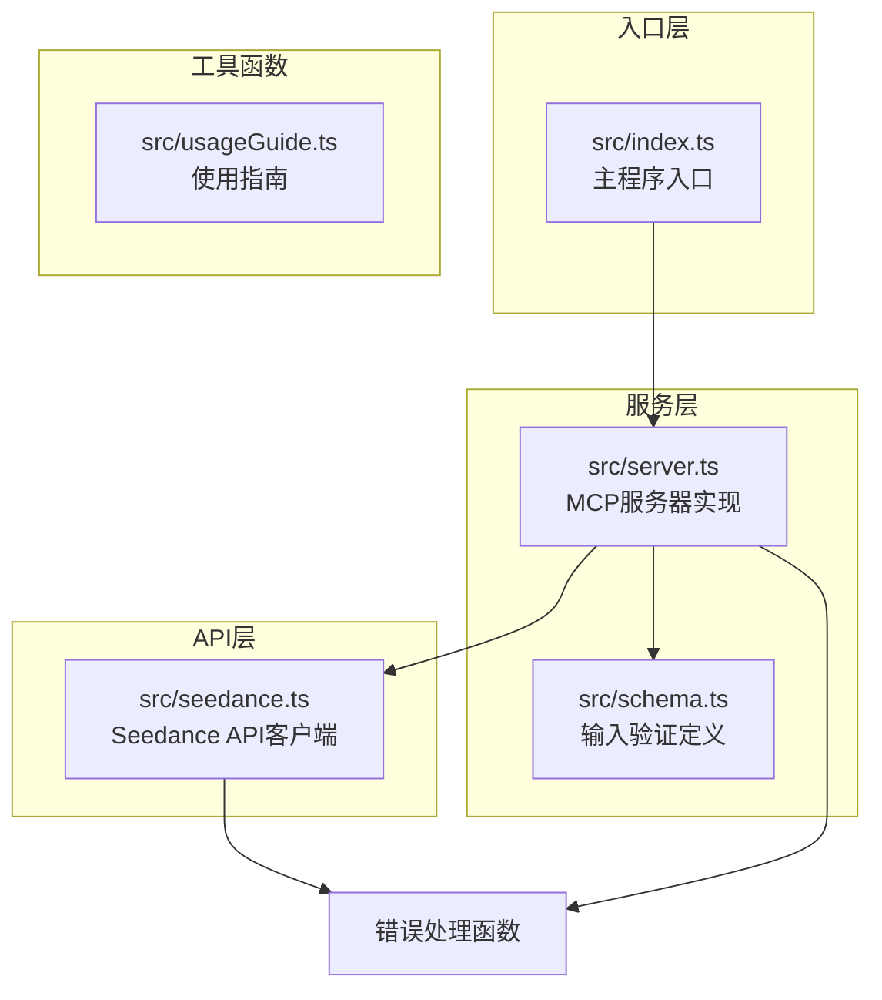
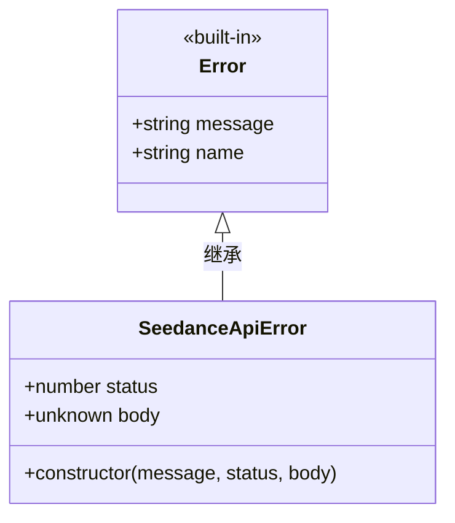
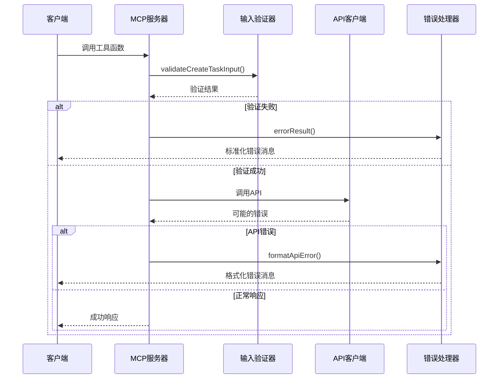
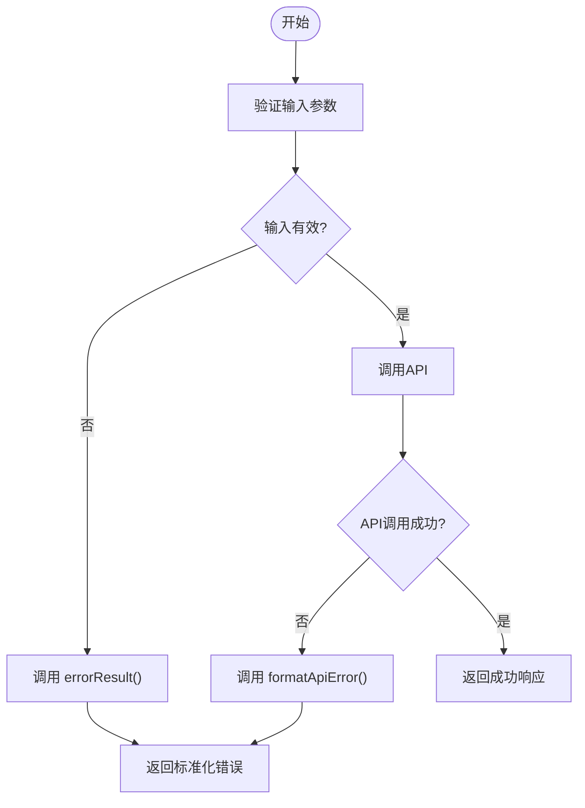
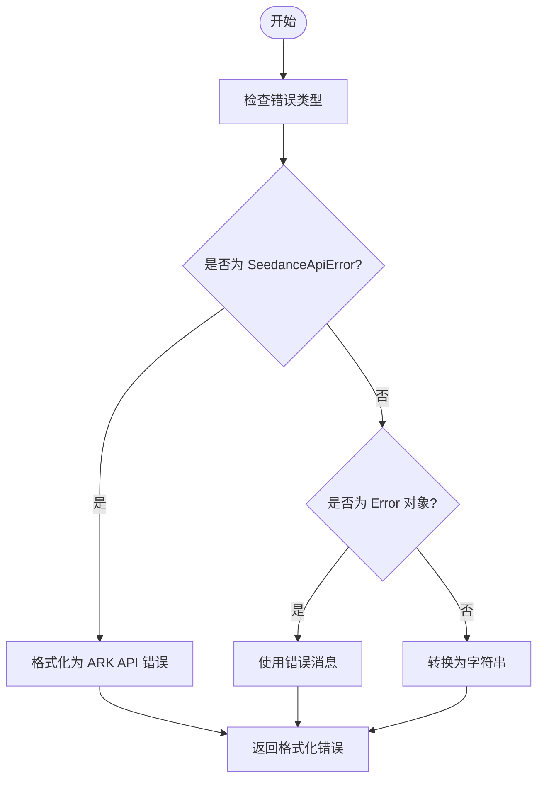
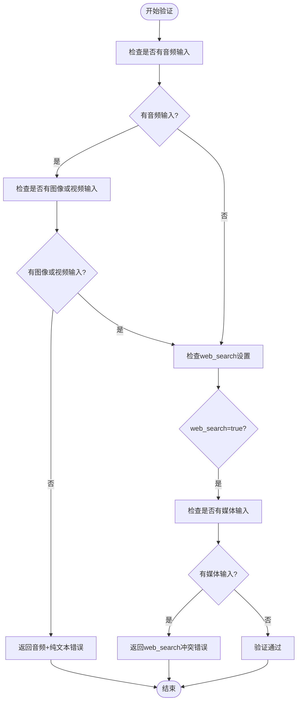
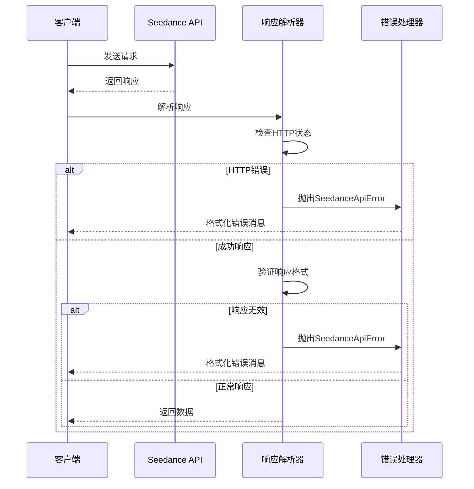
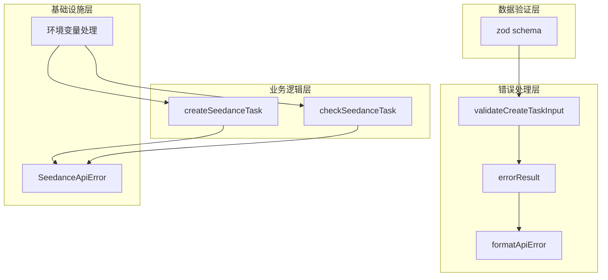
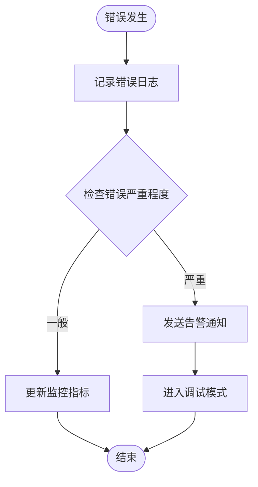

# 错误处理与异常管理

<cite>
**本文档引用的文件**
- [src/index.ts](file://src/index.ts)
- [src/seedance.ts](file://src/seedance.ts)
- [src/server.ts](file://src/server.ts)
- [src/schema.ts](file://src/schema.ts)
- [README.md](file://README.md)
</cite>

## 目录
1. [简介](#简介)
2. [项目结构](#项目结构)
3. [核心组件](#核心组件)
4. [架构概览](#架构概览)
5. [详细组件分析](#详细组件分析)
6. [依赖关系分析](#依赖关系分析)
7. [性能考虑](#性能考虑)
8. [故障排除指南](#故障排除指南)
9. [结论](#结论)

## 简介

本项目实现了完整的错误处理与异常管理机制，采用分层设计模式，确保在各种错误场景下都能提供清晰、一致的错误信息。系统主要包含以下错误处理特性：

- **统一的错误类型定义**：自定义 `SeedanceApiError` 类型
- **多级错误分类处理**：区分 API 错误、输入验证错误和未知错误
- **标准化错误消息格式**：提供用户友好的错误信息
- **异常传播与恢复策略**：确保错误在各层之间正确传递
- **最佳实践实现**：包括错误码标准化、日志记录策略等

## 项目结构

项目采用模块化设计，错误处理相关的代码分布在多个文件中：

**图表来源**
- [src/index.ts:1-19](file://src/index.ts#L1-L19)
- [src/server.ts:1-215](file://src/server.ts#L1-L215)
- [src/seedance.ts:1-286](file://src/seedance.ts#L1-L286)

**章节来源**
- [src/index.ts:1-19](file://src/index.ts#L1-L19)
- [src/server.ts:1-215](file://src/server.ts#L1-L215)
- [src/seedance.ts:1-286](file://src/seedance.ts#L1-L286)

## 核心组件

### 错误类型定义

系统定义了专门的错误类型来处理 API 相关的错误情况：

**图表来源**
- [src/seedance.ts:44-53](file://src/seedance.ts#L44-L53)

### 错误处理函数

系统提供了三个关键的错误处理函数：

1. **errorResult()** - 创建标准化的错误响应
2. **formatApiError()** - 格式化不同类型的错误
3. **validateCreateTaskInput()** - 输入验证错误处理

**章节来源**
- [src/server.ts:201-214](file://src/server.ts#L201-L214)

## 架构概览

错误处理架构采用分层设计，确保错误在各层之间正确传播和格式化：

**图表来源**
- [src/server.ts:62-89](file://src/server.ts#L62-L89)
- [src/server.ts:179-199](file://src/server.ts#L179-L199)
- [src/server.ts:201-207](file://src/server.ts#L201-L207)

## 详细组件分析

### errorResult() 函数分析

`errorResult()` 函数负责创建标准化的错误响应对象，确保所有错误都以一致的格式返回给客户端。

#### 实现特点

- **统一的错误标志**：设置 `isError: true` 标识错误状态
- **标准化的消息格式**：将错误信息包装在标准的响应结构中
- **兼容性保证**：确保错误响应符合 MCP 协议规范

#### 使用场景

**图表来源**
- [src/server.ts:209-214](file://src/server.ts#L209-L214)
- [src/server.ts:63-66](file://src/server.ts#L63-L66)

**章节来源**
- [src/server.ts:209-214](file://src/server.ts#L209-L214)

### formatApiError() 函数分析

`formatApiError()` 函数实现了多级错误分类处理，能够正确识别和格式化不同类型的错误。

#### 错误分类处理

**图表来源**
- [src/server.ts:201-207](file://src/server.ts#L201-L207)

#### 错误处理策略

| 错误类型 | 处理方式 | 示例输出 |
|---------|---------|---------|
| SeedanceApiError | 包含HTTP状态码和详细消息 | "ARK API error (HTTP 401): 认证失败" |
| 标准Error对象 | 直接使用message属性 | "网络连接超时" |
| 未知类型 | 转换为字符串 | "Object object" |

**章节来源**
- [src/server.ts:201-207](file://src/server.ts#L201-L207)

### validateCreateTaskInput() 函数分析

输入验证错误处理机制确保只有符合要求的输入才能触发API调用。

#### 验证规则

**图表来源**
- [src/server.ts:179-199](file://src/server.ts#L179-L199)

#### 验证规则详解

1. **音频输入限制**：纯文本+音频组合被拒绝
   - 错误信息："Seedance 2.0 does not support pure-text + audio generation. Audio references must be paired with at least one image_urls or video_urls item."

2. **web_search冲突**：web_search=true与媒体输入同时使用被拒绝
   - 错误信息："web_search=true requires text-only input. Remove image_urls / video_urls / audio_urls, or set web_search=false."

**章节来源**
- [src/server.ts:179-199](file://src/server.ts#L179-L199)

### Seedance API错误处理

API层实现了完善的错误处理机制，包括HTTP状态码处理和响应解析。

#### 错误处理流程

**图表来源**
- [src/seedance.ts:149-194](file://src/seedance.ts#L149-L194)
- [src/seedance.ts:116-140](file://src/seedance.ts#L116-L140)

**章节来源**
- [src/seedance.ts:149-194](file://src/seedance.ts#L149-L194)
- [src/seedance.ts:116-140](file://src/seedance.ts#L116-L140)

## 依赖关系分析

错误处理机制涉及多个模块间的协作关系：

**图表来源**
- [src/server.ts:10-15](file://src/server.ts#L10-L15)
- [src/seedance.ts:44-53](file://src/seedance.ts#L44-L53)

**章节来源**
- [src/server.ts:10-15](file://src/server.ts#L10-L15)
- [src/seedance.ts:44-53](file://src/seedance.ts#L44-L53)

## 性能考虑

### 错误处理性能优化

1. **延迟抛出**：输入验证在API调用前进行，避免不必要的网络请求
2. **错误缓存**：格式化的错误消息可以被缓存以减少重复计算
3. **异步处理**：错误处理采用异步模式，不影响正常业务流程

### 内存使用优化

- **错误对象复用**：对于相同类型的错误，可以复用错误对象实例
- **消息字符串优化**：避免创建过长的错误消息字符串
- **资源清理**：确保错误处理过程中及时释放资源

## 故障排除指南

### 常见错误场景及解决方案

#### 环境变量配置错误

**问题**：`Missing ARK_API_KEY environment variable` 错误

**原因**：
- 未设置 `ARK_API_KEY` 环境变量
- 环境变量为空或只包含空白字符

**解决方案**：
1. 在MCP客户端配置中设置 `ARK_API_KEY`
2. 确保API密钥有效且未过期
3. 验证网络连接正常

#### API调用失败

**问题**：Seedance API返回HTTP错误状态码

**原因**：
- 认证失败（401）
- 请求格式错误（400）
- 服务器内部错误（500）

**解决方案**：
1. 检查API密钥有效性
2. 验证请求参数格式
3. 查看API响应中的详细错误信息

#### 输入验证失败

**问题**：输入参数不符合要求

**常见场景**：
- 纯文本+音频输入组合
- web_search=true与媒体输入同时使用
- 参数超出允许范围

**解决方案**：
1. 检查参数组合是否符合业务规则
2. 验证参数类型和范围
3. 参考使用指南调整参数设置

### 调试技巧

#### 日志记录策略

1. **错误级别分离**：区分不同严重程度的错误
2. **上下文信息**：记录错误发生时的相关上下文
3. **敏感信息过滤**：避免在日志中记录API密钥等敏感信息

#### 错误监控

#### 调试工具使用

1. **MCP Inspector**：使用官方调试工具检查协议通信
2. **网络抓包**：监控API请求和响应
3. **日志分析**：分析错误日志模式

**章节来源**
- [README.md:253-263](file://README.md#L253-L263)

## 结论

本项目实现了完整的错误处理与异常管理机制，具有以下特点：

1. **层次化设计**：从输入验证到API调用再到错误格式化的完整链路
2. **标准化处理**：统一的错误响应格式和消息格式
3. **用户友好**：提供清晰、易懂的错误信息
4. **可扩展性**：模块化设计便于功能扩展和维护

通过合理的错误处理策略，系统能够在各种异常情况下保持稳定运行，并为用户提供有用的诊断信息。建议在实际使用中结合具体的业务需求，进一步完善错误处理机制。