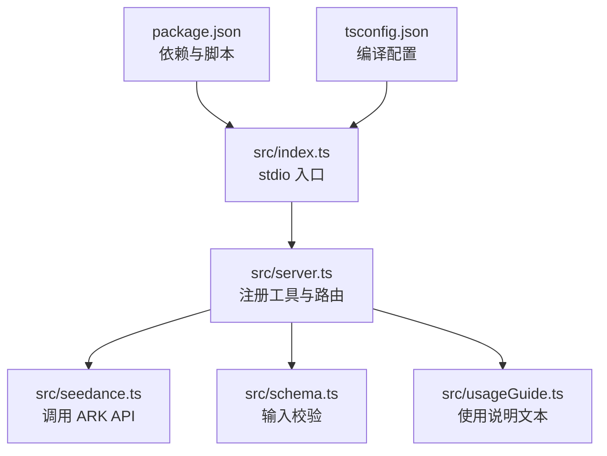
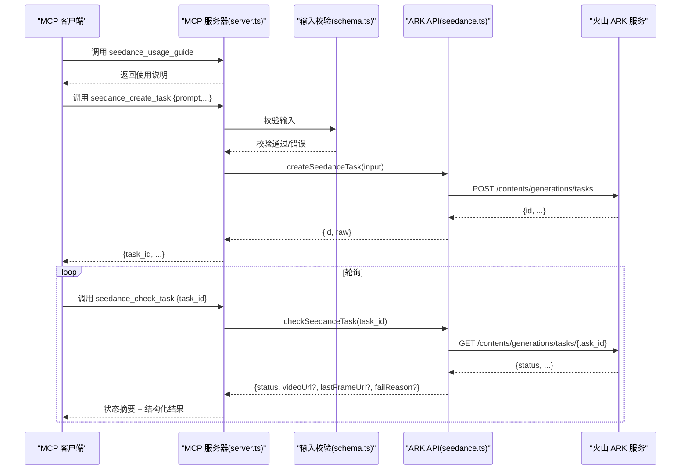
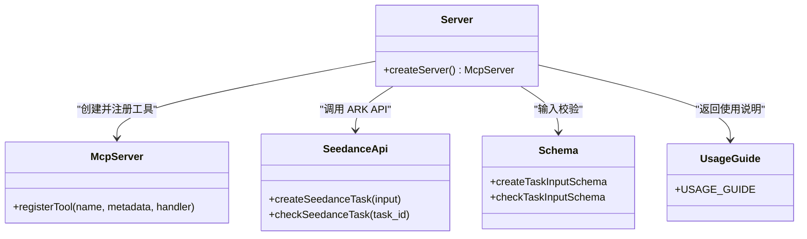
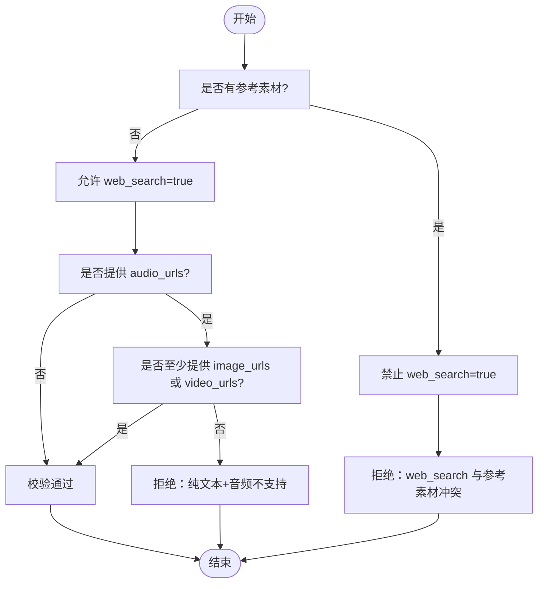
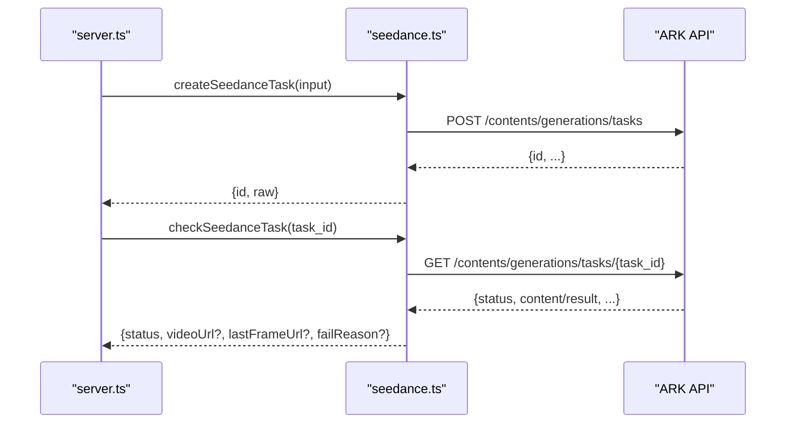
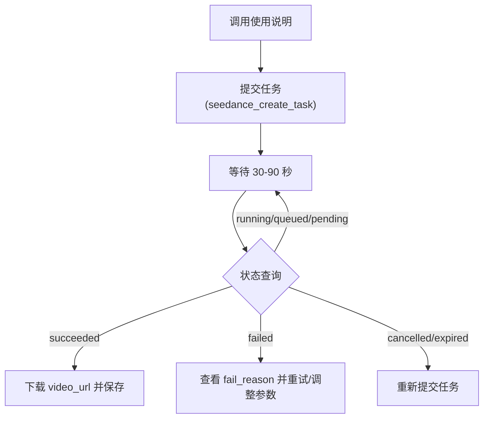
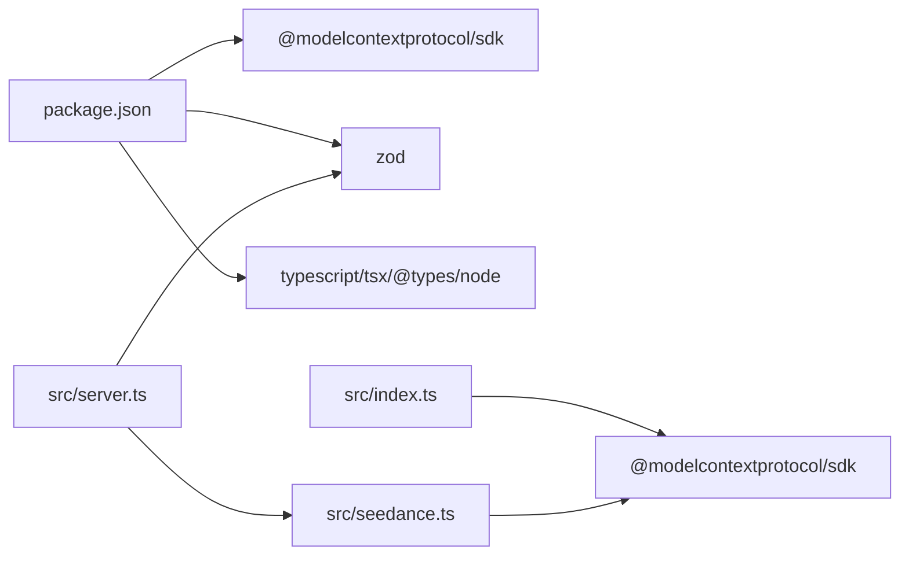

# 使用指南和最佳实践

<cite>
**本文引用的文件**
- [README.md](file://README.md)
- [package.json](file://package.json)
- [src/index.ts](file://src/index.ts)
- [src/server.ts](file://src/server.ts)
- [src/seedance.ts](file://src/seedance.ts)
- [src/schema.ts](file://src/schema.ts)
- [src/usageGuide.ts](file://src/usageGuide.ts)
- [tsconfig.json](file://tsconfig.json)
</cite>

## 目录
1. [简介](#简介)
2. [项目结构](#项目结构)
3. [核心组件](#核心组件)
4. [架构总览](#架构总览)
5. [详细组件分析](#详细组件分析)
6. [依赖关系分析](#依赖关系分析)
7. [性能考虑](#性能考虑)
8. [故障排查指南](#故障排查指南)
9. [结论](#结论)
10. [附录](#附录)

## 简介
本指南面向希望使用火山方舟 Seedance 2.0 视频生成能力的用户与集成者，提供从入门到精通的完整使用说明。该仓库实现了一个本地 stdio MCP 服务器，将 Seedance 2.0 的“文生视频/图生视频/多模态参考生成”能力以三个工具形式暴露给任意 MCP 客户端（如 Codex、Claude Desktop、Cursor 等）。核心工作流为：先获取使用说明，再提交任务，最后轮询状态并下载结果。

- 本地 stdio 运行，无需云端部署
- 通过环境变量提供火山方舟 API Key
- 严格参数校验与错误提示
- 支持多模态参考素材（文本+图像+视频+音频）

## 项目结构
- src/index.ts：MCP 服务器入口，建立 stdio 传输并启动服务
- src/server.ts：注册三个 MCP 工具（使用说明、创建任务、查询任务），并封装业务逻辑
- src/seedance.ts：对接火山方舟 ARK API 的客户端，负责任务提交与状态查询
- src/schema.ts：Zod 输入校验定义，统一参数类型与默认值
- src/usageGuide.ts：标准使用说明文本，作为工具返回内容
- package.json：包元信息、脚本与依赖
- tsconfig.json：TypeScript 编译配置

图表来源
- [src/index.ts:1-19](file://src/index.ts#L1-L19)
- [src/server.ts:1-215](file://src/server.ts#L1-L215)
- [src/seedance.ts:1-286](file://src/seedance.ts#L1-L286)
- [src/schema.ts:1-141](file://src/schema.ts#L1-L141)
- [src/usageGuide.ts:1-59](file://src/usageGuide.ts#L1-L59)
- [package.json:1-51](file://package.json#L1-L51)
- [tsconfig.json:1-23](file://tsconfig.json#L1-L23)

章节来源
- [README.md:267-283](file://README.md#L267-L283)
- [package.json:1-51](file://package.json#L1-L51)
- [tsconfig.json:1-23](file://tsconfig.json#L1-L23)

## 核心组件
- 使用说明工具（seedance_usage_guide）
  - 无参数，返回标准化使用说明文本，建议首次调用
- 创建任务工具（seedance_create_task）
  - 提交视频生成任务，立即返回 task_id，不阻塞
  - 参数包括：prompt、model、duration、ratio、resolution、generate_audio、watermark、web_search、return_last_frame、image_urls、video_urls、audio_urls
  - 对输入进行严格校验，拒绝不合法组合
- 查询任务工具（seedance_check_task）
  - 依据 task_id 查询状态，支持 running/queued/pending/succeeded/failed/cancelled/expired 等状态
  - 成功时返回 video_url（及可选 last_frame_url），失败时返回 fail_reason

章节来源
- [README.md:153-230](file://README.md#L153-L230)
- [src/server.ts:31-177](file://src/server.ts#L31-L177)
- [src/schema.ts:52-127](file://src/schema.ts#L52-L127)

## 架构总览
MCP 服务器通过 stdio 与客户端通信，内部将工具调用映射到火山 ARK API。输入参数经 Zod 校验后，转换为 ARK API 请求体，异步提交任务并返回 task_id；随后客户端轮询查询任务状态。

图表来源
- [src/server.ts:31-177](file://src/server.ts#L31-L177)
- [src/seedance.ts:149-278](file://src/seedance.ts#L149-L278)
- [src/schema.ts:52-127](file://src/schema.ts#L52-L127)

## 详细组件分析

### 组件一：MCP 服务器与工具注册
- 服务器初始化与指令说明
- 注册三个工具及其输入模式、注解（只读、幂等、开放世界）
- 工具调用的错误处理与结构化返回

图表来源
- [src/server.ts:20-177](file://src/server.ts#L20-L177)
- [src/seedance.ts:149-278](file://src/seedance.ts#L149-L278)
- [src/schema.ts:52-141](file://src/schema.ts#L52-L141)
- [src/usageGuide.ts:1-59](file://src/usageGuide.ts#L1-L59)

章节来源
- [src/server.ts:20-177](file://src/server.ts#L20-L177)

### 组件二：输入校验与参数规范
- 模型枚举、宽高比、分辨率、角色枚举
- URL 必须为 http/https
- 数组上限：image_urls≤9、video_urls≤3、audio_urls≤3
- 互斥与依赖规则：
  - 纯文本 + 音频：不允许
  - web_search=true：禁止与任何参考素材同时出现
- 参数默认值与描述

图表来源
- [src/schema.ts:52-127](file://src/schema.ts#L52-L127)
- [src/server.ts:179-199](file://src/server.ts#L179-L199)

章节来源
- [src/schema.ts:1-141](file://src/schema.ts#L1-L141)
- [src/server.ts:179-199](file://src/server.ts#L179-L199)

### 组件三：任务创建与查询
- 任务创建
  - 构造请求体：模型、内容（文本+多模态）、比例、分辨率、时长、音频开关、水印、工具、返回末帧
  - 发送 POST 请求，解析响应，提取 task_id
- 任务查询
  - 发送 GET 请求，解析状态与结果字段
  - 归一化不同 SDK 版本的结果字段名
  - 返回结构化内容（状态、视频 URL、末帧 URL、失败原因）

图表来源
- [src/server.ts:62-89](file://src/server.ts#L62-L89)
- [src/server.ts:105-173](file://src/server.ts#L105-L173)
- [src/seedance.ts:149-278](file://src/seedance.ts#L149-L278)

章节来源
- [src/seedance.ts:149-278](file://src/seedance.ts#L149-L278)
- [src/server.ts:62-89](file://src/server.ts#L62-L89)
- [src/server.ts:105-173](file://src/server.ts#L105-L173)

### 组件四：标准工作流程
- 步骤
  1) 调用使用说明工具
  2) 提交任务，获得 task_id
  3) 等待 30-90 秒
  4) 轮询查询任务状态
  5) 成功后下载视频 URL（通常 24 小时内过期）
- 时长与耗时
  - 15 秒标准模型任务通常需要 2-5 分钟完成
  - 快速模型更快但质量略低

图表来源
- [README.md:212-227](file://README.md#L212-L227)
- [src/server.ts:111-157](file://src/server.ts#L111-L157)

章节来源
- [README.md:212-227](file://README.md#L212-L227)
- [src/server.ts:111-157](file://src/server.ts#L111-L157)

### 组件五：多模态输入最佳实践
- 文本 + 图像
  - 在 prompt 中用占位符引用参考图像，role 可指定 first_frame/last_frame 以驱动动画
- 文本 + 视频
  - 在 prompt 中用占位符引用参考视频，role 指定 reference_video
- 文本 + 音频
  - 必须与至少一张图像或一段视频配对，否则被拒绝
- 上传素材要求
  - 必须为公网可访问的 HTTPS/HTTP 地址，本地路径与内网地址无效
- 组合策略
  - 优先提供与主题强相关的参考素材，确保 prompt 中正确引用
  - 控制数量：图像最多 9 张、视频最多 3 段、音频最多 3 条

章节来源
- [README.md:167-178](file://README.md#L167-L178)
- [src/schema.ts:106-126](file://src/schema.ts#L106-L126)
- [src/server.ts:179-199](file://src/server.ts#L179-L199)

### 组件六：参数详解与选择建议
- prompt
  - 描述性自然语言；可包含占位符引用参考素材
- model
  - doubao-seedance-2-0-260128：高质量标准模型
  - doubao-seedance-2-0-fast-260128：快速模型，延迟更低
- duration
  - 4-15 秒；越长耗时与成本越高
- ratio
  - 21:9/16:9/4:3/1:1/3:4/9:16/adaptive；短剧/竖屏常用 9:16
- resolution
  - 480p/720p；720p 更清晰，480p 更快更便宜
- generate_audio
  - 默认开启；关闭可生成无声视频
- watermark
  - 默认开启；部分账号可能无法关闭
- web_search
  - 仅纯文本输入可用；与参考素材冲突时被拒绝
- return_last_frame
  - 返回末帧图片 URL，便于拼接片段
- image_urls/video_urls/audio_urls
  - 严格上限与角色语义；音频需与图像/视频配对

章节来源
- [README.md:163-198](file://README.md#L163-L198)
- [src/schema.ts:52-127](file://src/schema.ts#L52-L127)

### 组件七：常见场景与模板
- 产品演示视频
  - prompt 描述产品特性与使用场景；提供产品图/演示视频作为参考
  - ratio 选择 16:9；resolution 720p；duration 5-10 秒
- 教育内容制作
  - prompt 包含知识点与讲解；参考图像/视频辅助说明
  - ratio 选择 16:9；可开启音频生成
- 创意短片
  - 以参考视频/图像为风格引导；合理使用 first_frame/last_frame 动画
  - ratio 9:16 适合短视频平台

章节来源
- [README.md:167-178](file://README.md#L167-L178)
- [src/schema.ts:106-126](file://src/schema.ts#L106-L126)

## 依赖关系分析
- 运行时依赖
  - @modelcontextprotocol/sdk：MCP 协议与 stdio 传输
  - zod：输入参数校验
- 开发依赖
  - typescript、tsx、@types/node：开发与调试
- 脚本
  - build：TypeScript 编译并设置可执行权限
  - dev：热加载运行
  - start：生产启动
  - typecheck：类型检查

图表来源
- [package.json:26-34](file://package.json#L26-L34)
- [src/index.ts:1-19](file://src/index.ts#L1-L19)
- [src/server.ts:1-16](file://src/server.ts#L1-L16)
- [src/seedance.ts:1-1](file://src/seedance.ts#L1-L1)

章节来源
- [package.json:19-25](file://package.json#L19-L25)
- [package.json:26-34](file://package.json#L26-L34)

## 性能考虑
- 任务耗时
  - 15 秒标准模型通常 2-5 分钟；快速模型更快
- 轮询策略
  - 建议 30-90 秒间隔轮询；避免过于频繁导致限流
- 成本控制
  - 降低分辨率（480p）或缩短时长（4-8 秒）可显著降低成本
  - 仅在必要时开启音频生成
- 质量保证
  - 使用高质量参考素材；合理标注 first_frame/last_frame
  - 适当提高分辨率与时长以提升观感

章节来源
- [README.md:229-229](file://README.md#L229-L229)
- [src/server.ts:135-144](file://src/server.ts#L135-L144)
- [src/schema.ts:78-81](file://src/schema.ts#L78-L81)
- [src/schema.ts:65-71](file://src/schema.ts#L65-L71)

## 故障排查指南
- 环境变量缺失
  - 症状：调用真实 API 的工具报错，提示缺少 ARK_API_KEY
  - 处理：在 MCP 客户端配置或系统环境变量中设置
- URL 不可达
  - 症状：提交任务时报错或状态长期 pending
  - 处理：确保 image_urls/video_urls/audio_urls 为公网可访问的 HTTPS/HTTP 地址
- 参数冲突
  - 纯文本 + 音频：被拒绝
  - web_search=true 与参考素材同时出现：被拒绝
  - 处理：移除冲突项或调整组合
- 任务状态异常
  - running/queued/pending：继续等待
  - failed：查看 fail_reason 并调整 prompt/参数
  - cancelled/expired：重新提交任务
- URL 过期
  - 症状：下载失败或 404
  - 处理：任务成功后尽快下载，注意 24 小时有效期

章节来源
- [README.md:103-106](file://README.md#L103-L106)
- [README.md:233-239](file://README.md#L233-L239)
- [src/server.ts:179-199](file://src/server.ts#L179-L199)
- [src/server.ts:129-156](file://src/server.ts#L129-L156)

## 结论
本指南提供了从安装、配置、参数选择到多模态实践与性能优化的完整路径。遵循标准工作流与参数规范，结合合理的轮询策略与素材准备，可在本地高效地使用 Seedance 2.0 进行视频生成。遇到问题时，优先检查环境变量、URL 可达性与参数组合，并根据状态反馈及时调整。

## 附录

### A. 安装与运行
- 通过 npx（推荐）
  - 在 MCP 客户端中配置命令为 npx，参数为 -y seedance-2-mcp
- 全局安装
  - npm install -g seedance-2-mcp
- 从源码运行（开发者）
  - git clone && npm install && npm run build && node dist/index.js
- 要求 Node.js ≥ 18

章节来源
- [README.md:59-89](file://README.md#L59-L89)

### B. 环境变量
- ARK_API_KEY：火山方舟 API Key（必填）
- ARK_BASE_URL：火山 ARK API 基础地址（可选，默认 cn-beijing）

章节来源
- [README.md:93-101](file://README.md#L93-L101)

### C. 客户端配置示例
- Codex、Claude Desktop、Cursor 等 MCP 客户端均可通过 stdio 配置接入，命令为 npx -y seedance-2-mcp，并在 env 中设置 ARK_API_KEY

章节来源
- [README.md:109-149](file://README.md#L109-L149)

### D. 安全与合规
- 不要把 ARK_API_KEY 写入 Git 仓库
- 生成的 video_url/last_frame_url 为带签名的临时 URL，默认约 24 小时过期
- 仅使用公网可访问的素材 URL
- 遵守火山方舟与 Seedance 的使用条款，避免生成违法、未成年人不当或侵权内容

章节来源
- [README.md:233-239](file://README.md#L233-L239)