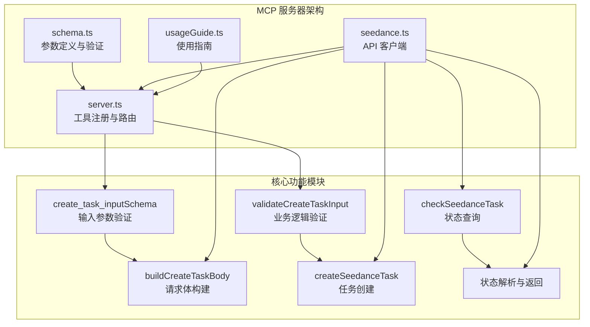
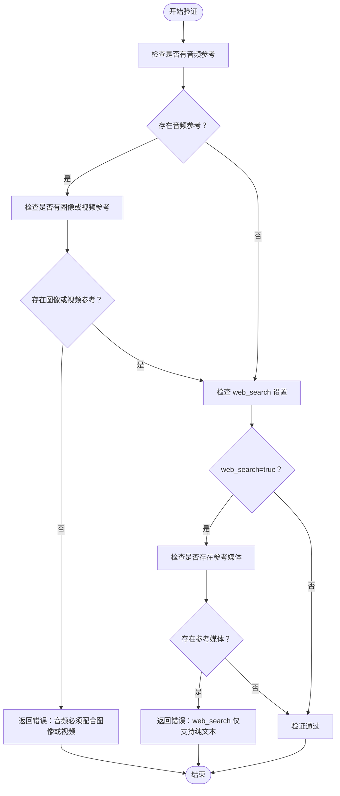
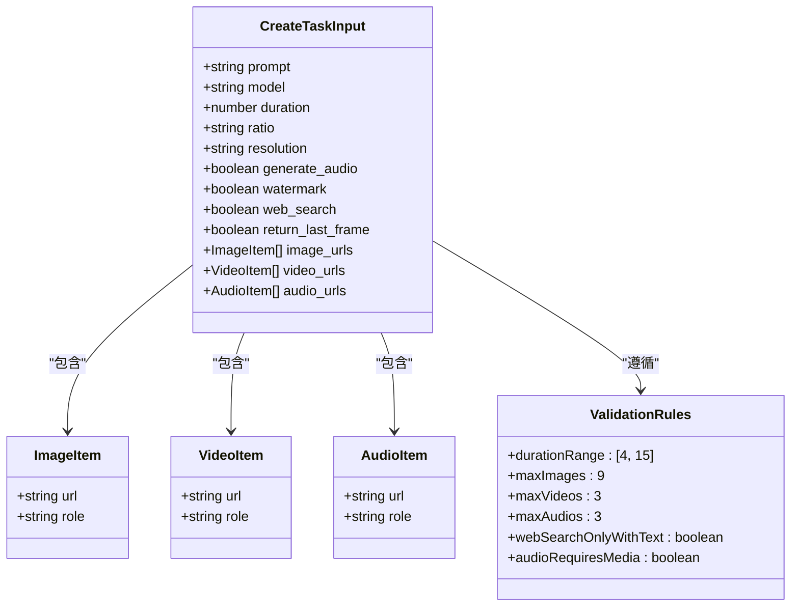

# 参数参考手册

<cite>
**本文档引用的文件**
- [schema.ts](file://src/schema.ts)
- [seedance.ts](file://src/seedance.ts)
- [server.ts](file://src/server.ts)
- [usageGuide.ts](file://src/usageGuide.ts)
- [README.md](file://README.md)
</cite>

## 目录
1. [简介](#简介)
2. [项目结构概览](#项目结构概览)
3. [核心参数详解](#核心参数详解)
4. [多模态输入参数](#多模态输入参数)
5. [参数验证规则](#参数验证规则)
6. [最佳实践指南](#最佳实践指南)
7. [参数组合示例](#参数组合示例)
8. [故障排除指南](#故障排除指南)
9. [总结](#总结)

## 简介

本手册详细说明了 `seedance_create_task` 工具的所有参数，包括必填参数 `prompt` 的编写技巧和最佳实践，以及可选参数的用途、默认值和使用限制。该工具提供了火山引擎 ARK Seedance 2.0 视频生成服务的本地 MCP 接口，支持文生视频、图生视频、视频生视频等多种生成模式。

## 项目结构概览



**图表来源**
- [schema.ts:52-127](file://src/schema.ts#L52-L127)
- [server.ts:20-177](file://src/server.ts#L20-L177)
- [seedance.ts:102-286](file://src/seedance.ts#L102-L286)

**章节来源**
- [schema.ts:1-141](file://src/schema.ts#L1-L141)
- [server.ts:1-215](file://src/server.ts#L1-L215)
- [seedance.ts:1-286](file://src/seedance.ts#L1-L286)

## 核心参数详解

### prompt（必需参数）

**类型**: string  
**默认值**: 无（必需）  
**取值范围**: 1个或多个字符  
**约束条件**: 
- 不能为空字符串
- 支持媒体引用标记 `[Image1]`、`[Video1]`、`[Audio1]`
- 1-based 顺序匹配参考媒体数组

**编写技巧与最佳实践**:
- 明确描述视频内容、风格、情感和场景
- 使用具体的视觉描述词和动作描述
- 当使用参考媒体时，确保在 prompt 中正确引用对应编号
- 保持描述简洁明了，避免歧义

**章节来源**
- [schema.ts:52-58](file://src/schema.ts#L52-L58)
- [usageGuide.ts:24-25](file://src/usageGuide.ts#L24-L25)

### model（可选参数）

**类型**: enum  
**默认值**: `doubao-seedance-2-0-260128`  
**可选值**:
- `doubao-seedance-2-0-260128`（标准版，最高质量）
- `doubao-seedance-2-0-fast-260128`（快速版，较低质量）

**用途说明**:
- 标准版提供最高质量输出，渲染时间较长
- 快速版优化延迟性能，质量相对较低但速度更快
- 根据项目需求平衡质量和性能

**章节来源**
- [schema.ts:59-64](file://src/schema.ts#L59-L64)
- [usageGuide.ts:19-20](file://src/usageGuide.ts#L19-L20)

### duration（可选参数）

**类型**: integer  
**默认值**: 5  
**取值范围**: [4, 15] 秒  
**约束条件**:
- 必须为整数
- 最小值：4秒
- 最大值：15秒

**使用建议**:
- 4-8秒：适合短视频、表情包、片段展示
- 8-12秒：适合完整故事片段
- 12-15秒：适合完整短片

**章节来源**
- [schema.ts:65-71](file://src/schema.ts#L65-L71)
- [usageGuide.ts:27](file://src/usageGuide.ts#L27)

### ratio（可选参数）

**类型**: enum  
**默认值**: `16:9`  
**可选值**:
- `21:9`（超宽屏）
- `16:9`（横屏）
- `4:3`（传统屏）
- `1:1`（正方形）
- `3:4`（竖屏）
- `9:16`（垂直短视频）
- `adaptive`（自适应）

**用途说明**:
- `9:16`：适用于 TikTok、Instagram Reels 等垂直短视频
- `16:9`：适用于 YouTube、B站等横屏视频
- `adaptive`：当提供参考媒体时，模型自动选择最佳比例

**章节来源**
- [schema.ts:72-77](file://src/schema.ts#L72-L77)
- [usageGuide.ts:28-29](file://src/usageGuide.ts#L28-L29)

### resolution（可选参数）

**类型**: enum  
**默认值**: `720p`  
**可选值**:
- `480p`（较低分辨率）
- `720p`（推荐分辨率）

**用途说明**:
- `720p`：推荐配置，质量与性能平衡
- `480p`：更快的渲染速度，更低的存储需求
- 根据网络带宽和存储空间选择合适的分辨率

**章节来源**
- [schema.ts:78-81](file://src/schema.ts#L78-L81)
- [usageGuide.ts:30](file://src/usageGuide.ts#L30)

### generate_audio（可选参数）

**类型**: boolean  
**默认值**: true  
**用途说明**:
- `true`：生成同步音频（对白、音效、背景音乐）
- `false`：生成无声视频
- 适用于需要静音场景或后期配音的情况

**章节来源**
- [schema.ts:82-87](file://src/schema.ts#L82-L87)
- [usageGuide.ts:31](file://src/usageGuide.ts#L31)

### watermark（可选参数）

**类型**: boolean  
**默认值**: true  
**用途说明**:
- `true`：添加平台水印
- `false`：移除水印
- 部分账户可能无法完全移除水印

**章节来源**
- [schema.ts:88-93](file://src/schema.ts#L88-L93)
- [usageGuide.ts:32](file://src/usageGuide.ts#L32)

### web_search（可选参数）

**类型**: boolean  
**默认值**: false  
**用途说明**:
- 启用基于网络搜索的提示词增强
- 仅支持纯文本输入（无参考媒体）
- 与参考媒体同时使用会被拒绝

**重要限制**:
- 禁止与 `image_urls`、`video_urls`、`audio_urls` 同时使用
- 仅当 `web_search=true` 且存在参考媒体时才会被拒绝

**章节来源**
- [schema.ts:94-99](file://src/schema.ts#L94-L99)
- [usageGuide.ts:33-34](file://src/usageGuide.ts#L33-L34)

### return_last_frame（可选参数）

**类型**: boolean  
**默认值**: false  
**用途说明**:
- `true`：同时返回最后一帧图片 URL
- 便于多段视频拼接和预览
- 生成额外的 API 调用成本

**章节来源**
- [schema.ts:100-105](file://src/schema.ts#L100-L105)
- [usageGuide.ts:35-36](file://src/usageGuide.ts#L35-L36)

## 多模态输入参数

### image_urls（可选参数）

**类型**: array  
**默认值**: 无  
**最大长度**: 9  
**单元素结构**: `{ url, role? }`  
**可选角色**:
- `reference_image`（默认）：普通参考图像
- `first_frame`：用于图生视频的起始帧
- `last_frame`：用于图生视频的结束帧

**用途说明**:
- 支持最多9张参考图像
- 用于图生视频、风格迁移、动画生成
- `first_frame` 和 `last_frame` 组合可创建渐变效果

**章节来源**
- [schema.ts:106-112](file://src/schema.ts#L106-L112)
- [usageGuide.ts:37-39](file://src/usageGuide.ts#L37-L39)

### video_urls（可选参数）

**类型**: array  
**默认值**: 无  
**最大长度**: 3  
**单元素结构**: `{ url, role? }`  
**可选角色**:
- `reference_video`（默认）：参考视频

**用途说明**:
- 支持最多3个参考视频
- 用于视频风格迁移、动作模仿
- 可作为图生视频的动态参考

**章节来源**
- [schema.ts:113-119](file://src/schema.ts#L113-L119)
- [usageGuide.ts:40-41](file://src/usageGuide.ts#L40-L41)

### audio_urls（可选参数）

**类型**: array  
**默认值**: 无  
**最大长度**: 3  
**单元素结构**: `{ url, role? }`  
**可选角色**:
- `reference_audio`（默认）：参考音频

**关键限制**:
- 必须与至少一个图像或视频参考配合使用
- 纯文本 + 音频生成会被拒绝
- Seedance 2.0 不支持纯文本 + 音频的组合

**章节来源**
- [schema.ts:120-126](file://src/schema.ts#L120-L126)
- [usageGuide.ts:42-44](file://src/usageGuide.ts#L42-L44)

## 参数验证规则

### 业务逻辑验证



**图表来源**
- [server.ts:179-199](file://src/server.ts#L179-L199)

### 技术约束验证



**图表来源**
- [schema.ts:52-127](file://src/schema.ts#L52-L127)
- [server.ts:179-199](file://src/server.ts#L179-L199)

**章节来源**
- [server.ts:179-199](file://src/server.ts#L179-L199)
- [schema.ts:65-71](file://src/schema.ts#L65-L71)

## 最佳实践指南

### 参数选择策略

**质量优先场景**:
- 使用标准模型：`model=doubao-seedance-2-0-260128`
- 分辨率：`720p`
- 生成音频：`true`
- 水印：`true`

**性能优先场景**:
- 使用快速模型：`model=doubao-seedance-2-0-fast-260128`
- 分辨率：`480p`
- 生成音频：`true`（如需）
- 水印：`true`

**成本控制场景**:
- 使用快速模型
- 分辨率：`480p`
- 生成音频：`false`
- 水印：`false`

### 参考媒体使用建议

**图像参考**:
- 提供高质量、清晰的参考图像
- 使用 `first_frame` 和 `last_frame` 创建动画效果
- 控制数量在合理范围内（≤9张）

**视频参考**:
- 选择与目标场景相关的参考视频
- 注意视频长度和质量的平衡
- 控制数量在合理范围内（≤3个）

**音频参考**:
- 确保音频与视觉内容协调
- 音频质量直接影响生成效果
- 必须配合图像或视频使用

### 网络搜索增强

**适用场景**:
- 需要最新的信息或时效性内容
- 纯文本描述，无具体参考媒体
- 需要额外的背景知识补充

**使用限制**:
- 不能与任何参考媒体同时使用
- 仅支持纯文本输入
- 可能增加生成时间和成本

**章节来源**
- [usageGuide.ts:46-58](file://src/usageGuide.ts#L46-L58)

## 参数组合示例

### 基础文生视频

```json
{
  "prompt": "一个美丽的日落海滩，海浪轻柔地拍打着沙滩，夕阳西下",
  "model": "doubao-seedance-2-0-260128",
  "duration": 8,
  "ratio": "16:9",
  "resolution": "720p",
  "generate_audio": true,
  "watermark": true,
  "web_search": false,
  "return_last_frame": false
}
```

### 图生视频动画

```json
{
  "prompt": "参考图像中的花朵逐渐绽放，花瓣随风飘动",
  "model": "doubao-seedance-2-0-260128",
  "duration": 5,
  "ratio": "1:1",
  "resolution": "720p",
  "generate_audio": false,
  "watermark": true,
  "web_search": false,
  "return_last_frame": true,
  "image_urls": [
    {
      "url": "https://example.com/flower_bud.jpg",
      "role": "first_frame"
    },
    {
      "url": "https://example.com/flower_bloom.jpg",
      "role": "last_frame"
    }
  ]
}
```

### 多模态参考生成

```json
{
  "prompt": "参考视频中的舞蹈动作，结合音频中的音乐节奏，生成新的舞蹈序列",
  "model": "doubao-seedance-2-0-260128",
  "duration": 10,
  "ratio": "9:16",
  "resolution": "720p",
  "generate_audio": true,
  "watermark": true,
  "web_search": false,
  "return_last_frame": false,
  "image_urls": [
    {
      "url": "https://example.com/dancer_pose.jpg",
      "role": "reference_image"
    }
  ],
  "video_urls": [
    {
      "url": "https://example.com/reference_dance.mp4",
      "role": "reference_video"
    }
  ],
  "audio_urls": [
    {
      "url": "https://example.com/music_track.mp3",
      "role": "reference_audio"
    }
  ]
}
```

### 性能优化配置

```json
{
  "prompt": "简短的城市夜景动画，建筑物灯光闪烁",
  "model": "doubao-seedance-2-0-fast-260128",
  "duration": 4,
  "ratio": "16:9",
  "resolution": "480p",
  "generate_audio": false,
  "watermark": false,
  "web_search": false,
  "return_last_frame": false
}
```

## 故障排除指南

### 常见错误及解决方案

**参数验证错误**:
- 错误：`prompt 不能为空`
  - 解决：提供有效的非空字符串
- 错误：`duration 必须在 [4, 15] 范围内`
  - 解决：调整持续时间到允许范围内
- 错误：`音频必须配合图像或视频`
  - 解决：添加至少一个图像或视频参考

**业务逻辑错误**:
- 错误：`web_search=true 与参考媒体同时使用`
  - 解决：移除参考媒体或将 `web_search` 设为 `false`
- 错误：`纯文本 + 音频生成`
  - 解决：添加图像或视频参考，或将音频移除

**API 调用错误**:
- 错误：`Missing ARK_API_KEY`
  - 解决：设置正确的 `ARK_API_KEY` 环境变量
- 错误：`URL 必须以 http:// 或 https:// 开头`
  - 解决：使用有效的公网可访问 URL

### 性能优化建议

**渲染时间优化**:
- 使用快速模型减少等待时间
- 降低分辨率以加快处理速度
- 减少参考媒体数量
- 缩短视频时长

**成本控制**:
- 关闭不必要的音频生成
- 移除水印以减少处理开销
- 使用较低分辨率输出
- 避免过度使用网络搜索增强

**稳定性保障**:
- 确保所有参考媒体 URL 公网可达
- 验证 API 密钥有效性
- 监控任务状态及时重试失败的任务
- 预留充足的重试时间窗口

**章节来源**
- [server.ts:179-207](file://src/server.ts#L179-L207)
- [seedance.ts:149-194](file://src/seedance.ts#L149-L194)

## 总结

本参数参考手册详细介绍了 `seedance_create_task` 工具的所有参数及其使用方法。关键要点包括：

1. **参数分类**：明确区分必需参数（`prompt`）和可选参数，了解每个参数的作用和默认值
2. **验证规则**：掌握参数范围限制和业务逻辑约束，避免常见错误
3. **最佳实践**：根据不同场景选择合适的参数组合，平衡质量、性能和成本
4. **多模态支持**：充分利用图像、视频、音频参考媒体的组合效果
5. **故障排除**：识别常见问题并提供针对性的解决方案

建议在实际使用前先调用 `seedance_usage_guide` 工具获取完整的使用说明，然后根据具体需求选择合适的参数配置。记住生成的视频 URL 通常会在24小时内过期，应及时下载保存。