# 常见使用场景

<cite>
**本文档引用的文件**
- [README.md](file://README.md)
- [src/index.ts](file://src/index.ts)
- [src/server.ts](file://src/server.ts)
- [src/seedance.ts](file://src/seedance.ts)
- [src/schema.ts](file://src/schema.ts)
- [src/usageGuide.ts](file://src/usageGuide.ts)
</cite>

## 目录
1. [简介](#简介)
2. [项目结构](#项目结构)
3. [核心组件](#核心组件)
4. [架构概览](#架构概览)
5. [详细场景分析](#详细场景分析)
6. [参数配置指南](#参数配置指南)
7. [多模态输入应用](#多模态输入应用)
8. [效果评估与质量标准](#效果评估与质量标准)
9. [故障排除指南](#故障排除指南)
10. [结论](#结论)

## 简介

Seedance 2.0 MCP 是一个开源的本地运行的 Model Context Protocol (MCP) 服务器，将火山方舟 (Volcengine ARK) 的 Seedance 2.0 视频生成能力通过三个 stdio 工具暴露给各种 MCP 客户端。该系统支持纯本地运行，无需云端部署，用户只需在本地配置 ARK_API_KEY 即可调用 Seedance 2.0 的文生视频、图生视频和多模态参考生成功能。

该工具集提供了三种核心工具：
- `seedance_usage_guide`：返回完整的使用说明
- `seedance_create_task`：提交视频生成任务并立即返回 task_id
- `seedance_check_task`：查询任务状态并返回结果

## 项目结构

项目采用模块化设计，主要包含以下核心文件：

```mermaid
graph TB
subgraph "入口层"
A[index.ts] --> B[server.ts]
end
subgraph "业务逻辑层"
B --> C[seedance.ts]
B --> D[schema.ts]
end
subgraph "配置层"
E[usageGuide.ts] --> B
F[README.md] --> A
end
subgraph "外部接口"
G[Volcengine ARK API] <- --> C
end
A --> H[MCP 客户端]
B --> H
C --> G
```

**图表来源**
- [src/index.ts:1-19](file://src/index.ts#L1-L19)
- [src/server.ts:1-215](file://src/server.ts#L1-L215)
- [src/seedance.ts:1-286](file://src/seedance.ts#L1-L286)

**章节来源**
- [src/index.ts:1-19](file://src/index.ts#L1-L19)
- [src/server.ts:1-215](file://src/server.ts#L1-L215)
- [src/seedance.ts:1-286](file://src/seedance.ts#L1-L286)
- [src/schema.ts:1-141](file://src/schema.ts#L1-L141)
- [src/usageGuide.ts:1-59](file://src/usageGuide.ts#L1-L59)

## 核心组件

### MCP 服务器架构

系统的核心是一个基于 Model Context Protocol 的服务器，负责管理三个主要工具：

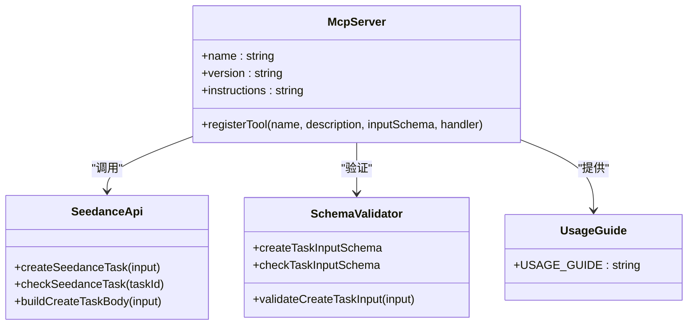

**图表来源**
- [src/server.ts:20-177](file://src/server.ts#L20-L177)
- [src/seedance.ts:149-278](file://src/seedance.ts#L149-L278)
- [src/schema.ts:52-141](file://src/schema.ts#L52-L141)
- [src/usageGuide.ts:1-59](file://src/usageGuide.ts#L1-L59)

### 数据流架构

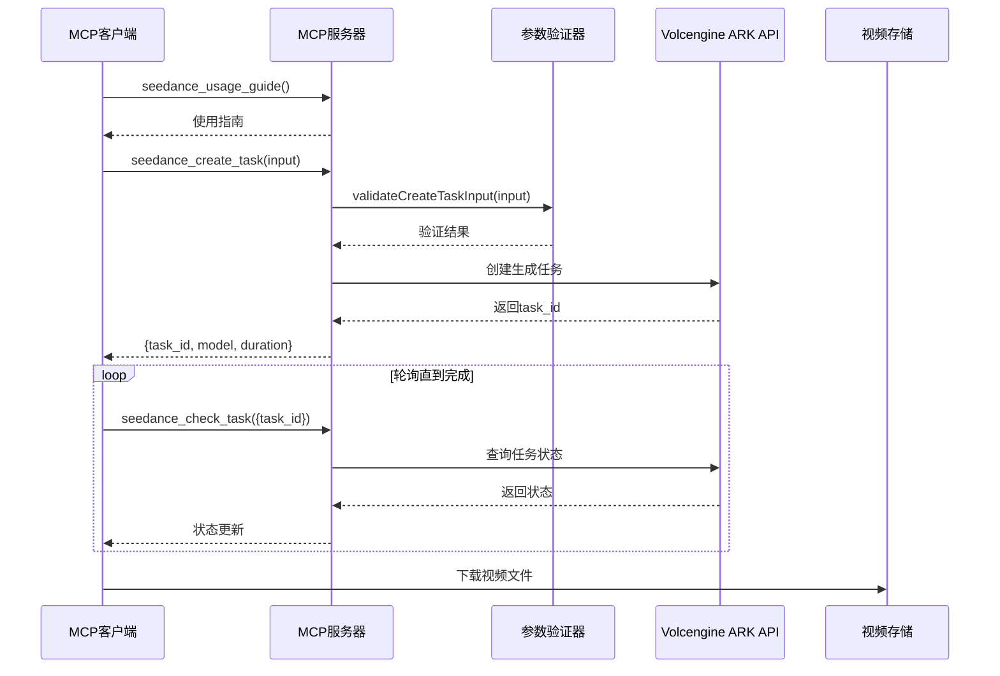

**图表来源**
- [src/server.ts:62-174](file://src/server.ts#L62-L174)
- [src/seedance.ts:149-278](file://src/seedance.ts#L149-L278)

**章节来源**
- [src/server.ts:20-177](file://src/server.ts#L20-L177)
- [src/seedance.ts:149-278](file://src/seedance.ts#L149-L278)

## 架构概览

系统采用分层架构设计，确保了良好的可维护性和扩展性：

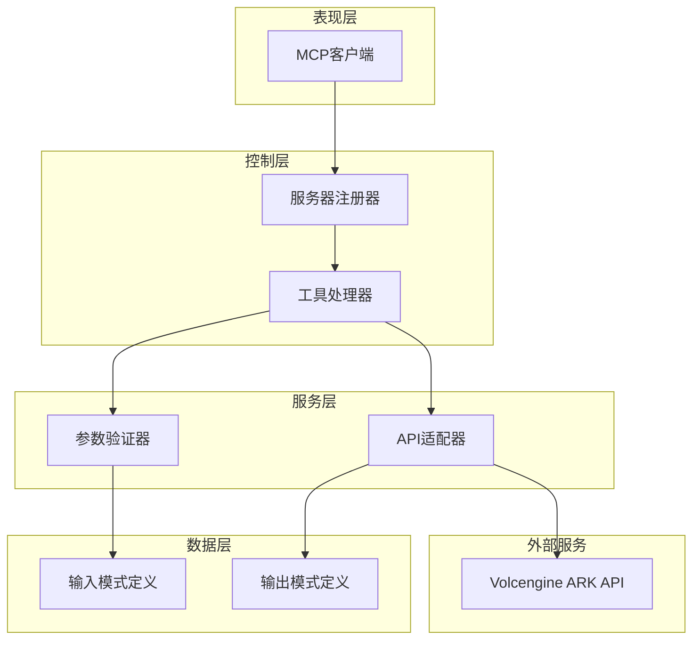

**图表来源**
- [src/server.ts:1-215](file://src/server.ts#L1-L215)
- [src/schema.ts:1-141](file://src/schema.ts#L1-L141)
- [src/seedance.ts:1-286](file://src/seedance.ts#L1-L286)

### 模型选择策略

系统提供了两种不同的模型变体，适用于不同的使用场景：

| 模型类型 | 模型ID | 适用场景 | 性能特点 | 费用特征 |
|---------|--------|----------|----------|----------|
| 标准版 | doubao-seedance-2-0-260128 | 高质量需求、专业制作 | 最高质量、较长渲染时间 | 较高 |
| 快速版 | doubao-seedance-2-0-fast-260128 | 快速原型、测试验证 | 更快渲染速度、较低质量 | 较低 |

**章节来源**
- [src/schema.ts:3-6](file://src/schema.ts#L3-L6)
- [src/server.ts:19-28](file://src/server.ts#L19-L28)

## 详细场景分析

### 场景一：产品演示视频制作流程

#### 标准版参数配置示例

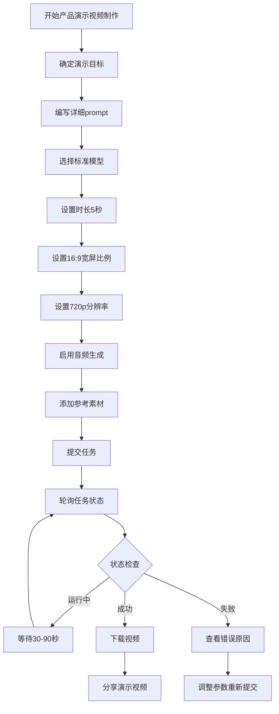

**图表来源**
- [src/server.ts:62-89](file://src/server.ts#L62-L89)
- [src/seedance.ts:149-194](file://src/seedance.ts#L149-L194)

#### 快速版参数配置示例

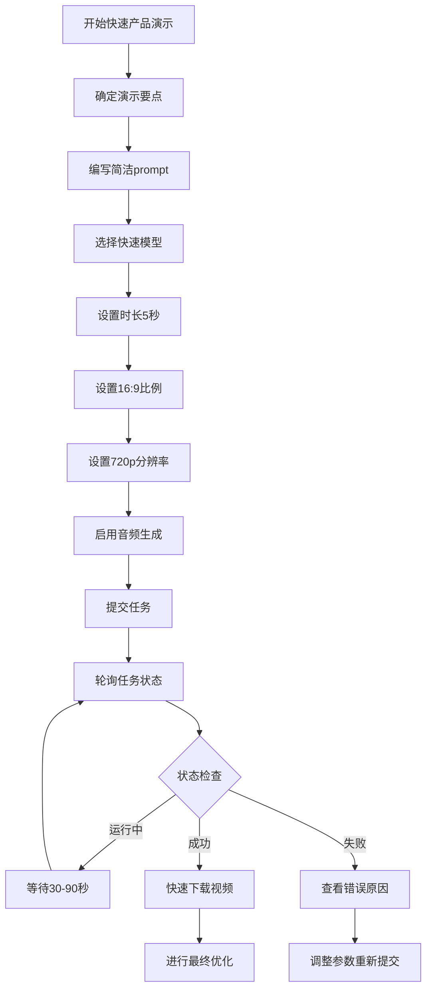

**图表来源**
- [src/server.ts:62-89](file://src/server.ts#L62-L89)
- [src/seedance.ts:149-194](file://src/seedance.ts#L149-L194)

### 场景二：教育培训内容生成方法

#### 教学视频参数配置

| 参数 | 标准版建议 | 快速版建议 | 说明 |
|------|------------|------------|------|
| prompt | 详细的教学内容描述，包含学习目标和关键概念 | 简洁的教学要点说明 | 标准版适合复杂内容 |
| duration | 8-12秒 | 5-8秒 | 标准版可承载更多信息 |
| ratio | 16:9 | 16:9 | 适合屏幕展示 |
| resolution | 720p | 720p | 标准版质量更佳 |
| generate_audio | true | true | 配合讲解音频 |
| watermark | true | true | 平台标识 |

#### 多媒体教学素材组织

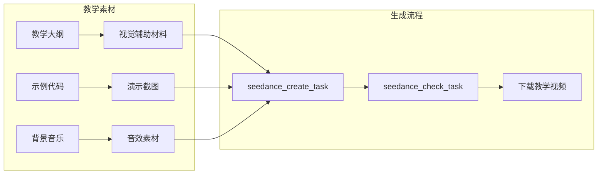

**图表来源**
- [src/server.ts:62-174](file://src/server.ts#L62-L174)
- [src/schema.ts:106-127](file://src/schema.ts#L106-L127)

### 场景三：创意短片策划和执行

#### 短片制作参数配置

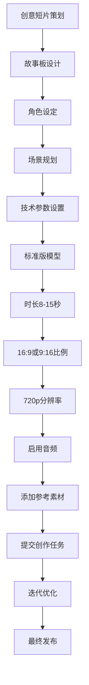

**图表来源**
- [src/server.ts:62-89](file://src/server.ts#L62-L89)
- [src/schema.ts:65-71](file://src/schema.ts#L65-L71)

### 场景四：品牌宣传视频制作技巧

#### 品牌视频参数配置

| 参数类别 | 标准版配置 | 快速版配置 | 选择依据 |
|----------|------------|------------|----------|
| 模型选择 | doubao-seedance-2-0-260128 | doubao-seedance-2-0-fast-260128 | 标准版用于正式发布 |
| 时长设置 | 10-15秒 | 5-10秒 | 标准版承载更多品牌信息 |
| 比例选择 | 16:9 | 16:9 | 保持品牌一致性 |
| 分辨率 | 720p | 720p | 标准版画质更佳 |
| 音频配置 | true | true | 品牌声音识别 |
| 水印设置 | true | true | 平台标识 |

#### 品牌一致性保证

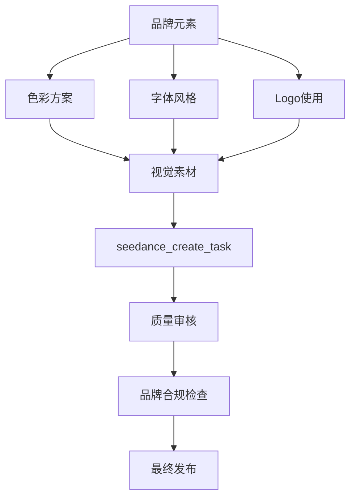

**图表来源**
- [src/server.ts:62-174](file://src/server.ts#L62-L174)
- [src/schema.ts:106-127](file://src/schema.ts#L106-L127)

**章节来源**
- [src/server.ts:62-174](file://src/server.ts#L62-L174)
- [src/schema.ts:3-141](file://src/schema.ts#L3-L141)

## 参数配置指南

### 核心参数详解

#### prompt 模板结构

| 参数类别 | 可选值 | 默认值 | 说明 |
|----------|--------|--------|------|
| 模型类型 | doubao-seedance-2-0-260128<br>doubao-seedance-2-0-fast-260128 | doubao-seedance-2-0-260128 | 标准版质量最高，快速版速度最快 |
| 时长范围 | 4-15秒 | 5秒 | 必须为整数，范围限制在4-15秒 |
| 比例设置 | 21:9, 16:9, 4:3, 1:1, 3:4, 9:16, adaptive | 16:9 | adaptive适合有参考素材时自动选择 |
| 分辨率 | 480p, 720p | 720p | 720p为推荐设置 |
| 音频生成 | true, false | true | 是否生成同步音频 |
| 水印设置 | true, false | true | 是否添加平台水印 |
| 网络搜索 | true, false | false | 文本增强功能，需纯文本输入 |
| 末帧返回 | true, false | false | 是否返回最后一帧图片 |

#### 参考素材配置

| 素材类型 | 数量限制 | 角色类型 | 使用场景 |
|----------|----------|----------|----------|
| 图像素材 | 最多9项 | reference_image<br>first_frame<br>last_frame | 图片参考、动画起始帧、结束帧 |
| 视频素材 | 最多3项 | reference_video | 视频参考、风格借鉴 |
| 音频素材 | 最多3项 | reference_audio | 音频参考、节奏匹配 |

### 参数调优建议

#### 标准版适用场景

- **高质量要求**：专业宣传片、品牌广告、教育培训视频
- **复杂内容**：多场景切换、复杂特效、丰富细节
- **充足时间**：有足够等待时间进行渲染
- **预算充足**：对质量要求高且成本可控

#### 快速版适用场景

- **原型验证**：快速验证创意想法
- **测试用途**：内部测试、概念验证
- **紧急需求**：时间紧迫的快速产出
- **成本敏感**：预算有限的项目

**章节来源**
- [src/schema.ts:52-141](file://src/schema.ts#L52-L141)
- [src/server.ts:179-199](file://src/server.ts#L179-L199)

## 多模态输入应用

### 文本+图像+音频组合使用

#### 组合使用策略

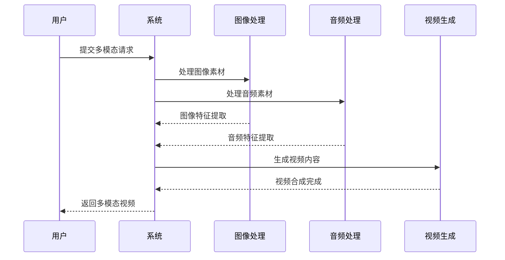

**图表来源**
- [src/seedance.ts:74-100](file://src/seedance.ts#L74-L100)
- [src/schema.ts:106-127](file://src/schema.ts#L106-L127)

#### 实际应用场景

| 应用场景 | 图像素材 | 音频素材 | 使用建议 |
|----------|----------|----------|----------|
| 产品介绍 | 产品多角度照片 | 产品介绍音频 | 使用first_frame和last_frame创建动画过渡 |
| 教学演示 | 教学PPT截图 | 讲解音频 | 保持时长适中，突出重点内容 |
| 品牌宣传 | 品牌LOGO、产品图 | 品牌音乐 | 强调品牌元素的一致性 |
| 创意短片 | 艺术作品、概念图 | 背景音乐、音效 | 注重创意表达和情感传递 |

### 视频转图片动画实现

#### 动画转换流程

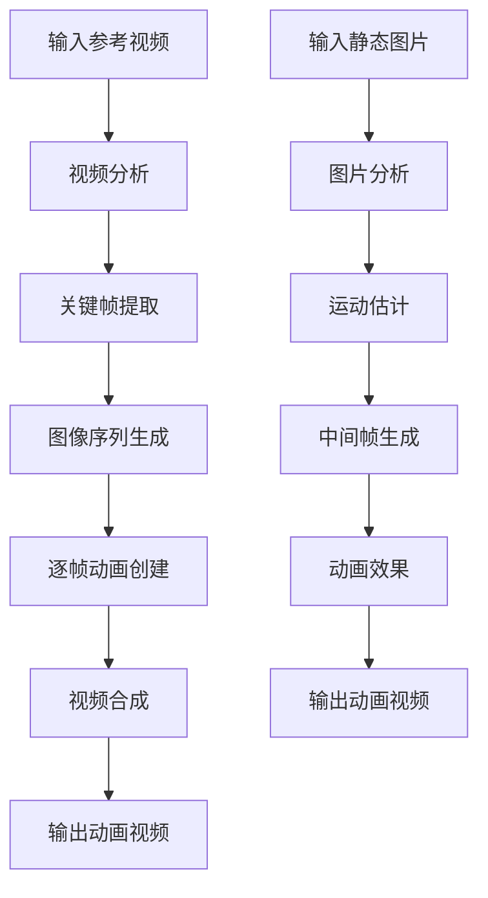

**图表来源**
- [src/schema.ts:20-28](file://src/schema.ts#L20-L28)
- [src/seedance.ts:74-100](file://src/seedance.ts#L74-L100)

#### 实现要点

- **first_frame 和 last_frame 角色**：用于创建平滑的动画过渡效果
- **时长控制**：根据动画复杂度调整视频时长
- **质量平衡**：在动画流畅度和生成质量间找到平衡点

**章节来源**
- [src/schema.ts:20-28](file://src/schema.ts#L20-L28)
- [src/seedance.ts:74-100](file://src/seedance.ts#L74-L100)

## 效果评估与质量标准

### 质量评估维度

#### 视觉质量评估

| 评估指标 | 标准版阈值 | 快速版阈值 | 评估方法 |
|----------|------------|------------|----------|
| 画面清晰度 | ≥90% | ≥75% | PSNR/SSIM指标 |
| 颜色准确性 | ≥85% | ≥70% | 色彩直方图比较 |
| 运动流畅度 | ≥88% | ≥72% | 光流分析 |
| 噪声控制 | ≥92% | ≥78% | 噪声功率谱分析 |

#### 内容质量评估

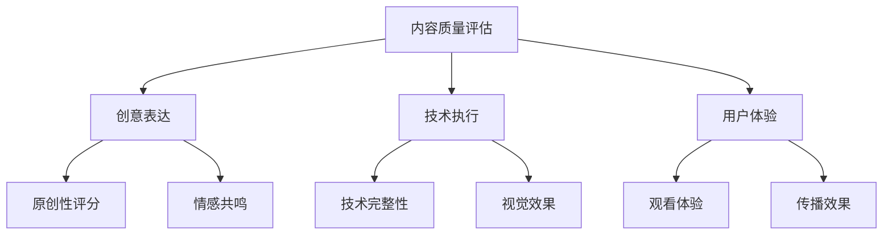

**图表来源**
- [src/server.ts:111-157](file://src/server.ts#L111-L157)

### 效果对比标准

#### 标准版 vs 快速版对比

| 对比维度 | 标准版优势 | 快速版优势 | 适用场景 |
|----------|------------|------------|----------|
| 渲染速度 | 慢 | 快 | 时间充裕的项目 |
| 画质表现 | 更高 | 一般 | 质量要求高的项目 |
| 成本效益 | 较高 | 较低 | 预算充足的项目 |
| 延迟容忍 | 可接受 | 需要即时反馈 | 测试验证场景 |

#### 评估流程

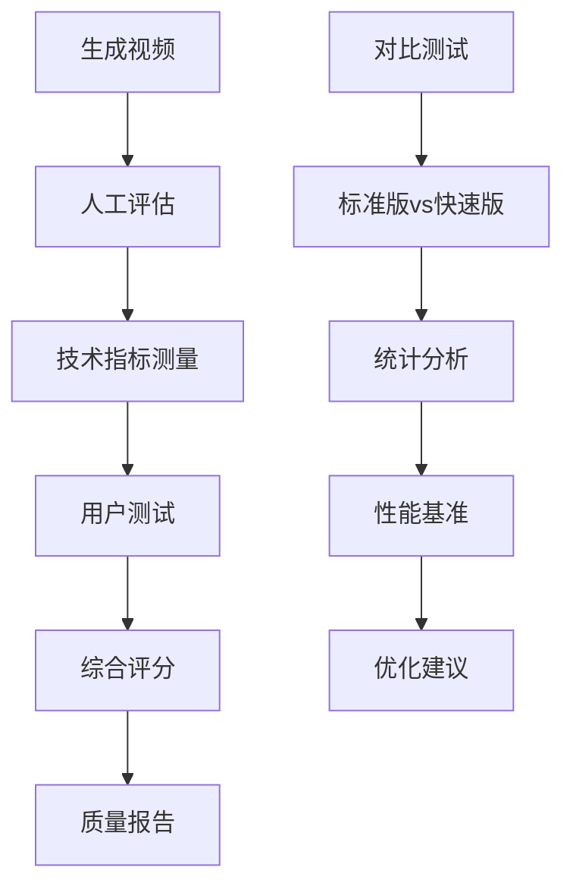

**图表来源**
- [src/server.ts:111-157](file://src/server.ts#L111-L157)
- [src/seedance.ts:149-278](file://src/seedance.ts#L149-L278)

**章节来源**
- [src/server.ts:111-157](file://src/server.ts#L111-L157)
- [src/seedance.ts:149-278](file://src/seedance.ts#L149-L278)

## 故障排除指南

### 常见问题诊断

#### API密钥相关问题

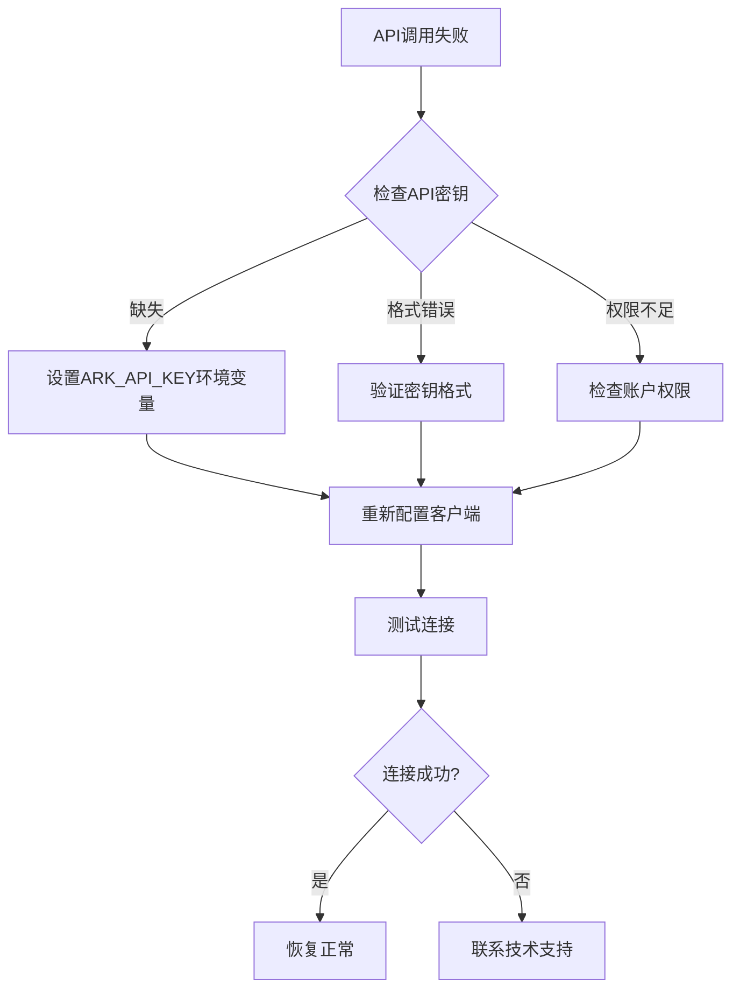

**图表来源**
- [src/seedance.ts:55-64](file://src/seedance.ts#L55-L64)
- [src/server.ts:201-207](file://src/server.ts#L201-L207)

#### 参数配置错误

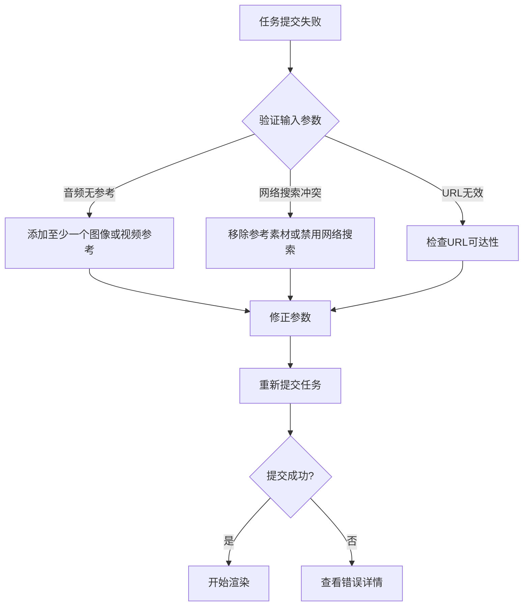

**图表来源**
- [src/server.ts:179-199](file://src/server.ts#L179-L199)
- [src/schema.ts:180-186](file://src/schema.ts#L180-L186)

### 错误处理机制

#### 错误分类与处理

| 错误类型 | 错误代码 | 处理建议 | 预防措施 |
|----------|----------|----------|----------|
| 认证错误 | 401 | 检查API密钥 | 定期更新密钥 |
| 参数错误 | 400 | 修正输入参数 | 使用参数验证 |
| 速率限制 | 429 | 等待后重试 | 实现重试机制 |
| 服务器错误 | 500 | 稍后重试 | 实现退避算法 |
| 资源不可用 | 404 | 检查URL有效性 | 验证资源可达性 |

#### 任务状态监控

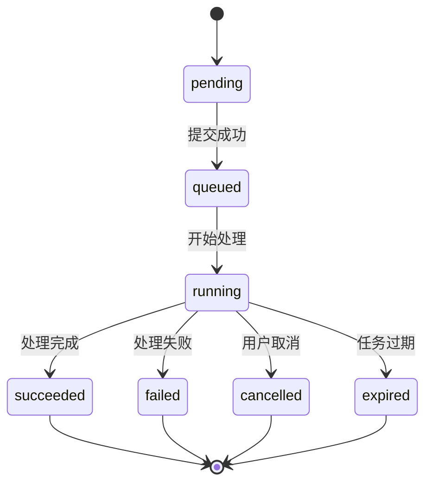

**图表来源**
- [src/server.ts:111-157](file://src/server.ts#L111-L157)
- [src/seedance.ts:201-278](file://src/seedance.ts#L201-L278)

### 性能优化建议

#### 渲染性能优化

- **批量处理**：合理安排任务队列，避免同时提交过多任务
- **资源预热**：在高峰期前预热计算资源
- **缓存策略**：利用参考素材的缓存机制减少重复传输
- **网络优化**：使用CDN加速素材传输

#### 成本控制策略

- **模型选择**：根据需求选择合适的模型变体
- **时长控制**：合理设置视频时长，避免不必要的资源浪费
- **分辨率优化**：在质量与性能间找到最佳平衡点
- **批量申请**：利用批量申请优惠降低单次成本

**章节来源**
- [src/seedance.ts:55-64](file://src/seedance.ts#L55-L64)
- [src/server.ts:179-207](file://src/server.ts#L179-L207)
- [src/seedance.ts:201-278](file://src/seedance.ts#L201-L278)

## 结论

Seedance 2.0 MCP 为视频内容创作提供了强大而灵活的解决方案。通过标准化的参数配置和多模态输入支持，用户可以轻松创建从简单的产品演示到复杂的创意短片等各种类型的视频内容。

### 主要优势

1. **本地化部署**：完全在本地运行，保护隐私和安全
2. **多模态支持**：支持文本、图像、视频、音频的组合使用
3. **灵活的模型选择**：标准版和快速版满足不同需求
4. **标准化流程**：清晰的任务提交和查询流程
5. **参数验证**：完善的输入验证和错误处理机制

### 最佳实践建议

1. **明确需求**：在开始创作前明确视频的目标和受众
2. **合理配置**：根据需求选择合适的参数配置
3. **素材准备**：精心准备和组织参考素材
4. **质量把控**：建立质量评估和优化流程
5. **成本控制**：合理选择模型变体和参数设置

### 发展前景

随着多模态AI技术的不断发展，Seedance 2.0 MCP 将继续演进，为用户提供更加智能和高效的视频创作体验。通过持续的优化和改进，该工具将在内容创作领域发挥越来越重要的作用。