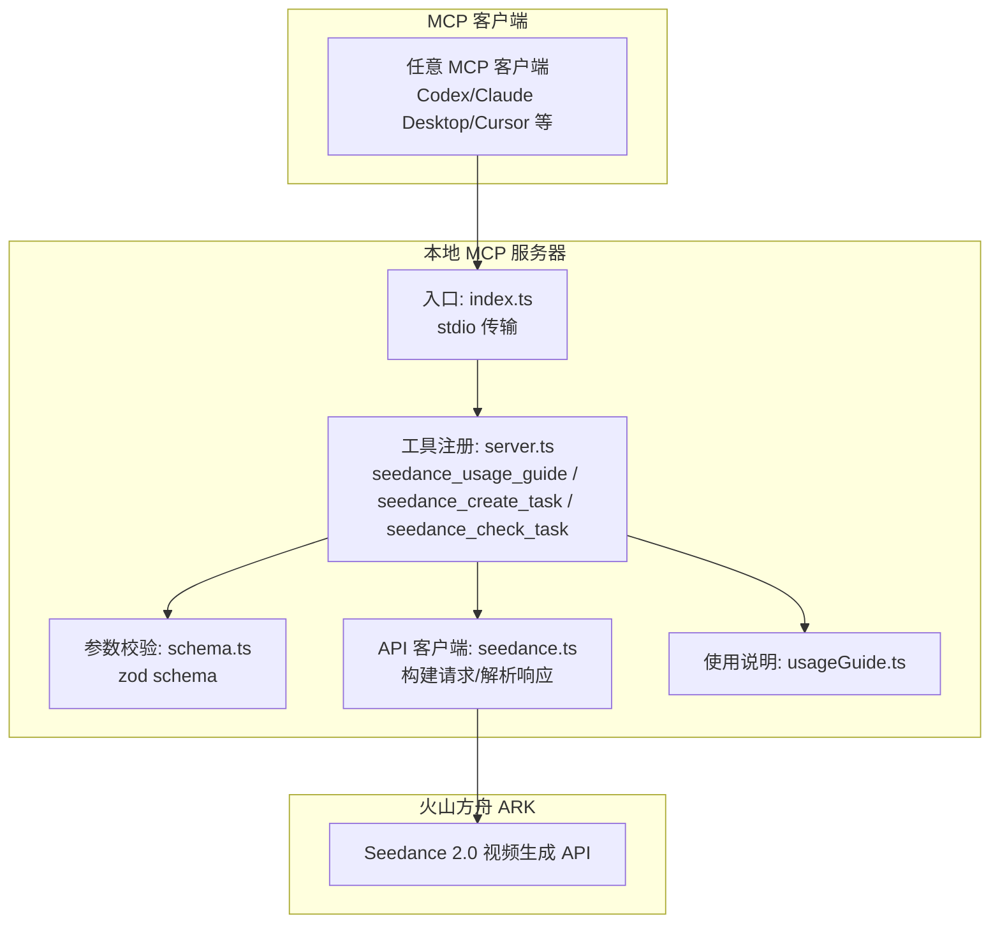
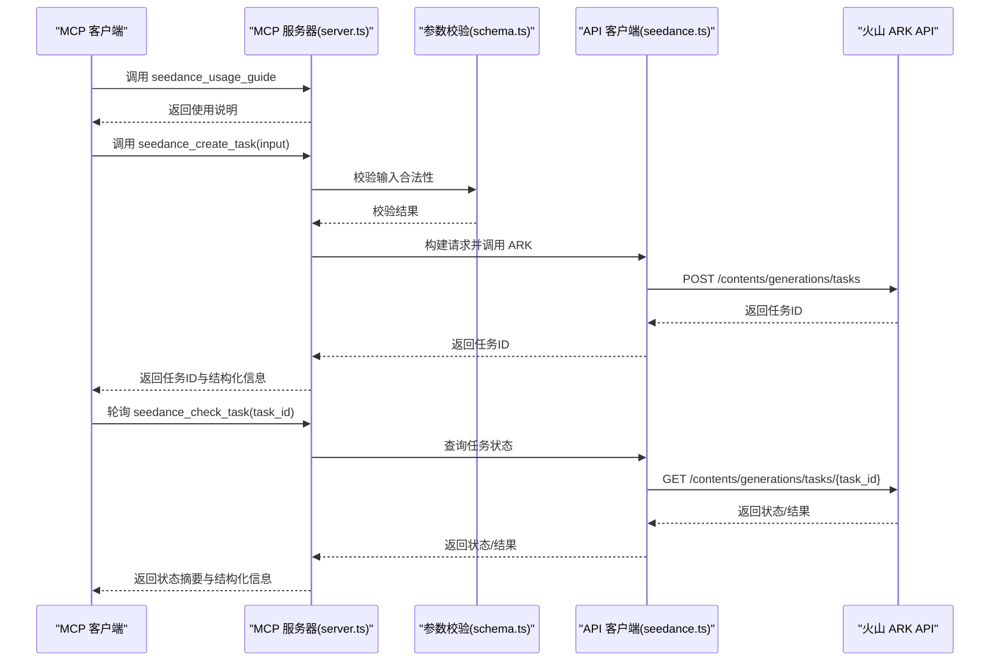
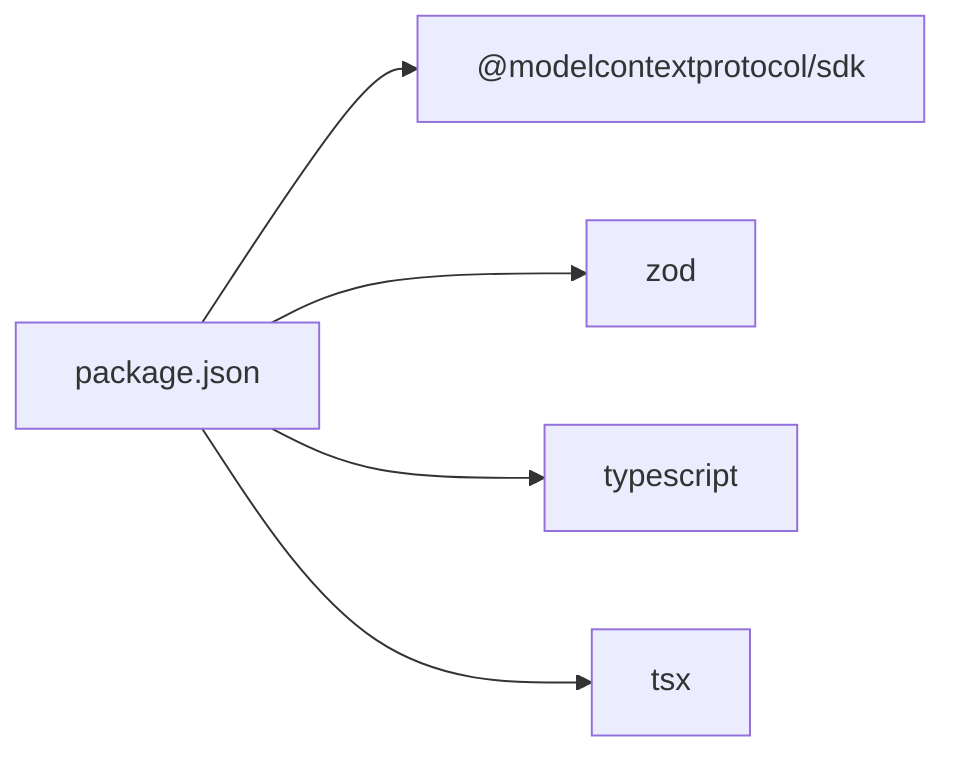

# 最佳实践指南

<cite>
**本文引用的文件**
- [README.md](file://README.md)
- [index.ts](file://src/index.ts)
- [server.ts](file://src/server.ts)
- [schema.ts](file://src/schema.ts)
- [seedance.ts](file://src/seedance.ts)
- [usageGuide.ts](file://src/usageGuide.ts)
- [package.json](file://package.json)
</cite>

## 目录
1. [简介](#简介)
2. [项目结构](#项目结构)
3. [核心组件](#核心组件)
4. [架构总览](#架构总览)
5. [详细组件分析](#详细组件分析)
6. [依赖关系分析](#依赖关系分析)
7. [性能与成本优化](#性能与成本优化)
8. [质量保证与安全使用](#质量保证与安全使用)
9. [故障排查指南](#故障排查指南)
10. [结论](#结论)
11. [附录](#附录)

## 简介
本指南面向使用火山方舟 Seedance 2.0 视频生成能力的开发者与内容创作者，围绕 prompt 编写、参考素材组合、多场景应用、性能与成本优化、质量保证与安全使用等方面提供系统化最佳实践。该仓库提供了一个本地 stdio MCP 服务器，将 Seedance 2.0 的文生视频、图生视频、多模态参考生成能力以三个工具形式暴露给任意 MCP 客户端，支持纯文本、图片、视频、音频的组合输入，并提供任务提交与轮询查询能力。

## 项目结构
- 入口与传输层：通过 stdio 传输协议连接 MCP 客户端，负责工具注册与消息路由。
- 工具层：提供使用说明、任务提交、任务查询三个工具。
- 参数与校验：基于 zod 的输入 schema，统一约束参数类型、范围与组合规则。
- API 客户端：封装火山方舟 ARK 的 REST API，负责鉴权、请求构建、响应解析与错误格式化。
- 使用说明：提供标准化的使用流程、参数说明与注意事项。

图表来源
- [index.ts:1-19](file://src/index.ts#L1-L19)
- [server.ts:20-177](file://src/server.ts#L20-L177)
- [schema.ts:52-141](file://src/schema.ts#L52-L141)
- [seedance.ts:149-278](file://src/seedance.ts#L149-L278)
- [usageGuide.ts:1-59](file://src/usageGuide.ts#L1-L59)

章节来源
- [README.md:267-283](file://README.md#L267-L283)
- [package.json:1-51](file://package.json#L1-L51)

## 核心组件
- 使用说明工具：返回标准化的使用指南，包含工作流、模型选择、参数表与注意事项。
- 任务提交工具：接收自然语言描述与可选参考素材，立即返回任务 ID，不阻塞等待。
- 任务查询工具：根据任务 ID 查询状态，成功后返回视频 URL（以及可选末帧图片），失败返回原因。
- 参数与校验：统一约束 duration、ratio、resolution、generate_audio、watermark、web_search、return_last_frame、image_urls、video_urls、audio_urls 等字段，确保输入合法与互斥条件满足。
- API 客户端：封装 ARK API 的鉴权、请求体构建、响应解析与错误格式化，支持自定义基础 URL。

章节来源
- [server.ts:31-177](file://src/server.ts#L31-L177)
- [schema.ts:52-141](file://src/schema.ts#L52-L141)
- [seedance.ts:149-278](file://src/seedance.ts#L149-L278)
- [usageGuide.ts:1-59](file://src/usageGuide.ts#L1-L59)

## 架构总览
下图展示 MCP 客户端与本地服务器、API 客户端与火山 ARK 的交互流程，以及工具调用的职责边界。

图表来源
- [server.ts:31-177](file://src/server.ts#L31-L177)
- [schema.ts:52-141](file://src/schema.ts#L52-L141)
- [seedance.ts:149-278](file://src/seedance.ts#L149-L278)

## 详细组件分析

### prompt 编写技巧与模板
- 场景描述：明确主体、背景、时间、地点、氛围等，帮助模型理解画面基调。
- 动作序列：使用连贯的动作动词，描述角色行为或物体运动轨迹。
- 风格元素：指定摄影风格（如电影感、纪录片）、色调、光影、构图比例等。
- 情感与节奏：强调情绪变化、音乐节拍、镜头切换节奏，提升叙事张力。
- 参考素材标注：在 prompt 中使用占位符引用参考素材，确保顺序与数组一致。
- 纯文本 + 网络增强：当启用网络增强时，需保持纯文本输入，避免与参考素材混用。

章节来源
- [schema.ts:52-127](file://src/schema.ts#L52-L127)
- [usageGuide.ts:24-44](file://src/usageGuide.ts#L24-L44)
- [README.md:159-186](file://README.md#L159-L186)

### 参考素材的有效使用策略
- 图片作为参考图像：最多 9 项，可标注参考图像、首帧、尾帧，用于图生视频或动画过渡。
- 视频作为参考视频：最多 3 项，用于风格迁移或动作参考。
- 音频作为参考音频：最多 3 项，必须与至少一项图片或视频配对，用于音画同步。
- URL 要求：所有素材 URL 必须公网可访问，HTTPS/HTTP 均可，本地路径与内网地址无效。
- 组合策略：优先使用与目标风格最接近的素材；音频与视觉素材成对出现以获得更好的音画同步效果。

章节来源
- [schema.ts:106-126](file://src/schema.ts#L106-L126)
- [README.md:176-178](file://README.md#L176-L178)
- [README.md:238](file://README.md#L238)

### 不同应用场景的最佳实践
- 产品演示视频：聚焦产品特性与使用流程，使用高分辨率与合适比例，必要时开启音轨以增强表现力。
- 教育内容制作：强调清晰度与可读性，采用稳定镜头与简洁背景，可使用首帧/尾帧衔接片段。
- 创意短片：注重风格一致性与节奏把控，结合参考视频与音频形成统一的视觉与听觉语言。
- 品牌宣传：突出品牌元素与调性，使用品牌色与标志性构图，谨慎使用水印以符合品牌策略。

章节来源
- [schema.ts:72-81](file://src/schema.ts#L72-L81)
- [schema.ts:78-81](file://src/schema.ts#L78-L81)
- [schema.ts:88-93](file://src/schema.ts#L88-L93)

### 任务提交与轮询流程
- 标准流程：先调用使用说明工具，再提交任务，等待 30-90 秒后轮询查询，直至成功或失败。
- 成功后处理：及时下载视频 URL（通常 24 小时内过期），必要时保存末帧图片用于拼接。
- 失败与异常：关注失败原因与状态码，修正输入后重新提交。

章节来源
- [server.ts:105-173](file://src/server.ts#L105-L173)
- [README.md:212-227](file://README.md#L212-L227)

### 参数与校验逻辑
- 模型选择：标准模型质量最高，快速模型延迟更低但保真度略降。
- 时长与分辨率：时长限制在 4-15 秒；分辨率 480p/720p，720p 更推荐。
- 比例选择：根据用途选择 16:9/9:16/4:3 等，或使用 adaptive 让模型自适配。
- 互斥与组合：纯文本 + 音频不被支持；启用网络增强时不得携带参考素材。
- 结构化输出：工具返回人类可读摘要与结构化内容，便于自动化处理。

章节来源
- [schema.ts:59-64](file://src/schema.ts#L59-L64)
- [schema.ts:65-71](file://src/schema.ts#L65-L71)
- [schema.ts:78-81](file://src/schema.ts#L78-L81)
- [schema.ts:72-77](file://src/schema.ts#L72-L77)
- [schema.ts:184-196](file://src/schema.ts#L184-L196)
- [server.ts:62-89](file://src/server.ts#L62-L89)
- [server.ts:105-173](file://src/server.ts#L105-L173)

### API 客户端与错误处理
- 鉴权与基础 URL：通过环境变量注入 API Key，支持自定义基础 URL。
- 请求体构建：将 prompt 与参考素材转换为统一内容项，附加模型、时长、比例、分辨率等参数。
- 响应解析：兼容多种结果字段布局，提取视频 URL、末帧 URL、失败原因等。
- 错误格式化：区分 API 错误与通用错误，提供可读的错误信息与状态码。

章节来源
- [seedance.ts:55-72](file://src/seedance.ts#L55-L72)
- [seedance.ts:102-114](file://src/seedance.ts#L102-L114)
- [seedance.ts:201-278](file://src/seedance.ts#L201-L278)
- [server.ts:201-207](file://src/server.ts#L201-L207)

## 依赖关系分析
- 运行时依赖：MCP SDK 与 zod，分别用于协议通信与输入校验。
- 开发依赖：TypeScript、tsx、Node 类型声明，支持开发与热重载。
- 入口脚本：通过二进制名绑定到 dist/index.js，构建后赋予可执行权限。

图表来源
- [package.json:26-34](file://package.json#L26-L34)

章节来源
- [package.json:19-25](file://package.json#L19-L25)

## 性能与成本优化
- 合理设置时长与分辨率
  - 时长：在 4-15 秒范围内根据内容复杂度选择，避免过长导致渲染时间显著增加。
  - 分辨率：720p 画质更优，480p 渲染更快、成本更低，适合快速迭代与预览。
- 模型选择
  - 标准模型：质量最高，适合最终交付；快速模型：延迟更低，适合原型验证与批量试错。
- 参考素材数量
  - 图片最多 9 项、视频最多 3 项、音频最多 3 项，避免过度堆叠导致模型负担与质量下降。
- 轮询策略
  - 初次轮询间隔 30-90 秒，根据任务状态动态调整；成功后尽快下载，避免链接过期。
- 网络增强
  - 仅在纯文本输入时启用，避免与参考素材混用导致拒绝。

章节来源
- [schema.ts:65-71](file://src/schema.ts#L65-L71)
- [schema.ts:78-81](file://src/schema.ts#L78-L81)
- [schema.ts:59-64](file://src/schema.ts#L59-L64)
- [schema.ts:106-126](file://src/schema.ts#L106-L126)
- [README.md:229](file://README.md#L229)
- [README.md:95-101](file://README.md#L95-L101)

## 质量保证与安全使用
- 质量保证
  - 预览检查：使用快速模型与较低分辨率进行快速预览，确认构图、节奏与音画同步。
  - 多版本对比：在相同 prompt 下生成多个版本（不同模型、时长、比例），择优留存。
  - 最终审核：在标准模型与更高分辨率下生成最终版本，进行人工审核与导出。
- 安全使用
  - API 密钥保护：将密钥置于 MCP 客户端配置或环境变量中，严禁写入仓库或日志。
  - URL 安全性：所有素材 URL 必须公网可达，避免本地路径与内网地址。
  - 数据隐私：遵守火山方舟与 Seedance 的使用条款，避免生成违法、未成年人不当或侵权内容。
  - 链接有效期：生成的视频 URL 通常 24 小时内过期，成功后尽快下载。

章节来源
- [README.md:233-240](file://README.md#L233-L240)
- [README.md:237](file://README.md#L237)
- [README.md:95-101](file://README.md#L95-L101)
- [schema.ts:184-196](file://src/schema.ts#L184-L196)

## 故障排查指南
- 常见错误与处理
  - 缺少 API Key：检查 MCP 客户端配置或环境变量是否正确注入。
  - 纯文本 + 音频：移除音频或添加图片/视频参考后再提交。
  - 网络增强与参考素材冲突：仅保留纯文本输入或移除参考素材。
  - URL 不可达：确保所有素材 URL 为公网可访问的 HTTPS/HTTP。
  - 任务长时间 pending：适当延长轮询间隔，或降低分辨率与时长重试。
- 日志与诊断
  - 服务器仅在标准错误输出日志，避免污染 MCP JSON-RPC 流。
  - 使用 MCP Inspector 对 stdio 通道进行调试与观察。

章节来源
- [server.ts:149-173](file://src/server.ts#L149-L173)
- [server.ts:201-207](file://src/server.ts#L201-L207)
- [README.md:253-263](file://README.md#L253-L263)

## 结论
通过规范的 prompt 编写、合理的参考素材组合、恰当的参数配置与严格的流程管理，可以高效产出高质量的视频内容。在保证安全与合规的前提下，结合性能与成本优化策略，能够在不同应用场景中取得最佳的产出效率与质量平衡。

## 附录
- 快速接入提示词与客户端配置示例详见仓库说明文档。
- 使用流程与参数参考详见使用说明工具与参数 schema。

章节来源
- [README.md:28-56](file://README.md#L28-L56)
- [usageGuide.ts:1-59](file://src/usageGuide.ts#L1-L59)
- [schema.ts:52-141](file://src/schema.ts#L52-L141)