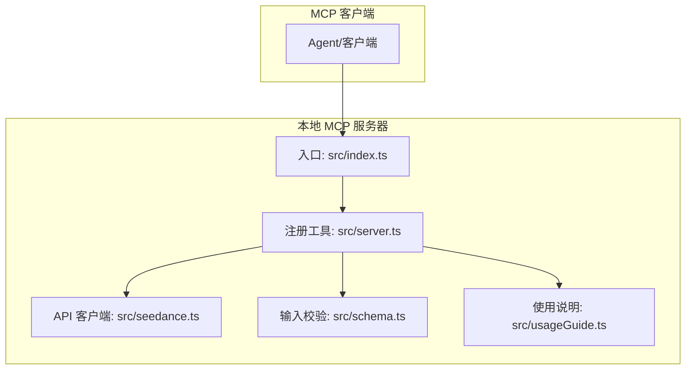
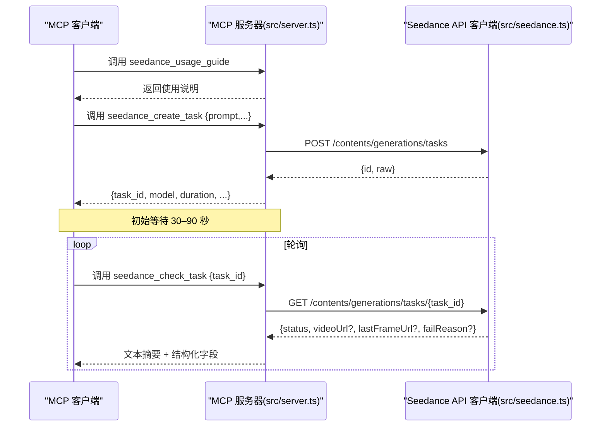
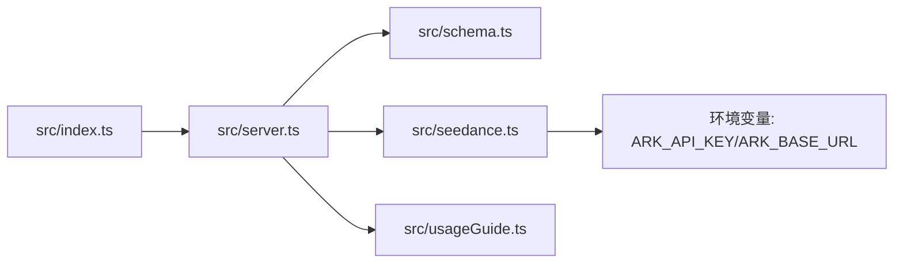

# 标准工作流程

<cite>
**本文引用的文件**
- [src/index.ts](file://src/index.ts)
- [src/server.ts](file://src/server.ts)
- [src/seedance.ts](file://src/seedance.ts)
- [src/schema.ts](file://src/schema.ts)
- [src/usageGuide.ts](file://src/usageGuide.ts)
- [README.md](file://README.md)
- [package.json](file://package.json)
- [tsconfig.json](file://tsconfig.json)
</cite>

## 目录
1. [简介](#简介)
2. [项目结构](#项目结构)
3. [核心组件](#核心组件)
4. [架构总览](#架构总览)
5. [详细组件分析](#详细组件分析)
6. [依赖关系分析](#依赖关系分析)
7. [性能考量](#性能考量)
8. [故障排查指南](#故障排查指南)
9. [结论](#结论)
10. [附录](#附录)

## 简介
本文件面向使用 MCP 客户端（如 Codex、Claude Desktop、Cursor 等）集成本项目的用户，系统化阐述从“任务创建”到“结果获取”的标准工作流程。重点说明以下要点：
- seedance_create_task 与 seedance_check_task 的调用时机与顺序
- 任务创建后的异步处理机制：任务 ID 获取、轮询策略（初始等待 30–90 秒，后续 15 秒轮询）、状态监控策略
- 任务状态语义（pending/processing/succeeded/failed）及每种状态下的正确处理方式
- 错误处理最佳实践：网络异常、API 限流、超时重试等
- 多语言实现思路与示例路径（以“代码片段路径”形式给出）

## 项目结构
该项目是一个本地 stdio MCP 服务器，封装了火山方舟 ARK 的 Seedance 2.0 视频生成能力，通过三个工具暴露给 MCP 客户端：
- seedance_usage_guide：返回标准使用说明
- seedance_create_task：提交任务并立即返回 task_id
- seedance_check_task：按 task_id 查询任务状态，成功时返回 video_url（及可选 last_frame_url）

图表来源
- [src/index.ts:1-19](file://src/index.ts#L1-L19)
- [src/server.ts:20-177](file://src/server.ts#L20-L177)
- [src/seedance.ts:149-278](file://src/seedance.ts#L149-L278)
- [src/schema.ts:52-141](file://src/schema.ts#L52-L141)
- [src/usageGuide.ts:1-59](file://src/usageGuide.ts#L1-L59)

章节来源
- [README.md:267-283](file://README.md#L267-L283)
- [package.json:1-51](file://package.json#L1-L51)
- [tsconfig.json:1-23](file://tsconfig.json#L1-L23)

## 核心组件
- 工具注册与控制流
  - seedance_usage_guide：返回使用说明，建议首次调用
  - seedance_create_task：提交任务，返回 task_id；不阻塞等待
  - seedance_check_task：按 task_id 查询状态，返回结构化结果
- API 客户端
  - createSeedanceTask：POST 创建任务
  - checkSeedanceTask：GET 查询任务
- 输入校验
  - 使用 zod 定义输入模式，含枚举、范围、数量限制与互斥规则
- 使用说明
  - 提供标准工作流、参数说明与注意事项

章节来源
- [src/server.ts:31-177](file://src/server.ts#L31-L177)
- [src/seedance.ts:149-278](file://src/seedance.ts#L149-L278)
- [src/schema.ts:52-141](file://src/schema.ts#L52-L141)
- [src/usageGuide.ts:1-59](file://src/usageGuide.ts#L1-L59)

## 架构总览
下图展示了 MCP 工具调用与 API 请求的交互关系，以及状态流转的典型路径。

图表来源
- [src/server.ts:49-177](file://src/server.ts#L49-L177)
- [src/seedance.ts:149-278](file://src/seedance.ts#L149-L278)

## 详细组件分析

### 工具：seedance_usage_guide
- 作用：返回标准使用说明，包含工作流、模型选择、参数参考与注意事项
- 调用建议：首次调用 seedance_create_task 之前先调用该工具，确保了解初始等待与轮询策略

章节来源
- [src/server.ts:31-47](file://src/server.ts#L31-L47)
- [src/usageGuide.ts:1-59](file://src/usageGuide.ts#L1-L59)

### 工具：seedance_create_task
- 功能：提交任务并立即返回 task_id，不阻塞等待渲染完成
- 关键行为
  - 输入校验：基于 schema 进行类型、范围、数量与互斥规则检查
  - 发送请求：POST /contents/generations/tasks
  - 返回结构：包含 task_id 与原始响应（raw），便于透传未知字段
- 初始等待提示：建议等待 30–90 秒后再轮询

章节来源
- [src/server.ts:49-90](file://src/server.ts#L49-L90)
- [src/schema.ts:52-127](file://src/schema.ts#L52-L127)
- [src/seedance.ts:149-194](file://src/seedance.ts#L149-L194)

### 工具：seedance_check_task
- 功能：按 task_id 查询任务状态，返回状态摘要与结构化字段
- 状态处理策略
  - succeeded：返回 video_url（及可选 last_frame_url），提醒 URL 有效期
  - failed：返回 fail_reason（如有）
  - pending/queued/in_queue/running：提示继续等待（30–90 秒后重试）
  - cancelled/canceled：任务已取消
  - expired：任务已过期，需重新提交
  - 其他：保留原始 status 与 raw
- 返回结构：包含 task_id、status、video_url、last_frame_url、fail_reason、raw

章节来源
- [src/server.ts:92-177](file://src/server.ts#L92-L177)
- [src/seedance.ts:201-278](file://src/seedance.ts#L201-L278)

### API 客户端：createSeedanceTask 与 checkSeedanceTask
- createSeedanceTask
  - 构造请求体：将 CreateTaskInput 映射为 API 请求体
  - 发送 POST 请求：/contents/generations/tasks
  - 校验响应：非 2xx 抛出 SeedanceApiError；解析 JSON 并校验 id 存在
- checkSeedanceTask
  - 发送 GET 请求：/contents/generations/tasks/{task_id}
  - 解析响应：标准化状态与结果字段（videoUrl/lastFrameUrl/failReason），兼容多种 SDK 版本字段布局
  - 校验与错误处理：非 2xx 抛出 SeedanceApiError

章节来源
- [src/seedance.ts:149-194](file://src/seedance.ts#L149-L194)
- [src/seedance.ts:201-278](file://src/seedance.ts#L201-L278)

### 输入校验与参数约束
- 模型与分辨率枚举、宽高比集合
- 参数范围与数量限制：duration∈[4,15]、image_urls≤9、video_urls≤3、audio_urls≤3
- 互斥规则：
  - 纯文本 + audio_urls 被拒绝
  - web_search=true 时禁止携带任何参考媒体
- URL 必须为 http/https 可达

章节来源
- [src/schema.ts:3-28](file://src/schema.ts#L3-L28)
- [src/schema.ts:52-127](file://src/schema.ts#L52-L127)
- [src/server.ts:179-199](file://src/server.ts#L179-L199)

### 错误处理与异常类型
- SeedanceApiError：封装 HTTP 状态码与响应体，统一格式化消息
- 格式化错误：优先提取 error.message 或 message 字段，否则回退为 HTTP 状态描述
- 工具层 errorResult：将错误信息作为结构化结果返回，标记 isError

章节来源
- [src/seedance.ts:44-53](file://src/seedance.ts#L44-L53)
- [src/seedance.ts:126-140](file://src/seedance.ts#L126-L140)
- [src/server.ts:201-214](file://src/server.ts#L201-L214)

## 依赖关系分析
- 入口与传输
  - src/index.ts 通过 StdioServerTransport 连接 MCP 服务器
- 服务器与工具
  - src/server.ts 注册三个工具，并依赖 schema 与 seedance.ts
- API 客户端
  - src/seedance.ts 依赖环境变量（ARK_API_KEY、ARK_BASE_URL），调用火山方舟 API
- 类型与校验
  - src/schema.ts 使用 zod 定义输入模式
- 使用说明
  - src/usageGuide.ts 提供标准工作流与参数说明

图表来源
- [src/index.ts:1-19](file://src/index.ts#L1-L19)
- [src/server.ts:1-18](file://src/server.ts#L1-L18)
- [src/seedance.ts:55-72](file://src/seedance.ts#L55-L72)

章节来源
- [src/index.ts:1-19](file://src/index.ts#L1-L19)
- [src/server.ts:1-18](file://src/server.ts#L1-L18)
- [src/seedance.ts:55-72](file://src/seedance.ts#L55-L72)

## 性能考量
- 渲染时长
  - 标准模型 15 秒任务通常需要 2–5 分钟完成；快速模型更快
- 轮询策略
  - 初始等待 30–90 秒，随后 15 秒轮询一次
  - 若任务长时间处于 pending/queued，可适当延长等待时间（例如 30–90 秒）
- 并发与重试
  - 合理控制并发轮询数量，避免触发 API 限流
  - 对瞬时网络波动采用指数退避重试（例如 1×、2×、4×、8× 最大不超过 60 秒）
- 资源管理
  - 成功后尽快下载视频 URL，避免过期
  - 控制轮询频率，降低不必要的请求开销

## 故障排查指南
- 缺少 API Key
  - 症状：调用真实 API 的工具报错
  - 处理：在 MCP 客户端配置中注入 ARK_API_KEY，或设置系统环境变量
- URL 不可达
  - 症状：任务创建失败或轮询返回异常
  - 处理：确保 image_urls/video_urls/audio_urls 为公网可访问的 http/https 地址
- 参数校验失败
  - 症状：seedance_create_task 返回错误信息
  - 处理：检查 duration/ratio/resolution/web_search 与参考媒体的互斥关系
- 任务状态异常
  - pending/queued：继续等待并轮询
  - failed：查看 fail_reason，修正输入后重试
  - expired：重新提交任务
  - succeeded：立即下载 video_url（通常 24 小时内过期）
- 网络异常与限流
  - 症状：请求超时或频繁 429/5xx
  - 处理：增加退避重试、降低并发、检查代理与防火墙设置

章节来源
- [README.md:93-106](file://README.md#L93-L106)
- [src/server.ts:179-199](file://src/server.ts#L179-L199)
- [src/seedance.ts:167-194](file://src/seedance.ts#L167-L194)
- [src/seedance.ts:222-278](file://src/seedance.ts#L222-L278)

## 结论
本项目通过 MCP 工具将火山方舟 Seedance 2.0 的视频生成能力本地化、标准化地暴露给各类客户端。遵循“创建任务—初始等待—轮询查询—获取结果”的标准流程，结合合理的轮询策略与错误处理，可在保证稳定性的同时获得高质量的视频输出。建议在生产环境中配合指数退避重试、并发控制与及时下载策略，进一步提升可靠性与用户体验。

## 附录

### 标准工作流程（步骤与时机）
- 步骤 1：调用 seedance_usage_guide，阅读使用说明
- 步骤 2：调用 seedance_create_task 提交任务，记录返回的 task_id
- 步骤 3：等待 30–90 秒
- 步骤 4：调用 seedance_check_task 查询状态
- 步骤 5：重复步骤 4，直到状态为 succeeded 或 failed
- 步骤 6：若 succeeded，立即下载 video_url（通常 24 小时内过期）

章节来源
- [README.md:212-227](file://README.md#L212-L227)
- [src/server.ts:62-89](file://src/server.ts#L62-L89)
- [src/server.ts:105-173](file://src/server.ts#L105-L173)

### 任务状态语义与处理建议
- pending/queued/in_queue/running
  - 处理：继续等待 30–90 秒后重试
- succeeded
  - 处理：下载 video_url；若 return_last_frame=true，同时下载 last_frame_url
- failed
  - 处理：读取 fail_reason，修正输入后重新提交
- cancelled/canceled
  - 处理：任务已取消，可重新提交
- expired
  - 处理：重新提交任务
- 其他
  - 处理：保留原始 status 与 raw，按需上报或记录

章节来源
- [src/server.ts:111-157](file://src/server.ts#L111-L157)
- [src/seedance.ts:35-42](file://src/seedance.ts#L35-L42)

### 多语言实现思路与示例路径
以下为不同语言实现“标准工作流程”的思路与示例路径（不直接展示代码，仅提供路径以便查阅）：
- Python
  - 使用 requests 发送 HTTP 请求，遵循“创建—等待—轮询—下载”
  - 示例路径参考：
    - [创建任务请求:156-163](file://src/seedance.ts#L156-L163)
    - [查询任务请求:210-218](file://src/seedance.ts#L210-L218)
    - [输入校验规则:52-127](file://src/schema.ts#L52-L127)
- JavaScript/TypeScript
  - 使用 fetch 或 axios，遵循相同流程
  - 示例路径参考：
    - [创建任务函数:149-194](file://src/seedance.ts#L149-L194)
    - [查询任务函数:201-278](file://src/seedance.ts#L201-L278)
    - [工具注册与调用:49-177](file://src/server.ts#L49-L177)
- Go
  - 使用 net/http 或第三方库，注意 JSON 解析与错误处理
  - 示例路径参考：
    - [错误类型与消息提取:44-53](file://src/seedance.ts#L44-L53)
    - [响应解析与校验:116-194](file://src/seedance.ts#L116-L194)
- Java
  - 使用 HttpClient 或 OkHttp，注意 URL 编码与异常捕获
  - 示例路径参考：
    - [查询任务 URL 构造与请求头:210-218](file://src/seedance.ts#L210-L218)
    - [输入参数与枚举:3-28](file://src/schema.ts#L3-L28)

章节来源
- [src/seedance.ts:149-278](file://src/seedance.ts#L149-L278)
- [src/schema.ts:52-127](file://src/schema.ts#L52-L127)
- [src/server.ts:49-177](file://src/server.ts#L49-L177)

### 轮询策略与等待时间建议
- 初始等待：30–90 秒
- 轮询间隔：15 秒（可根据任务规模调整至 30–60 秒）
- 重试上限：建议 10–20 次，累计超过 10–20 分钟后停止
- 退避策略：1×、2×、4×、8×，最大不超过 60 秒

章节来源
- [src/server.ts:72-74](file://src/server.ts#L72-L74)
- [README.md:229](file://README.md#L229)