# 开发工作流程

<cite>
**本文档引用的文件**
- [package.json](file://package.json)
- [tsconfig.json](file://tsconfig.json)
- [README.md](file://README.md)
- [.gitignore](file://.gitignore)
- [src/index.ts](file://src/index.ts)
- [src/server.ts](file://src/server.ts)
- [src/schema.ts](file://src/schema.ts)
- [src/seedance.ts](file://src/seedance.ts)
- [src/usageGuide.ts](file://src/usageGuide.ts)
</cite>

## 目录
1. [简介](#简介)
2. [项目结构](#项目结构)
3. [核心组件](#核心组件)
4. [架构概览](#架构概览)
5. [详细组件分析](#详细组件分析)
6. [开发工作流程](#开发工作流程)
7. [脚本命令详解](#脚本命令详解)
8. [热重载与生产构建](#热重载与生产构建)
9. [代码质量保证](#代码质量保证)
10. [版本控制最佳实践](#版本控制最佳实践)
11. [性能考虑](#性能考虑)
12. [故障排除指南](#故障排除指南)
13. [结论](#结论)

## 简介

seedance-2-mcp 是一个开源的本地运行 MCP (Model Context Protocol) 服务器，将火山方舟 (Volcengine ARK) Seedance 2.0 视频生成能力通过三个 stdio 工具暴露给各种 MCP 客户端。该项目基于 Node.js + TypeScript 构建，使用官方 @modelcontextprotocol/sdk 实现。

该服务器提供了以下 MCP 工具：
- `seedance_usage_guide`: 返回完整的使用说明
- `seedance_create_task`: 提交视频生成任务并立即返回 task_id
- `seedance_check_task`: 通过 task_id 查询任务状态

## 项目结构

项目采用简洁的模块化结构，主要文件组织如下：

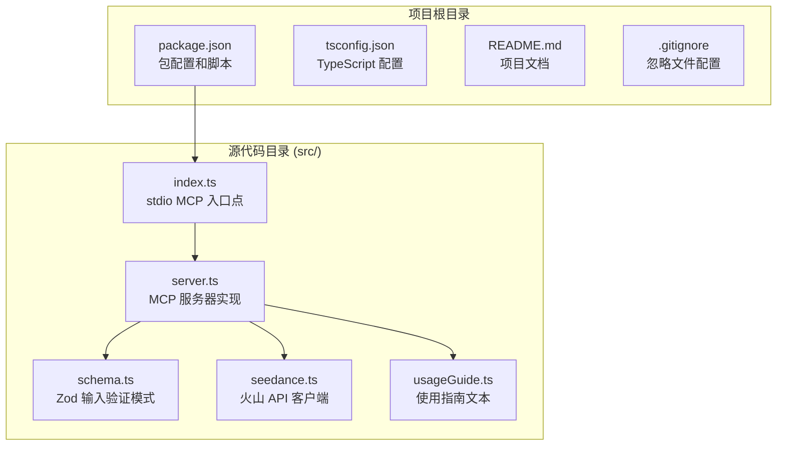

**图表来源**
- [package.json:1-51](file://package.json#L1-L51)
- [src/index.ts:1-19](file://src/index.ts#L1-L19)
- [src/server.ts:1-215](file://src/server.ts#L1-L215)

**章节来源**
- [package.json:1-51](file://package.json#L1-L51)
- [tsconfig.json:1-23](file://tsconfig.json#L1-L23)
- [README.md:267-283](file://README.md#L267-L283)

## 核心组件

### 主要模块职责

1. **入口模块 (index.ts)**: 设置 stdio 传输层，启动 MCP 服务器
2. **服务器模块 (server.ts)**: 注册三个 MCP 工具，处理请求路由
3. **模式定义 (schema.ts)**: 使用 Zod 定义输入验证规则
4. **API 客户端 (seedance.ts)**: 实现火山 API 的 REST 客户端
5. **使用指南 (usageGuide.ts)**: 提供标准化的使用说明

### 依赖关系图

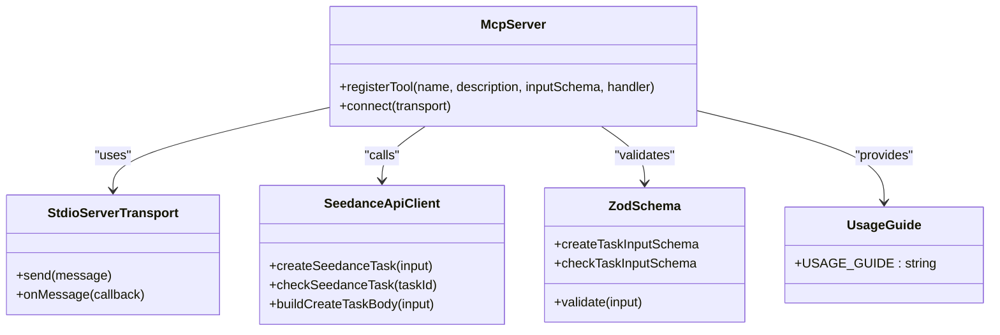

**图表来源**
- [src/server.ts:20-177](file://src/server.ts#L20-L177)
- [src/index.ts:6-12](file://src/index.ts#L6-L12)
- [src/seedance.ts:149-278](file://src/seedance.ts#L149-L278)

**章节来源**
- [src/index.ts:1-19](file://src/index.ts#L1-L19)
- [src/server.ts:1-215](file://src/server.ts#L1-L215)
- [src/schema.ts:1-141](file://src/schema.ts#L1-L141)
- [src/seedance.ts:1-286](file://src/seedance.ts#L1-L286)
- [src/usageGuide.ts:1-59](file://src/usageGuide.ts#L1-L59)

## 架构概览

### 整体架构设计

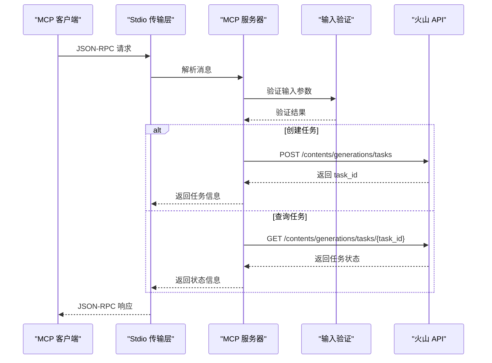

**图表来源**
- [src/index.ts:6-12](file://src/index.ts#L6-L12)
- [src/server.ts:62-89](file://src/server.ts#L62-L89)
- [src/server.ts:105-173](file://src/server.ts#L105-L173)
- [src/seedance.ts:149-194](file://src/seedance.ts#L149-L194)
- [src/seedance.ts:201-278](file://src/seedance.ts#L201-L278)

### 数据流架构

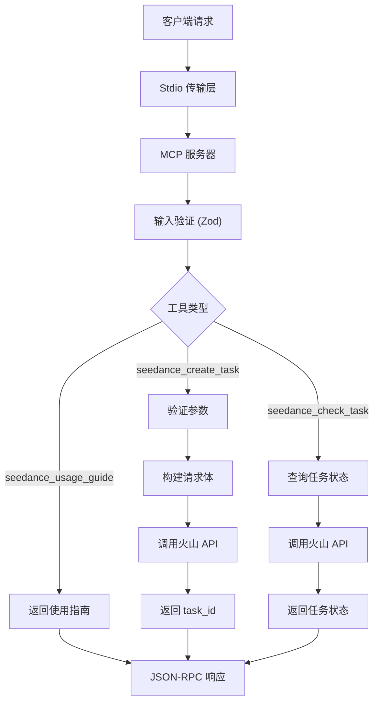

**图表来源**
- [src/server.ts:31-177](file://src/server.ts#L31-L177)
- [src/schema.ts:52-141](file://src/schema.ts#L52-L141)
- [src/seedance.ts:102-278](file://src/seedance.ts#L102-L278)

## 详细组件分析

### MCP 服务器实现

服务器模块实现了三个核心工具的注册和处理逻辑：

#### 工具注册机制

```mermaid
classDiagram
class ServerModule {
+SERVER_NAME : string
+SERVER_VERSION : string
+createServer() McpServer
-validateCreateTaskInput(input) string|null
-formatApiError(err) string
-errorResult(message) CallToolResult
}
class UsageGuideTool {
+name : "seedance_usage_guide"
+title : "使用指南"
+description : "返回完整使用说明"
+inputSchema : {}
+annotations : readOnlyHint=true
}
class CreateTaskTool {
+name : "seedance_create_task"
+title : "创建任务"
+description : "提交视频生成任务"
+inputSchema : CreateTaskInput
+annotations : readOnlyHint=false
}
class CheckTaskTool {
+name : "seedance_check_task"
+title : "检查任务"
+description : "查询任务状态"
+inputSchema : CheckTaskInput
+annotations : readOnlyHint=true
}
ServerModule --> UsageGuideTool
ServerModule --> CreateTaskTool
ServerModule --> CheckTaskTool
```

**图表来源**
- [src/server.ts:20-177](file://src/server.ts#L20-L177)

#### 输入验证系统

输入验证使用 Zod 库实现强类型检查：

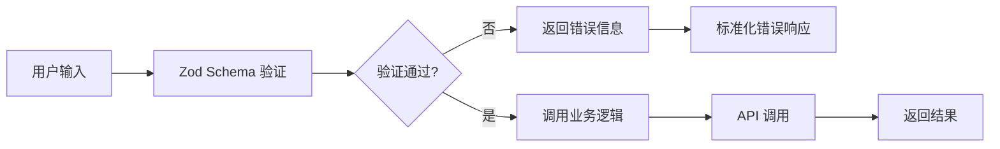

**图表来源**
- [src/schema.ts:52-141](file://src/schema.ts#L52-L141)
- [src/server.ts:179-199](file://src/server.ts#L179-L199)

**章节来源**
- [src/server.ts:1-215](file://src/server.ts#L1-L215)
- [src/schema.ts:1-141](file://src/schema.ts#L1-L141)

### 火山 API 客户端

API 客户端模块封装了与火山方舟 API 的交互：

#### API 调用流程

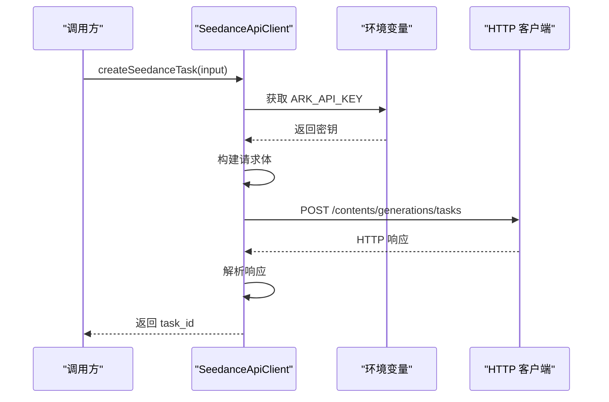

**图表来源**
- [src/seedance.ts:149-194](file://src/seedance.ts#L149-L194)
- [src/seedance.ts:55-64](file://src/seedance.ts#L55-L64)

#### 错误处理机制

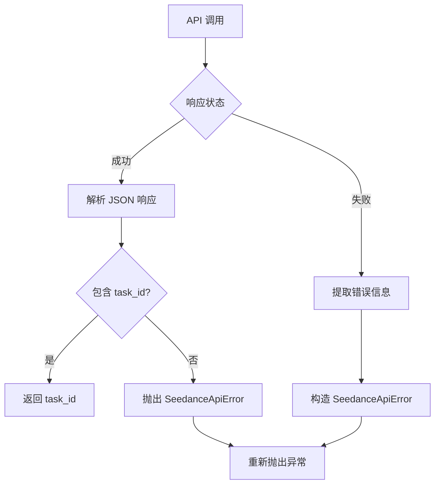

**图表来源**
- [src/seedance.ts:167-194](file://src/seedance.ts#L167-L194)
- [src/seedance.ts:126-140](file://src/seedance.ts#L126-L140)

**章节来源**
- [src/seedance.ts:1-286](file://src/seedance.ts#L1-L286)

## 开发工作流程

### 日常开发流程

#### 1. 环境准备

```bash
# 克隆项目
git clone https://github.com/seedance/seedance-2-mcp.git
cd seedance-2-mcp

# 安装依赖
npm install

# 设置环境变量
echo "ARK_API_KEY=your_api_key" > .env
```

#### 2. 代码编写规范

- 使用 TypeScript 进行类型安全编程
- 遵循 Zod 模式进行输入验证
- 保持函数单一职责原则
- 添加适当的注释和文档字符串

#### 3. 编译流程

```bash
# 类型检查
npm run typecheck

# 开发模式（热重载）
npm run dev

# 生产构建
npm run build
```

#### 4. 测试流程

```bash
# 运行测试
npm test

# 调试 MCP 服务器
npx -y @modelcontextprotocol/inspector npx -y seedance-2-mcp
```

#### 5. 调试技巧

- 使用 `console.error` 进行调试输出（stdout 保留用于 MCP 通信）
- 利用 MCP Inspector 工具监控通信
- 检查环境变量配置
- 验证网络连接和 API 密钥

**章节来源**
- [README.md:243-264](file://README.md#L243-L264)
- [package.json:19-25](file://package.json#L19-L25)

## 脚本命令详解

### 开发脚本

| 脚本命令 | 功能描述 | 使用场景 |
|---------|----------|----------|
| `npm run dev` | 使用 tsx 直接运行源码 | 开发调试，热重载 |
| `npm run build` | TypeScript 编译并设置可执行权限 | 生产构建 |
| `npm run typecheck` | TypeScript 类型检查 | 代码质量保证 |
| `npm start` | 运行编译后的 dist/index.js | 生产环境启动 |

### 构建配置

#### TypeScript 配置

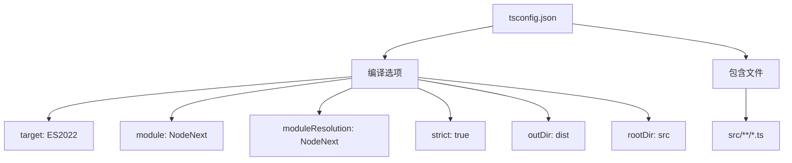

**图表来源**
- [tsconfig.json:2-22](file://tsconfig.json#L2-L22)

#### 依赖管理

- **运行时依赖**: @modelcontextprotocol/sdk, zod
- **开发依赖**: @types/node, tsx, typescript
- **Node.js 版本要求**: >= 18

**章节来源**
- [package.json:16-34](file://package.json#L16-L34)
- [tsconfig.json:1-23](file://tsconfig.json#L1-L23)

## 热重载与生产构建

### 开发模式 (Hot Reload)

开发模式使用 tsx 实现热重载功能：

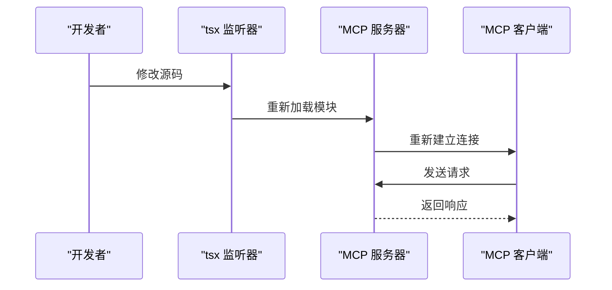

**图表来源**
- [package.json:21](file://package.json#L21)
- [src/index.ts:6-12](file://src/index.ts#L6-L12)

### 生产构建 (Production Build)

生产构建包含以下步骤：

1. **TypeScript 编译**: 将 TypeScript 源码编译为 JavaScript
2. **权限设置**: 设置 dist/index.js 为可执行文件
3. **产物优化**: 移除不必要的调试信息

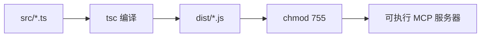

**图表来源**
- [package.json:20](file://package.json#L20)

**章节来源**
- [package.json:19-25](file://package.json#L19-L25)
- [src/index.ts:1-19](file://src/index.ts#L1-L19)

## 代码质量保证

### 类型检查

项目使用严格的 TypeScript 配置确保代码质量：

#### 编译选项分析

| 选项 | 值 | 作用 |
|------|-----|------|
| `strict` | true | 启用所有严格类型检查 |
| `noImplicitOverride` | true | 禁止隐式重写 |
| `noUnusedLocals` | true | 报告未使用局部变量 |
| `esModuleInterop` | true | 改善 CommonJS 互操作性 |
| `skipLibCheck` | true | 跳过库文件类型检查 |

### 输入验证

使用 Zod 实现运行时类型验证：

#### 验证规则

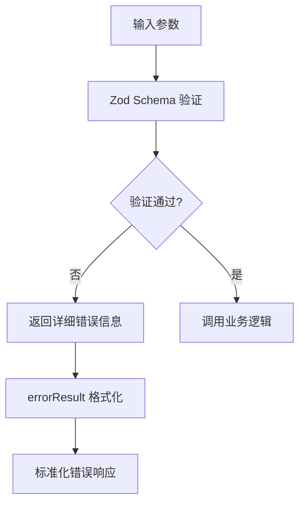

**图表来源**
- [src/schema.ts:52-141](file://src/schema.ts#L52-L141)
- [src/server.ts:62-89](file://src/server.ts#L62-L89)

**章节来源**
- [tsconfig.json:9-19](file://tsconfig.json#L9-L19)
- [src/schema.ts:1-141](file://src/schema.ts#L1-L141)
- [src/server.ts:179-215](file://src/server.ts#L179-L215)

## 版本控制最佳实践

### Git 工作流程

#### 分支管理策略

```mermaid
gitgraph
commit id: "初始提交"
branch develop
checkout develop
commit id: "功能开发"
branch feature/new-tool
checkout feature/new-tool
commit id: "新增工具"
commit id: "代码审查"
checkout develop
merge feature/new-tool
commit id: "合并到主分支"
checkout main
merge develop
commit id: "发布版本"
```

#### 提交规范

| 类型 | 描述 | 示例 |
|------|------|------|
| feat | 新功能 | `feat(server): 添加新工具` |
| fix | 修复缺陷 | `fix(schema): 修正验证规则` |
| docs | 文档更新 | `docs(readme): 更新使用说明` |
| refactor | 重构代码 | `refactor(server): 优化架构` |
| test | 测试相关 | `test(seedance): 添加单元测试` |

### 文件忽略策略

项目使用 .gitignore 配置忽略以下文件：

- `node_modules/`: 依赖包目录
- `dist/`: 编译产物目录
- `.env*`: 环境变量文件
- IDE 配置文件: `.DS_Store`, `.idea/`, `.vscode/`

**章节来源**
- [.gitignore:1-17](file://.gitignore#L1-L17)
- [README.md:243-264](file://README.md#L243-L264)

## 性能考虑

### 内存管理

- 使用流式处理避免大对象内存占用
- 及时清理未使用的变量和引用
- 合理使用缓存机制

### 网络优化

- 实现请求超时和重试机制
- 使用连接池管理 API 连接
- 优化并发请求处理

### 并发处理

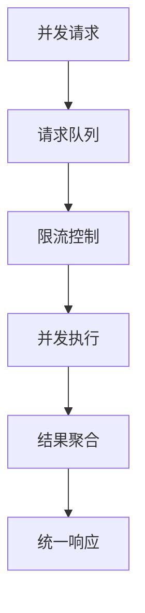

## 故障排除指南

### 常见问题及解决方案

#### 环境变量配置

**问题**: `Missing ARK_API_KEY environment variable`
**解决方案**: 
1. 在 MCP 客户端配置中设置 `env` 字段
2. 或者在 shell 环境中设置 `ARK_API_KEY`
3. 确保 API Key 来自火山方舟控制台

#### 网络连接问题

**问题**: API 调用失败
**解决方案**:
1. 检查网络连接
2. 验证 API Key 有效性
3. 确认火山 API 可达性

#### 类型检查错误

**问题**: TypeScript 编译失败
**解决方案**:
1. 运行 `npm run typecheck` 查看具体错误
2. 检查 Zod 模式定义
3. 确保所有参数都有正确的类型注解

### 调试工具

#### MCP Inspector 使用

```bash
# 安装 Inspector
npm install -g @modelcontextprotocol/inspector

# 监控 MCP 通信
npx -y @modelcontextprotocol/inspector npx -y seedance-2-mcp
```

#### 日志记录

- 使用 `console.error` 进行调试输出
- 避免在 stdout 输出调试信息（保留给 MCP JSON-RPC）
- 记录关键操作和错误信息

**章节来源**
- [src/seedance.ts:55-64](file://src/seedance.ts#L55-L64)
- [src/server.ts:201-207](file://src/server.ts#L201-L207)
- [README.md:253-263](file://README.md#L253-L263)

## 结论

seedance-2-mcp 提供了一个完整的 MCP 服务器实现，具有以下特点：

### 技术优势

- **类型安全**: 完整的 TypeScript 类型系统
- **输入验证**: 使用 Zod 实现强类型验证
- **模块化设计**: 清晰的模块分离和职责划分
- **热重载开发**: 开发效率高，调试体验好

### 开发体验

- **简单易用**: 清晰的 API 设计和使用说明
- **文档完善**: 详细的 README 和代码注释
- **工具支持**: 完备的开发和调试工具链

### 最佳实践

遵循本文档的开发流程和最佳实践，可以确保项目的高质量开发和维护。建议团队在开发过程中：

1. 严格遵守 TypeScript 类型规范
2. 使用 Zod 进行输入验证
3. 定期运行类型检查和代码审查
4. 保持良好的版本控制习惯
5. 及时更新文档和使用说明

通过这些实践，可以确保项目的长期可维护性和扩展性。