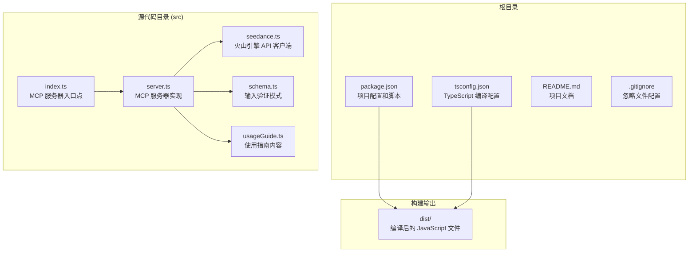
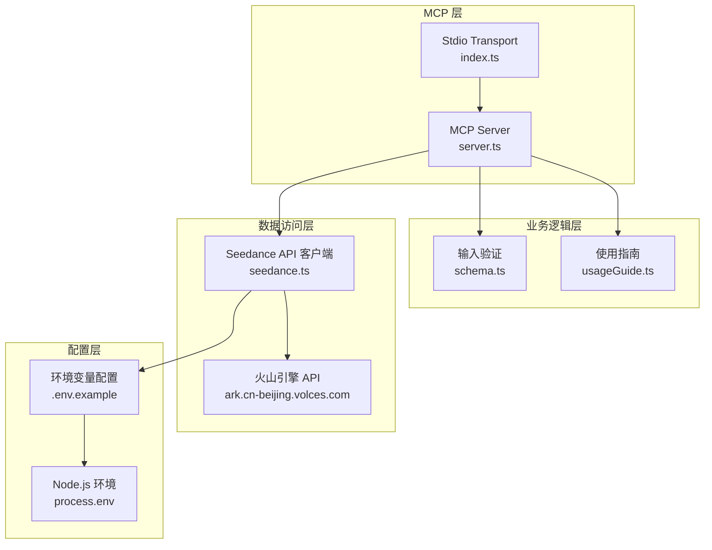
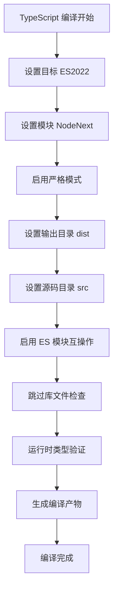
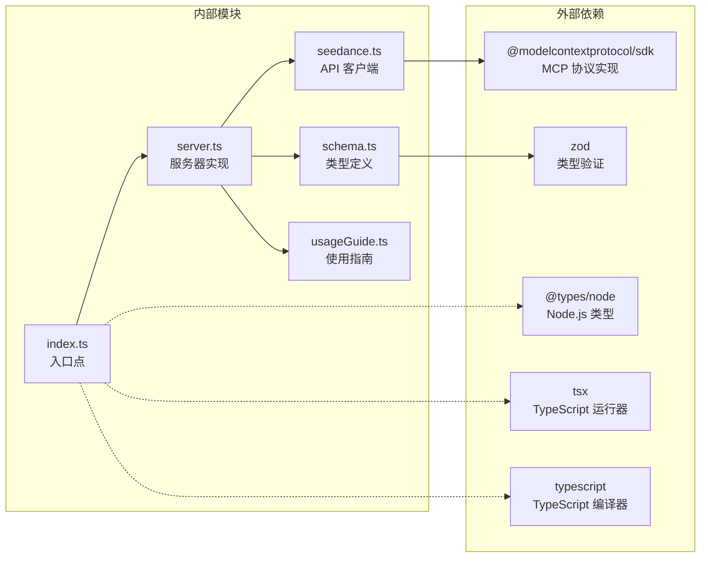

# 开发环境搭建

<cite>
**本文档引用的文件**
- [package.json](file://package.json)
- [tsconfig.json](file://tsconfig.json)
- [README.md](file://README.md)
- [src/index.ts](file://src/index.ts)
- [src/server.ts](file://src/server.ts)
- [src/seedance.ts](file://src/seedance.ts)
- [src/schema.ts](file://src/schema.ts)
- [.gitignore](file://.gitignore)
</cite>

## 目录
1. [简介](#简介)
2. [项目结构](#项目结构)
3. [核心组件](#核心组件)
4. [架构概览](#架构概览)
5. [详细组件分析](#详细组件分析)
6. [依赖分析](#依赖分析)
7. [性能考虑](#性能考虑)
8. [故障排除指南](#故障排除指南)
9. [结论](#结论)

## 简介

这是一个基于 Node.js 和 TypeScript 的本地 stdio MCP 服务器，用于调用火山引擎 ARK Seedance 2.0 视频生成 API。该项目提供了三个 MCP 工具：使用指南查询、任务创建和任务状态检查。

## 项目结构

项目采用模块化设计，主要包含以下目录和文件：



**图表来源**
- [package.json:1-51](file://package.json#L1-L51)
- [tsconfig.json:1-23](file://tsconfig.json#L1-L23)
- [src/index.ts:1-19](file://src/index.ts#L1-L19)

**章节来源**
- [package.json:1-51](file://package.json#L1-L51)
- [tsconfig.json:1-23](file://tsconfig.json#L1-L23)
- [README.md:267-283](file://README.md#L267-L283)

## 核心组件

### Node.js 版本要求

项目明确要求 Node.js 版本 >= 18，这是由于项目依赖原生的 `fetch` API：

- **最低版本**: Node.js 18+
- **原因**: 使用原生 fetch API 进行 HTTP 请求
- **兼容性**: ES2022 目标和 NodeNext 模块系统

### TypeScript 环境配置

项目使用严格的 TypeScript 配置：

**编译选项**:
- `target`: ES2022 - 支持现代 JavaScript 特性
- `module`: NodeNext - 使用 ES 模块语法
- `moduleResolution`: NodeNext - Node.js 模块解析策略
- `strict`: true - 启用严格类型检查
- `outDir`: dist - 输出目录
- `rootDir`: src - 源代码根目录
- `esModuleInterop`: true - ES 模块互操作性
- `skipLibCheck`: true - 跳过库文件类型检查

**类型定义**:
- 使用 Zod 进行运行时类型验证
- 详细的接口定义确保 API 安全性

**章节来源**
- [package.json:16-18](file://package.json#L16-L18)
- [tsconfig.json:2-22](file://tsconfig.json#L2-L22)
- [src/schema.ts:1-141](file://src/schema.ts#L1-L141)

## 架构概览

项目采用分层架构设计，清晰分离关注点：



**图表来源**
- [src/index.ts:1-19](file://src/index.ts#L1-L19)
- [src/server.ts:20-177](file://src/server.ts#L20-L177)
- [src/seedance.ts:55-72](file://src/seedance.ts#L55-L72)

## 详细组件分析

### 开发服务器启动方法

项目提供了两种开发模式：

#### 开发模式 (tsx)
```bash
npm run dev
```
- 使用 tsx 直接执行 TypeScript 文件
- 实时重载，适合开发调试
- 自动编译和执行

#### 生产模式 (tsc)
```bash
npm run build
npm start
```
- 使用 tsc 编译 TypeScript 到 JavaScript
- 生成 dist 目录中的编译产物
- 使用 Node.js 运行编译后的代码

**章节来源**
- [package.json:19-25](file://package.json#L19-L25)
- [src/index.ts:6-12](file://src/index.ts#L6-L12)

### TypeScript 编译选项详解



**图表来源**
- [tsconfig.json:2-22](file://tsconfig.json#L2-L22)

**章节来源**
- [tsconfig.json:2-22](file://tsconfig.json#L2-L22)

### 依赖安装流程

#### 生产依赖
- `@modelcontextprotocol/sdk`: MCP 协议实现
- `zod`: 运行时类型验证

#### 开发依赖
- `@types/node`: Node.js 类型定义
- `tsx`: TypeScript 运行器
- `typescript`: TypeScript 编译器

**安装命令**:
```bash
npm install
```

**章节来源**
- [package.json:26-34](file://package.json#L26-L34)

### 环境变量配置

项目使用以下环境变量：

| 变量名 | 必填 | 默认值 | 描述 |
|--------|------|--------|------|
| `ARK_API_KEY` | 是 | 无 | 火山引擎 API 密钥 |
| `ARK_BASE_URL` | 否 | `https://ark.cn-beijing.volces.com/api/v3` | API 基础 URL |

**注意**: `.env.example` 文件仅作开发参考，实际生效位置是 MCP 客户端配置中的 `env` 字段。

**章节来源**
- [README.md:93-106](file://README.md#L93-L106)
- [src/seedance.ts:55-72](file://src/seedance.ts#L55-L72)

## 依赖分析

项目依赖关系图：



**图表来源**
- [package.json:26-34](file://package.json#L26-L34)
- [src/index.ts:1-4](file://src/index.ts#L1-L4)

**章节来源**
- [package.json:26-34](file://package.json#L26-L34)

## 性能考虑

### 编译优化
- 使用 NodeNext 模块系统减少打包体积
- 关闭 sourceMap 生成提升编译速度
- 启用严格模式确保类型安全

### 运行时优化
- 使用 Zod 进行高效的运行时验证
- 实现智能的错误处理和重试机制
- 优化网络请求和 API 调用

## 故障排除指南

### 常见问题及解决方案

#### Node.js 版本问题
**问题**: `Error: Cannot find module 'fetch'`
**解决方案**: 确保使用 Node.js 18+ 版本

#### TypeScript 编译错误
**问题**: `TSXXXX: Cannot find module 'xxx'`
**解决方案**: 
1. 运行 `npm install`
2. 检查 `tsconfig.json` 中的模块解析配置
3. 确认 `@types/node` 已正确安装

#### MCP 服务器启动失败
**问题**: `Error: Fatal error in seedance-2-mcp:`
**解决方案**:
1. 检查 `ARK_API_KEY` 环境变量是否设置
2. 验证网络连接和 API 可达性
3. 查看详细的错误堆栈信息

#### 环境变量配置问题
**问题**: `Missing ARK_API_KEY environment variable`
**解决方案**:
1. 在 MCP 客户端配置中设置 `env` 字段
2. 或者在 shell 环境中设置 `ARK_API_KEY`
3. 避免将密钥写入版本控制系统

**章节来源**
- [README.md:93-106](file://README.md#L93-L106)
- [src/seedance.ts:55-64](file://src/seedance.ts#L55-L64)

## 结论

本项目提供了一个完整的本地 MCP 服务器开发环境，具有以下特点：

1. **现代化技术栈**: 基于 Node.js 18+ 和 TypeScript 5.x
2. **严格的类型安全**: 使用 Zod 进行运行时验证
3. **灵活的开发模式**: 支持 tsx 直接运行和 tsc 编译运行
4. **清晰的架构设计**: 分层架构便于维护和扩展
5. **完善的错误处理**: 提供详细的错误信息和调试支持

开发团队可以基于此环境快速搭建和调试 MCP 服务器，为各种 AI 客户端提供本地视频生成服务。