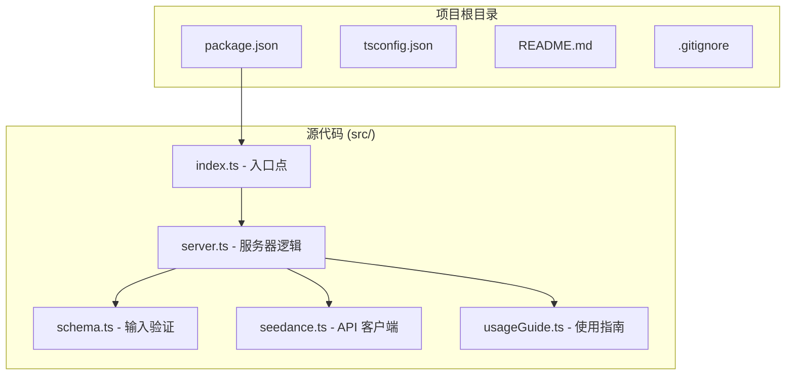
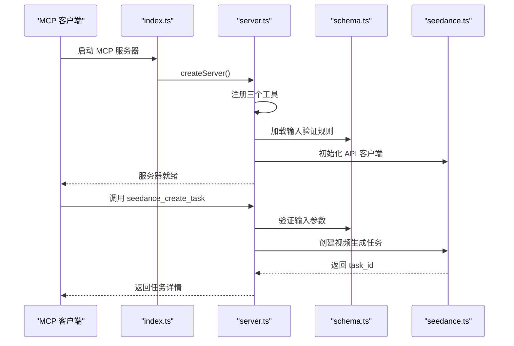
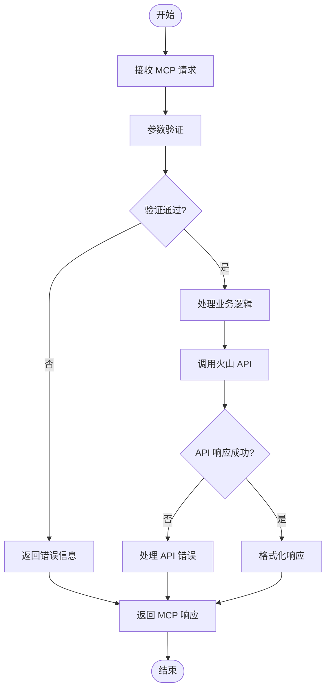
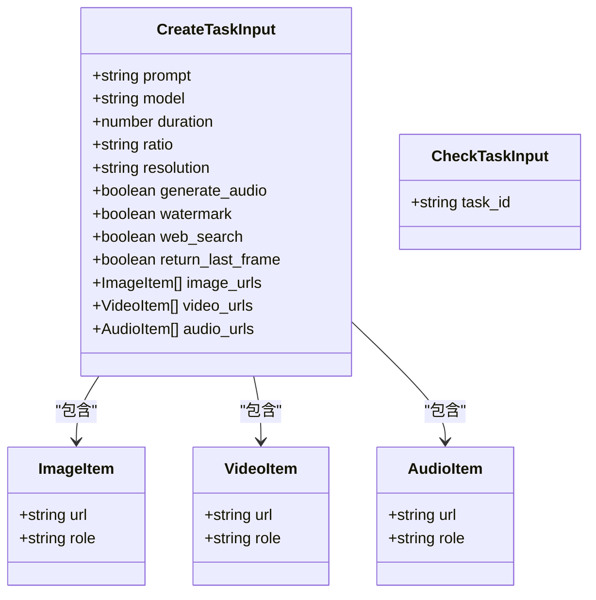
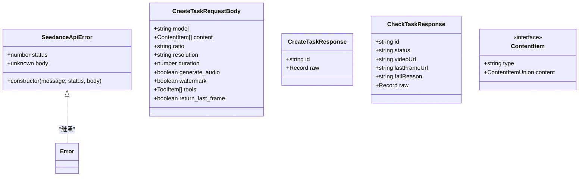
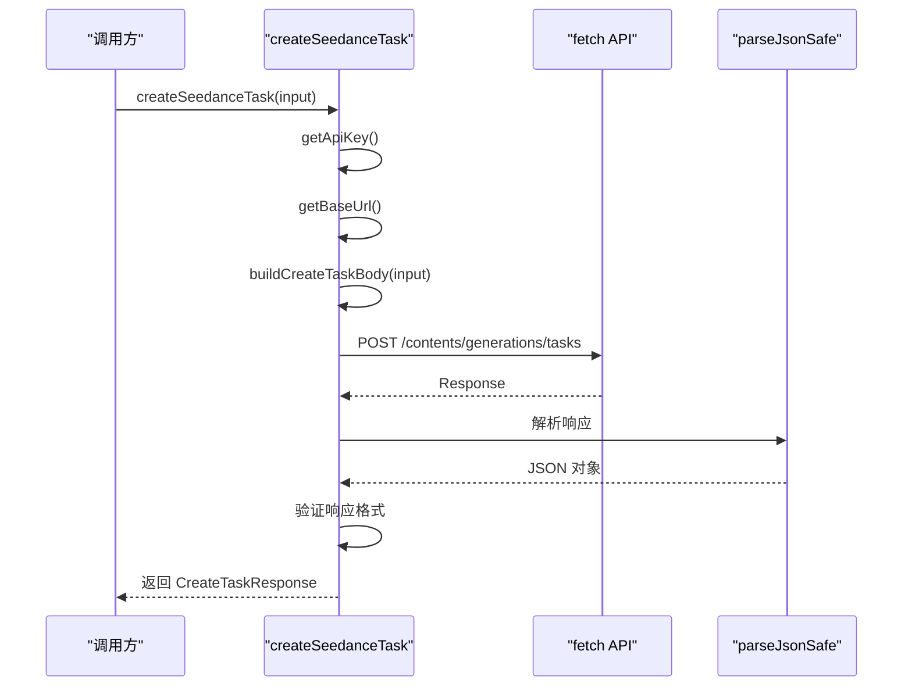
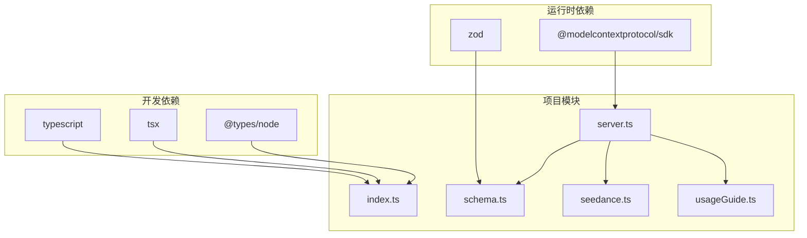
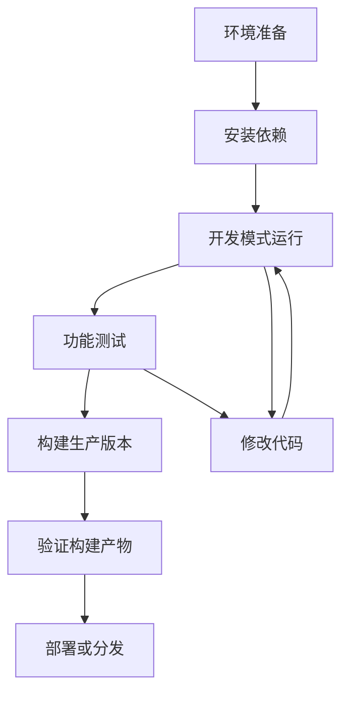
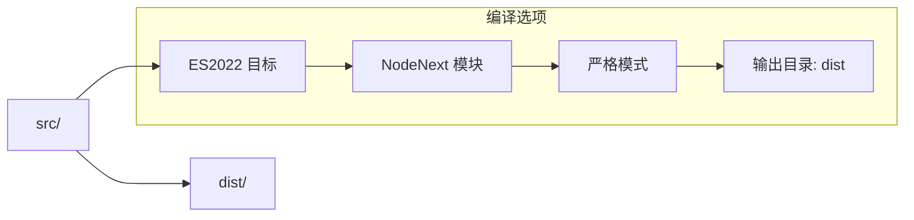
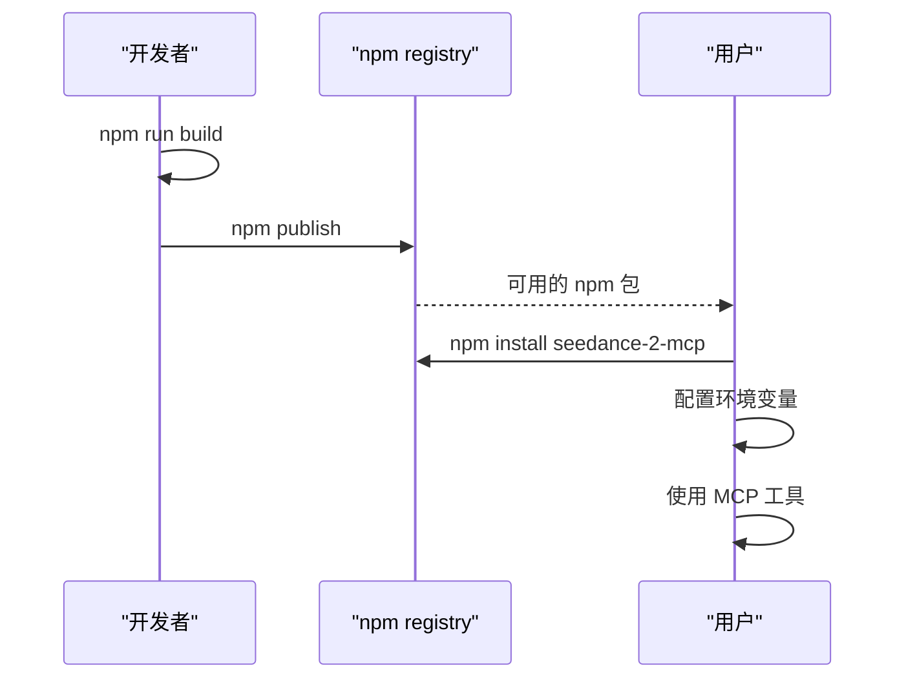

# 开发者指南

<cite>
**本文档引用的文件**
- [package.json](file://package.json)
- [tsconfig.json](file://tsconfig.json)
- [README.md](file://README.md)
- [src/index.ts](file://src/index.ts)
- [src/server.ts](file://src/server.ts)
- [src/schema.ts](file://src/schema.ts)
- [src/seedance.ts](file://src/seedance.ts)
- [src/usageGuide.ts](file://src/usageGuide.ts)
- [.gitignore](file://.gitignore)
</cite>

## 目录
1. [简介](#简介)
2. [项目结构](#项目结构)
3. [开发环境搭建](#开发环境搭建)
4. [核心组件](#核心组件)
5. [架构概览](#架构概览)
6. [详细组件分析](#详细组件分析)
7. [依赖关系分析](#依赖关系分析)
8. [调试指南](#调试指南)
9. [开发工作流程](#开发工作流程)
10. [代码贡献指南](#代码贡献指南)
11. [构建与部署](#构建与部署)
12. [扩展开发指导](#扩展开发指导)
13. [性能优化建议](#性能优化建议)
14. [故障排除指南](#故障排除指南)
15. [结论](#结论)

## 简介

seedance-2-mcp 是一个开源、本地运行的 MCP (Model Context Protocol) 服务器，将火山方舟 (Volcengine ARK) Seedance 2.0 视频生成能力通过三个 stdio 工具暴露给 Codex、Claude Desktop、Cursor 等任意 MCP 客户端。该项目完全本地化运行，不需要任何云端部署，使用 Node.js + TypeScript 编写，基于官方 @modelcontextprotocol/sdk 构建。

## 项目结构

项目采用简洁的模块化结构，主要包含以下核心文件：



**图表来源**
- [src/index.ts:1-19](file://src/index.ts#L1-L19)
- [src/server.ts:1-215](file://src/server.ts#L1-L215)
- [src/schema.ts:1-141](file://src/schema.ts#L1-L141)
- [src/seedance.ts:1-286](file://src/seedance.ts#L1-L286)
- [src/usageGuide.ts:1-59](file://src/usageGuide.ts#L1-L59)

**章节来源**
- [README.md:267-283](file://README.md#L267-L283)
- [package.json:1-51](file://package.json#L1-L51)

## 开发环境搭建

### 系统要求

- **Node.js**: >= 18 (依赖原生 fetch 功能)
- **npm**: 最新稳定版本
- **操作系统**: macOS、Windows 或 Linux

### 开发工具配置

1. **Node.js 版本管理** (推荐使用 nvm):
   ```bash
   nvm install 18
   nvm use 18
   ```

2. **包管理器选择**:
   - 推荐使用 npm 8+
   - 或者使用 pnpm 7+

### 依赖安装步骤

```bash
# 克隆项目
git clone https://github.com/seedance/seedance-2-mcp.git
cd seedance-2-mcp

# 安装依赖
npm install

# 验证类型检查
npm run typecheck

# 开发模式运行
npm run dev

# 构建生产版本
npm run build

# 启动生产服务
npm start
```

**章节来源**
- [README.md:89](file://README.md#L89)
- [package.json:16-25](file://package.json#L16-L25)
- [tsconfig.json:1-23](file://tsconfig.json#L1-L23)

## 核心组件

### MCP 服务器架构

项目实现了三个核心 MCP 工具：

| 工具名称 | 功能描述 | 输入参数 | 返回值 |
|---------|----------|----------|--------|
| `seedance_usage_guide` | 返回完整的使用说明 | 无参数 | Markdown 格式的使用指南 |
| `seedance_create_task` | 提交视频生成任务 | 任务参数 (prompt, model, duration 等) | task_id 和任务详情 |
| `seedance_check_task` | 查询任务状态 | { task_id: string } | 任务状态和结果 |

### 服务器初始化流程



**图表来源**
- [src/index.ts:6-12](file://src/index.ts#L6-L12)
- [src/server.ts:20-177](file://src/server.ts#L20-L177)
- [src/schema.ts:52-127](file://src/schema.ts#L52-L127)
- [src/seedance.ts:149-194](file://src/seedance.ts#L149-L194)

**章节来源**
- [src/server.ts:20-177](file://src/server.ts#L20-L177)
- [src/schema.ts:1-141](file://src/schema.ts#L1-L141)

## 架构概览

### 整体架构设计

```mermaid
graph TB
subgraph "MCP 层"
MCP_SDK[@modelcontextprotocol/sdk]
MCP_SERVER[McpServer]
end
subgraph "应用层"
USAGE[usageGuide.ts]
VALIDATION[schema.ts]
SERVER_LOGIC[server.ts]
end
subgraph "API 层"
SEEDANCE_CLIENT[seedance.ts]
VOLC_API[VOLCENGINE ARK API]
end
subgraph "数据层"
ENV[环境变量]
CACHE[请求缓存]
end
MCP_SDK --> MCP_SERVER
MCP_SERVER --> SERVER_LOGIC
SERVER_LOGIC --> USAGE
SERVER_LOGIC --> VALIDATION
SERVER_LOGIC --> SEEDANCE_CLIENT
SEEDANCE_CLIENT --> VOLC_API
ENV --> SEEDANCE_CLIENT
CACHE --> SEEDANCE_CLIENT
```

**图表来源**
- [src/server.ts:1-29](file://src/server.ts#L1-L29)
- [src/seedance.ts:55-72](file://src/seedance.ts#L55-L72)
- [src/schema.ts:1-141](file://src/schema.ts#L1-L141)

### 数据流处理



**图表来源**
- [src/server.ts:62-89](file://src/server.ts#L62-L89)
- [src/seedance.ts:149-194](file://src/seedance.ts#L149-L194)

## 详细组件分析

### 输入验证系统

项目使用 Zod 库实现强大的输入验证机制：



**图表来源**
- [src/schema.ts:52-127](file://src/schema.ts#L52-L127)
- [src/schema.ts:37-50](file://src/schema.ts#L37-L50)

#### 参数验证规则

| 参数 | 验证规则 | 默认值 | 说明 |
|------|----------|--------|------|
| prompt | 非空字符串 | 必填 | 视频生成描述 |
| model | 枚举值 | doubao-seedance-2-0-260128 | 模型选择 |
| duration | 整数 [4,15] | 5 | 视频时长(秒) |
| ratio | 枚举值 | 16:9 | 宽高比 |
| resolution | 枚举值 | 720p | 输出分辨率 |
| image_urls | 最多9个 | 无 | 参考图像URL数组 |
| video_urls | 最多3个 | 无 | 参考视频URL数组 |
| audio_urls | 最多3个 | 无 | 参考音频URL数组 |

**章节来源**
- [src/schema.ts:52-127](file://src/schema.ts#L52-L127)
- [src/schema.ts:179-199](file://src/schema.ts#L179-L199)

### 火山 API 客户端



**图表来源**
- [src/seedance.ts:44-53](file://src/seedance.ts#L44-L53)
- [src/seedance.ts:13-42](file://src/seedance.ts#L13-L42)

#### API 调用流程



**图表来源**
- [src/seedance.ts:149-194](file://src/seedance.ts#L149-L194)
- [src/seedance.ts:116-124](file://src/seedance.ts#L116-L124)

**章节来源**
- [src/seedance.ts:149-286](file://src/seedance.ts#L149-L286)

### MCP 工具实现

#### seedance_usage_guide 工具

该工具提供完整的使用说明，包括标准工作流程、模型选择、参数参考和重要注意事项。

#### seedance_create_task 工具

实现视频生成任务的提交功能，立即返回 task_id 并不阻塞等待渲染完成。

#### seedance_check_task 工具

查询任务状态，支持多种状态处理：
- `running`/`queued`/`pending`: 仍在处理中
- `succeeded`: 任务成功，返回 video_url 和可选末帧图片
- `failed`: 任务失败，返回失败原因
- `cancelled`/`expired`: 任务已取消或已过期

**章节来源**
- [src/server.ts:31-177](file://src/server.ts#L31-L177)
- [src/usageGuide.ts:1-59](file://src/usageGuide.ts#L1-L59)

## 依赖关系分析

### 核心依赖



**图表来源**
- [package.json:26-34](file://package.json#L26-L34)
- [src/index.ts:1-4](file://src/index.ts#L1-L4)
- [src/server.ts:1-15](file://src/server.ts#L1-L15)

### 依赖版本要求

| 依赖包 | 版本范围 | 用途 |
|--------|----------|------|
| @modelcontextprotocol/sdk | ^1.29.0 | MCP 协议实现 |
| zod | ^3.25.76 | 输入参数验证 |
| typescript | ^5.5.4 | TypeScript 编译 |
| tsx | ^4.19.2 | 开发时热重载 |
| @types/node | ^20.14.0 | Node.js 类型定义 |

**章节来源**
- [package.json:26-34](file://package.json#L26-L34)

## 调试指南

### 使用 @modelcontextprotocol/inspector 进行调试

推荐使用官方 inspector 工具进行 MCP 通信调试：

```bash
# 使用 npx 直接调试
npx -y @modelcontextprotocol/inspector npx -y seedance-2-mcp

# 本地源码调试
npx -y @modelcontextprotocol/inspector node dist/index.js
```

### 开发模式调试

```bash
# 启动开发服务器
npm run dev

# 类型检查
npm run typecheck

# 构建并启动
npm run build && npm start
```

### 日志记录策略

- **标准输出 (stdout)**: 保留用于 MCP JSON-RPC 通信
- **标准错误 (stderr)**: 用于调试日志和错误信息
- **环境变量**: 使用 ARK_API_KEY 和 ARK_BASE_URL

**章节来源**
- [README.md:253-263](file://README.md#L253-L263)
- [src/index.ts:10-18](file://src/index.ts#L10-L18)

## 开发工作流程

### 本地开发流程



### 开发步骤详解

1. **环境准备**:
   - 确保 Node.js >= 18
   - 安装项目依赖
   - 配置环境变量

2. **开发模式**:
   ```bash
   npm run dev  # 实时重载开发
   ```

3. **测试验证**:
   - 使用 MCP 客户端测试工具
   - 验证输入参数验证
   - 测试错误处理

4. **构建发布**:
   ```bash
   npm run build  # 生成 dist 目录
   npm run typecheck  # 类型检查
   ```

**章节来源**
- [README.md:243-251](file://README.md#L243-L251)
- [package.json:19-24](file://package.json#L19-L24)

## 代码贡献指南

### 编码规范

1. **TypeScript 规范**:
   - 使用严格模式 (strict: true)
   - 明确的类型声明
   - 适当的接口定义

2. **命名约定**:
   - 文件名: kebab-case
   - 类名: PascalCase
   - 变量名: camelCase
   - 常量名: UPPER_SNAKE_CASE

3. **代码格式**:
   - 使用 Prettier 进行代码格式化
   - 适当的注释和文档

### 测试要求

1. **单元测试**:
   - 为每个工具函数编写测试
   - 测试边界条件和异常情况
   - 验证输入参数验证

2. **集成测试**:
   - 测试完整的 MCP 工作流程
   - 验证 API 调用和响应处理
   - 测试错误场景

### 提交规范

1. **Git 提交消息**:
   ```
   feat(server): 添加新的工具注册功能
   
   - 新增工具注册方法
   - 支持动态工具配置
   - 更新相关文档
   ```

2. **Pull Request 要求**:
   - 包含完整的测试用例
   - 更新相关文档
   - 通过所有 CI 检查

**章节来源**
- [tsconfig.json:9-19](file://tsconfig.json#L9-L19)

## 构建与部署

### TypeScript 编译配置

项目使用严格的 TypeScript 配置：



**图表来源**
- [tsconfig.json:2-21](file://tsconfig.json#L2-L21)

### 构建脚本

| 脚本命令 | 功能 | 说明 |
|----------|------|------|
| `npm run build` | 生成生产版本 | TypeScript 编译 + 设置执行权限 |
| `npm run dev` | 开发模式 | 使用 tsx 实时重载 |
| `npm run start` | 启动生产 | 运行 dist/index.js |
| `npm run typecheck` | 类型检查 | 严格模式检查 |

### 打包优化

1. **输出配置**:
   - 目标 ES2022
   - NodeNext 模块系统
   - 关闭源码映射 (sourceMap: false)

2. **文件结构**:
   - 源代码位于 src/ 目录
   - 编译输出到 dist/ 目录
   - 自动设置执行权限

### 发布流程



**章节来源**
- [package.json:19-24](file://package.json#L19-L24)
- [tsconfig.json:1-23](file://tsconfig.json#L1-L23)

## 扩展开发指导

### 添加新的 MCP 工具

要添加新的 MCP 工具，需要：

1. **定义输入验证**:
   ```typescript
   // 在 schema.ts 中添加新的输入验证规则
   export const newToolInputShape = {
     // 参数定义
   };
   ```

2. **实现工具逻辑**:
   ```typescript
   // 在 server.ts 中注册新工具
   server.registerTool(
     "new_tool_name",
     {
       title: "New Tool",
       description: "Tool description",
       inputSchema: newToolInputShape,
     },
     async (input) => {
       // 工具实现逻辑
     }
   );
   ```

3. **更新使用指南**:
   ```typescript
   // 在 usageGuide.ts 中添加使用说明
   ```

### 集成其他 API

要集成其他 API 服务：

1. **创建 API 客户端**:
   ```typescript
   // 在 seedance.ts 中添加新的 API 客户端
   export async function newApiCall(params) {
     // API 调用实现
   }
   ```

2. **错误处理**:
   ```typescript
   export class NewApiError extends Error {
     public readonly status: number;
     constructor(message, status) {
       super(message);
       this.status = status;
     }
   }
   ```

3. **输入验证**:
   ```typescript
   // 使用 Zod 定义新的输入验证规则
   ```

**章节来源**
- [src/server.ts:31-47](file://src/server.ts#L31-L47)
- [src/schema.ts:52-127](file://src/schema.ts#L52-L127)

## 性能优化建议

### 内存管理

1. **避免内存泄漏**:
   - 及时清理定时器和事件监听器
   - 使用弱引用处理大型对象
   - 监控内存使用情况

2. **异步操作优化**:
   ```typescript
   // 使用 Promise.all 并行处理多个请求
   const results = await Promise.all([
     api1(),
     api2(),
     api3()
   ]);
   ```

### 网络请求优化

1. **请求超时控制**:
   ```typescript
   const controller = new AbortController();
   setTimeout(() => controller.abort(), 30000); // 30秒超时
   
   const response = await fetch(url, {
     signal: controller.signal
   });
   ```

2. **连接池管理**:
   - 复用 HTTP 连接
   - 控制并发请求数量
   - 实现重试机制

### 缓存策略

1. **响应缓存**:
   ```typescript
   // 对于只读数据实现缓存
   const cache = new Map();
   
   function getCachedData(key) {
     if (cache.has(key)) {
       return cache.get(key);
     }
     const data = fetchData(key);
     cache.set(key, data);
     return data;
   }
   ```

2. **API 限流**:
   ```typescript
   class RateLimiter {
     private tokens: number;
     private lastRefill: number;
     
     constructor(maxTokens: number, refillRate: number) {
       this.tokens = maxTokens;
       this.lastRefill = Date.now();
     }
     
     async acquire() {
       // 实现令牌桶算法
     }
   }
   ```

## 故障排除指南

### 常见问题及解决方案

#### 环境变量配置问题

**问题**: `Missing ARK_API_KEY environment variable`

**解决方案**:
1. 在 MCP 客户端配置中设置环境变量
2. 确保 API Key 格式正确
3. 验证网络连接

#### API 调用错误

**问题**: ARK API 请求失败

**解决方案**:
1. 检查网络连接
2. 验证 API Key 权限
3. 查看错误响应详情

#### 输入参数验证失败

**问题**: 参数验证错误

**解决方案**:
1. 检查参数类型和范围
2. 验证 URL 格式
3. 确认必填参数

### 调试技巧

1. **启用详细日志**:
   ```bash
   # 使用环境变量控制日志级别
   DEBUG=1 npm run dev
   ```

2. **使用 inspector 工具**:
   ```bash
   npx -y @modelcontextprotocol/inspector npx -y seedance-2-mcp
   ```

3. **网络抓包分析**:
   ```bash
   # 使用 curl 测试 API 调用
   curl -H "Authorization: Bearer $ARK_API_KEY" \
        -H "Content-Type: application/json" \
        https://ark.cn-beijing.volces.com/api/v3/contents/generations/tasks
   ```

**章节来源**
- [src/seedance.ts:55-64](file://src/seedance.ts#L55-L64)
- [src/seedance.ts:204-206](file://src/seedance.ts#L204-L206)

## 结论

seedance-2-mcp 是一个设计精良的 MCP 服务器实现，提供了完整的视频生成工具集。项目具有以下特点：

1. **模块化设计**: 清晰的模块分离，便于维护和扩展
2. **强类型安全**: 使用 TypeScript 和 Zod 确保类型安全
3. **严格验证**: 完善的输入参数验证机制
4. **易于调试**: 提供完整的调试工具链
5. **生产就绪**: 完善的构建和部署流程

开发者可以基于此项目快速扩展新的 MCP 工具，或集成其他 API 服务。项目的架构设计为未来的功能扩展提供了良好的基础。