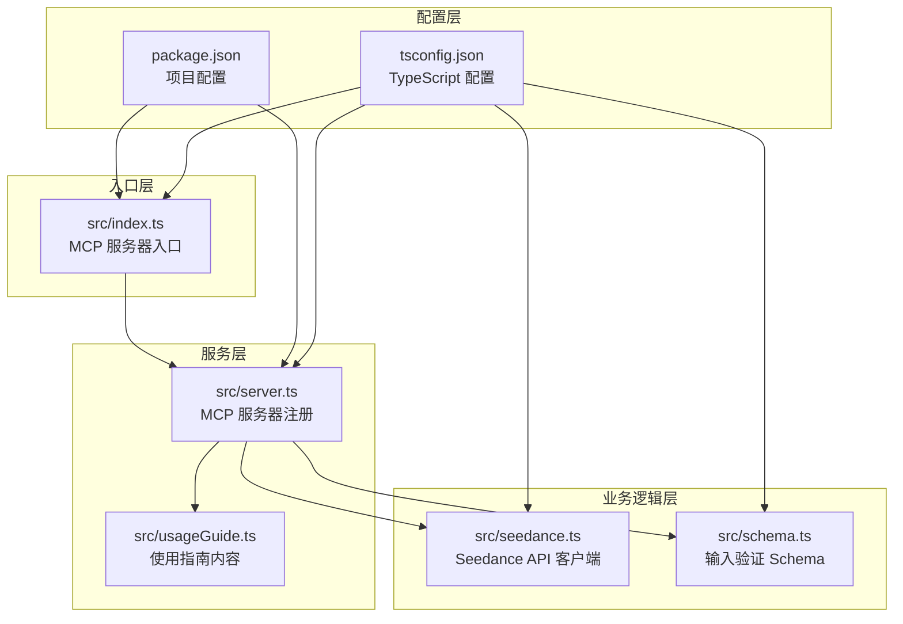
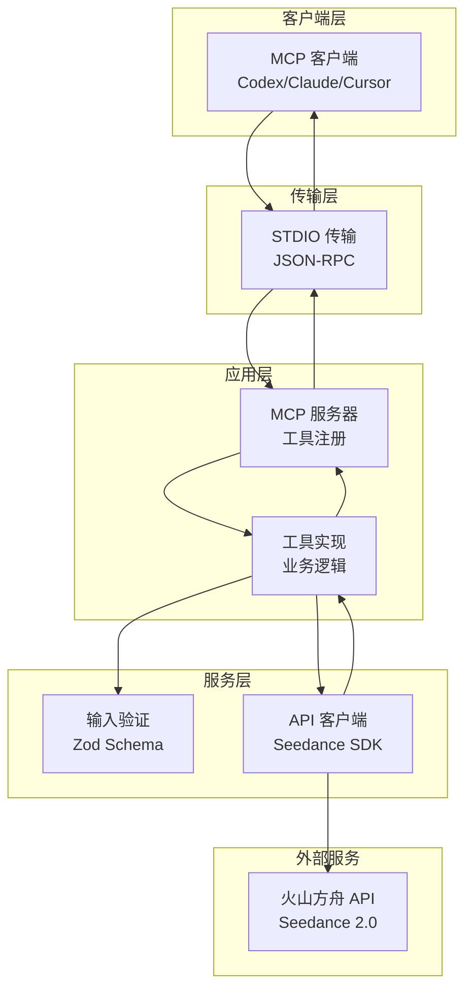
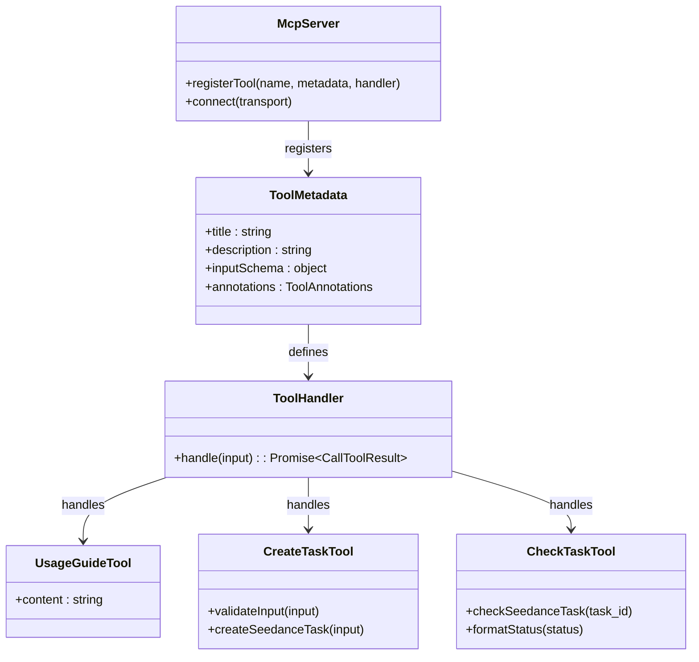
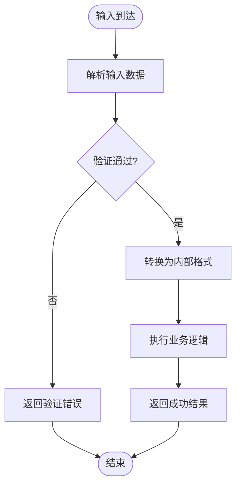
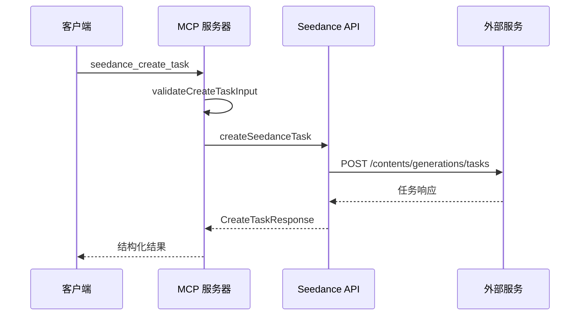

# 扩展与贡献

<cite>
**本文档引用的文件**
- [src/index.ts](file://src/index.ts)
- [src/server.ts](file://src/server.ts)
- [src/seedance.ts](file://src/seedance.ts)
- [src/schema.ts](file://src/schema.ts)
- [src/usageGuide.ts](file://src/usageGuide.ts)
- [package.json](file://package.json)
- [README.md](file://README.md)
- [tsconfig.json](file://tsconfig.json)
</cite>

## 目录
1. [简介](#简介)
2. [项目结构](#项目结构)
3. [核心组件](#核心组件)
4. [架构概览](#架构概览)
5. [详细组件分析](#详细组件分析)
6. [扩展指南](#扩展指南)
7. [贡献规范](#贡献规范)
8. [Pull Request 流程](#pull-request-流程)
9. [性能考虑](#性能考虑)
10. [故障排除指南](#故障排除指南)
11. [结论](#结论)

## 简介

Seedance-2-mcp 是一个开源的 Model Context Protocol (MCP) 服务器，将火山方舟 (Volcengine ARK) Seedance 2.0 视频生成功能以本地 stdio 工具的形式暴露给各种 MCP 客户端。该项目采用 TypeScript 编写，使用官方 @modelcontextprotocol/sdk 库，提供了三个核心工具：`seedance_usage_guide`、`seedance_create_task` 和 `seedance_check_task`。

该项目的设计原则是保持简单、可靠和可扩展，为开发者提供清晰的扩展点和贡献路径。

## 项目结构

项目采用模块化设计，每个功能模块都有明确的职责分工：



**图表来源**
- [src/index.ts:1-19](file://src/index.ts#L1-L19)
- [src/server.ts:1-215](file://src/server.ts#L1-L215)
- [src/seedance.ts:1-286](file://src/seedance.ts#L1-L286)
- [src/schema.ts:1-141](file://src/schema.ts#L1-L141)

**章节来源**
- [src/index.ts:1-19](file://src/index.ts#L1-L19)
- [src/server.ts:1-215](file://src/server.ts#L1-L215)
- [package.json:1-51](file://package.json#L1-L51)

## 核心组件

### MCP 服务器核心

MCP 服务器通过 `createServer()` 函数创建，注册了三个核心工具：

1. **seedance_usage_guide**: 返回完整的使用指南
2. **seedance_create_task**: 提交视频生成任务
3. **seedance_check_task**: 查询任务状态

### Seedance API 客户端

封装了与火山方舟 API 的交互，包括：
- 任务创建 (`createSeedanceTask`)
- 任务查询 (`checkSeedanceTask`)
- 错误处理 (`SeedanceApiError`)

### 输入验证系统

使用 Zod 库实现强类型输入验证，确保数据的完整性和正确性。

**章节来源**
- [src/server.ts:20-177](file://src/server.ts#L20-L177)
- [src/seedance.ts:149-286](file://src/seedance.ts#L149-L286)
- [src/schema.ts:1-141](file://src/schema.ts#L1-L141)

## 架构概览

项目采用分层架构设计，确保关注点分离和良好的可维护性：



**图表来源**
- [src/index.ts:6-12](file://src/index.ts#L6-L12)
- [src/server.ts:20-177](file://src/server.ts#L20-L177)
- [src/seedance.ts:149-286](file://src/seedance.ts#L149-L286)

## 详细组件分析

### 服务器注册机制

服务器通过 `registerTool` 方法注册工具，每个工具都包含元数据定义：



**图表来源**
- [src/server.ts:31-174](file://src/server.ts#L31-L174)

### 输入验证流程

使用 Zod Schema 实现强类型验证，确保输入数据符合预期格式：



**图表来源**
- [src/schema.ts:52-127](file://src/schema.ts#L52-L127)
- [src/server.ts:179-199](file://src/server.ts#L179-L199)

### API 客户端实现

封装了与外部 API 的交互，包括错误处理和响应格式化：



**图表来源**
- [src/server.ts:62-89](file://src/server.ts#L62-L89)
- [src/seedance.ts:149-194](file://src/seedance.ts#L149-L194)

**章节来源**
- [src/server.ts:179-215](file://src/server.ts#L179-L215)
- [src/seedance.ts:149-286](file://src/seedance.ts#L149-L286)

## 扩展指南

### 添加新的 MCP 工具

要添加新的 MCP 工具，需要遵循以下步骤：

#### 1. 定义工具元数据

在 `src/server.ts` 中使用 `registerTool` 方法注册新工具：

```typescript
server.registerTool(
  "new_tool_name",
  {
    title: "工具标题",
    description: "工具描述",
    inputSchema: yourInputSchema,
    annotations: {
      readOnlyHint: boolean,
      idempotentHint: boolean,
      openWorldHint: boolean,
    },
  },
  async (input: YourInputType): Promise<CallToolResult> => {
    // 工具实现逻辑
  }
);
```

#### 2. 创建输入验证 Schema

在 `src/schema.ts` 中定义输入验证规则：

```typescript
export const newToolInputShape = {
  // 定义字段和验证规则
};

export const newToolInputSchema = z.object(newToolInputShape);
export type NewToolInput = z.infer<typeof newToolInputSchema>;
```

#### 3. 实现业务逻辑

在 `src/seedance.ts` 或新建文件中实现具体的业务逻辑，确保：
- 使用适当的错误处理
- 返回标准化的响应格式
- 遵循现有代码风格

#### 4. 更新使用指南

在 `src/usageGuide.ts` 中添加新工具的使用说明。

**章节来源**
- [src/server.ts:31-174](file://src/server.ts#L31-L174)
- [src/schema.ts:1-141](file://src/schema.ts#L1-L141)

### 集成其他视频生成 API

要集成其他视频生成 API，可以按照以下模式扩展：

#### 1. 创建 API 客户端类

```typescript
export class AlternativeVideoApi {
  private baseUrl: string;
  private apiKey: string;
  
  constructor(baseUrl: string, apiKey: string) {
    this.baseUrl = baseUrl;
    this.apiKey = apiKey;
  }
  
  async createTask(input: CreateTaskInput): Promise<CreateTaskResponse> {
    // 实现 API 调用
  }
  
  async checkTask(taskId: string): Promise<CheckTaskResponse> {
    // 实现状态查询
  }
}
```

#### 2. 实现统一接口

确保新 API 客户端实现与现有接口兼容，包括：
- 标准化的输入格式
- 统一的错误处理机制
- 一致的响应格式

#### 3. 配置切换机制

添加配置选项来选择不同的 API 提供商：

```typescript
const API_PROVIDER = process.env.VIDEO_API_PROVIDER || 'seedance';
```

### 添加新的数据验证规则

扩展输入验证系统的方法：

#### 1. 扩展现有 Schema

在 `src/schema.ts` 中添加新的验证规则：

```typescript
const newField = z.string()
  .min(1, "新字段不能为空")
  .max(100, "新字段长度不能超过100")
  .regex(/^[a-zA-Z0-9]+$/, "新字段只能包含字母数字字符");
```

#### 2. 创建自定义验证器

```typescript
const customValidator = z.string().refine(
  (value) => {
    // 自定义验证逻辑
    return value.length > 0;
  },
  {
    message: "自定义验证失败",
  }
);
```

#### 3. 更新工具验证函数

在 `src/server.ts` 中更新相应的验证函数：

```typescript
function validateNewInput(input: NewInput): string | null {
  // 实现新的验证逻辑
  return null;
}
```

**章节来源**
- [src/seedance.ts:102-114](file://src/seedance.ts#L102-L114)
- [src/schema.ts:30-50](file://src/schema.ts#L30-L50)

## 贡献规范

### 编码风格

#### TypeScript 规范

- 使用严格模式 (`"strict": true`)
- 避免未使用的局部变量 (`"noUnusedLocals": true`)
- 明确的类型声明
- 一致的命名约定

#### 代码组织

- 每个功能模块独立文件
- 清晰的函数和类命名
- 适当的注释和文档字符串
- 一致的缩进和空格

#### 错误处理

- 使用专门的错误类 (`SeedanceApiError`)
- 明确的错误消息
- 适当的错误级别
- 资源清理

### 注释要求

#### 文件头部注释

每个文件都应该包含版权和许可证信息：

```typescript
/*
 * 版权所有 (c) 2024 Seedance-2-MCP 贡献者
 * 许可证: MIT
 */
```

#### 函数注释

重要的函数应该包含详细的 JSDoc 注释：

```typescript
/**
 * 提交 Seedance 2.0 视频生成任务
 * @param input - 任务输入参数
 * @returns 任务响应对象
 * @throws SeedanceApiError 当 API 调用失败时
 */
export async function createSeedanceTask(input: CreateTaskInput): Promise<CreateTaskResponse>
```

#### 复杂逻辑注释

对于复杂的算法或业务逻辑，应该添加解释性注释：

```typescript
// 不同版本的 SDK 在结果位置上略有差异；为了兼容性
// 我们探测最常见的情况
const content = 
  (obj.content as Record<string, unknown> | undefined) ??
  (obj.result as Record<string, unknown> | undefined) ??
  {};
```

### 提交信息格式

遵循 Conventional Commits 规范：

```
<type>(<scope>): <subject>

<body>

<footer>
```

示例：

```
feat(server): 添加新的视频生成 API 支持

- 集成 AlternativeVideo API
- 添加配置选项
- 更新使用指南

Closes #123
```

类型说明：
- `feat`: 新功能
- `fix`: 修复
- `docs`: 文档更新
- `style`: 代码格式调整
- `refactor`: 重构
- `test`: 测试
- `chore`: 构建过程或辅助工具的变动

**章节来源**
- [tsconfig.json:9-19](file://tsconfig.json#L9-L19)
- [src/seedance.ts:44-53](file://src/seedance.ts#L44-L53)

## Pull Request 流程

### PR 准备

1. **分支策略**
   - 从 `main` 分支创建功能分支
   - 分支命名: `feature/<描述>` 或 `fix/<描述>`
   - 确保分支是最新的

2. **代码检查**
   - 运行 `npm run typecheck`
   - 运行 `npm run build`
   - 运行所有测试

3. **文档更新**
   - 更新相关文档
   - 添加使用示例
   - 更新变更日志

### PR 内容要求

#### 标题规范
```
<类型>(<范围>): <简短描述>
```

#### 描述模板
```
## 概述
简要描述变更内容

## 问题/需求
关联的问题或需求

## 解决方案
详细描述实现方案

## 测试方法
如何验证变更

## 影响范围
可能受影响的功能
```

### 代码审查标准

#### 代码质量
- 符合编码规范
- 有适当的注释
- 错误处理完整
- 性能考虑充分

#### 功能正确性
- 通过所有测试
- 兼容性保持
- 回归测试通过

#### 文档完整性
- 更新相关文档
- 添加使用示例
- 更新 API 文档

**章节来源**
- [package.json:19-25](file://package.json#L19-L25)

## 性能考虑

### 并发处理

当前实现采用串行处理请求，对于高并发场景可以考虑：

1. **连接池管理**: 重用 HTTP 连接
2. **请求队列**: 限制并发请求数
3. **超时控制**: 设置合理的超时时间

### 内存优化

1. **流式处理**: 对大响应使用流式处理
2. **及时释放**: 及时清理临时对象
3. **缓存策略**: 合理使用缓存

### 网络优化

1. **重试机制**: 实现指数退避重试
2. **超时配置**: 可配置的超时参数
3. **连接复用**: 复用网络连接

## 故障排除指南

### 常见问题

#### API 密钥问题

**症状**: 调用 API 时返回认证错误

**解决方案**:
1. 确认 `ARK_API_KEY` 环境变量已正确设置
2. 验证 API 密钥的有效性
3. 检查网络连接

#### URL 有效性问题

**症状**: 任务创建失败，提示 URL 无效

**解决方案**:
1. 确保所有媒体 URL 都是公网可访问的
2. 验证 URL 格式正确
3. 检查媒体文件是否可达

#### 超时问题

**症状**: 请求超时或响应缓慢

**解决方案**:
1. 检查网络连接稳定性
2. 考虑增加超时时间
3. 优化媒体文件大小

### 调试技巧

#### 启用详细日志

使用 MCP Inspector 进行调试：

```bash
npx -y @modelcontextprotocol/inspector npx -y seedance-2-mcp
```

#### 错误诊断

查看详细的错误信息和堆栈跟踪：

```typescript
console.error(`致命错误: ${SERVER_NAME}`, msg);
```

**章节来源**
- [src/index.ts:14-18](file://src/index.ts#L14-L18)
- [src/seedance.ts:55-64](file://src/seedance.ts#L55-L64)

## 结论

Seedance-2-mcp 项目提供了一个清晰、可扩展的框架，用于集成视频生成 API 到 MCP 生态系统中。通过遵循本文档中的扩展指南和贡献规范，开发者可以轻松地添加新的工具、集成其他 API 提供商，并保持代码质量和项目稳定性。

关键的设计原则包括：
- 清晰的关注点分离
- 强类型的输入验证
- 完善的错误处理机制
- 可扩展的架构设计
- 详细的文档和使用指南

未来的发展方向包括支持更多视频生成 API、增强错误处理能力、优化性能表现，以及提供更丰富的工具集。