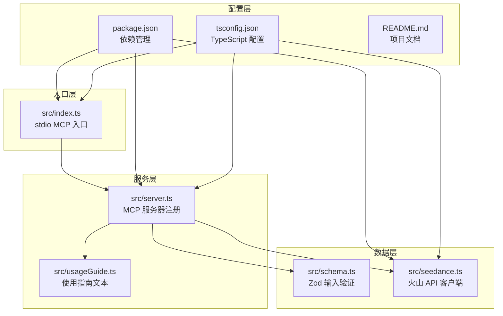
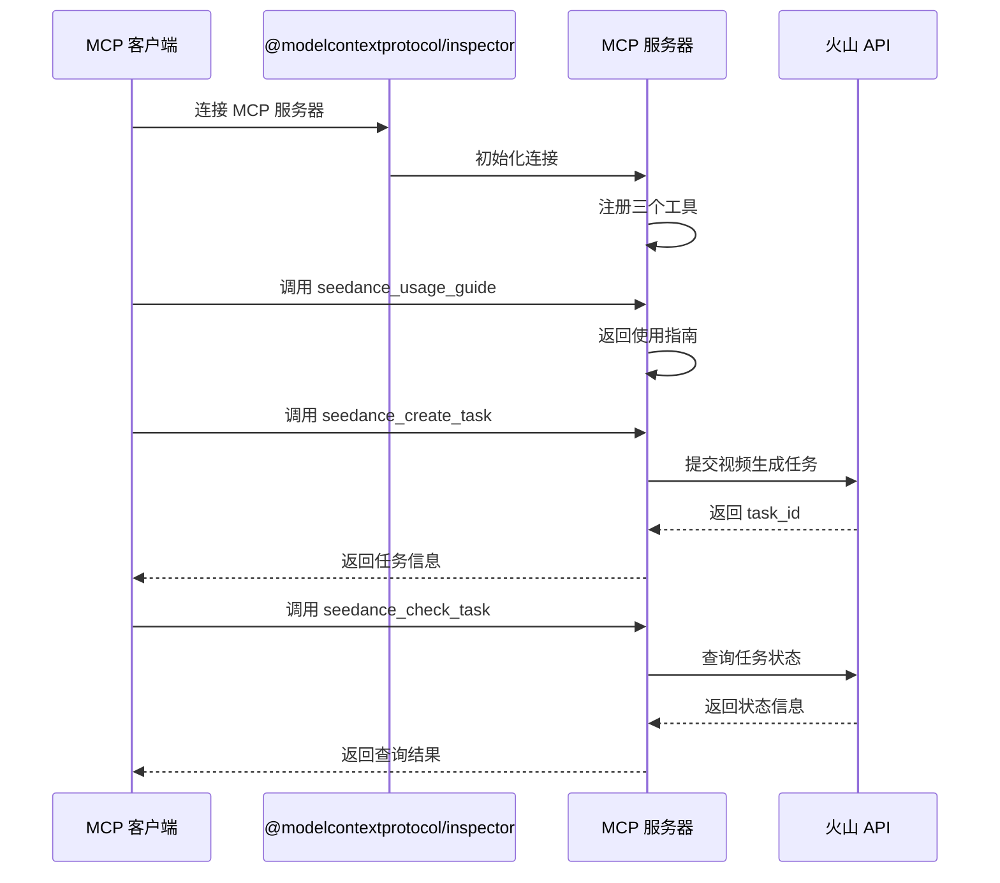
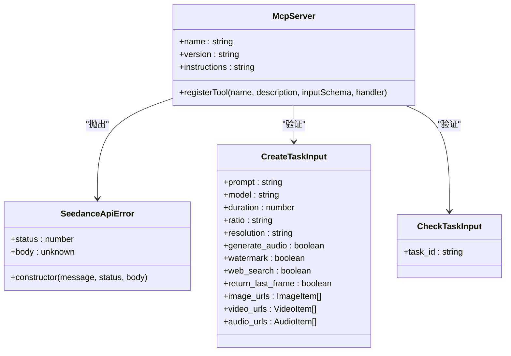
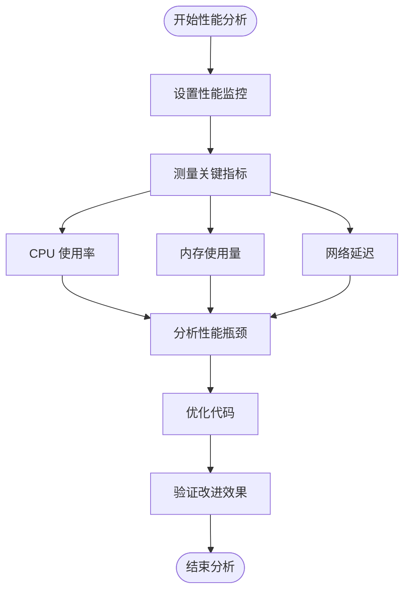
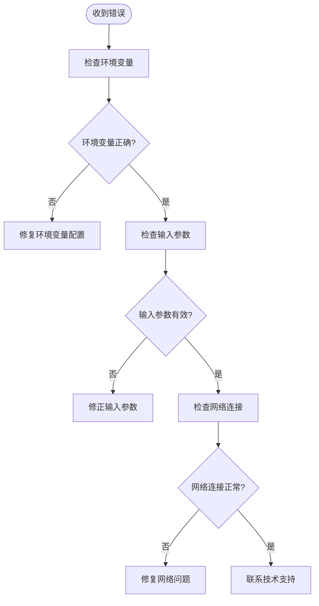

# 调试与测试

<cite>
**本文档引用的文件**
- [README.md](file://README.md)
- [package.json](file://package.json)
- [src/index.ts](file://src/index.ts)
- [src/server.ts](file://src/server.ts)
- [src/seedance.ts](file://src/seedance.ts)
- [src/schema.ts](file://src/schema.ts)
- [src/usageGuide.ts](file://src/usageGuide.ts)
- [tsconfig.json](file://tsconfig.json)
</cite>

## 目录
1. [简介](#简介)
2. [项目结构](#项目结构)
3. [核心组件](#核心组件)
4. [架构概览](#架构概览)
5. [详细组件分析](#详细组件分析)
6. [依赖关系分析](#依赖关系分析)
7. [性能考虑](#性能考虑)
8. [故障排除指南](#故障排除指南)
9. [结论](#结论)

## 简介

本指南专注于使用 @modelcontextprotocol/inspector 对 MCP 协议进行调试，以及为该种子程序创建全面的测试策略。该项目是一个本地运行的 MCP 服务器，将火山方舟 Seedance 2.0 视频生成功能暴露为三个 stdio 工具。文档涵盖了连接配置、消息监控、单元测试、集成测试、日志记录最佳实践、性能分析工具使用方法、断点调试技巧和常见问题的调试思路。

## 项目结构

该项目采用模块化设计，主要包含以下核心文件：



**图表来源**
- [src/index.ts:1-19](file://src/index.ts#L1-L19)
- [src/server.ts:1-215](file://src/server.ts#L1-L215)
- [src/seedance.ts:1-286](file://src/seedance.ts#L1-L286)
- [src/schema.ts:1-141](file://src/schema.ts#L1-L141)
- [src/usageGuide.ts:1-59](file://src/usageGuide.ts#L1-L59)

**章节来源**
- [README.md:267-283](file://README.md#L267-L283)
- [package.json:1-51](file://package.json#L1-L51)

## 核心组件

### MCP 服务器组件

项目的核心是基于 @modelcontextprotocol/sdk 构建的 MCP 服务器，负责注册三个主要工具：

1. **seedance_usage_guide**: 提供完整的使用说明
2. **seedance_create_task**: 提交视频生成任务
3. **seedance_check_task**: 查询任务状态

每个工具都实现了严格的输入验证和错误处理机制。

### 数据验证组件

使用 Zod 库实现类型安全的输入验证，确保所有外部输入都符合预期格式。

### API 客户端组件

封装了与火山方舟 ARK API 的交互逻辑，包括认证、请求构建和响应解析。

**章节来源**
- [src/server.ts:20-177](file://src/server.ts#L20-L177)
- [src/schema.ts:52-141](file://src/schema.ts#L52-L141)
- [src/seedance.ts:149-278](file://src/seedance.ts#L149-L278)

## 架构概览



**图表来源**
- [src/index.ts:6-12](file://src/index.ts#L6-L12)
- [src/server.ts:31-177](file://src/server.ts#L31-L177)
- [src/seedance.ts:149-278](file://src/seedance.ts#L149-L278)

## 详细组件分析

### MCP 服务器实现

MCP 服务器使用官方 SDK 创建，具有以下特点：

- **严格的身份验证**: 通过 Authorization 头部传递 API 密钥
- **灵活的配置**: 支持自定义基础 URL 和 API 密钥
- **完整的错误处理**: 将 API 错误转换为人类可读的消息



**图表来源**
- [src/server.ts:20-177](file://src/server.ts#L20-L177)
- [src/seedance.ts:44-53](file://src/seedance.ts#L44-L53)
- [src/schema.ts:129-141](file://src/schema.ts#L129-L141)

### 输入验证系统

使用 Zod 实现的类型安全验证系统，提供了以下功能：

- **枚举验证**: 确保模型、比例、分辨率等参数在允许范围内
- **URL 验证**: 确保所有外部引用都是有效的 HTTP/HTTPS URL
- **数量限制**: 限制参考媒体的数量（图像最多9个，视频最多3个，音频最多3个）

**章节来源**
- [src/schema.ts:30-141](file://src/schema.ts#L30-L141)
- [src/server.ts:179-199](file://src/server.ts#L179-L199)

### API 客户端实现

API 客户端封装了与火山方舟 API 的交互，包括：

- **认证管理**: 从环境变量读取 API 密钥
- **请求构建**: 将输入参数转换为 API 请求格式
- **响应解析**: 处理不同格式的 API 响应
- **错误处理**: 将 HTTP 错误转换为结构化的错误对象

**章节来源**
- [src/seedance.ts:55-72](file://src/seedance.ts#L55-L72)
- [src/seedance.ts:102-114](file://src/seedance.ts#L102-L114)
- [src/seedance.ts:149-278](file://src/seedance.ts#L149-L278)

## 依赖关系分析

```mermaid
graph TD
A[seedance-2-mcp] --> B[@modelcontextprotocol/sdk]
A --> C[zod]
A --> D[TypeScript]
A --> E[Node.js >= 18]
F[开发依赖] --> G[tsx]
F --> H[typescript]
F --> I[@types/node]
B --> J[MCP 协议实现]
C --> K[输入验证]
D --> L[编译器]
G --> M[热重载开发]
H --> N[类型检查]
I --> O[类型定义]
```

**图表来源**
- [package.json:26-34](file://package.json#L26-L34)
- [package.json:19-25](file://package.json#L19-L25)

**章节来源**
- [package.json:16-34](file://package.json#L16-L34)
- [tsconfig.json:2-22](file://tsconfig.json#L2-L22)

## 性能考虑

### 内存管理

- **流式响应处理**: API 响应使用流式解析，避免大对象占用过多内存
- **错误对象优化**: 自定义错误类只存储必要的信息
- **字符串处理**: 使用高效的字符串操作和 URL 验证

### 并发处理

- **异步操作**: 所有网络请求都是异步的，不会阻塞事件循环
- **超时控制**: 建议在生产环境中添加适当的超时机制
- **重试策略**: 可以考虑实现指数退避的重试机制

### 性能监控



## 故障排除指南

### MCP 连接问题

1. **检查 @modelcontextprotocol/inspector 安装**
   ```bash
   npm list -g @modelcontextprotocol/inspector
   ```

2. **验证 MCP 服务器启动**
   ```bash
   npx -y @modelcontextprotocol/inspector npx -y seedance-2-mcp
   ```

3. **检查环境变量配置**
   ```bash
   echo $ARK_API_KEY
   ```

### 常见错误诊断



### 日志记录最佳实践

1. **使用标准错误输出**: 所有调试信息应该写入 stderr，避免干扰 MCP JSON-RPC 流
2. **结构化日志**: 使用 JSON 格式记录关键事件和错误
3. **敏感信息过滤**: 确保不记录 API 密钥或其他敏感信息

**章节来源**
- [src/index.ts:10-18](file://src/index.ts#L10-L18)
- [src/seedance.ts:55-64](file://src/seedance.ts#L55-L64)

### 断点调试技巧

1. **使用 VS Code 调试器**
   - 创建 launch.json 配置文件
   - 设置断点在关键函数处
   - 使用条件断点监控特定情况

2. **远程调试配置**
   ```bash
   node --inspect-brk=9229 dist/index.js
   ```

3. **MCP 消息监控**
   - 使用 @modelcontextprotocol/inspector 监控所有消息
   - 记录请求和响应的完整内容
   - 分析消息序列和时间戳

### 性能分析工具使用

1. **内存泄漏检测**
   ```bash
   node --inspect dist/index.js
   # 在 Chrome DevTools 中使用 Memory 面板
   ```

2. **CPU 使用率分析**
   ```bash
   node --prof dist/index.js
   # 生成 v8.log 文件
   ```

3. **网络性能监控**
   - 监控 API 调用延迟
   - 分析并发请求处理能力
   - 识别慢查询和阻塞操作

### 单元测试编写指南

虽然当前项目没有包含测试文件，但可以按照以下模式编写测试：

1. **输入验证测试**
   - 测试各种有效的输入参数
   - 测试边界条件和异常输入
   - 验证错误消息的准确性

2. **API 客户端测试**
   - 使用模拟服务器测试 API 调用
   - 测试不同的响应状态
   - 验证错误处理逻辑

3. **工具函数测试**
   - 测试参数转换函数
   - 测试错误格式化函数
   - 测试 URL 验证逻辑

### 集成测试方法

1. **MCP 客户端联调测试**
   - 使用实际的 MCP 客户端进行测试
   - 验证完整的工具调用流程
   - 测试错误恢复机制

2. **端到端测试**
   - 模拟完整的用户工作流程
   - 测试从创建任务到获取结果的全过程
   - 验证所有边缘情况

3. **性能回归测试**
   - 建立基准性能指标
   - 定期运行性能测试
   - 监控性能变化趋势

**章节来源**
- [README.md:253-264](file://README.md#L253-L264)
- [src/schema.ts:30-141](file://src/schema.ts#L30-L141)
- [src/seedance.ts:149-278](file://src/seedance.ts#L149-L278)

## 结论

本指南提供了使用 @modelcontextprotocol/inspector 进行 MCP 协议调试的完整方法，包括连接配置、消息监控、日志记录最佳实践和性能分析工具的使用。通过遵循这些指导原则，开发者可以有效地调试和测试 MCP 服务器，确保其稳定性和可靠性。

项目的设计采用了模块化架构，使用 Zod 进行类型安全验证，以及完善的错误处理机制，为调试和测试提供了良好的基础。建议在开发过程中持续关注性能指标，定期进行压力测试，并建立完善的监控和日志记录机制。