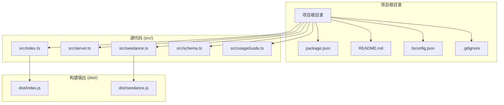
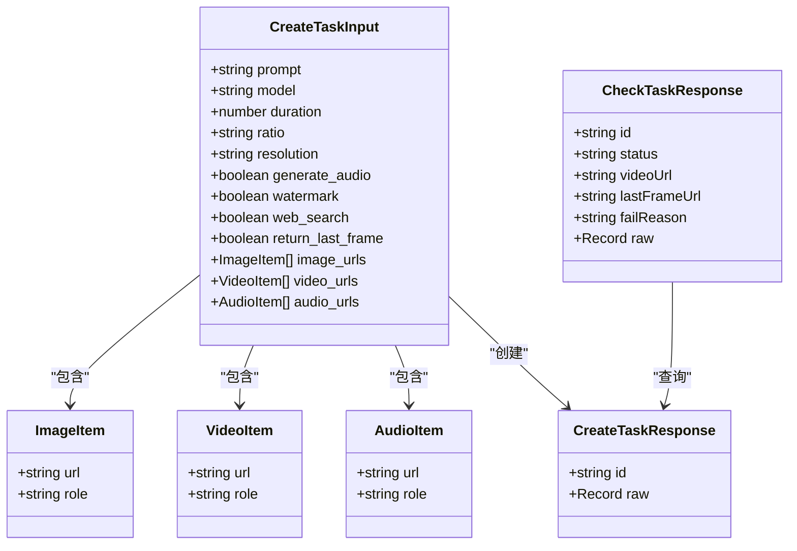
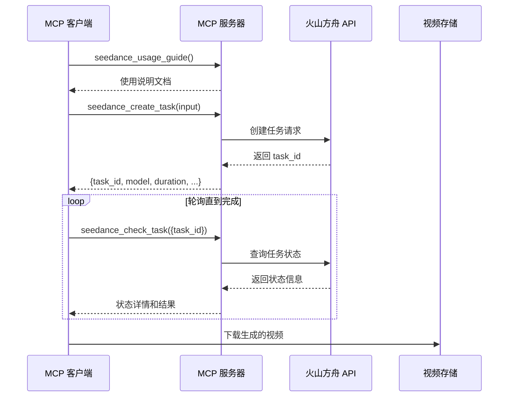
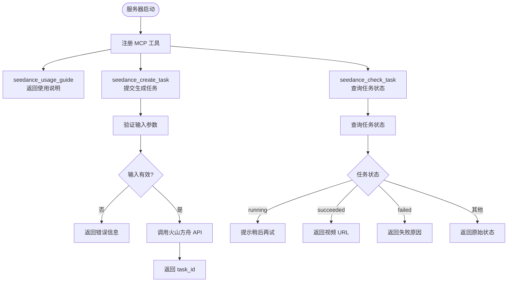
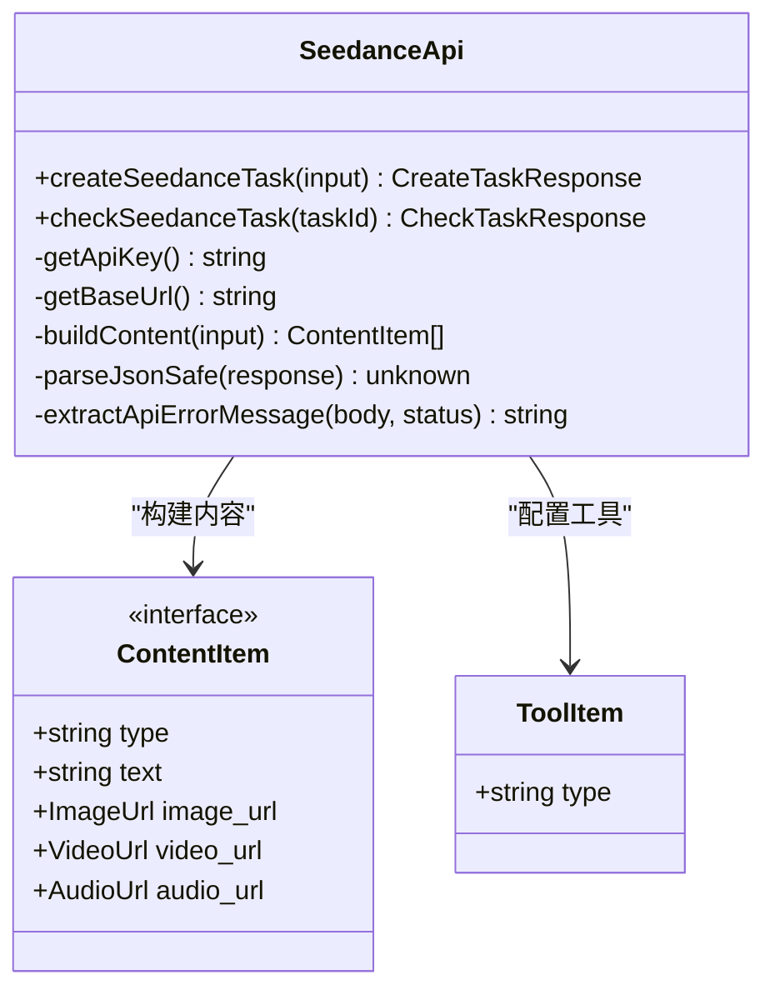
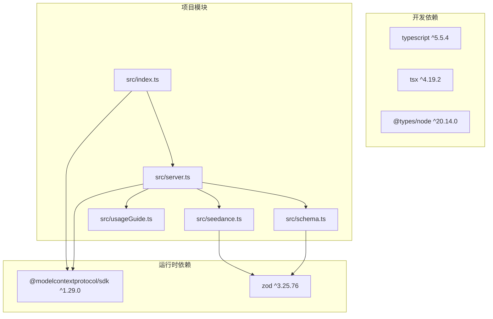

# 快速开始

<cite>
**本文档引用的文件**
- [README.md](file://README.md)
- [package.json](file://package.json)
- [src/index.ts](file://src/index.ts)
- [src/server.ts](file://src/server.ts)
- [src/seedance.ts](file://src/seedance.ts)
- [src/schema.ts](file://src/schema.ts)
- [src/usageGuide.ts](file://src/usageGuide.ts)
</cite>

## 目录
1. [简介](#简介)
2. [项目结构](#项目结构)
3. [核心组件](#核心组件)
4. [架构概览](#架构概览)
5. [详细组件分析](#详细组件分析)
6. [安装指南](#安装指南)
7. [环境变量配置](#环境变量配置)
8. [MCP 客户端配置示例](#mcp-客户端配置示例)
9. [首次使用工作流程](#首次使用工作流程)
10. [依赖关系分析](#依赖关系分析)
11. [性能考虑](#性能考虑)
12. [故障排除指南](#故障排除指南)
13. [结论](#结论)

## 简介

seedance-2-mcp 是一个开源、本地运行的 **MCP (Model Context Protocol)** 服务器，将火山方舟 (Volcengine ARK) Seedance 2.0 视频生成能力以三个 stdio 工具的形式暴露给 Codex、Claude Desktop、Cursor 等任意 MCP 客户端。

- 纯本地 stdio，**不需要任何云端部署**
- 由 Node.js + TypeScript 编写，使用官方 [`@modelcontextprotocol/sdk`](https://www.npmjs.com/package/@modelcontextprotocol/sdk)
- 用户在自己机器上配置 `ARK_API_KEY` 即可调用 Seedance 2.0 的 **文生视频 / 图生视频 / 多模态参考生成**

## 项目结构



**图表来源**
- [package.json:1-51](file://package.json#L1-L51)
- [src/index.ts:1-19](file://src/index.ts#L1-L19)
- [src/server.ts:1-215](file://src/server.ts#L1-L215)

**章节来源**
- [README.md:267-283](file://README.md#L267-L283)
- [package.json:1-51](file://package.json#L1-L51)

## 核心组件

### MCP 工具集

项目提供了三个核心 MCP 工具：

| 工具名称 | 作用 | 特点 |
|---------|------|------|
| `seedance_usage_guide` | 返回完整的使用说明 | 无参数，返回 Markdown 格式说明 |
| `seedance_create_task` | 提交视频生成任务 | 立即返回 `task_id`，不阻塞 |
| `seedance_check_task` | 查询任务状态 | 支持多种状态：running/pending/succeeded/failed |

### 核心数据结构



**图表来源**
- [src/schema.ts:52-127](file://src/schema.ts#L52-L127)
- [src/seedance.ts:25-42](file://src/seedance.ts#L25-L42)

**章节来源**
- [README.md:16-24](file://README.md#L16-L24)
- [src/schema.ts:1-141](file://src/schema.ts#L1-L141)

## 架构概览



**图表来源**
- [src/server.ts:31-177](file://src/server.ts#L31-L177)
- [src/seedance.ts:149-278](file://src/seedance.ts#L149-L278)

## 详细组件分析

### MCP 服务器实现

MCP 服务器通过 `@modelcontextprotocol/sdk` 实现，注册三个核心工具：



**图表来源**
- [src/server.ts:20-177](file://src/server.ts#L20-L177)
- [src/schema.ts:179-199](file://src/schema.ts#L179-L199)

### 火山方舟 API 客户端



**图表来源**
- [src/seedance.ts:149-278](file://src/seedance.ts#L149-L278)

**章节来源**
- [src/server.ts:1-215](file://src/server.ts#L1-L215)
- [src/seedance.ts:1-286](file://src/seedance.ts#L1-L286)

## 安装指南

### 1. 通过 `npx`（推荐 - 无需手动安装）

这是最简单的方式，MCP 客户端的配置里直接使用：

```bash
npx -y seedance-2-mcp
```

每次启动会下载（或复用缓存）最新版本。

**章节来源**
- [README.md:61-69](file://README.md#L61-L69)

### 2. 全局安装

```bash
npm install -g seedance-2-mcp
```

之后在客户端配置里使用 `seedance-2-mcp` 即可。

**章节来源**
- [README.md:71-78](file://README.md#L71-L78)

### 3. 从源码运行（开发者）

```bash
git clone https://github.com/seedance/seedance-2-mcp.git
cd seedance-2-mcp
npm install
npm run build
node dist/index.js
```

要求 **Node.js >= 18**（依赖原生 `fetch`）。

**章节来源**
- [README.md:79-89](file://README.md#L79-L89)

## 环境变量配置

### 必需环境变量

| 变量 | 必填 | 说明 |
|------|------|------|
| `ARK_API_KEY` | 是 | 火山方舟 API Key。前往 https://console.volcengine.com/ark 获取。 |
| `ARK_BASE_URL` | 否 | 默认 `https://ark.cn-beijing.volces.com/api/v3`。海外/代理可覆盖。 |

### 环境变量设置位置

复制 `.env.example` 到本地 `.env` 仅作开发参考；**真正生效的位置是 MCP 客户端配置里的 `env`**，因为客户端通过子进程拉起 MCP，会自己注入环境变量。

如果工具调用时未设置 `ARK_API_KEY`，三个工具中调用真实 API 的两个都会返回清晰错误：

> `Missing ARK_API_KEY environment variable. Please set ARK_API_KEY to your Volcengine ARK API key.`

**章节来源**
- [README.md:93-106](file://README.md#L93-L106)
- [src/seedance.ts:55-64](file://src/seedance.ts#L55-L64)

## MCP 客户端配置示例

### Codex 配置（`~/.codex/config.toml`）

```toml
[mcp_servers.seedance-2-mcp]
command = "npx"
args = ["-y", "seedance-2-mcp"]
env = { "ARK_API_KEY" = "your_key_here" }
```

### Claude Desktop 配置

macOS 路径：`~/Library/Application Support/Claude/claude_desktop_config.json`
Windows 路径：`%APPDATA%\Claude\claude_desktop_config.json`

```json
{
  "mcpServers": {
    "seedance-2-mcp": {
      "command": "npx",
      "args": ["-y", "seedance-2-mcp"],
      "env": {
        "ARK_API_KEY": "your_key_here"
      }
    }
  }
}
```

### Cursor / 其他 MCP 客户端

任何支持 stdio MCP 的客户端通用配置：

```json
{
  "command": "npx",
  "args": ["-y", "seedance-2-mcp"],
  "env": { "ARK_API_KEY": "your_key_here" }
}
```

**章节来源**
- [README.md:109-149](file://README.md#L109-L149)

## 首次使用工作流程

### 标准工作流程

```text
client → seedance_usage_guide                                  ← 阅读规则
client → seedance_create_task { prompt, ... }                  ← 提交任务
                                               ↓
                                       task_id: cgt-...
                                               ↓
client → seedance_check_task { task_id }                       ← 30-90s 后轮询
                               ↓
                       status: running         （继续等待）
                               ↓
                       status: succeeded       ← 返回 video_url
                               ↓
               立刻下载 video_url（约 24h 内会过期）
```

### 详细步骤说明

1. **调用 `seedance_usage_guide`** - 首次使用前先调用，了解标准流程、模型选择、参数表和注意事项
2. **调用 `seedance_create_task`** - 提交视频生成任务，立即返回 `task_id`，不阻塞
3. **等待 30-90 秒** - 根据任务复杂度等待渲染完成
4. **调用 `seedance_check_task`** - 使用 `task_id` 查询任务状态
5. **重复步骤 4** - 直到状态为 `succeeded` 或 `failed`
6. **下载视频** - 成功后立即下载 `video_url`（通常 24 小时内过期）

### 时间参考

15 秒标准模型任务通常需要 **2-5 分钟**完成；快速版会更短。

**章节来源**
- [README.md:212-227](file://README.md#L212-L227)
- [src/server.ts:105-173](file://src/server.ts#L105-L173)

## 依赖关系分析



**图表来源**
- [package.json:26-34](file://package.json#L26-L34)
- [src/index.ts:1-19](file://src/index.ts#L1-L19)
- [src/server.ts:1-16](file://src/server.ts#L1-L16)

**章节来源**
- [package.json:1-51](file://package.json#L1-L51)

## 性能考虑

### 模型选择

- **标准模型** (`doubao-seedance-2-0-260128`): 最高质量，适合对画质要求高的场景
- **快速模型** (`doubao-seedance-2-0-fast-260128`): 更快更便宜，质量略低

### 参数优化

- **分辨率**: 720p 是推荐值，480p 更快但质量较低
- **时长**: 4-15 秒范围内，越短完成时间越快
- **比例**: 16:9 适合横屏视频，9:16 适合竖屏短视频

### 并发处理

- 每个任务独立处理，支持并发多个任务
- 建议合理控制并发数量，避免 API 限流

## 故障排除指南

### 常见错误及解决方案

#### 1. 缺少 ARK_API_KEY

**错误信息**:
```
Missing ARK_API_KEY environment variable. Please set ARK_API_KEY to your Volcengine ARK API key.
```

**解决方案**:
- 在 MCP 客户端配置的 `env` 字段中设置 `ARK_API_KEY`
- 确保 API Key 来自 https://console.volcengine.com/ark
- 不要将 API Key 提交到版本控制系统

#### 2. 网络连接问题

**症状**: API 请求超时或连接失败

**解决方案**:
- 检查网络连接是否正常
- 如需代理，设置 `ARK_BASE_URL` 环境变量
- 确认防火墙允许出站连接

#### 3. URL 无效

**错误信息**: URL 必须以 http:// 或 https:// 开头

**解决方案**:
- 确保所有参考媒体 URL 都是公网可访问的 HTTPS 地址
- 避免使用本地文件路径或需要认证的资源
- 检查 URL 格式是否正确

#### 4. 参数验证失败

**常见验证错误**:
- `image_urls` 超过 9 项
- `video_urls` 超过 3 项  
- `audio_urls` 超过 3 项
- `web_search=true` 与参考素材同时使用
- 纯文本 + 音频组合不被支持

**解决方案**:
- 检查数组长度限制
- 遵循 `web_search` 的使用规则
- 音频必须与至少一个图像或视频参考配合使用

#### 5. 任务状态异常

**状态含义**:
- `running/queued/pending/in_queue`: 仍在处理中，等待 30-90 秒后重试
- `succeeded`: 任务成功，返回 `video_url`
- `failed`: 任务失败，返回失败原因
- `cancelled/canceled`: 任务被取消
- `expired`: 任务已过期，需要重新提交

**解决方案**:
- 对于 `running` 状态，耐心等待并定期轮询
- 对于 `failed` 状态，检查输入参数和参考素材
- 对于 `expired` 状态，重新提交任务

### 调试技巧

#### 使用 inspector 进行调试

```bash
# 使用官方 inspector 工具
npx -y @modelcontextprotocol/inspector npx -y seedance-2-mcp
```

#### 查看服务器日志

服务器会在 stderr 输出运行信息，stdout 专门用于 MCP JSON-RPC 通信：

```bash
# 查看服务器输出
npx -y seedance-2-mcp 2>&1
```

**章节来源**
- [src/seedance.ts:55-64](file://src/seedance.ts#L55-L64)
- [src/server.ts:179-199](file://src/server.ts#L179-L199)
- [README.md:253-263](file://README.md#L253-L263)

## 结论

seedance-2-mcp 为用户提供了简单易用的本地视频生成解决方案。通过 MCP 协议，用户可以在各种 AI 客户端中无缝使用火山方舟的 Seedance 2.0 能力。

### 关键优势

1. **完全本地化**: 无需云端部署，保护隐私安全
2. **跨平台兼容**: 支持多种 MCP 客户端（Codex、Claude Desktop、Cursor 等）
3. **灵活配置**: 支持多种模型和参数组合
4. **易于集成**: 通过标准 MCP 协议，便于与其他工具链集成

### 最佳实践

1. **首次使用**: 先调用 `seedance_usage_guide` 了解完整使用说明
2. **参数优化**: 根据需求选择合适的模型和参数
3. **及时下载**: 成功后立即下载生成的视频，避免链接过期
4. **安全配置**: 将 API Key 存储在安全的地方，不要提交到版本控制

通过遵循本指南，您应该能够快速配置并使用 seedance-2-mcp 来生成高质量的视频内容。