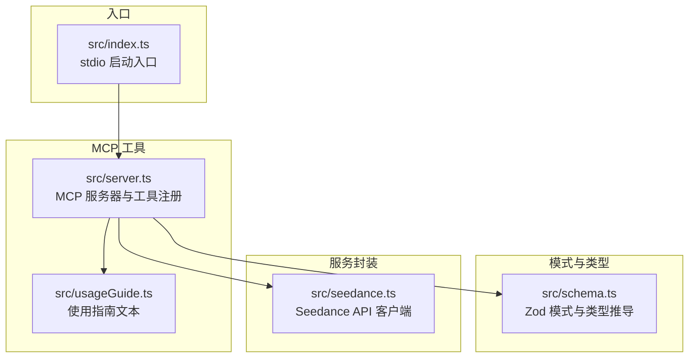
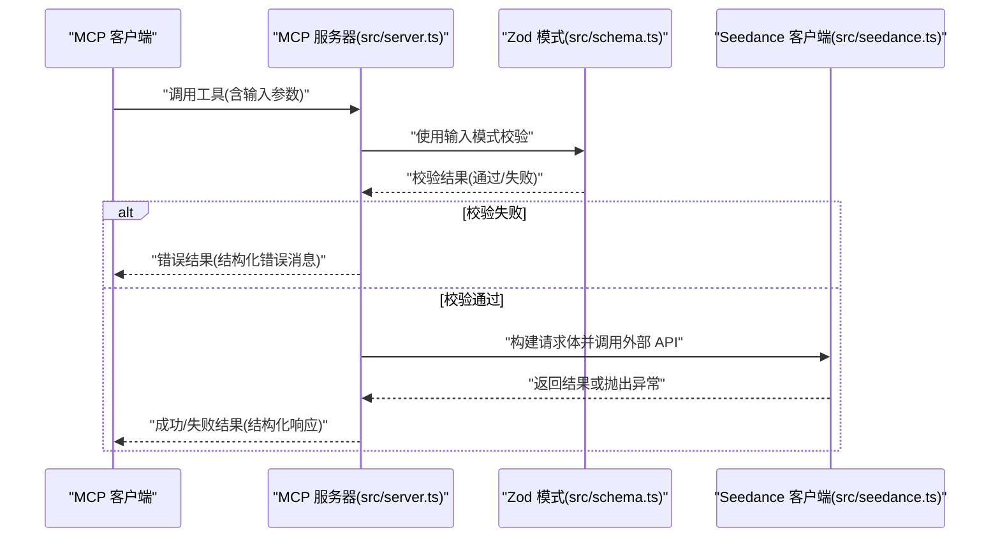
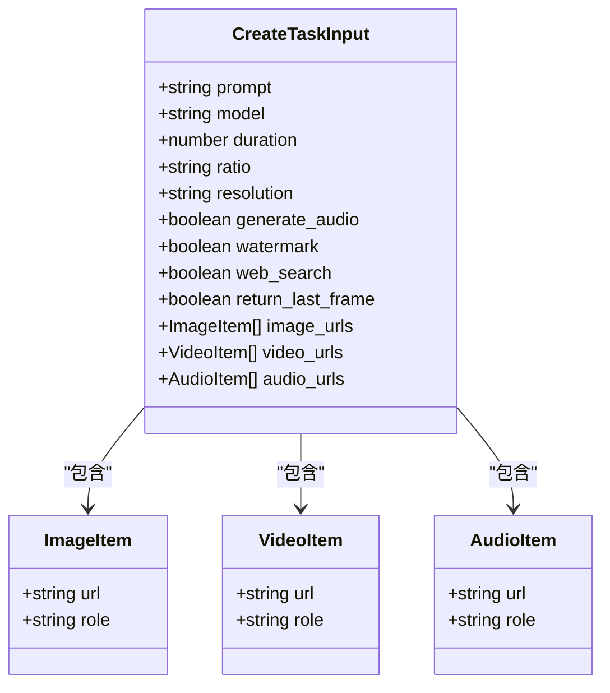
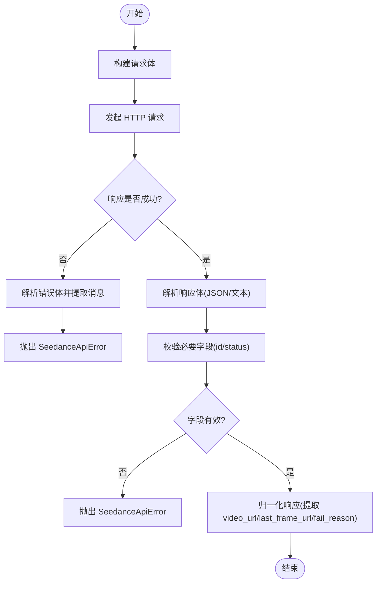
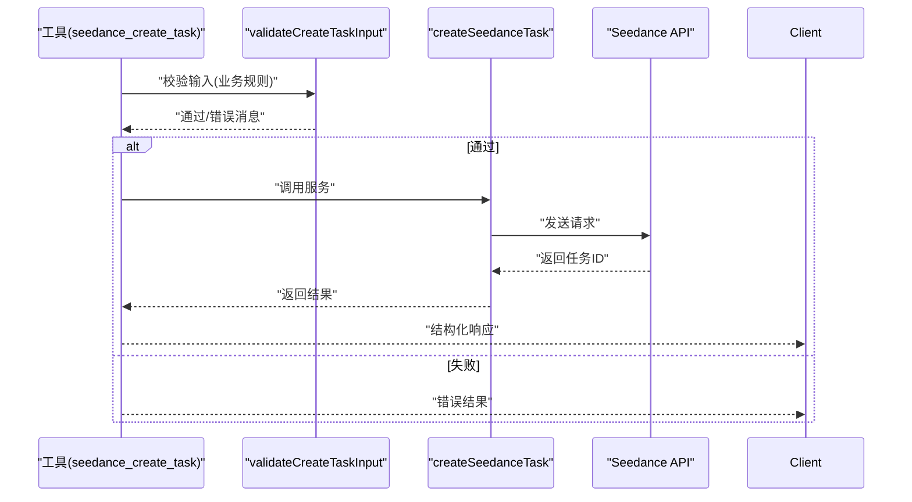
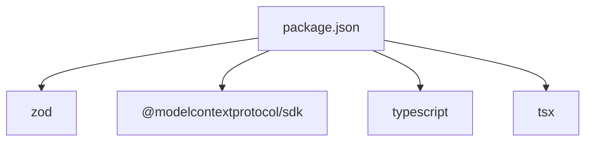

# 数据验证和类型系统

<cite>
**本文引用的文件**
- [src/index.ts](file://src/index.ts)
- [src/schema.ts](file://src/schema.ts)
- [src/seedance.ts](file://src/seedance.ts)
- [src/server.ts](file://src/server.ts)
- [src/usageGuide.ts](file://src/usageGuide.ts)
- [package.json](file://package.json)
- [tsconfig.json](file://tsconfig.json)
- [README.md](file://README.md)
</cite>

## 目录
1. [简介](#简介)
2. [项目结构](#项目结构)
3. [核心组件](#核心组件)
4. [架构总览](#架构总览)
5. [详细组件分析](#详细组件分析)
6. [依赖分析](#依赖分析)
7. [性能考量](#性能考量)
8. [故障排查指南](#故障排查指南)
9. [结论](#结论)
10. [附录](#附录)

## 简介
本项目通过 Zod 模式定义与类型推导，为 MCP 工具链提供强类型的数据验证与输入参数校验。核心目标包括：
- 使用 Zod 对输入参数进行编译时与运行时双重校验，确保字段存在性、类型正确性、取值范围与依赖关系约束。
- 通过类型推导生成强类型接口，减少手写类型声明的错误与重复劳动。
- 明确错误处理与错误消息格式化策略，便于用户与客户端理解失败原因。
- 提供扩展指南，帮助开发者新增自定义验证规则与工具。

## 项目结构
项目采用分层设计，围绕“模式定义—服务封装—MCP 工具注册—类型推导”的结构组织：
- 模式层：集中定义输入参数的 Zod 结构与枚举常量，统一约束与默认值。
- 服务层：封装对外 API 的请求构建、错误解析与响应归一化。
- 工具层：注册 MCP 工具，负责输入校验、调用服务与结果格式化。
- 类型层：基于 Zod 推导出强类型，贯穿各模块，提升可维护性与安全性。

图表来源
- [src/index.ts:1-19](file://src/index.ts#L1-L19)
- [src/server.ts:1-215](file://src/server.ts#L1-L215)
- [src/schema.ts:1-141](file://src/schema.ts#L1-L141)
- [src/seedance.ts:1-286](file://src/seedance.ts#L1-L286)
- [src/usageGuide.ts:1-59](file://src/usageGuide.ts#L1-L59)

章节来源
- [src/index.ts:1-19](file://src/index.ts#L1-L19)
- [src/server.ts:1-215](file://src/server.ts#L1-L215)
- [src/schema.ts:1-141](file://src/schema.ts#L1-L141)
- [src/seedance.ts:1-286](file://src/seedance.ts#L1-L286)
- [src/usageGuide.ts:1-59](file://src/usageGuide.ts#L1-L59)
- [package.json:1-51](file://package.json#L1-L51)
- [tsconfig.json:1-23](file://tsconfig.json#L1-L23)

## 核心组件
- Zod 模式与类型推导：在模式文件中集中定义输入参数的结构、默认值、约束与描述，使用类型推导生成强类型接口，确保工具函数与服务层的输入输出一致。
- Seedance API 客户端：封装请求构建、鉴权、响应解析与错误提取，提供统一的异常类型以便上层格式化。
- MCP 工具注册：注册三个工具，分别提供使用指南、创建任务与查询任务状态；工具注册时绑定 Zod 输入模式，实现自动校验。
- 自定义校验逻辑：在工具层补充业务级依赖关系校验（如音频与参考媒体的组合限制），并在错误时返回结构化的错误信息。

章节来源
- [src/schema.ts:1-141](file://src/schema.ts#L1-L141)
- [src/seedance.ts:1-286](file://src/seedance.ts#L1-L286)
- [src/server.ts:1-215](file://src/server.ts#L1-L215)

## 架构总览
下图展示了 MCP 工具调用到外部 API 的整体流程，以及数据在各层之间的传递与验证。

图表来源
- [src/server.ts:62-89](file://src/server.ts#L62-L89)
- [src/schema.ts:129-141](file://src/schema.ts#L129-L141)
- [src/seedance.ts:149-194](file://src/seedance.ts#L149-L194)

## 详细组件分析

### Zod 模式与类型推导
- 枚举与常量：定义模型列表、宽高比、分辨率、媒体角色等枚举集合，作为后续模式的取值域。
- URL 校验：自定义 URL 模式，强制以 http/https 开头，结合 Zod 的 refine 实现自定义校验。
- 输入模式：
  - 创建任务输入模式包含字符串、数值、布尔、数组等字段，均带有最小长度、最大长度、取值范围、默认值与描述。
  - 数组字段限制最大长度，并提供可选性与默认行为。
  - 使用 Zod 的 describe 为每个字段提供文档化说明，便于工具元数据与使用指南生成。
- 类型推导：通过 infer 生成强类型接口，确保工具函数与服务层的输入输出类型一致，减少手写类型声明的错误。

图表来源
- [src/schema.ts:37-127](file://src/schema.ts#L37-L127)
- [src/schema.ts:130-141](file://src/schema.ts#L130-L141)

章节来源
- [src/schema.ts:1-141](file://src/schema.ts#L1-L141)

### Seedance API 客户端
- 请求构建：将输入参数映射为外部 API 的请求体，处理内容数组（文本、图像、视频、音频）与可选字段。
- 鉴权与基础地址：从环境变量读取 API Key 与可选的基础地址，支持覆盖。
- 错误处理：统一解析非 JSON 与 JSON 响应，提取错误消息；对缺失必要字段或非预期响应抛出特定异常类型。
- 响应归一化：将不同 SDK 版本的响应形态统一为结构化的任务状态对象，包含任务 ID、状态、视频 URL、末帧 URL 与失败原因等。

图表来源
- [src/seedance.ts:102-194](file://src/seedance.ts#L102-L194)
- [src/seedance.ts:201-278](file://src/seedance.ts#L201-L278)

章节来源
- [src/seedance.ts:1-286](file://src/seedance.ts#L1-L286)

### MCP 工具注册与输入校验
- 工具注册：注册三个工具，分别为使用指南、创建任务与查询任务状态；每个工具绑定输入模式与注解。
- 输入校验：
  - 使用 Zod 模式进行结构化校验，确保字段存在性、类型与范围约束。
  - 补充业务级依赖关系校验：音频与参考媒体的组合限制、纯文本与联网增强的互斥关系。
- 错误处理：捕获 API 异常并格式化为人类可读的消息；对校验失败返回结构化错误结果。

图表来源
- [src/server.ts:62-89](file://src/server.ts#L62-L89)
- [src/server.ts:179-199](file://src/server.ts#L179-L199)
- [src/seedance.ts:149-194](file://src/seedance.ts#L149-L194)

章节来源
- [src/server.ts:1-215](file://src/server.ts#L1-L215)

### 参数规范与约束
以下为“创建任务”工具的输入参数规范，来源于模式定义与使用指南：
- prompt：字符串，必填；用于描述期望的视频内容；可引用参考媒体。
- model：枚举，默认值为标准模型；支持快速变体。
- duration：整数，范围 [4, 15]，默认 5；表示视频时长（秒）。
- ratio：枚举，默认 16:9；支持多种宽高比与自适应选项。
- resolution：枚举，默认 720p；支持 480p 与 720p。
- generate_audio：布尔，默认 true；是否生成同步音频。
- watermark：布尔，默认 true；是否添加平台水印。
- web_search：布尔，默认 false；启用联网增强，仅允许纯文本输入。
- return_last_frame：布尔，默认 false；是否返回末帧图片 URL。
- image_urls：数组，最多 9 项；每项包含 URL 与可选角色；默认角色为参考图像。
- video_urls：数组，最多 3 项；每项包含 URL 与可选角色；默认角色为参考视频。
- audio_urls：数组，最多 3 项；每项包含 URL 与可选角色；默认角色为参考音频；必须与至少一项图像或视频组合。

章节来源
- [src/schema.ts:52-127](file://src/schema.ts#L52-L127)
- [README.md:163-186](file://README.md#L163-L186)

### 错误处理与消息格式化
- SeedanceApiError：统一的 API 错误类型，包含状态码与原始响应体，便于上层格式化与记录。
- 错误提取：从 JSON 响应体中优先提取嵌套的错误消息，否则回退到顶层 message 或原始文本。
- 工具层错误格式化：将 API 错误转换为人类可读的字符串；对校验失败返回结构化错误结果，包含 isError 标记。
- 环境变量缺失：当缺少 API Key 时，直接抛出清晰的错误提示，避免静默失败。

章节来源
- [src/seedance.ts:44-53](file://src/seedance.ts#L44-L53)
- [src/seedance.ts:126-140](file://src/seedance.ts#L126-L140)
- [src/server.ts:201-214](file://src/server.ts#L201-L214)
- [src/seedance.ts:55-64](file://src/seedance.ts#L55-L64)

### 自定义验证规则与扩展指南
- 自定义 Zod 校验：通过 refine 添加自定义逻辑（如 URL 前缀校验），并提供明确的错误消息。
- 业务级依赖关系：在工具层补充复杂约束（如音频与参考媒体的组合限制、纯文本与联网增强的互斥），并返回结构化错误消息。
- 新增工具步骤：
  1) 在模式文件中定义输入模式与类型推导；
  2) 在服务层实现请求构建与错误处理；
  3) 在工具层注册新工具，绑定输入模式与注解；
  4) 在工具层补充必要的业务校验逻辑；
  5) 在使用指南中更新参数说明与注意事项。

章节来源
- [src/schema.ts:30-35](file://src/schema.ts#L30-L35)
- [src/server.ts:179-199](file://src/server.ts#L179-L199)
- [src/usageGuide.ts:1-59](file://src/usageGuide.ts#L1-L59)

### 实际验证示例与错误处理案例
- 正常流程：客户端调用创建任务工具，输入满足 Zod 模式与业务校验，返回任务 ID 与结构化响应。
- 范围约束失败：当 duration 超出 [4, 15] 范围时，Zod 校验失败，工具返回结构化错误消息。
- 依赖关系失败：当仅提供音频且未提供图像/视频时，业务校验返回错误消息，提示需与图像或视频组合。
- 纯文本与联网增强互斥：当 web_search=true 且同时提供参考媒体时，业务校验返回错误消息，提示需移除参考媒体或关闭联网增强。
- API 错误：当外部 API 返回非 2xx 时，解析错误体并格式化为人类可读消息，便于客户端处理。

章节来源
- [src/server.ts:62-89](file://src/server.ts#L62-L89)
- [src/server.ts:179-199](file://src/server.ts#L179-L199)
- [src/seedance.ts:167-194](file://src/seedance.ts#L167-L194)

## 依赖分析
- 运行时依赖：MCP SDK 与 Zod，分别用于协议交互与数据验证。
- 开发依赖：TypeScript、tsx、Node 类型声明，用于类型检查与开发调试。
- 编译配置：严格模式开启，确保类型安全与未使用变量检测。

图表来源
- [package.json:26-34](file://package.json#L26-L34)

章节来源
- [package.json:1-51](file://package.json#L1-L51)
- [tsconfig.json:9-19](file://tsconfig.json#L9-L19)

## 性能考量
- 校验开销：Zod 模式在工具层与服务层均进行校验，确保早期失败与快速反馈，避免无效网络请求。
- 错误解析：对非 JSON 响应进行安全解析，避免因格式问题导致的崩溃。
- 并发与重试：当前实现未引入并发控制与重试机制；如需增强稳定性，可在服务层增加指数退避与重试策略。

## 故障排查指南
- 环境变量缺失：确认已设置 API Key 与可选的基础地址，错误消息会明确提示。
- URL 无效：确保参考媒体 URL 以 http/https 开头，且可公开访问。
- 参数越界：检查 duration、数组长度等是否超出范围或数量限制。
- 业务规则冲突：核对音频与参考媒体的组合、纯文本与联网增强的互斥关系。
- API 响应异常：查看结构化响应中的原始体，定位具体错误字段。

章节来源
- [src/seedance.ts:55-64](file://src/seedance.ts#L55-L64)
- [src/schema.ts:30-35](file://src/schema.ts#L30-L35)
- [src/server.ts:179-199](file://src/server.ts#L179-L199)
- [src/seedance.ts:167-194](file://src/seedance.ts#L167-L194)

## 结论
本项目通过 Zod 模式与类型推导实现了强类型的数据验证与输入参数校验，结合 MCP 工具注册与服务封装，提供了清晰的错误处理与扩展机制。开发者可以基于现有模式与工具快速扩展新的功能，同时保持类型安全与一致性。

## 附录
- 使用指南：工具注册时绑定输入模式与注解，确保客户端能够获得准确的参数提示与约束信息。
- 参数参考：在模式文件中集中定义参数的默认值、取值范围与约束，便于生成一致的文档与使用指南。

章节来源
- [src/server.ts:31-47](file://src/server.ts#L31-L47)
- [src/usageGuide.ts:1-59](file://src/usageGuide.ts#L1-L59)