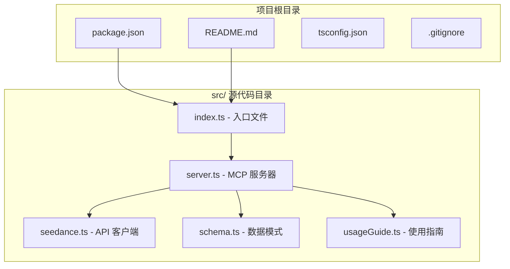
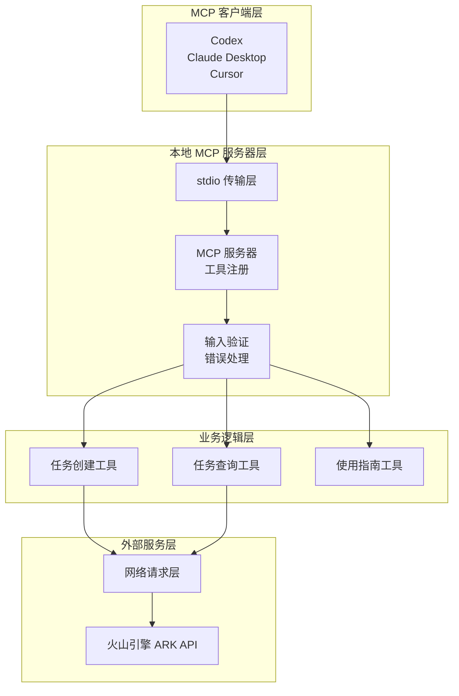
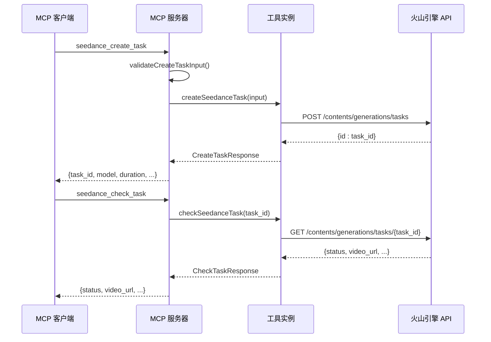
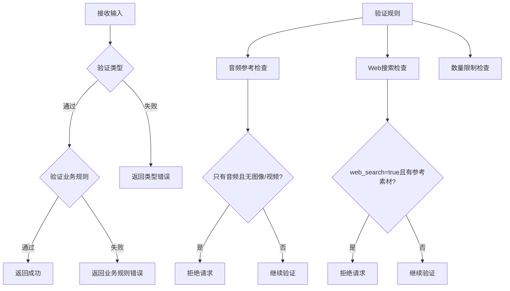
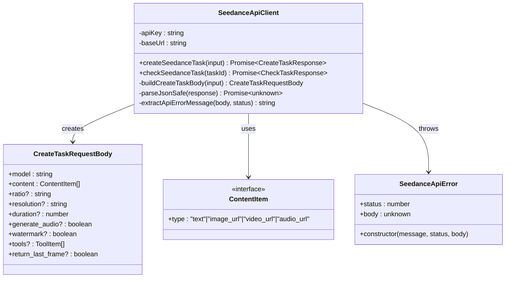
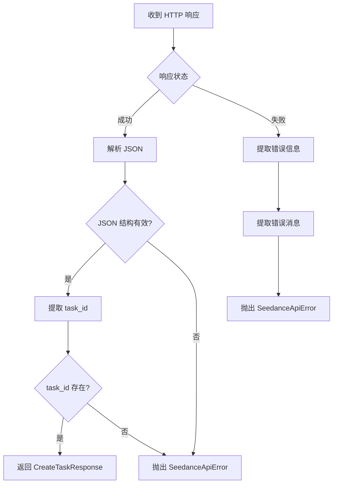
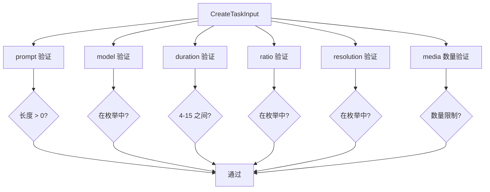
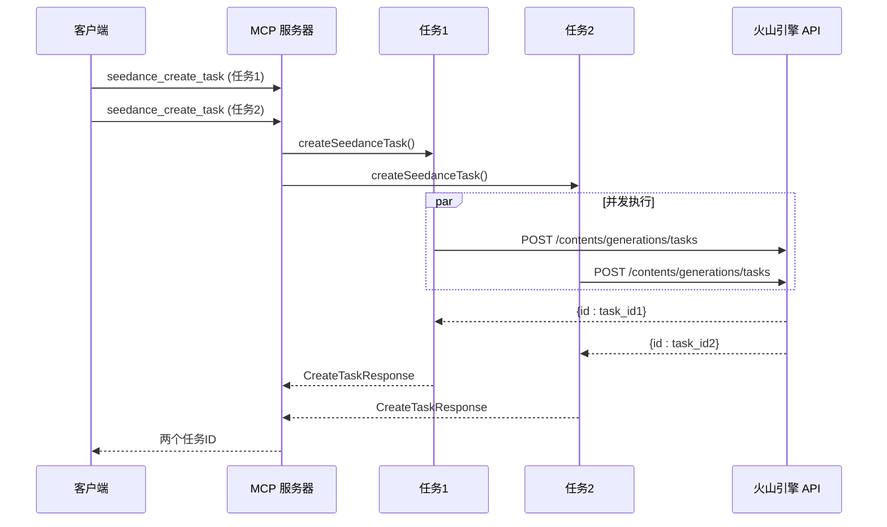
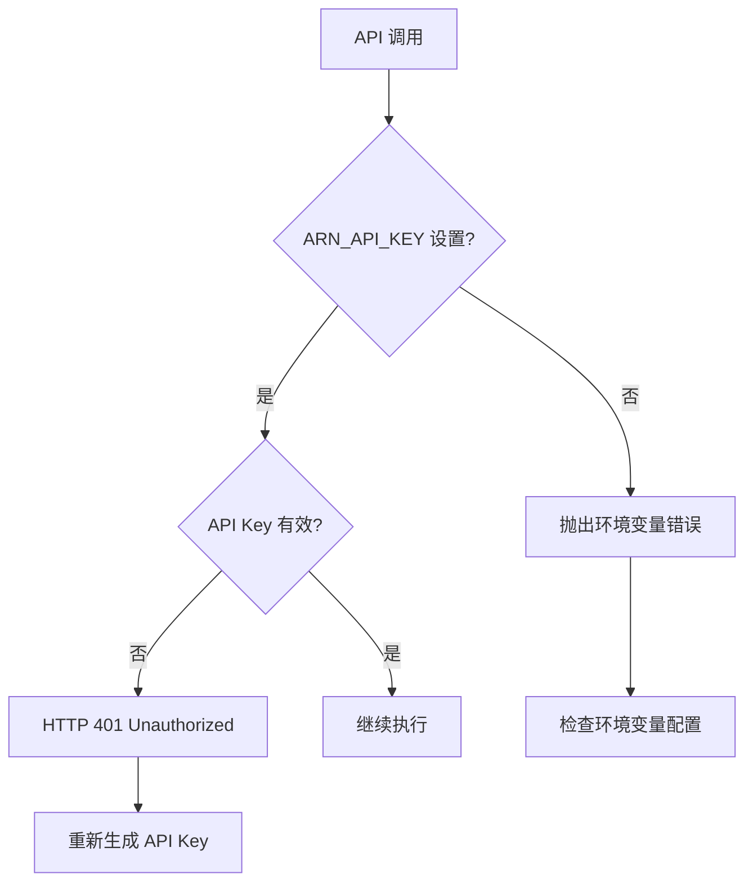
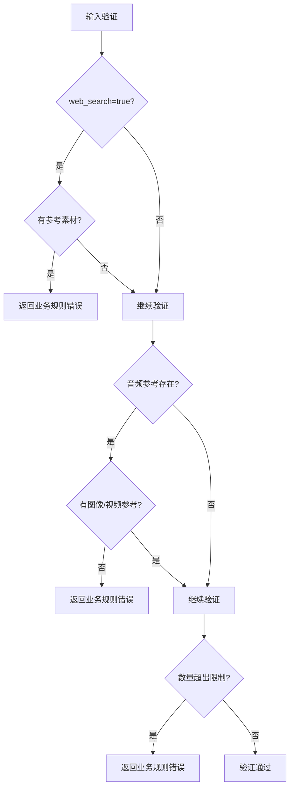

# 视频生成 API 集成

<cite>
**本文档引用的文件**
- [src/index.ts](file://src/index.ts)
- [src/server.ts](file://src/server.ts)
- [src/seedance.ts](file://src/seedance.ts)
- [src/schema.ts](file://src/schema.ts)
- [src/usageGuide.ts](file://src/usageGuide.ts)
- [package.json](file://package.json)
- [README.md](file://README.md)
</cite>

## 目录
1. [简介](#简介)
2. [项目结构](#项目结构)
3. [核心组件](#核心组件)
4. [架构概览](#架构概览)
5. [详细组件分析](#详细组件分析)
6. [依赖关系分析](#依赖关系分析)
7. [性能考虑](#性能考虑)
8. [故障排除指南](#故障排除指南)
9. [结论](#结论)
10. [附录](#附录)

## 简介

本项目是一个开源的本地运行 MCP (Model Context Protocol) 服务器，将火山引擎 ARK Seedance 2.0 视频生成功能以三个 stdio 工具的形式暴露给各种 MCP 客户端。该服务器使用 Node.js + TypeScript 编写，通过官方 @modelcontextprotocol/sdk 实现，用户只需在本地配置 ARK_API_KEY 即可调用火山引擎的文生视频、图生视频、多模态参考生成等功能。

## 项目结构

该项目采用模块化的 TypeScript 架构，主要包含以下核心文件：



**图表来源**
- [src/index.ts:1-19](file://src/index.ts#L1-L19)
- [src/server.ts:1-215](file://src/server.ts#L1-L215)
- [src/seedance.ts:1-286](file://src/seedance.ts#L1-L286)
- [src/schema.ts:1-141](file://src/schema.ts#L1-L141)
- [src/usageGuide.ts:1-59](file://src/usageGuide.ts#L1-L59)

**章节来源**
- [src/index.ts:1-19](file://src/index.ts#L1-L19)
- [src/server.ts:1-215](file://src/server.ts#L1-L215)
- [src/seedance.ts:1-286](file://src/seedance.ts#L1-L286)
- [src/schema.ts:1-141](file://src/schema.ts#L1-L141)
- [src/usageGuide.ts:1-59](file://src/usageGuide.ts#L1-L59)

## 核心组件

### MCP 服务器组件

MCP 服务器是整个应用的核心，负责注册和管理三个主要工具：

1. **seedance_usage_guide** - 提供完整的使用说明和参数参考
2. **seedance_create_task** - 提交视频生成任务并返回 task_id
3. **seedance_check_task** - 查询任务状态并返回结果

每个工具都实现了严格的输入验证和错误处理机制。

### 火山引擎 API 客户端

封装了与火山引擎 ARK API 的交互，包括：
- 认证处理（Bearer Token）
- 请求构建和响应解析
- 错误处理和重试机制
- 数据序列化和反序列化

### 数据模式定义

使用 Zod 库定义了完整的输入输出数据结构，确保类型安全和数据验证。

**章节来源**
- [src/server.ts:20-177](file://src/server.ts#L20-L177)
- [src/seedance.ts:149-286](file://src/seedance.ts#L149-L286)
- [src/schema.ts:52-141](file://src/schema.ts#L52-L141)

## 架构概览

该系统采用分层架构设计，实现了清晰的关注点分离：



**图表来源**
- [src/server.ts:20-177](file://src/server.ts#L20-L177)
- [src/seedance.ts:149-286](file://src/seedance.ts#L149-L286)

系统的关键特性包括：
- **异步非阻塞**：任务创建立即返回，不阻塞客户端
- **状态轮询**：通过独立工具查询任务状态
- **类型安全**：完整的 TypeScript 类型定义
- **错误隔离**：清晰的错误分类和处理

## 详细组件分析

### MCP 服务器实现

MCP 服务器使用 @modelcontextprotocol/sdk 创建，注册了三个核心工具：

#### 工具注册流程



**图表来源**
- [src/server.ts:62-89](file://src/server.ts#L62-L89)
- [src/server.ts:105-173](file://src/server.ts#L105-L173)
- [src/seedance.ts:149-194](file://src/seedance.ts#L149-L194)
- [src/seedance.ts:201-278](file://src/seedance.ts#L201-L278)

#### 输入验证机制

服务器实现了严格的输入验证，确保数据的完整性和正确性：



**图表来源**
- [src/server.ts:179-199](file://src/server.ts#L179-L199)

**章节来源**
- [src/server.ts:20-177](file://src/server.ts#L20-L177)
- [src/server.ts:179-215](file://src/server.ts#L179-L215)

### 火山引擎 API 客户端

API 客户端封装了与火山引擎 ARK API 的所有交互逻辑：

#### 认证和配置



**图表来源**
- [src/seedance.ts:13-53](file://src/seedance.ts#L13-L53)
- [src/seedance.ts:149-286](file://src/seedance.ts#L149-L286)

#### 请求构建过程

API 客户端实现了智能的请求构建逻辑：

1. **环境变量处理**：从 ARK_API_KEY 获取认证密钥
2. **基础 URL 解析**：支持自定义 ARK_BASE_URL
3. **内容构建**：将输入转换为 API 期望的 ContentItem 数组
4. **参数映射**：将 CreateTaskInput 映射到 CreateTaskRequestBody

#### 响应解析机制



**图表来源**
- [src/seedance.ts:116-194](file://src/seedance.ts#L116-L194)

**章节来源**
- [src/seedance.ts:55-72](file://src/seedance.ts#L55-L72)
- [src/seedance.ts:102-114](file://src/seedance.ts#L102-L114)
- [src/seedance.ts:116-140](file://src/seedance.ts#L116-L140)
- [src/seedance.ts:149-194](file://src/seedance.ts#L149-L194)
- [src/seedance.ts:201-278](file://src/seedance.ts#L201-L278)

### 数据模式定义

项目使用 Zod 库定义了完整的数据模式，确保类型安全：

#### 模型枚举

```mermaid
classDiagram
class SEEDANCE_MODELS {
<<enumeration>>
"doubao-seedance-2-0-260128"
"doubao-seedance-2-0-fast-260128"
}
class RATIOS {
<<enumeration>>
"21 : 9"
"16 : 9"
"4 : 3"
"1 : 1"
"3 : 4"
"9 : 16"
"adaptive"
}
class RESOLUTIONS {
<<enumeration>>
"480p"
"720p"
}
class IMAGE_ROLES {
<<enumeration>>
"reference_image"
"first_frame"
"last_frame"
}
class VIDEO_ROLES {
<<enumeration>>
"reference_video"
}
class AUDIO_ROLES {
<<enumeration>>
"reference_audio"
}
```

**图表来源**
- [src/schema.ts:3-28](file://src/schema.ts#L3-L28)

#### 输入验证规则



**图表来源**
- [src/schema.ts:52-127](file://src/schema.ts#L52-L127)

**章节来源**
- [src/schema.ts:1-141](file://src/schema.ts#L1-L141)

## 依赖关系分析

项目依赖关系清晰，采用了模块化的设计：

```mermaid
graph TB
subgraph "运行时依赖"
A[@modelcontextprotocol/sdk]
B[zod]
end
subgraph "开发时依赖"
C[typescript]
D[tsx]
E[@types/node]
end
subgraph "项目文件"
F[src/index.ts]
G[src/server.ts]
H[src/seedance.ts]
I[src/schema.ts]
J[src/usageGuide.ts]
end
F --> G
G --> H
G --> I
G --> J
H --> I
```

**图表来源**
- [package.json:26-34](file://package.json#L26-L34)
- [src/index.ts:1-19](file://src/index.ts#L1-L19)
- [src/server.ts:1-16](file://src/server.ts#L1-L16)

### 外部依赖分析

- **@modelcontextprotocol/sdk**: 提供 MCP 协议实现和 stdio 传输
- **zod**: 提供运行时类型检查和数据验证
- **Node.js >= 18**: 依赖原生 fetch API

**章节来源**
- [package.json:26-34](file://package.json#L26-L34)
- [package.json:16-18](file://package.json#L16-L18)

## 性能考虑

### 网络请求优化

1. **连接复用**: 使用 Node.js 原生 fetch，自动复用 HTTP 连接
2. **请求压缩**: 支持 gzip/deflate 压缩
3. **超时控制**: 建议在生产环境中添加超时配置

### 并发处理



### 内存管理

- **流式处理**: 使用流式响应解析，避免大对象内存占用
- **错误清理**: 清晰的错误堆栈和资源释放
- **缓存策略**: 无状态设计，避免不必要的缓存

## 故障排除指南

### 常见错误类型

#### 认证错误



**图表来源**
- [src/seedance.ts:55-64](file://src/seedance.ts#L55-L64)

#### 参数验证错误



**图表来源**
- [src/server.ts:179-199](file://src/server.ts#L179-L199)

#### 网络连接错误

- **超时**: 建议设置合理的超时时间（30-60秒）
- **重试**: 对临时性错误进行指数退避重试
- **连接池**: 使用默认的 Node.js 连接复用

**章节来源**
- [src/seedance.ts:44-53](file://src/seedance.ts#L44-L53)
- [src/server.ts:201-207](file://src/server.ts#L201-L207)

### 调试技巧

1. **使用 MCP Inspector**: 通过 `npx -y @modelcontextprotocol/inspector` 进行调试
2. **查看服务器日志**: 服务器会在 stderr 输出运行信息
3. **检查环境变量**: 确保 ARK_API_KEY 正确配置
4. **验证 URL 可达性**: 确保所有参考媒体 URL 可公网访问

### 监控指标

建议收集以下指标：
- **请求成功率**: 成功/失败比率
- **响应时间**: 任务创建和查询的平均响应时间
- **错误分布**: 不同错误类型的统计
- **并发度**: 同时处理的任务数量
- **资源使用**: CPU、内存、网络带宽使用情况

## 结论

本项目提供了一个完整、可靠的火山引擎 ARK Seedance 2.0 视频生成 API 集成解决方案。通过 MCP 协议，开发者可以轻松地将视频生成功能集成到各种本地 AI 客户端中。

### 主要优势

1. **零配置部署**: 本地运行，无需云端部署
2. **类型安全**: 完整的 TypeScript 类型定义
3. **错误处理**: 清晰的错误分类和处理机制
4. **扩展性强**: 模块化设计，易于功能扩展
5. **社区友好**: 开源 MIT 许可证

### 最佳实践建议

1. **环境管理**: 使用 MCP 客户端配置管理环境变量
2. **URL 策略**: 确保所有参考媒体 URL 可公网访问
3. **轮询策略**: 合理设置轮询间隔（30-90秒）
4. **错误恢复**: 实现指数退避重试机制
5. **监控告警**: 建立完善的监控和告警系统

## 附录

### API 端点说明

#### 任务创建端点
- **方法**: POST
- **路径**: `/api/v3/contents/generations/tasks`
- **认证**: Bearer Token
- **请求体**: CreateTaskRequestBody

#### 任务查询端点
- **方法**: GET
- **路径**: `/api/v3/contents/generations/tasks/{task_id}`
- **认证**: Bearer Token

### 请求参数格式

#### CreateTaskRequestBody
| 字段 | 类型 | 必填 | 默认值 | 说明 |
|------|------|------|--------|------|
| model | string | 否 | `doubao-seedance-2-0-260128` | 模型标识符 |
| content | ContentItem[] | 是 | - | 内容数组 |
| ratio | string | 否 | `16:9` | 宽高比 |
| resolution | string | 否 | `720p` | 输出分辨率 |
| duration | number | 否 | `5` | 视频时长(秒) |
| generate_audio | boolean | 否 | `true` | 是否生成音频 |
| watermark | boolean | 否 | `true` | 是否添加水印 |
| tools | ToolItem[] | 否 | - | 工具列表 |
| return_last_frame | boolean | 否 | `false` | 是否返回末帧 |

### 响应数据结构

#### CreateTaskResponse
```json
{
  "id": "cgt-2026xxxx-xxxxxx",
  "raw": {}
}
```

#### CheckTaskResponse
```json
{
  "id": "cgt-2026xxxx-xxxxxx",
  "status": "running",
  "videoUrl": "https://example.com/video.mp4",
  "lastFrameUrl": "https://example.com/frame.jpg",
  "failReason": "错误原因",
  "raw": {}
}
```

### 环境变量配置

| 变量名 | 必填 | 默认值 | 说明 |
|--------|------|--------|------|
| ARK_API_KEY | 是 | - | 火山引擎 API 密钥 |
| ARK_BASE_URL | 否 | `https://ark.cn-beijing.volces.com/api/v3` | API 基础 URL |

### 安装和运行

#### 通过 npx 运行
```bash
npx -y seedance-2-mcp
```

#### 从源码运行
```bash
git clone https://github.com/seedance/seedance-2-mcp.git
cd seedance-2-mcp
npm install
npm run build
node dist/index.js
```

### 开发者指南

1. **环境要求**: Node.js >= 18
2. **开发命令**:
   - `npm run dev`: 开发模式运行
   - `npm run build`: 构建项目
   - `npm run typecheck`: 类型检查
3. **调试工具**: 使用 MCP Inspector 进行调试