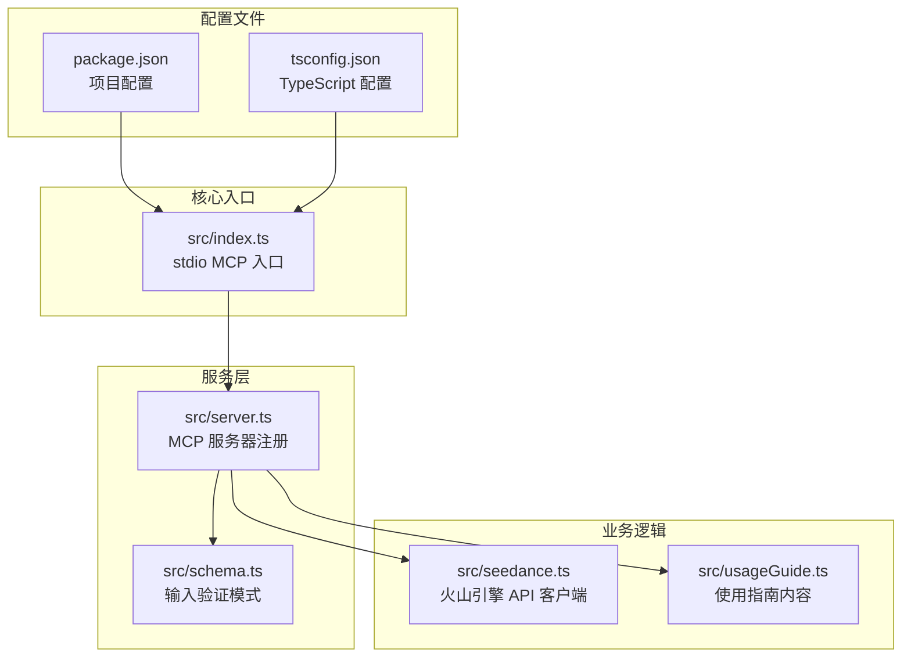
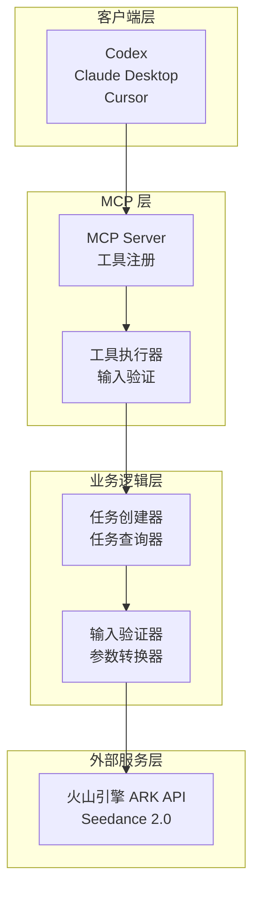
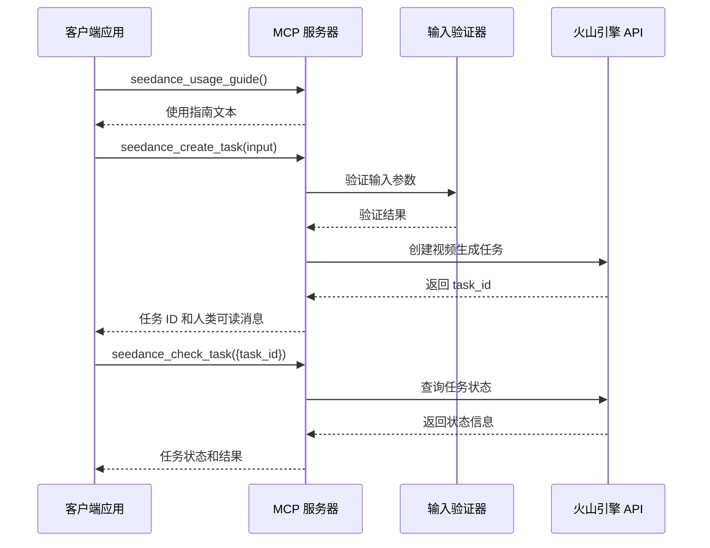
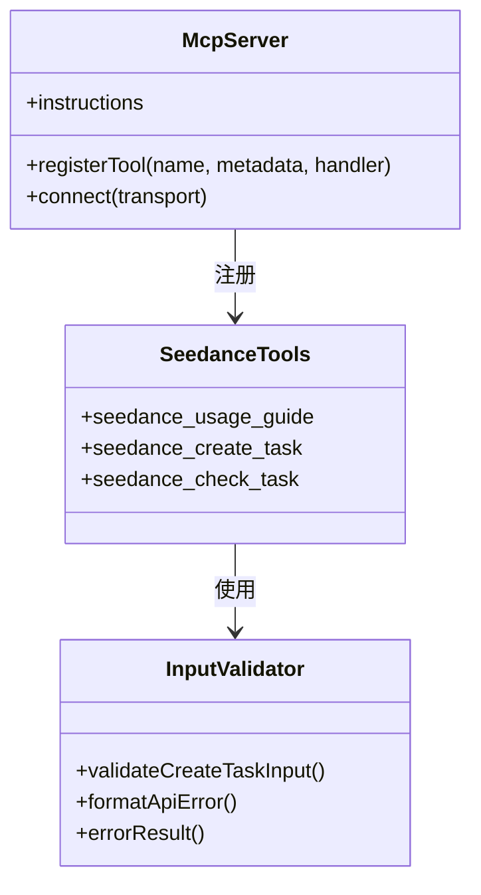
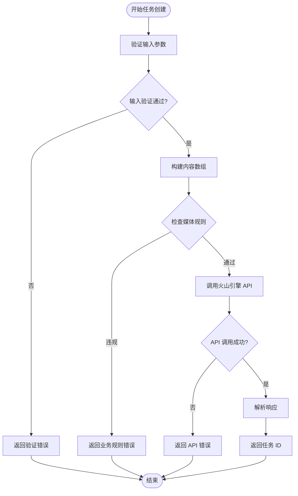
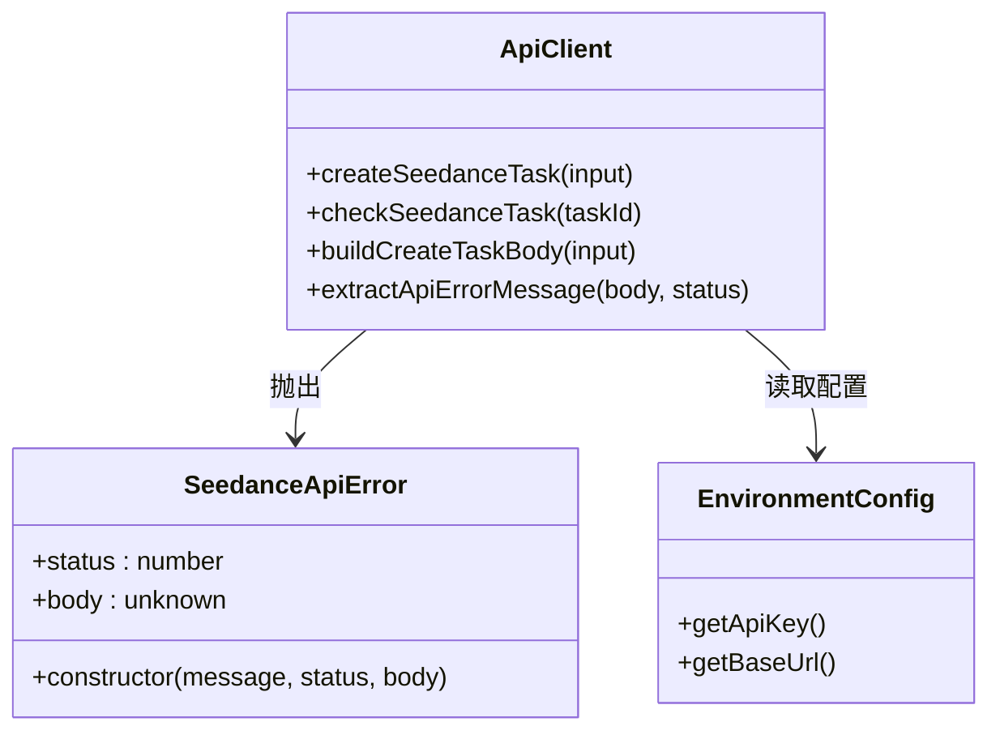
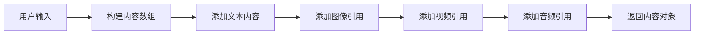
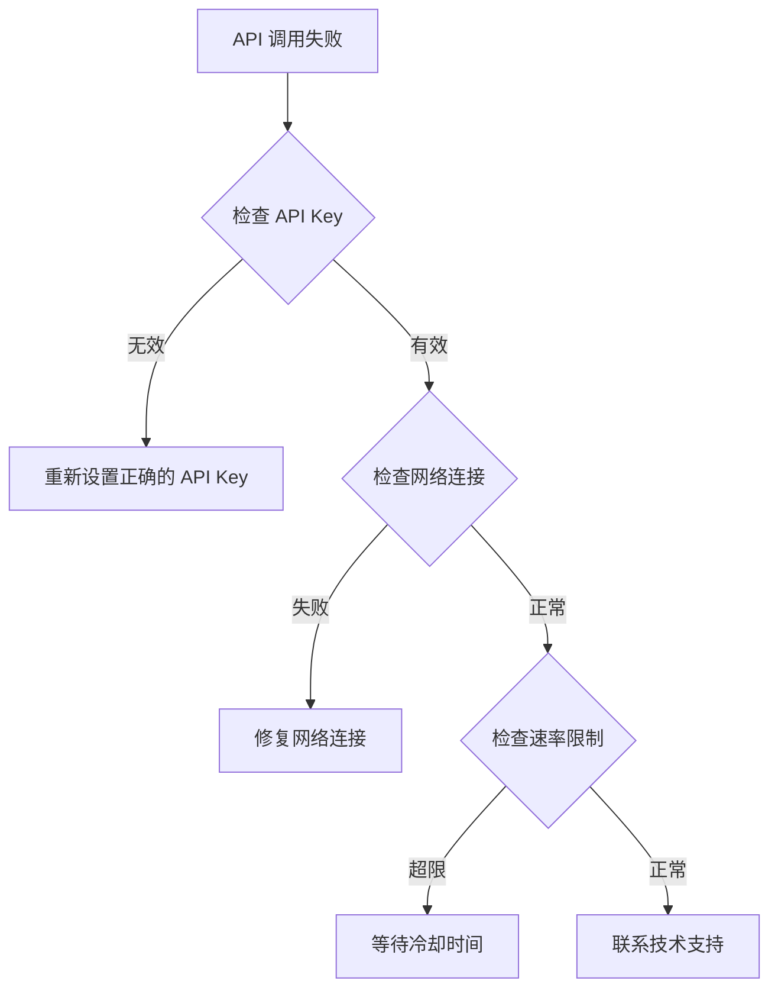

# 项目概述

<cite>
**本文档引用的文件**
- [README.md](file://README.md)
- [package.json](file://package.json)
- [src/index.ts](file://src/index.ts)
- [src/server.ts](file://src/server.ts)
- [src/seedance.ts](file://src/seedance.ts)
- [src/schema.ts](file://src/schema.ts)
- [src/usageGuide.ts](file://src/usageGuide.ts)
- [tsconfig.json](file://tsconfig.json)
</cite>

## 目录
1. [项目简介](#项目简介)
2. [项目结构](#项目结构)
3. [核心组件](#核心组件)
4. [架构概览](#架构概览)
5. [详细组件分析](#详细组件分析)
6. [依赖关系分析](#依赖关系分析)
7. [性能考虑](#性能考虑)
8. [故障排除指南](#故障排除指南)
9. [结论](#结论)

## 项目简介

seedance-mcp 是一个开源、本地运行的 **MCP (Model Context Protocol)** 服务器，专门用于将火山引擎 ARK Seedance 2.0 视频生成功能通过三个 stdio 工具暴露给各种 MCP 客户端。

### 核心价值主张

- **纯本地运行**：完全在本地机器上运行，无需云端部署
- **即开即用**：通过 npx 方式快速集成，无需手动安装
- **多模态支持**：支持文生视频、图生视频、多模态参考生成
- **跨平台兼容**：支持 Codex、Claude Desktop、Cursor 等主流 MCP 客户端

### 技术特色

- 基于 Node.js + TypeScript 构建
- 使用官方 @modelcontextprotocol/sdk
- 支持三种核心工具：使用指南、任务创建、任务查询
- 严格的输入验证和错误处理
- 支持自定义火山引擎 API 基础 URL

### 目标用户群体

- **AI 应用开发者**：希望在本地集成视频生成功能
- **内容创作者**：需要批量生成短视频内容
- **企业集成团队**：需要在内部系统中嵌入 AI 视频生成功能
- **研究机构**：进行多模态 AI 研究和实验

### 主要应用场景

- **短视频内容生产**：快速生成营销视频、教程视频
- **创意内容探索**：基于文本描述生成视觉内容
- **产品演示制作**：自动化生成产品介绍视频
- **教育内容创作**：批量生成教学视频材料

## 项目结构

项目采用模块化设计，核心文件组织如下：



**图表来源**
- [src/index.ts:1-19](file://src/index.ts#L1-L19)
- [src/server.ts:1-215](file://src/server.ts#L1-L215)
- [src/seedance.ts:1-286](file://src/seedance.ts#L1-L286)
- [src/schema.ts:1-141](file://src/schema.ts#L1-L141)
- [src/usageGuide.ts:1-59](file://src/usageGuide.ts#L1-L59)
- [package.json:1-51](file://package.json#L1-L51)
- [tsconfig.json:1-23](file://tsconfig.json#L1-L23)

**章节来源**
- [README.md:267-283](file://README.md#L267-L283)
- [package.json:1-51](file://package.json#L1-L51)

## 核心组件

### MCP 服务器核心

项目的核心是基于 Model Context Protocol 的服务器实现，提供了三个标准化的工具接口：

| 工具名称 | 功能描述 | 输入参数 | 输出内容 |
|---------|----------|----------|----------|
| `seedance_usage_guide` | 返回完整的使用说明 | 无参数 | Markdown 格式的使用指南 |
| `seedance_create_task` | 提交视频生成任务 | 丰富的参数配置 | 立即返回 `task_id` |
| `seedance_check_task` | 查询任务状态 | `{ task_id: string }` | 任务状态和结果 |

### 火山引擎 API 集成

通过 `seedance.ts` 文件实现了对火山引擎 ARK Seedance 2.0 API 的封装，包括：

- **任务创建**：POST `/api/v3/contents/generations/tasks`
- **任务查询**：GET `/api/v3/contents/generations/tasks/{task_id}`
- **认证机制**：基于 Bearer Token 的 API Key 认证
- **错误处理**：统一的 API 错误格式化

### 输入验证系统

使用 Zod 库构建了完整的输入验证系统，确保数据的完整性和正确性：

- **模型枚举**：标准版和快速版两种模型
- **参数范围**：严格的时间长度、分辨率等限制
- **媒体类型**：图像、视频、音频的引用管理
- **业务规则**：复杂的业务逻辑验证

**章节来源**
- [src/server.ts:20-177](file://src/server.ts#L20-L177)
- [src/seedance.ts:149-278](file://src/seedance.ts#L149-L278)
- [src/schema.ts:52-141](file://src/schema.ts#L52-L141)

## 架构概览

项目采用分层架构设计，确保了良好的可维护性和扩展性：



**图表来源**
- [src/index.ts:6-12](file://src/index.ts#L6-L12)
- [src/server.ts:20-177](file://src/server.ts#L20-L177)
- [src/seedance.ts:149-278](file://src/seedance.ts#L149-L278)

### 数据流处理



**图表来源**
- [src/server.ts:62-173](file://src/server.ts#L62-L173)
- [src/seedance.ts:149-278](file://src/seedance.ts#L149-L278)

## 详细组件分析

### MCP 服务器实现

`src/server.ts` 文件实现了完整的 MCP 服务器功能：

#### 工具注册机制



**图表来源**
- [src/server.ts:31-177](file://src/server.ts#L31-L177)
- [src/schema.ts:179-215](file://src/schema.ts#L179-L215)

#### 任务创建流程



**图表来源**
- [src/server.ts:62-89](file://src/server.ts#L62-L89)
- [src/seedance.ts:149-194](file://src/seedance.ts#L149-L194)

**章节来源**
- [src/server.ts:179-215](file://src/server.ts#L179-L215)
- [src/seedance.ts:149-194](file://src/seedance.ts#L149-L194)

### 火山引擎 API 客户端

`src/seedance.ts` 文件提供了完整的 API 客户端实现：

#### API 错误处理



**图表来源**
- [src/seedance.ts:44-53](file://src/seedance.ts#L44-L53)
- [src/seedance.ts:149-278](file://src/seedance.ts#L149-L278)

#### 内容构建器



**图表来源**
- [src/seedance.ts:74-100](file://src/seedance.ts#L74-L100)
- [src/seedance.ts:102-114](file://src/seedance.ts#L102-L114)

**章节来源**
- [src/seedance.ts:1-286](file://src/seedance.ts#L1-L286)

### 输入验证系统

`src/schema.ts` 文件使用 Zod 库构建了强大的输入验证系统：

#### 参数验证规则

| 参数类别 | 验证规则 | 默认值 | 说明 |
|---------|----------|--------|------|
| `prompt` | 非空字符串 | 必填 | 自然语言描述 |
| `model` | 枚举值 | `doubao-seedance-2-0-260128` | 模型选择 |
| `duration` | 整数 4-15 | 5 | 视频时长 |
| `ratio` | 枚举值 | `16:9` | 宽高比 |
| `resolution` | 枚举值 | `720p` | 输出分辨率 |
| `image_urls` | 最多9个 | 无 | 图像引用 |
| `video_urls` | 最多3个 | 无 | 视频引用 |
| `audio_urls` | 最多3个 | 无 | 音频引用 |

**章节来源**
- [src/schema.ts:52-141](file://src/schema.ts#L52-L141)

## 依赖关系分析

项目依赖关系简洁明了，主要依赖包括：

```mermaid
graph TB
subgraph "核心依赖"
A[@modelcontextprotocol/sdk<br/>MCP 协议实现]
B[zod<br/>输入验证]
end
subgraph "开发依赖"
C[@types/node<br/>Node.js 类型定义]
D[tsx<br/>TypeScript 运行器]
E[typescript<br/>TypeScript 编译器]
end
subgraph "项目文件"
F[package.json<br/>依赖声明]
G[tsconfig.json<br/>编译配置]
end
F --> A
F --> B
F --> C
F --> D
F --> E
G --> E
```

**图表来源**
- [package.json:26-34](file://package.json#L26-L34)
- [tsconfig.json:1-23](file://tsconfig.json#L1-L23)

### 版本要求

- **Node.js**: >= 18 (使用原生 fetch API)
- **TypeScript**: ^5.5.4
- **MCP SDK**: ^1.29.0

**章节来源**
- [package.json:16-18](file://package.json#L16-L18)
- [package.json:26-34](file://package.json#L26-L34)

## 性能考虑

### 启动性能

- **冷启动时间**：由于使用 npx 方式，首次启动需要下载依赖包
- **内存占用**：单进程 MCP 服务器，内存占用相对较小
- **并发处理**：基于事件循环的异步处理，支持并发请求

### API 调用优化

- **连接复用**：Node.js 内置的 HTTP/HTTPS 连接池
- **超时控制**：合理的请求超时设置
- **重试机制**：网络异常时的自动重试策略

### 缓存策略

- **依赖缓存**：npx 会缓存下载的包
- **环境变量**：API Key 和基础 URL 缓存在进程环境中

## 故障排除指南

### 常见问题及解决方案

#### 环境配置问题

| 问题症状 | 可能原因 | 解决方案 |
|----------|----------|----------|
| `Missing ARK_API_KEY` 错误 | API Key 未设置 | 在 MCP 客户端配置中设置 `ARK_API_KEY` |
| `Node.js >= 18` 版本错误 | Node.js 版本过低 | 升级到 Node.js 18 或更高版本 |
| `npx not found` 错误 | npx 未安装 | 安装 Node.js 或使用全局安装方式 |

#### API 调用失败



#### 任务状态异常

| 任务状态 | 可能原因 | 建议操作 |
|----------|----------|----------|
| `running` | 生成任务仍在处理中 | 等待 30-90 秒后重试 |
| `failed` | 输入参数错误或 API 调用失败 | 检查输入参数和网络连接 |
| `expired` | 任务超过有效期 | 重新提交任务 |
| `cancelled` | 任务被取消 | 检查账户权限和配额 |

**章节来源**
- [src/seedance.ts:55-64](file://src/seedance.ts#L55-L64)
- [src/server.ts:135-156](file://src/server.ts#L135-L156)

### 调试技巧

#### 使用 MCP Inspector

```bash
# 安装并使用 MCP Inspector 进行调试
npx -y @modelcontextprotocol/inspector npx -y seedance-2-mcp
```

#### 日志记录

- **标准输出**：保留给 MCP JSON-RPC 通信
- **标准错误**：用于记录服务器状态和错误信息
- **调试模式**：使用 `npm run dev` 启动开发模式

## 结论

seedance-mcp 项目成功地将火山引擎 ARK Seedance 2.0 的强大视频生成功能封装为标准的 MCP 服务器，为开发者提供了一个简单、可靠、可扩展的解决方案。

### 主要优势

1. **易用性**：通过 npx 方式实现零安装部署
2. **可靠性**：完善的错误处理和输入验证机制
3. **可扩展性**：模块化的架构设计便于功能扩展
4. **安全性**：敏感信息（API Key）的安全处理

### 发展前景

随着 MCP 协议的普及和 AI 多模态能力的发展，seedance-mcp 项目有望成为本地 AI 工具集成的重要基础设施，为更多开发者和企业提供便捷的视频生成功能。

### 社区贡献

项目采用 MIT 开源许可证，欢迎社区贡献代码、报告问题和提出改进建议。通过持续的社区参与，项目将持续改进和完善，为 AI 应用开发提供更好的支持。